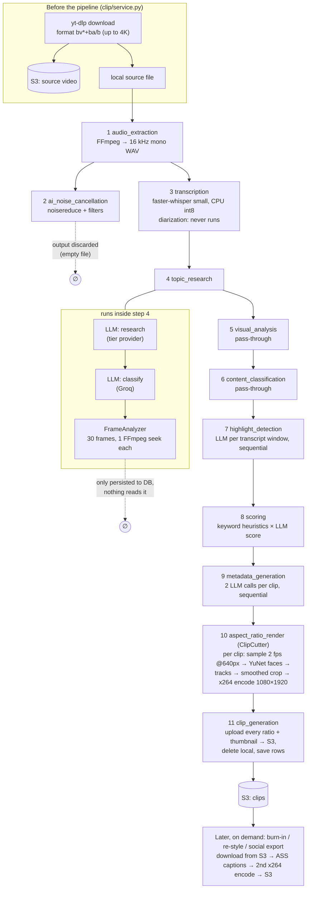

# Clipnera pipeline audit (Phase 0)

Date: 2026-09-24. Code read at `d24b98d` plus the staged, uncommitted work on
`highlighter.py` / `word_snapper.py` / `subtitle_styling/`. Timings measured on
the production box (EC2 **m7i-flex.large: 2 vCPU, 8 GB RAM, no GPU**) running
the deployed commit `2ffe871`, on project `28d31a8e` — a real 189.5 s, 1080p30
AV1 talking-head video, cut into its 4 real clips (96.8 s of output).

LLM stages were not timed (they cost money and depend on provider load); their
call counts are given instead. Per-hour figures are linear extrapolations of the
measured rates and are marked **est.**

---

## 1. Pipeline as it runs today

The frontend sends 11 steps (`frontend/lib/api.ts` `DEFAULT_PIPELINE_STEPS`).
`burn_in_export`, `subtitle_styling` and `depth_captions` exist but are not in
that list, so production clips are cut **caption-free**; captions are burned
later, at export or from the editor.

## 2. Stage by stage

| # | Stage | Does | In → Out | Measured (189.5 s video) | **est.** 60-min video | Used downstream? |
|---|---|---|---|---|---|---|
| 0 | Download | yt-dlp best video+audio, merge mp4, upload to S3 | URL → local mp4 + S3 | not measured (3.0 s S3 fetch of 9.6 MB) | — | Yes |
| 1 | audio_extraction | FFmpeg → 16 kHz mono WAV | mp4 → wav | 0.44 s | ~8 s | Yes (transcription) |
| 2 | ai_noise_cancellation | noisereduce, de-reverb, EQ, hum filter | wav → *nothing* | 1.94 s | ~37 s | **No.** `_upload_processed` returns a fake `processed://` URL, the fetch returns `b""`, the pipeline writes an empty `_enhanced.wav`, and transcription falls back to the original WAV. Final clips use the original audio too. |
| 3 | transcription | faster-whisper `small`, int8, beam 5, VAD, word timestamps; 20-min chunks | wav → segments + words | **62.5 s** (0.33× real time); 66.6 s cold | **~20 min** | Yes, everything |
| 4 | topic_research | LLM research (full transcript) + LLM classify + 30-frame OpenCV saliency | segments → summary, topics, category, frame data | frames: 5.1 s; 2 LLM calls | 2 LLM calls + ~5–15 s | Research: yes (highlight prompt). Category: yes (ratios, layout, scoring). **Frame analysis: no** — only written to `video_analysis`; its one reader `_detect_from_scenes` is never called. |
| 5 | visual_analysis | Returns step 4's frame data | — | ~0 | ~0 | No (UI step only) |
| 6 | content_classification | Returns step 4's category | — | ~0 | ~0 | No (UI step only) |
| 7 | highlight_detection | LLM over token-budgeted transcript windows, **one window at a time**; fit durations, snap to words/sentences, dedupe, spread | segments → candidates | LLM, not timed | N windows × 1 call, sequential | Yes |
| 8 | scoring | Keyword/heuristic factors × LLM score → 10–99; hook/engagement sub-scores | candidates → ranked | ~0 | ~0 | Yes (UI rank + score) |
| 9 | metadata_generation | Per clip: title LLM call (tier) + emoji-cue LLM call (Groq), **sequential across clips** | ranked → titled clips | LLM, not timed | **~40 sequential calls** for 20 clips | Yes. The title duplicates the title step 7 already returned. |
| 10 | aspect_ratio_render | ClipCutter per clip: 1 FFmpeg pass samples frames at 2 fps / 640 px, YuNet detection, tracks, smoothed crop path, 1 FFmpeg render pass (x264 `fast`, CRF 20) | clips → local mp4 per ratio | 4 clips: **62.6 s** sequential; 63.1 s at 2-way; 66.5 s at 7-way (current) | **~8.6 min** for 20 × 40 s clips | Yes |
| 11 | clip_generation | Upload every ratio + thumbnail to S3, delete local copy, write rows | local mp4 → S3 + DB | not separated (upload ~0.1–0.5 s/clip) | ~10 s | Yes |
| — | burn-in (export/editor) | Fetch clip from S3, ASS captions, **2nd x264 encode** (`fast`, CRF 23), upload | clip → captioned clip | 1.85 s per 21 s clip | on demand | Yes |

Cost breakdown for one 25 s clip render (EC2, measured with FFmpeg directly):

| Operation | Time |
|---|---|
| Frame sampling + face detection | 1.6 s + 0.5 s |
| AV1 decode only (dav1d) | 1.5 s |
| H.264 decode only | 1.3 s |
| Decode + crop + scale + **x264 `fast`** at 1080×1920 | **12.9–13.8 s** |
| Same with **x264 `veryfast`** | **7.6 s (−41%)** |

The encode dominates. AV1 sources are **not** the bottleneck (dav1d is fast),
so converting sources up front would add ~53 s per 3 min for nothing.

**Estimated 60-min video on EC2 today: ~30 min before LLM time** — dominated by
transcription (~20 min) and clip encoding (~8.6 min).

## 3. Waste found

**Output nothing uses**
- **Noise cancellation**, all of it. Its output is thrown away (see stage 2). Users
  who pick "Studio Noise Cancellation" get nothing in their clips.
- **Frame analysis:** 30 full-resolution FFmpeg seeks, results never read.
- **`subtitle_styling` step:** computes presets and caption segments that
  burn-in recomputes on its own. It isn't in the frontend's list either.
- **Dead code:** `_detect_from_scenes`, `_merge_overlapping` (was tests only; the staged work now calls it),
  `FrameAnalyzer.detect_bounding_boxes`, `analyze_candidate_clips`,
  `_describe_frame`, and a second, never-imported orchestrator runner in
  `pipeline/repository.py` (`PipelineService`).

**Repeated work**
- **The same video is transcribed again for every project.** The three EC2 artifacts for this
  189 s video are three separate transcriptions. Nothing is cached by file hash.
- **Two encodes per captioned clip:** the cut (CRF 20), then burn-in re-encodes it (CRF 23),
  which costs time and quality.
- **Titles generated twice:** once by highlight detection, then again by metadata generation.
- **Repeated setup:** each content step constructs a new `ContentIntelligenceService`
  (5 AI clients), and duration/dimensions are ffprobed about 5 times per run and once per clip.

**Running sequentially**
- **Highlight windows:** one LLM call at a time, although the windows are independent.
- **Metadata:** 2 calls per clip, one clip at a time (about 40 round trips for 20 clips).

**Settings that don't fit the hardware**
- **`MAX_CONCURRENT_CUTS = 7` on 2 vCPUs.** Measured: no faster than sequential,
  with up to 7× the memory of concurrent FFmpeg + OpenCV on an 8 GB box.
- **x264 `fast`:** `veryfast` is 41% faster at the same CRF (quality check still pending).
- **Burn-in hardcodes `libx264`** instead of using `FFmpegService`'s encoder picker.
- **Downloads fetch the best available stream** (up to 4K) although output is at most
  1080 px wide. It isn't the bottleneck (see the cost table), but it inflates download,
  S3 storage and disk.

**Correctness problems that block the brief's goals**
- **Diarization has never run in production.** Across all three real transcripts,
  `speaker` is `None` on 79 of 79 segments. There are four separate problems:
  1. `HF_TOKEN` is read with `os.getenv`. `.env` values never reach `os.environ`
     (the same bug the YouTube cookie path had), and the token isn't set anyway.
  2. `_apply_diarization` iterates the diarizer result as a list of dicts. WhisperX
     returns a DataFrame, so this would raise an error.
  3. Speaker numbers restart in every 20-minute chunk, so "Speaker 1" means a
     different person in each chunk.
  4. `min_speakers=2` is forced, even for a monologue.
- **No forced alignment.** Word times come from Whisper's own estimates. WhisperX is
  installed (a heavy dependency: torch, pyannote) but only its diarizer is imported.
- **Resume breaks after a reboot.** Step artifacts are kept in `/tmp`, so a reboot loses them.
- **Leftover files:**
  - EC2 `generated_clips/` holds **3.4 GB** of old renders;
  - `/tmp` collects `_enhanced.wav` and artifact JSON;
  - deleting a project removes only its source video from S3, not its clips.
- **Depth captions can't run on EC2.** Its models (SAM 3.1, ViTMatte, MatAnyone) aren't
  there, so the step fails if anyone selects it.

## 4. What to delete, merge and rewrite

Gains are for a 60-minute video on the current EC2 box.

### DELETE
| Item | Gain |
|---|---|
| Noise cancellation as a pipeline step (re-add later as a real, opt-in audio track for the output, if wanted) | ~37 s CPU; a feature that claims to work but doesn't |
| Frame analysis in `topic_research`, plus the `visual_analysis` step | ~5–15 s; one fewer confusing UI step |
| `subtitle_styling` step | 0 s (not in the default list), less code |
| Dead functions listed above | Code size only |

### MERGE
| Items | Gain |
|---|---|
| `content_classification` into `topic_research` (already happens; drop the pass-through step) | Clearer progress; 0 s |
| Title generation into the highlight call (the model already returns `title`); keep a separate call only for hashtags/description if needed | −20 LLM calls |
| Emoji cues for all clips into one batched call | −19 LLM calls |
| Cut + burn into one FFmpeg pass whenever the caption style is known at cut time (keep the clean master as the default) | One encode instead of two; −1 generation of quality loss |

### REWRITE
| Item | Change | Expected gain |
|---|---|---|
| **Transcription** | Needs your decision, see Question 1 below | **~20 min → ~1–7 min** |
| Diarization | Fix the four bugs above; one global speaker map; alignment-based word times | Unblocks speaker tracking, speaker-coloured captions, better selection |
| Transcript cache | Key by source file hash + model version, stored in S3 | Re-runs and duplicates: ~20 min → ~0 |
| Clip encode | x264 `veryfast` (after a quality check); `MAX_CONCURRENT_CUTS` = 1–2 | **~8.6 min → ~5 min** (−41% measured); lower memory |
| Highlight windows | Run concurrently, respecting provider rate limits | N sequential calls → ~1 round trip |
| Download | Cap at 1080p, prefer H.264/AV1 without re-encoding | Less download, disk and S3 |
| Artifacts / scratch | Store resume artifacts in S3; clean `/tmp`; delete clip objects when a project is deleted | Resume survives reboots; stops storage leaks |

**Estimated total after these changes:** ~30 min → **~7–12 min** for a 60-minute
video on the same box (range depends on the transcription option).

## 5. Where this stands against the brief

✅ done · 🟡 partial · ❌ missing

**Priority 1 — clip selection**
- ✅ Word-level timestamps (Whisper estimates, not forced alignment).
- ❌ Transcript cache.
- ❌ Diarization.
- 🟡 LLM rubric JSON with 7 dimensions. Missing: an explicit first-3-seconds hook score, payoff and controversy/novelty.
- ❌ Non-transcript signals (audio energy, laughter, speech rate, scene changes).
- 🟡 Boundaries:
  - word snapping exists;
  - sentence snapping and continuation-opener handling are in the staged work;
  - there's no silence-gap snapping or dead-air trimming;
  - antecedent checks are partial (connectives only).
- ❌ Filler-word or pause removal.
- ✅ Hook title.
- 🟡 Description. Hashtags not verified.
- ✅ Dedupe and top-N spread.
- ❌ Evaluation set.

**Priority 2 — subtitles**
- ✅ ASS/libass.
- ✅ 20 templates, including karaoke, pop, fade, bounce, typewriter, Hormozi and minimal.
- ✅ Emoji cues.
- 🟡 Keyword emphasis (`emphasis_color` exists).
- ❌ Speaker colours (needs diarization).
- ❌ Face-aware caption placement.
- 🟡 Multilingual: auto language detection; no translation.
- ❌ Per-clip SRT/VTT export.
- 🟡 Phrase-aware line breaking (by character/word budget, not by phrase).

**Priority 3 — reframing**
- ✅ Downscaled low-fps detection.
- ✅ Persistent track IDs.
- 🟡 Active speaker from mouth motion plus speech timing (no diarization mapping).
- ✅ Median + two-way EMA + dead zone + velocity cap.
- ❌ Scene-cut reset.
- ❌ Minimum speaker-turn length (camera can ping-pong).
- ❌ Hard-cut vs eased-pan rule on speaker change.
- ❌ Split screen (two-person layouts are detected but rendered as one follow-crop).
- ❌ Blurred-background fill.
- ✅ Centre-crop fallback.

**Priority 4 — layouts**
- 🟡 Content category drives aspect ratios.
- ❌ Layouts as config.
- ❌ Gaming facecam detection.
- ❌ Tutorial cursor following.

**Extras**
- ✅ Virality score and rank shown.
- 🟡 Watermark (brand kit module exists).
- 🟡 Re-render after changing captions: yes, from S3 without re-analysis. After changing boundaries or layout: no, that needs the source, which isn't kept on EC2.
- ❌ B-roll, zoom punch-ins, music with ducking, SFX, progress-bar/hook overlays.
- ❌ Job queue: runs are in-process tasks, capped at 10, and lost on restart (runs now fail cleanly instead of hanging).

## 6. Decisions needed before Phase 1

1. **Transcription engine.** This is the single biggest lever: about two-thirds of a run.
   - **(a) Hosted Whisper, e.g. Groq `whisper-large-v3-turbo`.** A large model, much
     more accurate than `small`, taking seconds per hour of audio at a small per-hour
     cost. Diarization would still run locally, or through a hosted diarization API.
   - **(b) Stay local on EC2.** Use `beam_size=1`, a distilled model and batched
     inference, plus WhisperX alignment. Roughly 2–3× faster; no API cost.
   - **(c) A GPU worker for heavy jobs.** Changes the infrastructure and cost model.
2. **Speed target.** For example, "60-min video → top 10 clips in under 10 min on the
   current box." That number decides whether option (b) is enough.
3. **Evaluation set.** 10–20 videos with your hand-picked best moments. Selection
   changes can't be measured without them.

Nothing has been changed for this audit, apart from adding this file.
