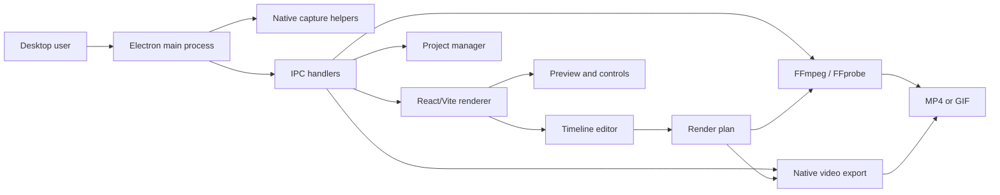
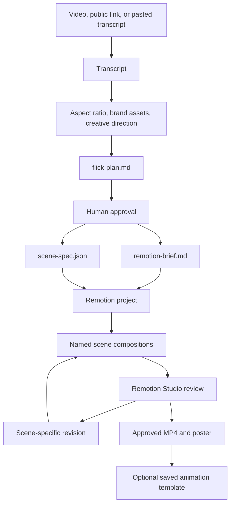

# Recordly and Flick: Open-Source Video Creation Approaches

This guide covers only these two public GitHub projects:

- [Recordly](https://github.com/webadderallorg/Recordly)
- [Flick](https://github.com/Creatorberry/flick)

The goal is to explain what each project does, how it is structured, how a user moves through it, which technologies control the important behavior, and what design ideas the projects share or keep separate.

## 1. Executive Comparison

| Concern | Recordly | Flick |
|---|---|---|
| Product type | Desktop screen recorder and editor | Local agent-directed animation workflow |
| Main input | Screen/window recording or existing media | Video, public link, or transcript |
| Main output | Polished MP4/GIF screen video | Named Remotion scene animations and rendered scenes |
| Runtime | Electron desktop app | Agent CLI plus local Remotion workspace |
| Editing model | Interactive timeline editor | Transcript and scene-plan approval, then code-driven scenes |
| Rendering | FFmpeg, native exporters, browser/client composition | Remotion compositions and FFmpeg tooling |
| Persistence | `.recordly` project files and app settings | `flick-output/` artifacts and saved animation templates |
| Native platform code | macOS ScreenCaptureKit, Windows WGC/WASAPI, native helpers | Primarily Node/Python/tooling workflow |
| Reuse | Extensions and marketplace | Saved Remotion animation library |
| Collaboration model | Community contributions and extensions | Agent prompts, examples, and reusable scene patterns |
| License stated by project | AGPL-3.0 badge in README | MIT |

The projects solve adjacent but different problems. Recordly is a complete recording and editing workstation. Flick is a creative director workflow that turns source material into individually named animated scenes.

## 2. Recordly

### 2.1 Product purpose

Recordly is an open-source desktop application for producing polished screen recordings, walkthroughs, demos, tutorials, product videos, and social clips. Its central idea is to remove the need for a separate motion-design pass after recording. The application combines capture, timeline editing, cursor polish, automatic zoom suggestions, webcam overlays, backgrounds, annotations, and export.

Recordly supports:

- macOS 14.0+
- Windows 10 build 19041+
- Modern Linux distributions

The repository's README describes Recordly as community-backed and accepting pull requests. It also exposes an extension system and a public marketplace.

### 2.2 High-level architecture



Recordly has three important layers:

1. **Electron main process:** owns windows, permissions, IPC registration, settings, project persistence, media servers, updates, and platform integration.
2. **Renderer application:** provides the React/Vite recording interface and editor experience.
3. **Native/media layer:** captures screens and audio through platform-specific helpers and renders or transforms media using FFmpeg and native exporters.

### 2.3 Repository structure

The important top-level areas are:

```text
Recordly/
├── electron/
│   ├── main.ts                         Electron main-process entry point
│   ├── preload.ts                      secure renderer bridge
│   ├── ipc/                            grouped IPC handlers and domain logic
│   │   ├── captions/                   caption generation and segmentation
│   │   ├── cursor/                     cursor bounds, monitoring, telemetry
│   │   ├── export/                     export streams and native-video paths
│   │   ├── ffmpeg/                     bundled binary and filters
│   │   ├── project/                    atomic saves, manager, sessions
│   │   ├── recording/                  recording, audio, platform capture
│   │   ├── register/                    IPC registration modules
│   │   └── settings/                   recording preferences persistence
│   ├── native/
│   │   ├── ScreenCaptureKitRecorder.swift    macOS capture
│   │   ├── windows-capture/                 Windows capture helper
│   │   ├── wgc-capture/                     Windows Graphics Capture/WASAPI
│   │   ├── cursor-monitor/                  native cursor monitoring
│   │   ├── gpu-export-probe/                GPU export support
│   │   └── nvidia-cuda-compositor/          CUDA compositor path
│   └── updater.ts                       desktop update handling
├── src/ or renderer application files    React/Vite user interface
├── scripts/                             native builds, packaging, smoke checks
├── docs/media/                          product demos and feature media
├── branding/                            icons and source assets
├── build/                               signing and entitlement files
├── electron-builder.json5                packaging configuration
├── vite.config.ts                      renderer build configuration
├── biome.json                           lint/format configuration
├── package.json                         scripts and dependencies
├── RELEASING.md                         release/signing/publishing process
└── EXTENSIONS.md                        extension system documentation
```

The source tree also contains a large test suite next to the Electron domain modules. Many tests target the hard parts of a desktop media application: native capture behavior, IPC contracts, cursor telemetry, project saves, export planning, platform permissions, and packaged binary behavior.

### 2.4 Startup and process boundaries

The Electron main process is the authority for privileged operations. The renderer should not directly own filesystem, native capture, or child-process responsibilities. Instead, the flow is:

1. Electron starts the main process.
2. The main process configures application paths, window behavior, permissions, update behavior, and IPC.
3. `preload.ts` exposes a controlled API to the renderer.
4. The React/Vite renderer calls that API for recording, project, settings, caption, export, and media actions.
5. Main-process handlers call FFmpeg, native helpers, filesystem persistence, or platform APIs.
6. Results and progress return over IPC.

The repository separates IPC by capability instead of placing all handlers in one file. This makes recording, cursor behavior, captions, export, projects, and settings independently testable.

### 2.5 Recording workflow

The user-facing workflow is:

```text
launch Recordly
  -> choose a display or window
  -> choose microphone/system audio
  -> start recording
  -> stop recording
  -> open the editor automatically
```

The capture implementation varies by operating system:

#### macOS

Recordly uses native ScreenCaptureKit-based helpers. The repository includes Swift sources for screen capture, window lists, native cursor monitoring, and system cursor assets. macOS 14 is the documented current minimum because the application relies on newer capture and audio capabilities.

#### Windows

Supported Windows builds use Windows Graphics Capture helpers and native WASAPI audio support. The native C++ areas include WGC session code, monitor utilities, Media Foundation encoding, and audio loopback. GPU export and NVIDIA CUDA compositor paths are also present.

Windows builds below build 19041 can use fallback capture, but the real operating-system cursor may remain visible.

#### Linux

Linux recording uses Electron capture APIs. The README notes that cursor hiding is not currently supported on Linux. System audio generally depends on PipeWire.

### 2.6 Editor and timeline model

Recordly's editor is designed around a timeline rather than a transcript or scene-plan file. The documented editing operations include:

- Trim unwanted sections.
- Add manual zoom regions.
- Accept automatic zoom suggestions derived from cursor activity.
- Add speed-up and slow-down regions.
- Add text, image, and figure annotations.
- Add extra audio regions.
- Crop the recorded frame.
- Adjust cursor rendering.
- Add or change webcam footage.
- Choose aspect ratio and frame styling.

The timeline is a composition of time-based regions. The editor can preserve those choices in a `.recordly` project file so the user can close and reopen work without flattening the project into only a final video.

This is a non-destructive editing approach: the source recording remains the basis, while trims, zooms, speed regions, cursor options, overlays, annotations, and styling describe how the final result should be rendered.

### 2.7 Cursor processing

Cursor presentation is a core Recordly feature. The README lists:

- Show/hide rendered cursor overlay.
- Cursor size adjustment.
- Cursor smoothing.
- Motion blur.
- Click bounce.
- Sway.
- Cursor loop mode for clean looping exports.
- macOS-style cursor assets.

The source tree places cursor bounds, interaction, monitoring, and telemetry under `electron/ipc/cursor/`. Cursor activity drives automatic zoom suggestions and provides data for the rendered cursor overlay.

The important design choice is to treat the cursor as editable visual data rather than accepting the raw operating-system pointer as the final presentation. This allows Recordly to smooth movement, emphasize clicks, hide the real cursor, and synchronize camera motion with user activity.

### 2.8 Webcam overlays

Recordly treats webcam video as a composited overlay rather than baking it into the initial screen capture. The documented controls include:

- Enable/disable webcam footage.
- Upload, replace, or remove the webcam source.
- Mirror the webcam.
- Preset or custom position.
- Size, margin, roundness, and shadow controls.
- Optional zoom-reactive scaling.

This allows a presenter bubble to stay visually balanced when the screen composition zooms or changes aspect ratio.

### 2.9 Frames and backgrounds

The final screen recording can be placed inside a designed frame. Recordly supports:

- Built-in wallpapers.
- Runtime wallpaper discovery.
- Custom uploaded backgrounds.
- Solid colors and gradients.
- Frame padding.
- Rounded corners.
- Background blur.
- Drop shadows.
- Aspect-ratio presets.

The renderer previews these choices, while export code turns them into the final media output.

### 2.10 Export architecture

Recordly supports MP4 and GIF export. Its package contains:

- `ffmpeg-static` and `ffprobe-static`.
- FFmpeg filter construction.
- Export streams.
- Native video export paths.
- GIF tooling.
- Media demuxing and MP4-related libraries.
- Platform-specific GPU export helpers.

The package scripts show a layered build process:

```text
build platform native helpers
  -> TypeScript compile
  -> Vite renderer build
  -> normalize Electron main process
  -> smoke-test normalized Electron main process
  -> electron-builder package
```

There are target-specific commands for macOS, Windows, and Linux. The output can reveal exported files in the system file manager. GIF export has controls for frame rate, looping, quality, and size presets.

### 2.11 Project persistence

Recordly saves and reopens projects using `.recordly` files. The project IPC area includes:

- Atomic save logic.
- Project manager.
- Session state.
- Project source mapping.
- Recording storage paths.

Atomic saves matter because an editor project contains the user's work: timeline regions, media references, editor preferences, and render settings. A partial write could make the project impossible to reopen, so the repository tests this behavior directly.

### 2.12 Extensions and marketplace

Recordly has a community-driven extension system. Extensions can add capabilities such as:

- Cursor click sounds.
- Device frames.
- Browser mockups.
- Wallpapers.
- Render hooks.
- Settings panels.

The marketplace is linked from the README at [marketplace.recordly.dev/extensions](https://marketplace.recordly.dev/extensions). The design makes Recordly more than a fixed editor: the core app provides recording, timeline, rendering, and settings primitives, while extensions add domain-specific presentation features.

### 2.13 Captions

The Electron IPC tree includes caption generation, parsing, audio candidates, segmentation, silence handling, and Whisper integration. This indicates that captions are treated as a local media-processing capability with multiple stages:

```text
source audio
  -> candidate audio selection
  -> Whisper generation
  -> segment/word parsing
  -> caption styling or sidecar output
  -> export integration
```

The project also tests caption generation, parsing, segmentation, silence, and runtime error handling.

### 2.14 Build, quality, and release workflow

Important package scripts include:

```text
npm run dev
npm run build
npm run build:mac
npm run build:win
npm run build:linux
npm run lint
npm test
npm run i18n:check
npm run smoke:packaged-binaries
npm run verify:macos-distribution
npm run release:create
```

The repository has GitHub workflows for quality checks, general releases, macOS release candidates, Homebrew publishing, Winget publishing, and automatic translation. `RELEASING.md` documents signing, notarization, release automation, and cross-platform auto-update publishing.

Building from source requires Node/npm and platform-native tooling:

- macOS: Xcode Command Line Tools.
- Linux: build-essential, CMake, X11/XTest/XRandR-related development libraries.
- Windows: Visual Studio 2022 or Build Tools with C++ and CMake.

### 2.15 Recordly's core approach

Recordly's approach can be summarized as:

1. Capture real screen/window activity using the best native backend available.
2. Preserve interaction metadata such as cursor movement and clicks.
3. Keep the recording editable through a timeline project instead of immediately flattening it.
4. Use motion-driven transformations such as cursor smoothing, auto-zooms, and speed regions.
5. Composite webcam, annotations, backgrounds, and frame styling at render time.
6. Export through FFmpeg/native media pipelines.
7. Extend the editor through community extensions.
8. Package the same product for three desktop operating systems.

## 3. Flick

### 3.1 Product purpose

Flick is an open-source agent skill for turning videos, public links, or transcripts into original short-form scene animations. It is not structured like a hosted web application. The user invokes it through an agent CLI, supplies source material and creative direction, approves a scene plan, reviews rendered scenes in Remotion Studio, and optionally saves good animations for reuse.

Its README summarizes the product as:

```text
video or link -> timestamped transcript
transcript -> aspect ratio + brand assets + creative opinion
approved scene plan -> named Remotion scene animations
Studio preview -> feedback -> reusable scene animations
```

Flick does not use background music. It uses bundled sound effects only when they match an on-screen action.

### 3.2 High-level architecture



Flick's control loop is intentionally staged. It does not jump straight from an input video to one opaque final export. It preserves the transcript, plan, brief, scene specification, source assets, render files, and reusable animation decisions.

### 3.3 Repository structure

The public repository contains these important areas:

```text
flick/
├── skills/flick/                      primary Flick skill and assets
├── .agents/skills/flick/              agent integration workflow
├── .claude/skills/flick/              Claude-oriented workflow files
├── .claude-plugin/                    Claude plugin metadata
├── scripts/                           setup and workflow support scripts
├── examples/                          showcase animations and complete examples
├── assets/                            README and project media
├── .github/                           contribution and repository configuration
├── README.md                          product, installation, outputs, and usage
├── CONTRIBUTING.md                    contribution expectations
├── LICENSE                             MIT license
└── .gitignore                         ignores local Flick workspaces
```

The same workflow is made available through several agent integration locations. This is important because Flick is distributed as agent capability rather than as a standalone server executable.

### 3.4 Installation model

The README documents these installation paths:

#### Claude Code

```text
/plugin marketplace add Creatorberry/flick
/plugin install flick@flick
```

Then invoke `/flick`.

#### Codex

```text
npx skills add Creatorberry/flick --skill flick --agent codex --global --yes
```

Then ask the agent to use `$flick`.

#### Other compatible agent CLIs

```text
npx skills add Creatorberry/flick --skill flick --global
```

The skill can later be updated through the relevant plugin or `npx skills update` commands.

### 3.5 First-run environment

On the first run, Flick creates a local `flick-output/` workspace and installs or prepares:

- Remotion.
- A bundled FFmpeg binary.
- Whisper.
- `yt-dlp`.
- Flick's bundled sound effects.

The documented prerequisites are Node.js 20+, Python 3, and network access. If Node or Python is missing, Flick explains the requirement and asks before attempting a system installer.

The first-run design makes the workflow portable: project-specific generated material is kept in one local workspace, while required tools are prepared as part of the skill experience.

### 3.6 Source ingestion and transcript

Flick accepts:

- A local video.
- A public video link.
- A pasted transcript.

When it receives a video or link, it creates a timestamped transcript. When the user supplies a transcript, that transcript becomes the script Flick animates. The transcript is not merely an internal temporary value; it is written to `transcript.json` and becomes the source for scene planning.

This allows the agent to reason about the content before deciding how to visualize it. The visual workflow begins with language and timing, rather than requiring the user to manually scrub a timeline to identify moments.

### 3.7 Creative inputs

After transcript creation, Flick asks for only the creative constraints it needs to plan scenes:

- Aspect ratio.
- Selected brand assets.
- Creative opinion or direction.

The result is an approved scene plan. This is a deliberately small input surface: the system derives candidate scenes from the transcript and asks the user to provide the visual constraints and taste that automation cannot safely infer.

### 3.8 Output artifacts

Each Flick run uses a local folder with this documented shape:

```text
flick-output/
├── transcript.json
├── flick-plan.md
├── remotion-brief.md
├── scene-spec.json
├── brand-assets/
├── remotion/
└── scenes/
    └── [approved-scene-name]/
        ├── [approved-scene-name].mp4
        └── poster.jpg
```

The artifacts have distinct roles:

| Artifact | Role |
|---|---|
| `transcript.json` | Timestamped source transcript |
| `flick-plan.md` | Compact scene plan presented for approval |
| `remotion-brief.md` | Build instructions for the animation implementation |
| `scene-spec.json` | Machine-readable scene and implementation specification |
| `brand-assets/` | Selected images, fonts, logos, or related assets |
| `remotion/` | Remotion project and composition code |
| `scenes/` | Individually rendered approved scenes |
| `poster.jpg` | Preview image for a rendered scene |

Flick's design makes the creative process inspectable and resumable. A future revision can use the transcript, plan, and scene spec without reconstructing the entire decision process.

### 3.9 Scene implementation

Each approved transcript scene becomes a separately named Remotion animation. The result is not one monolithic timeline with unnamed regions. It is a collection of compositions that can be rendered, reviewed, revised, and reused independently.

The practical flow is:

1. Identify a meaningful transcript scene.
2. Give it a stable approved name.
3. Create a Remotion composition for that scene.
4. Render the scene to MP4 and a poster image.
5. Open it in Remotion Studio.
6. Apply feedback to only the scene that needs revision.
7. Re-render that scene.

This reduces the cost of iteration because feedback is scoped to a named visual unit.

### 3.10 Review and approval

Flick renders individual scenes, opens the compositions in Remotion Studio, and asks what should change. It revises only the scene mentioned by the user. Once the user approves, Flick asks which scene animations should be saved as reusable assets.

The human is therefore placed at two important checkpoints:

- Before implementation: approve the scene plan.
- After implementation: review the actual motion output.

The agent can automate transcription, planning, and code generation, but it does not treat the first generated animation as final.

### 3.11 Reusable animation library

Flick installs editable Remotion templates in its saved-animation area. Before building a new scene, it reads the library catalog and reuses a template only when its visual pattern clearly fits the requested scene.

This is a constrained reuse strategy:

- Existing animations are editable rather than opaque binaries.
- A catalog is consulted before implementation.
- Reuse is based on visual fit.
- The system avoids forcing a template onto unrelated content.
- Approved new scenes can become future templates.

### 3.12 Audio approach

Flick intentionally excludes background music. It uses bundled sound effects when they correspond to an on-screen action. This keeps the audio layer subordinate to the visual explanation and avoids automatically adding a generic music bed to every output.

### 3.13 Privacy and local state

The README states that Flick workspaces remain local and are ignored by default. It also reminds users to use only video, images, fonts, audio, and brand assets they have the right to use.

This local-workspace approach is a major architectural choice. It avoids requiring a hosted media backend for the main workflow and keeps intermediate creative files alongside the generated Remotion project.

### 3.14 Examples and contribution model

The repository includes example animations such as:

- China OCR hook.
- Claude token waste.
- Gstack workflow.

The README encourages showcase examples made with Flick. The project is MIT licensed. The maintained core consists of skill workflows, scripts, examples, assets, and reusable animation material.

### 3.15 Flick's core approach

Flick's approach can be summarized as:

1. Convert source media into a timestamped transcript.
2. Ask for only aspect ratio, brand assets, and creative direction.
3. Produce a compact scene plan for human approval.
4. Turn approved scenes into named Remotion compositions.
5. Review scenes independently in Remotion Studio.
6. Revise only the scene that needs work.
7. Save successful scene patterns as reusable animation assets.
8. Keep the run's intermediate artifacts in a local workspace.

## 4. Shared Design Ideas

Although the projects have different product shapes, they share several strong ideas.

### 4.1 Do not flatten too early

Recordly preserves a `.recordly` project containing editable timeline state. Flick preserves transcript, plan, brief, scene specification, Remotion code, and scene outputs. Both keep an editable representation instead of treating the first rendered video as the only source of truth.

### 4.2 Treat motion as structured data

Recordly models cursor paths, zoom regions, speed regions, annotations, webcam placement, and frame styling. Flick models scene names, timing, composition code, and animation templates. In both projects, motion is described by data or code that can be adjusted and rendered again.

### 4.3 Reviewable units reduce iteration cost

Recordly lets users edit individual timeline regions. Flick lets users revise individual named scenes. Both avoid making every change require rebuilding a completely unrelated portion of the project.

### 4.4 Media tooling belongs behind a stable application layer

Recordly hides FFmpeg, native encoders, capture helpers, and platform permissions behind Electron IPC. Flick hides transcript extraction, FFmpeg preparation, Remotion setup, and agent instructions behind the Flick skill. The user interacts with a workflow, not with every low-level media command.

### 4.5 Reuse should remain editable

Recordly's extensions add new render and UI capabilities. Flick's saved animations are editable Remotion templates. Neither approach depends exclusively on a library of pre-rendered videos that cannot adapt to new content.

## 5. The Fundamental Difference in User Experience

### Recordly: direct manipulation

The user records a screen, sees the result in an editor, drags timeline regions, adjusts controls, previews the composition, and exports. The user makes frequent visual decisions directly in the application.

### Flick: directed generation

The user provides source material and creative direction, reviews a generated plan, approves or rejects scene implementations, and gives natural-language feedback. The agent and Remotion handle much of the implementation work.

A simple distinction is:

```text
Recordly: capture -> timeline -> direct editing -> export
Flick: source -> transcript -> plan approval -> generated scenes -> review -> reuse
```

## 6. What Each Project Is Best Suited For

### Recordly is best suited for

- Product demos where the source is a live screen interaction.
- Tutorials that need cursor emphasis and zooming.
- Presenters who want webcam bubbles.
- Users who want direct timeline control.
- Teams that need desktop-native recording on multiple platforms.
- Repeated exports from editable project files.
- Community-specific presentation features through extensions.

### Flick is best suited for

- Turning an existing video or script into motion-graphic scenes.
- Short-form content that benefits from a creative visual treatment.
- Agent-assisted animation generation.
- Workflows where scene planning and approval matter.
- Reusing successful Remotion animation patterns.
- Developers or creators comfortable reviewing generated project files.

## 7. Practical Setup Summary

### Recordly

```bash
git clone https://github.com/webadderallorg/Recordly.git recordly
cd recordly
npm install
npm run dev
```

For packaged builds:

```bash
npm run build
npm run build:mac
npm run build:win
npm run build:linux
```

Use the platform prerequisites from the README before building native helpers. The main development stack is Electron, React, Vite, TypeScript, native C++/Swift helpers, FFmpeg, and Electron Builder.

### Flick

Claude Code:

```text
/plugin marketplace add Creatorberry/flick
/plugin install flick@flick
```

Codex:

```bash
npx skills add Creatorberry/flick --skill flick --agent codex --global --yes
```

Other compatible agents:

```bash
npx skills add Creatorberry/flick --skill flick --global
```

Flick's first run requires Node.js 20+, Python 3, and network access so it can prepare Remotion, FFmpeg, Whisper, `yt-dlp`, and sound effects.

## 8. Final Summary

Recordly is an open-source, cross-platform desktop editor that combines native capture with a direct manipulation timeline and a sophisticated media export pipeline. Its strength is control over the entire screen-recording lifecycle: capture, cursor treatment, zooms, webcam, annotations, styling, project persistence, and export.

Flick is an open-source agent workflow that turns source material into approved, named Remotion scenes. Its strength is creative orchestration: transcript-first planning, human checkpoints, scene-specific iteration, local intermediate artifacts, and reusable animation templates.

Recordly's key pattern is **editable capture plus timeline composition**. Flick's key pattern is **transcript-led planning plus reusable generated scenes**. Both are valuable open-source approaches, but they should not be treated as the same architecture: one is a native desktop application, and the other is a local agent and animation-production workflow.
