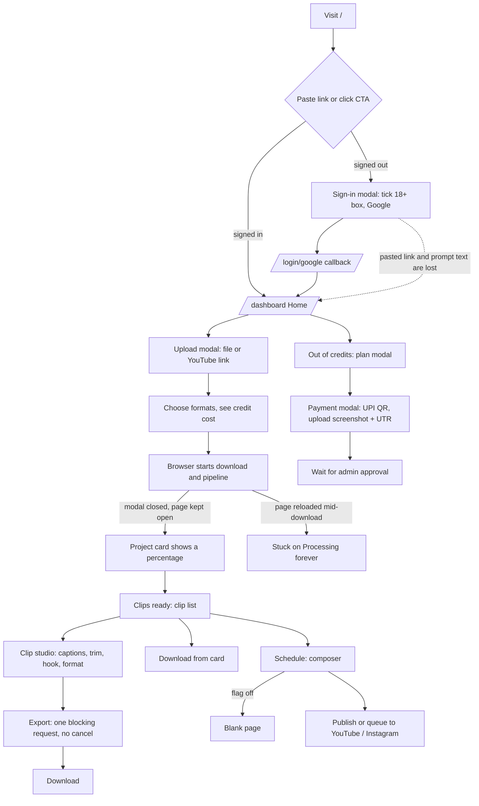

# Clipnera UI revamp — Wave 0 audit

Audit date: 3 October 2026. Branch: `clipnera` at `38f9bd5`.

This is the merged audit of the existing frontend. Seven auditors each read one slice of `frontend/` in full; their detailed reports sit in [audit/](audit/) and this file is the summary the later waves build on. Every claim here traces to a `file:line` in a slice report.

| Slice report | Covers | Files read |
|---|---|---|
| [01-foundation-routes](audit/01-foundation-routes.md) | `app/`, config, `components/ui`, `skeletons`, `legal`, `public` | 79 |
| [02-data-layer](audit/02-data-layer.md) | `lib/`, `hooks/`, backend contract check | 30 |
| [03-marketing-auth](audit/03-marketing-auth.md) | landing, editor landing, sign-in, legal pages | 39 |
| [04-dashboard-shell](audit/04-dashboard-shell.md) | shell, home, projects, upload, pipeline progress | 23 |
| [05-clips-studio-editor](audit/05-clips-studio-editor.md) | clip list, clip studio, the new Editor, `lib/editor` | 34 |
| [06-reels-brand-social](audit/06-reels-brand-social.md) | reels, brand kit, scheduler, analytics, today's B-roll | 21 |
| [07-settings-billing-admin](audit/07-settings-billing-admin.md) | settings, payments, admin, today's flags | 29 |

**How it was done.** Code was read, not run. No source file was changed. Screenshots of public pages are in [screenshots/](screenshots/).

**What this audit does not cover** (see section 9):
- Signed-in screens were not screenshotted: the backend was not running and sign-in is Google-only.
- Bundle size and Core Web Vitals were not measured, because a production build would break the running dev server.
- Next.js 15.1.6 was not checked against security advisories.

---

## 1. The ten findings that shape the revamp

1. **There is no prompt experience to revamp; it has to be built.** The clip studio and the new Editor have no instruction box, no streaming, no step progress and no visible version history. The backend has agent tools and a loop (`backend/editor/agent_tools.py`) with no endpoint. The one chat-style surface is the footage reel board (`FootageReelBoard`), which has plan, chat-to-edit and instant preview, but drops the user's message and never shows the reply.
2. **The dashboard is one client component.** `DashboardApp` (1,021 lines) is the auth gate, data store, router and modal host. All 13 dashboard `page.tsx` files return `null` and the layout discards `children`. There are no dynamic imports anywhere, so every signed-in route ships every view.
3. **There is no design system.** `components/ui` has six components and no Button, Input, Dialog, Tabs or Toast. The only CSS variables are a dead violet theme, one of which (`--border`) still sets every default border colour. The real palette is amber on neutral.
4. **No route-level safety net.** No `middleware`, `loading.tsx`, `error.tsx` or `not-found.tsx`. All guards are client effects after first paint, and signed-out users land on `/` or `/login` depending on the area.
5. **No server-state cache.** Everything is `useEffect` + `useState`. `/me`, `/social/connections` and `/creator-intro` are fetched by several components, and one pipeline run can have four watchers (SSE plus 2 s, 3 s and 5 s polls).
6. **The landing page's main action does nothing.** The pasted link is stored and never read. The landing videos are not in the build, so the page shows posters hot-linked from Pexels under a "Live demo · real footage, real output" label.
7. **Several visible features are not real.** Analytics is entirely hard-coded; half the Scheduler is sample data; "folders" are in-memory and vanish on reload; rename is not saved; the studio Audio tab, Sound panel, auto-zoom and stock B-roll are preview-only. 13 controls carry a `NotWiredBadge`; others are fake without one.
8. **Feature flags are one global on/off per key.** 13 keys, no per-user, per-workspace, per-plan or percentage targeting, no remote config, no history. Turning off a parent does not turn off its grandchildren.
9. **Today's B-roll is a shared stock library reachable through a four-result keyword search.** No browse, filters, favourites, hover preview, user uploads or vector index. Admin can ingest by topic and take down, but not upload, tag or review.
10. **Payments are manual UPI in INR.** The user scans a QR code and uploads a screenshot; an admin approves by hand. No gateway, renewal, cancel, downgrade or invoice.

---

## 2. Route map

30 URLs. Full table with guards and line references: [01 §1](audit/01-foundation-routes.md).

| Area | URL | Renders | Notes |
|---|---|---|---|
| Marketing | `/` | `LandingPageView` | CTA opens sign-in modal or goes to `/dashboard` |
| Marketing | `/editor` | `EditorLanding` | Marketing page for the Editor, not the tool; has a prompt box whose text is lost at sign-in |
| Auth | `/login`, `/signup` | `AuthShell` + `GoogleSignIn` | Same page with one prop changed; nothing public links to either |
| Auth | `/login/google` | inline callback card | OAuth code exchange, then `/dashboard` |
| Legal | `/privacy`, `/terms`, `/refunds`, `/cookies` | `LegalPage` | Server pages with metadata |
| Legal | `/data-deletion`, `/unsubscribe` | `LegalPage` | Client pages; functional screens dressed as legal pages |
| App | `/dashboard` | Home | via `DashboardApp` |
| App | `/dashboard/folders` | Projects | "folders" are projects |
| App | `/dashboard/projects/[projectId]` | Clip list (`ClipGeneratorView`) | A processing project cannot be opened |
| App | `/dashboard/projects/[projectId]/edit/[clipId]` | Clip studio (`VideoEditorStudio`) | Full screen |
| App | `/dashboard/editor`, `/dashboard/editor/[editorProjectId]` | New Editor (`EditorView`) | Behind `agent_editor`, default off; blank when off |
| App | `/dashboard/reels`, `/reels/[reelId]`, `/reels/footage/[editId]` | `ReelsView` | Behind flag; blank when off |
| App | `/dashboard/scheduler` | `SocialSchedulerView` | Behind flag; blank when off |
| App | `/dashboard/analytics` | `ViralAnalyticsView` | No nav entry; all sample data |
| App | `/dashboard/brand-kit` | `BrandKitView` | |
| App | `/dashboard/settings` | `SettingsView` | `?tab=billing\|social\|team` |
| App | `/dashboard/connect/[platform]` | inline callback card | Outside the shell; accepts `youtube`, `tiktok`, `instagram`, `x` |
| Admin | `/admin` → `/admin/overview` | redirect | The only server redirect in the app |
| Admin | `/admin/overview`, `users`, `users/[id]`, `payments`, `credits`, `social`, `usage`, `broll`, `features` | one view each | `AdminGate` in the layout; each view wraps itself in `AdminLayout` |

Naming collisions to resolve in Wave 2: `/editor` (marketing) and `/dashboard/editor` (tool); inside the app, tab `editor` is the clip studio and tab `video_editor` is the new Editor.

---

## 3. User flows

### 3.1 End to end, as it works today

### 3.2 Where each flow is drawn in detail

| Flow | Report |
|---|---|
| First visit, sign-in, consent, session expiry | [03 §3](audit/03-marketing-auth.md) |
| Upload, pipeline progress, projects and folders, notifications, credit limits | [04 §4](audit/04-dashboard-shell.md) |
| Clip edit, preview, export; the new Editor | [05 §5](audit/05-clips-studio-editor.md) |
| Reels, brand kit, connect and publish, analytics | [06 §5](audit/06-reels-brand-social.md) |
| Upgrade, credit pack, account deletion, admin actions | [07 §6](audit/07-settings-billing-admin.md) |

### 3.3 Dead ends found

- The link or prompt typed on a marketing page is discarded at sign-in.
- There is no onboarding: a new account lands on Home with no first-run guidance.
- A reload during the source download leaves the project on "Processing" for good; there is no retry for failed or cancelled projects.
- A processing project cannot be opened, so the step list is never seen.
- Session expiry clears the token and bounces to `/` with no message.
- Scheduler, Reels and Editor render blank when their flag is off; Home's "Schedule" button goes there anyway.
- Finished reels cannot be published; the Scheduler only takes project clips.
- A footage reel in `draft` shows a header and nothing else.
- Plan change after purchase: no cancel, downgrade or renewal path.
- Team: a member is created with a password, and the app has no password sign-in.

---

## 4. State, data and styling as they are

Detail: [02 §3–4, §7](audit/02-data-layer.md), [01 §3](audit/01-foundation-routes.md).

**Data fetching**
- One hand-written client, `lib/api.ts` (2,593 lines, 133 methods). All 133 map to a real backend route.
- Roughly half the endpoints use the `{data, message, error}` envelope and half do not; two wrappers hide the difference. Errors reach callers as plain strings matched on text.
- The backend has no 422 handler, so validation failures show as "Something went wrong".
- No retries, little cancellation, no request de-duplication.

**State**
- One React context (entitlements) and two module-level caches. Everything else lives in `DashboardApp` state and is passed down as props.
- Undo in the clip studio is 100 in-memory snapshots, lost on clip switch or reload.
- The new Editor's `lib/editor/timeline.ts` is the exception: 13 validated operations, fixtures shared with the backend, and server versions.

**Real-time**
- Pipeline progress uses SSE plus three overlapping polls. Notifications have a sound reconnect design. Only the active project is polled; others show a frozen percentage.

**Auth**
- A 7-day JWT in `localStorage`, no refresh, server logout is a no-op, a 401 clears the token without redirecting.

**Styling**
- Tailwind utility classes inline; no shared primitives, so the same button and card class strings are retyped across files.
- Palette in use: amber-500/400 on neutral-950/900/800, with emerald, rose and sky for status.
- Off-palette: violet-family classes in 21 files, fuchsia in the hook panel, a red/rose split for errors, platform gradients in the scheduler.
- Fonts: Syne for the wordmark; Anton only in `AuthShell`.
- `framer-motion` is installed and never imported. `usePrefersReducedMotion` exists and is used unevenly.
- No modal in the app is an accessible dialog (no focus trap, no `role="dialog"`).

---

## 5. Component inventory and decisions

KEEP = reuse, restyle to the new tokens. REBUILD = the behaviour stays, the component is rewritten. DELETE = remove. Reasons and line references are in the slice reports.

Under the project's UI rule, nothing a user can see is removed without the owner's confirmation. Every DELETE below that affects a screen is listed again in section 8.

### 5.1 Primitives, skeletons, legal ([01 §4](audit/01-foundation-routes.md))

| Component | Decision | Note |
|---|---|---|
| `LogoMark`, `PageHeader`, `ScoreRing` | KEEP | |
| `StatusPill` | KEEP | `ai` tone is violet; move `projectStatus` to `lib/` |
| `Select` | REBUILD | Then replace the 11 native selects |
| `NotWiredBadge` | KEEP | Until each fake feature is wired or removed |
| `Skeleton`, `DashboardSkeleton`, `StatsSkeleton`, `AnalyticsSkeleton`, `BrandKitSkeleton`, `ModalSkeleton`, `SidebarSkeleton`, `HeaderSkeleton`, `ProjectCardGridSkeleton` | REBUILD | Each follows its new screen |
| `TableSkeleton`, `TableRowSkeleton` | KEEP | |
| `VideoCardSkeleton`, `FormSkeleton`, `UploadSkeleton`, `ProfileSkeleton`, `SettingsSkeleton`, `VideoPlayerSkeleton`, `ImageSkeleton`, `ClipListSkeleton`, `PipelineSkeleton`, `NotificationsSkeleton`, `AuthSkeleton` | DELETE | Zero importers; render nowhere |
| `EmptyState` (in `skeletons/`) | DELETE, rebuild in `ui/` | No screen uses it |
| `LegalPage` | REBUILD (visual) | Keep every word of content |
| `BusinessDetails`, `ContactLine`, `BUSINESS`, `CookieNotice` | KEEP | Move `BUSINESS` to `lib/` |

### 5.2 Marketing and auth ([03 §1](audit/03-marketing-auth.md))

| Component | Decision | Note |
|---|---|---|
| `LandingPageView`, `Navbar`, `Footer`, `HeroSection`, `HeroStage`, `ClipWall`, `ResultsPreview`, `PublishSection`, `PricingSection`, `BottomCta`, `VideoLinkForm` | REBUILD | Prompt-first hero; carry the visitor's input through sign-in |
| `SignInModal`, `AuthShell`, `GoogleSignIn` | REBUILD | One sign-in surface; ask for consent once |
| `EditorLanding` | REBUILD | Merge with `/` |
| `LandingVideo` | KEEP | Fix the missing media |
| `BurnedCaption`, `SectionIntro`, `BrandMark`, `EngineSection`, `BeforeAfterShowcase`, `CaptionTypographyShowcase`, `FaqSection`, `GoogleLogo` | KEEP | |
| `RoiCalculator` | REBUILD or DELETE | Owner decision |
| `Reel` (placeholder art in `EditorLanding`) | DELETE | Replace with real footage |
| `AuthModal` (dashboard) | REBUILD, rename | It is a workspace switcher; should be a menu |
| `GoogleCallbackPage` | KEEP logic, REBUILD screen | |

### 5.3 Dashboard shell, home, projects, upload ([04 §1](audit/04-dashboard-shell.md))

| Component | Decision | Note |
|---|---|---|
| `DashboardApp`, `(shell)/layout.tsx`, the `return null` pages | REBUILD | Real layout, providers and per-route pages |
| `Sidebar`, `Header`, `NotificationsDrawer`, `CreditsPopover` | REBUILD | |
| `DashboardHomeView` | REBUILD | Becomes the prompt-first home |
| `ProjectFoldersView` | REBUILD | Folders are fake today |
| `UploadModal` | REBUILD | Move pipeline start to the server |
| `PipelineStepIndicator` | REBUILD | |
| `PipelineProgressTracker` | DELETE or REBUILD | Unreachable today; rebuild as the real progress page |
| `MobileTabBar`, `CommandPalette`, `SnackbarStack`, `EntitlementsProvider`, `PlanBanner`, `OutputFormatPicker` | KEEP | |
| `ProLockBadge`, `Avatar` | KEEP | Move to `ui/` |
| `connect/[platform]/page.tsx` | KEEP | Restyle |

### 5.4 Clips, clip studio, Editor ([05 §1](audit/05-clips-studio-editor.md))

| Component | Decision | Note |
|---|---|---|
| `ClipGeneratorView`, `ClipCard` | REBUILD | Keep hover-to-preview |
| `ClipPoster`, `CaptionStylePreview` | KEEP | |
| `VideoEditorStudio` / `StudioContent`, `StudioTopBar` | REBUILD | Split into hooks on the Timeline model |
| `TranscriptPanel` | REBUILD | Strongest interaction in the app; needs keyboard selection |
| `StudioCanvas` | KEEP approach, REBUILD composition | |
| `Timeline`, `ExportDialog`, `PlatformOverlay` | REBUILD | |
| `ClipRail`, `Transport`, `Inspector`, `ShortcutsDialog`, `CaptionsPanel` | KEEP | |
| `controls.tsx` | KEEP | Promote to `ui/` |
| `studioUtils.ts`, `useHistory.ts`, `useStudioLayout.ts` | KEEP | |
| `HookPanel`, `BrollPanel`, `HookTransitionPanel`, `AudioEnhancerPanel`, `AudioBeforeAfter` | REBUILD | Audio is not connected to the clip today |
| `ClipBrollPanel` | KEEP logic, REBUILD UI | |
| `SoundPanel`, auto-zoom in `FormatPanel` | DELETE or finish | Owner decision; `FormatPanel` ratio picker is KEEP |
| `EditorView`, `EditorHome`, `EditorProject`, `TimelineView` | REBUILD | Scaffold only |
| `lib/editor/timeline.ts` and its tests | KEEP | The foundation for the new editor |

### 5.5 Reels, brand kit, publishing, analytics ([06 §2](audit/06-reels-brand-social.md))

| Component | Decision | Note |
|---|---|---|
| `ReelsView`, `NewReelForm`, `SceneCard`, `ReelBoard` | REBUILD | One file holds three screens |
| `FootageReelForm` | KEEP logic, REBUILD shell | Most complete upload validation in the app |
| `FootageReelBoard` | KEEP logic, REBUILD layout | Closest thing to the target prompt experience |
| `ReelPreviewPlayer` | KEEP core, REBUILD chrome | Proxy-based timeline player; reusable for B-roll preview |
| `BrandKitView` | REBUILD | No logo upload; a failed load can overwrite the kit |
| `ChannelIntroPanel` | KEEP logic, REBUILD placement | |
| `ChannelIntroNudge`, `ReelsCoverPicker`, `platforms.ts` | KEEP | Platform gradients need a palette decision |
| `SocialSchedulerView`, `PublishComposer`, `ScheduledPostsQueue` | REBUILD | Carry over the provider rules |
| `PostCalendar`, `ConnectedPlatformsPanel` | KEEP logic, REBUILD UI | |
| `ViralAnalyticsView` | DELETE content, REBUILD from real data | Owner decision |

### 5.6 Settings, billing, admin ([07 §1](audit/07-settings-billing-admin.md))

| Component | Decision | Note |
|---|---|---|
| `SettingsView`, `AccountPrivacyPanel`, `PlanSelectionModal`, `PaymentModal` | REBUILD | Mount each modal once; design payment so a gateway can replace the UPI step |
| `CreditPacksCard`, `MyPaymentsCard` | KEEP | Restyle |
| `PaymentStatusBadge` | DELETE | Fold into `StatusPill`; no visible change |
| `AdminGate`, `AdminUi`, `AdminOverviewView`, `DailyBarChart`, `AdminUsageView` | KEEP | |
| `AdminLayout`, `AdminUsersView`, `AdminUserDetailView`, `AdminCreditsView`, `AdminPaymentsView`, `AdminSocialView` | REBUILD | |
| `AdminBrollView` | REBUILD | Becomes the curation console (Wave 4) |
| `AdminFeaturesView`, `FeatureSwitches` | REBUILD | Becomes the flags console (Wave 5) |

### 5.7 Hooks and library code ([02 §1, §5](audit/02-data-layer.md))

| Item | Decision | Note |
|---|---|---|
| `usePrefersReducedMotion` | KEEP | Make it the single motion gate |
| `useEntitlements` | KEEP model, REBUILD plumbing | Server-driven capabilities are the right design |
| `useNotificationInbox` | KEEP design, REBUILD edges | |
| `useFeatureFlags`, `usePlan`, `usePipelineProgress`, `useHookTransitionCatalog` | REBUILD | On a shared query cache |
| `useDownloadProgress`, `startPipelineWhenReady`, `lib/data/mockProjects.ts` | DELETE | No callers |
| 18 uncalled API methods (password-era `authApi`, workspace member calls, `fetchFormats`, `brandKitApi.delete`, others) | DELETE or wire | Member role/remove should be wired, not deleted |
| `lib/utils/urlParser.ts` | REBUILD | Invents titles, channels and posters from keyword matches |

**Totals:** about 205 decisions — roughly 70 keep, 100 rebuild, 35 delete.

---

## 6. Baselines the later waves start from

### 6.1 Prompt experience (input to Wave 1)

| Target | Today |
|---|---|
| Prompt bar always reachable | None in the studio or Editor. A message box on the footage reel board only |
| Instant acknowledgement, streamed plan | None. The reel board disables controls and waits |
| Live step progress | A four-step checklist while a footage reel is analysed; a percentage for clip projects |
| Progressive preview | `ReelPreviewPlayer` already plays low-res proxies from the plan without a render |
| Named, reversible versions | In-memory undo in the studio; server versions exist in the Editor model but have no UI |
| Human error states with a retry prompt | None |
| Background jobs with notification | Notifications exist; pipeline start depends on the browser tab staying open |

### 6.2 B-roll (input to Wave 4)

Detail: [06 §4](audit/06-reels-brand-social.md), [07 §4](audit/07-settings-billing-admin.md).

- **Exists:** a shared stock library ingested from Pexels, NASA and Wikimedia, with licence records, vertical renditions, and admin ingest, search, block, take-down and restore.
- **User access:** a four-result keyword search tied to one AI-placed cutaway. The studio's "Add stock footage" is four Unsplash stills with no backend.
- **Missing for the platform library:** admin upload, tag editing, a review queue (ingested shots go straight to live), collections, bulk actions, licence display.
- **Missing for the user library:** everything — upload, transcode, thumbnails, tagging, quotas.
- **Missing for both:** browse, filters, favourites, hover preview, drag to timeline, semantic search (an optional re-rank exists, off by default, no vector index).

### 6.3 Feature flags (input to Wave 5)

Detail: [07 §3](audit/07-settings-billing-admin.md), [02 §7](audit/02-data-layer.md).

- **Exists:** 13 global boolean keys in the database, an admin page of switches, a public `GET /features` fetched once per page load, "all off until loaded" default.
- **Missing:** per-user, per-workspace and per-plan targeting, percentage rollout, kill switches that reach an open tab, server-side evaluation, typed definitions, remote config, an audit log (only the last writer is stored and never shown).
- **Bug:** parent flags are checked one level deep.
- Plan entitlements are a separate per-user system and should stay separate.

### 6.4 Architecture (input to Wave 3)

- No code splitting, no server rendering of signed-in pages, no query cache, no virtualised lists.
- Video is loaded as direct signed MP4s; proxies exist only for footage reels; no HLS.
- The clip studio's playhead is top-level React state set every frame, so the whole studio re-renders during playback.
- Export is one blocking HTTP request with invented progress; pressing ⌘E twice starts two exports.
- The pipeline is started by the browser, not the server.

---

## 7. Tech debt, ranked

Each item links to the slice that holds the line references.

### Broken now

| # | Problem | Source |
|---|---|---|
| 1 | Audio enhancement always fails: the client sends camelCase to snake_case schemas (422) and sends an empty audio URL | [02 §8](audit/02-data-layer.md), [05 §7](audit/05-clips-studio-editor.md) |
| 2 | Landing link field and its three tabs do nothing; landing videos are missing from the build | [03 §6](audit/03-marketing-auth.md) |
| 3 | Reload during source download leaves a project on "Processing" forever; download and pipeline-start errors are swallowed | [04 §7](audit/04-dashboard-shell.md) |
| 4 | Failed initial dashboard load leaves the skeleton up permanently | [04 §7](audit/04-dashboard-shell.md) |
| 5 | "New folder" creates an in-memory project that polls a 404 every 5 s; rename and upload "Project name" are not saved | [04 §7](audit/04-dashboard-shell.md) |
| 6 | Stale closure after a long upload overwrites the project list | [04 §7](audit/04-dashboard-shell.md) |
| 7 | Brand kit: a failed load shows defaults with a working Save, which would overwrite the real kit | [06 §8](audit/06-reels-brand-social.md) |
| 8 | Image-reel Render can be double-clicked; no confirmation before spending credits, including the 120-credit AI shot | [06 §8](audit/06-reels-brand-social.md) |
| 9 | Card download and batch export send different options from studio export, so captions turned off come back on | [05 §7](audit/05-clips-studio-editor.md) |
| 10 | Export call drops ten caption fields | [02 §8](audit/02-data-layer.md) |
| 11 | Flag hierarchy: turning off a parent does not disable grandchildren | [07 §3](audit/07-settings-billing-admin.md) |
| 12 | Free-tier fallback shows 60 credits; the server grants 20. Credit balance is not refetched after a charge | [02 §8](audit/02-data-layer.md), [04 §7](audit/04-dashboard-shell.md) |
| 13 | Composer spins forever if connections fail to load; expired accounts vanish with "No connected accounts yet" | [06 §8](audit/06-reels-brand-social.md) |
| 14 | Sign-in modal and sticky navbar share `z-50`; likely stacking bug | [03 §6](audit/03-marketing-auth.md) |

### Structural

| # | Problem | Source |
|---|---|---|
| 15 | God components: `DashboardApp` 1,021 lines, `UploadModal` 1,075, `StudioContent` ~900, `ProjectFoldersView` 855, `SettingsView` 485 | 04, 05, 07 |
| 16 | No shared primitives; plan and payment modals mounted twice with different behaviour; three copies of the credit bar | 01, 04, 07 |
| 17 | No query cache; duplicate fetches; up to four watchers per pipeline run; one poll never stops | [02 §4](audit/02-data-layer.md) |
| 18 | Mixed response envelope; string-matched errors; no 422 handler | [02 §3](audit/02-data-layer.md) |
| 19 | JWT in `localStorage`, no refresh, no server logout | [02 §8](audit/02-data-layer.md) |
| 20 | No loading, error or not-found routes; inconsistent signed-out destinations | [01 §6](audit/01-foundation-routes.md) |
| 21 | Admin actions have no audit trail except credit top-ups; one all-powerful admin role | [07 §7](audit/07-settings-billing-admin.md) |

### Accessibility and responsive

| # | Problem | Source |
|---|---|---|
| 22 | No modal is an accessible dialog; flag switches have no accessible name; clip cards are not keyboard reachable | 05, 07 |
| 23 | No mobile navigation on the landing page; tablet sidebar rail cannot expand | 03, 04 |
| 24 | Sidebar renders its tree two or three times with duplicate DOM ids | [04 §7](audit/04-dashboard-shell.md) |

### Dead or misleading

| # | Problem | Source |
|---|---|---|
| 25 | 13 unused skeleton exports, 18 uncalled API methods, one dead hook, `mockProjects.ts`, `framer-motion` installed and unused, empty `public/landing/` | 01, 02 |
| 26 | Hard-coded content presented as real: Analytics, scheduler suggestions, hook tester (random 88–98), platform overlay counts, `urlParser` | 05, 06, 02 |
| 27 | Copy and policy mismatches: "real footage" over stock; Pexels hot-links against a cookie policy that says Clipnera serves all files; TikTok and X named in legal pages and the connect callback | 01, 03 |
| 28 | Backend with no UI: admin music API, depth captions (has a pricing line), agent tools | 02, 05, 07 |

---

## 8. Decisions that need the owner

The audit makes a recommendation for each. Wave 1 does not depend on any of them; Wave 2 design does.

| # | Question | Recommendation |
|---|---|---|
| 1 | Are folders a real feature? | Yes, build them on the server; remove the in-memory version |
| 2 | Analytics is all sample data. Remove, hide behind a flag, or build? | Hide behind a flag until real data exists |
| 3 | Preview-only controls: Sound panel, auto-zoom, stock stills, studio Audio tab, clip-style switches, topic chips, hard-coded tags | Finish audio; remove the rest until built |
| 4 | Which platforms do we claim? Plan says YouTube and Instagram; legal pages and callback name TikTok and X | Claim only YouTube and Instagram everywhere |
| 5 | Two landing pages (`/` and `/editor`) | Merge into one prompt-first landing |
| 6 | Is violet allowed (bought credits, plan notice, admin, `ai` status tone)? And platform brand gradients? | No violet; allow platform brand colours only on platform marks |
| 7 | Light theme: the brief asks for light and dark; the app is dark only | Design both, ship dark first |
| 8 | Payments stay manual UPI for the revamp? | Yes; design the modal so a gateway slots in later |
| 9 | Team: members get a password the app cannot use | Invite by Google account; wire role change and removal |
| 10 | `RoiCalculator` and `PipelineProgressTracker` | Drop the calculator; rebuild the tracker as the project progress page |
| 11 | Should a processing project have its own page with the step list? | Yes; it is the natural home for live step progress |

Removing the 13 dead skeletons, the dead hook and uncalled API methods changes no screen, so those do not need confirmation.

---

## 9. Gaps in this audit

| Gap | Why | How to close it |
|---|---|---|
| Signed-in and admin screenshots | Backend not running; sign-in is Google-only | Owner starts the backend and provides a signed-in browser session, or approves a seeded test account in a throwaway database |
| Bundle size and Core Web Vitals | `next build` would corrupt the running dev server's `.next` | Build to a separate `distDir` in Wave 3 and record the baseline |
| Runtime behaviour | Findings come from reading code; a few are marked "likely" in the slice reports (stacking bug, audio request key) | Confirm during Wave 7 E2E work |
| Dependency advisories | Not run | `npm audit` in Wave 3 |

---

## 10. What the revamp must not lose

Working behaviour that is easy to break during a rebuild. Full list: [01 "What the revamp must not break"](audit/01-foundation-routes.md) and the closing section of each slice report.

- Google sign-in with state check, 18+ consent, and the unsubscribe and data-deletion endpoints that Meta and email links point at.
- Legal page content, word for word, and the business details block.
- Caption preview that mirrors the server's burn-in (`studioUtils`, `CaptionStylePreview`).
- Transcript editing: click to seek, range select, cut and restore, filler removal; the studio keyboard map.
- Provider rules in the composer: TikTok disclosure, YouTube made-for-kids, Instagram cover.
- Connection status model: active, needs reconnect, disconnecting, expiring soon.
- Server-driven entitlements and plan comparison rows; server-priced checkout.
- Footage reel upload validation: limits, duration probing, per-file progress.
- The Editor's Timeline model, operations and shared fixtures.
- Notification inbox reconnect logic; snackbar pause on hover and tab visibility.
- Every existing URL, including the OAuth callback paths registered with Google, YouTube and Meta.
