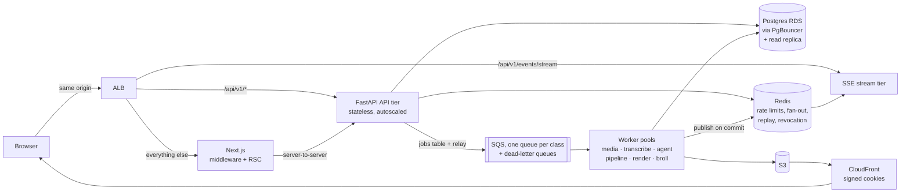
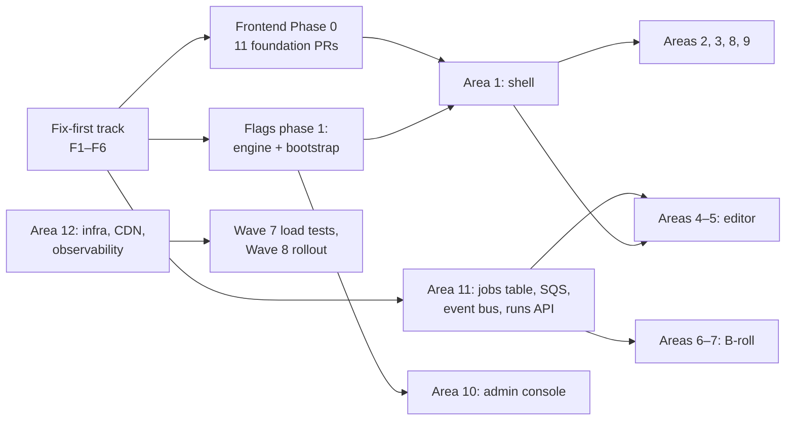

# Clipnera UI revamp — Wave 3: architecture

Date: 3 October 2026. Branch `clipnera` at `38f9bd5`.

This is the merged architecture. Four detailed documents sit underneath it, and this file is what Waves 5–7 build against. Where those documents disagree, **section 3 of this file decides**, and the slice documents are read with those decisions applied.

| Document | Covers |
|---|---|
| [architecture/frontend.md](architecture/frontend.md) | App structure, rendering, data layer, real-time client, editor client, performance budgets and baseline, observability, migration and file ownership |
| [architecture/backend.md](architecture/backend.md) | Services, queue and workers, agent runs, real-time server, media, data, security, gateway, load model, envelope, observability, migration |
| [architecture/events.md](architecture/events.md) | Run, job, version and user event schemas; ordering, idempotency, resume |
| [architecture/openapi.yaml](architecture/openapi.yaml) | OpenAPI 3.1 for new and changed endpoints (46 paths) |
| [05-broll.md](05-broll.md) §6–8 | B-roll data model, API and editor integration |
| [06-flags.md](06-flags.md) §3–8 | Flag engine, bootstrap, kill switch, remote config, contracts |

---

## 1. The architecture in one page

- **Frontend:** Next.js 15.5 with route groups and real layouts in place of `DashboardApp`. Marketing pages are static and the app shell is server-rendered; the editor is a client island. TanStack Query sits over one `apiFetch` client, with types generated from OpenAPI. Each user gets one SSE stream per tab. The new UI is built in `app/v2/`, and middleware sends each URL to the old or new tree by flag.
- **Backend:** a stateless API, with every long task as a server-owned job and every prompt edit as an agent run. Each run writes a numbered event log and produces exactly one version. Auth moves to httpOnly cookies, and every response uses one envelope.
- **Cost stance:** no GPU, Graviton Spot capacity for workers, and minimal sizes until load demands more (backend §10.3, owner Q1). LLM provider rate limits are the real bottleneck, not infrastructure.

## 2. Findings in today's code that block the revamp

Both architects found problems that are bugs or risks today, not just obstacles to scaling. They are collected here because several should be fixed **before** any revamp work, independent of flags.

| # | Problem | Where | Severity |
|---|---|---|---|
| F1 | `next@15.1.6` has 33 advisories, 4 critical: a middleware auth bypass (GHSA-f82v-jwr5-mffw) and an RCE in React flight (GHSA-9qr9-h5gf-34mp). Fixed in 15.5.27 | frontend §6.4 | Critical |
| F2 | Generated clips are served from `/static/clips` with no auth | `backend/main.py:77` | High |
| F3 | Any access token can reset a password; the reset token is printed to stdout | `auth/background_task.py:11-17`, `auth/service.py:188-213` | High |
| F4 | Credit deduction reads the balance, then inserts, with no lock, so two concurrent charges can overspend | `subscription/service.py:499-523` | High |
| F5 | AI-shot files survive account deletion | `user/service.py:20`, `broll/assets/` | High (compliance) |
| F6 | Grandchild flags stay on when a grandparent is off: `/edits` stays open and Pro footage reels keep billing at 1.5× while Reels is hidden | `feature_flags/service.py:23-24` | High |
| F7 | In SQS mode, footage-reel jobs likely fail because the worker never imports `edit_engine.jobs` | `jobs/worker.py:97-103` | Medium (likely) |
| F8 | Notifications published by workers never reach the browser | `notifications/service.py:64-84` | Medium |
| F9 | A second API replica in `inprocess` mode fails the other replica's running pipelines at startup | `main.py:53`, `pipeline/service.py:66-81` | Blocks scale-out |
| F10 | Heavy work runs inside HTTP requests (export FFmpeg, YouTube download, probing) | `pipeline/service.py:1902` | Blocks scale-out |

F1–F6 are proposed as a **fix-first track**, ahead of Wave 6 and outside the flag system. F1 needs a dependency upgrade, and F6 needs the production check in [06-flags §12](06-flags.md) first. Both are waiting on the owner's go-ahead.

## 3. Reconciliation: where the slice documents disagreed

| # | Topic | Disagreement | Decision | Why |
|---|---|---|---|---|
| R1 | Topology | Frontend: same origin, `/api/v1/*` routed at the load balancer. Backend: `app.` and `api.` subdomains | **Same origin.** Subdomains are the fallback | Removes CORS and preflights, allows host-only cookies, and avoids the Safari ITP risk the backend itself lists. Owner question O1 |
| R2 | Cookie names and paths | Frontend: `__Host-cn_session` and `__Host-cn_refresh` (forces `Path=/`). Backend: `cn_at` and `cn_rt` with `Path=/api/v1/auth` | Access: **`__Host-cn_at`** (`Path=/`, 15 min). Refresh: **`cn_rt`**, host-only (no `Domain`), `Path=/api/v1/auth`, `SameSite=Strict`. CSRF: **`cn_csrf`** plus `X-CSRF-Token` | The refresh token goes only to the refresh endpoint. With same origin, host-only cookies give the `__Host-` guarantee without the prefix |
| R3 | Expired-token code and exchange endpoint | `ACCESS_EXPIRED` vs `TOKEN_EXPIRED`; `/auth/session/exchange` vs `/auth/session/upgrade` | **`TOKEN_EXPIRED`**, **`POST /auth/session/upgrade`** | The backend owns auth contracts. Migration follows backend §8.1 A → B → C; frontend's `auth_cookie_enforce` flag is the switch for release C |
| R4 | Event envelope and names | Frontend proposed `{v, topic, ...}`, `run.op.applied`, `resync`, Redis Streams as the store | **[events.md](architecture/events.md) is the contract:** `{type, v, stream, seq, durable, ts, ...}`, `run.operation.applied`, `sync.reset`. Postgres is the durable log, Redis is fan-out plus a short replay buffer | Gapless per-stream `seq` with backfill (`?after_seq=`) is stronger than a capped per-user Redis Stream, and durable events are needed for "your edit is still running" across devices |
| R5 | Stream scope | Frontend: one per user, with tab leader election over `BroadcastChannel`. Backend: one per tab, with a `project_id` filter for heavy `run.*` events | **One per tab for v1.** Leader election is deferred | The per-project filter doesn't fit a single leader. 25k peak connections fit 6–8 stream tasks (backend §10.2). Revisit after the Wave 7 load test |
| R6 | Flag endpoint | Frontend: `GET /flags/evaluate?surface=ui`. Flags: `GET /flags/bootstrap` | **`GET /flags/bootstrap`** only. Middleware reads the `new_ui_*` keys from it | One endpoint, owned by the flags design |
| R7 | No-flicker mechanism | Frontend: middleware plus a signed `cn_ui` cookie (5 min) chooses the `app/v2` tree. Flags: server component plus `FlagsProvider`, no middleware | **Both, at different levels.** Middleware and `cn_ui` choose the **tree** for `new_ui_*` area flags; the root layout passes the same bootstrap into `FlagsProvider` for **in-page** flags. `cn_ui` is signed by a Next-only secret, not shared with the backend | Tree choice must happen before render (legacy `DashboardApp` ignores `children`); in-page flags need no middleware |
| R8 | Anonymous bucketing cookie | `cn_aid` vs `cn_anon` | **`cn_anon`** | Flags owns bucketing; one cookie to list on `/cookies` |
| R9 | Redis | Flags: not needed. Backend: ElastiCache for rate limits, fan-out, replay, revocation | **Redis is introduced** (backend §7.2). The flag engine keeps Postgres `LISTEN/NOTIFY` and may publish through Redis later | Flags works either way; nothing to change in 06-flags |
| R10 | UI area flags | Frontend added `new_ui_auth`, `new_ui_editor_timeline`, `new_ui_library`, `new_ui_user_broll`, `new_ui_export`, `new_ui_reels`; flags §9.1 lists fewer | **Catalogue below (§4).** `new_ui_library` and `new_ui_user_broll` are dropped: the library is gated by `broll_platform_library` / `broll_user_library` under `new_ui_shell` | No two flags gating the same surface |
| R11 | Frontend types | Frontend: generated from OpenAPI (`openapi-typescript`, committed, CI drift check). Flags: hand-written TS mirrors | **Generated** is the rule. Hand-written mirrors are allowed until `backend/scripts/export_openapi.py` lands, each with a contract test | Satisfies the AGENTS.md exact-match rule mechanically |
| R12 | B-roll storage quotas | Flags placeholders 2 / 50 GiB; B-roll priced 1 / 25 GiB | **1 GiB Free / 25 GiB Pro** (remote config, read through entitlements) | B-roll priced it; owner question O9 |
| R13 | Error envelope | Frontend B6: `error:<CODE>` string. Backend §11.1: `error` object | **Backend:** `error = {code, message, details, request_id, retryable}`. Client reads string or object until auth release C | Matches every other contract already written |
| R14 | Proxy keyframe interval | Frontend 0.5 s; backend 1 s GOP | **1 s GOP**, 540p MP4, faststart | Smaller proxies and faster encodes. Measure scrubbing in Wave 7 and move to 0.5 s if it misses the 250 ms budget |

| R15 | Animation library | Frontend §5 proposed removing `framer-motion`; seven design-system components use it through one wrapper ([02 §13](02-design-system.md)) | **Keep, loaded as `motion/react` with `LazyMotion`** (about 5 KB), only on routes that render an animated overlay | Exit animations and reduced-motion handling stay in one place; the cost fits the route budgets |

## 4. Flag catalogue for the revamp (merged)

Every flag is defined in [06-flags §3.1](06-flags.md) form. Evaluation is hierarchical: a flag is on only if every ancestor is on.

| Flag | Parent / requires | Gates | Wave 6 area |
|---|---|---|---|
| `new_ui_shell` | — | New shell, navigation, prompt bar. Parent of every `new_ui_*` | 1 |
| `new_ui_auth` | `new_ui_shell` | `/`, `/editor`, `/login`, `/signup` (prompt carried through sign-in) | 2 |
| `new_ui_dashboard` | `new_ui_shell` | Home, projects, upload, project progress page, analytics (behind its own flag) | 3 |
| `new_ui_editor` | `new_ui_shell`; requires `agent_editor` | Editor and clip studio URLs; prompt bar, plan and progress | 4 |
| `new_ui_editor_timeline` | `new_ui_editor` | New preview, timeline and versions | 5 |
| `prompt_streaming_v2` | requires `agent_editor` | Run event stream; pinned per run | 4, 11 |
| `broll_platform_library` | `broll_studio` | Clipnera library browse and insert | 6 |
| `broll_user_library` | `broll_studio` | Personal uploads | 7 |
| `new_ui_export` | `new_ui_shell` | Export dialog, share, scheduler | 8 |
| `new_ui_settings` | `new_ui_shell` | Settings, billing, usage, brand kit | 9 |
| `new_ui_reels` | `new_ui_shell` | `/dashboard/reels/**` | 4 (provisional) |
| `new_ui_admin` | — (staff rule) | `/admin/**`, flags console, B-roll curation | 10 |
| `auth_cookie_enforce` | — | Auth release C: middleware redirects, Bearer rejected from browsers | 2, 11 |

The 13 existing keys keep their names and behaviour ([06-flags §9.2](06-flags.md)), apart from the F6 fix.

## 5. Contracts every team follows

Frozen from this point; changes go through the Lead, with both architecture documents updated in the same change.

| Contract | Rule | Source |
|---|---|---|
| Envelope | `{data, message, error}` on every JSON response. `error = {code, message, details, request_id, retryable}`. 422 handler maps to `VALIDATION_FAILED` with field details | backend §11 |
| Client | One `apiFetch`; typed `ApiError` by `code`, never string matching; `credentials: 'include'`, `X-CSRF-Token`, `X-Request-ID`, `X-Workspace-Id`; single-flight refresh on `TOKEN_EXPIRED` | frontend §3.2–3.3, backend §17 |
| Types | Generated from FastAPI OpenAPI; every route declares `response_model`; snake_case on the wire; stable operation ids `<router>_<fn>` | frontend §3.8, R11 |
| Long work | Anything over about 2 s returns `202` with a `Job` or `Run`; `Idempotency-Key` on every creating or credit-spending POST | backend §3.3 |
| Events | One `EventSource` per tab at `/api/v1/events/stream`; de-duplicate by `(stream, seq)`; backfill gaps; `sync.reset` means refetch snapshots; unknown types ignored | events.md §7 |
| Runs and versions | One active run per project; follow-ups queue; one prompt = one named version; hand edits send `client_batch_id` and handle `423 ITEM_LOCKED` and `409 STALE_VERSION`; restore never deletes | backend §4, events.md §3 |
| Media | `GET /media/session` before media loads; 540p MP4 proxies drive the editor; HLS only for long sources, share pages and export preview | backend §6, R14 |
| Pagination | Signed opaque cursors (`meta.next_cursor`); ranked B-roll search is the one exception in ordering, not in format | backend §11.3, 05-broll §7.1 |
| Flags and config | Backend `flags.is_enabled(key, ctx)` / `flags.config(key)`; frontend `useFlag`, `useConfig`, `<Flagged>`, `getFlags()`; plan promises read through entitlements | 06-flags §8.5 |
| B-roll in the timeline | Asset id `b_<id>`, key `broll:<id>`, checked for tenant and status inside `EditorService.apply` | 05-broll §8.1 |

## 6. Performance budgets and baseline

Measured on `38f9bd5` in a throwaway worktree (frontend §6.1). Next's build table under-reports the dashboard, so CI uses our own per-route script.

| Route | Today (gzipped JS) | Budget |
|---|---|---|
| `/dashboard/**` | 368 KB | 200 KB |
| `/admin/overview` | 238 KB | 200 KB |
| `/` | 147 KB | 130 KB |
| Legal pages | 110–111 KB | 120 KB |
| CSS | 19 KB | 30 KB |

Targets: LCP < 2.0 s, INP < 200 ms, CLS < 0.1, enforced in CI via the route-budget script and Lighthouse CI (frontend §6.3). Legacy routes start at today's size as their limit and tighten after Phase 0. Prompt budgets from [01 §5](01-experience-principles.md) are measured with telemetry spans.

## 7. Build order

Detail and file ownership per area: frontend §8, backend §14, 05-broll §13, 06-flags §13.

## 8. Owner questions (architecture)

Each has a default the teams proceed on; only answers that change the default need a reply.

| # | Question | Default |
|---|---|---|
| O1 | Serve the API on the same origin as the app (`/api/v1/*` at the load balancer)? | Yes |
| O2 | Move from one EC2 host to ECS, RDS, ElastiCache and CloudFront? About $350–500/month at minimal sizes | Yes, staged at minimal sizes |
| O3 | Region | `ap-south-1`, CloudFront global |
| O4 | Frontend hosting: Vercel, or self-hosted Node beside the backend? | Self-hosted Node behind CloudFront, same region |
| O5 | Upgrade Next.js to 15.5.27 now (F1)? | Yes, as the first fix-first item |
| O6 | Production Postgres: RDS or self-hosted, and may we enable pgvector? | Enable; keyword-only search until available |
| O7 | Remove password auth routes (UI is Google-only)? | After invites use Google accounts; fix F3 now either way |
| O8 | "Switch to classic" visible to users during rollout? | Support link only |
| O9 | B-roll storage quotas 1 GiB Free / 25 GiB Pro? | Yes; never auto-delete, block uploads only |
| O10 | Telemetry sink | Self-hosted Grafana stack (Loki, Tempo, Mimir) |
| O11 | Does the clip studio URL open the new Editor? | Yes, on that clip, under `new_ui_editor` |

Product questions from the audit (§8) and the experience principles (§14) are still open; see the wave summary.
