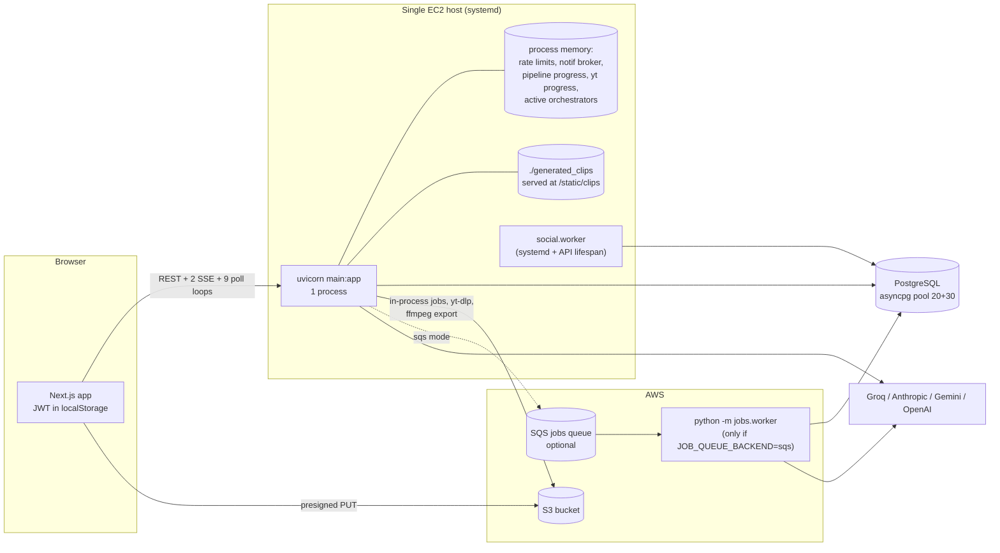
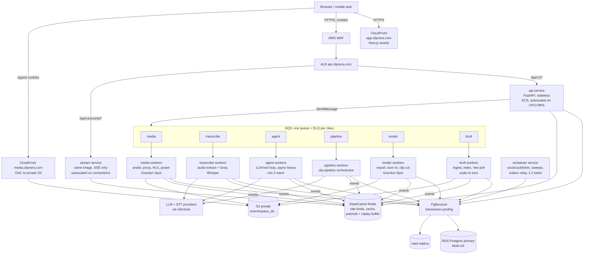
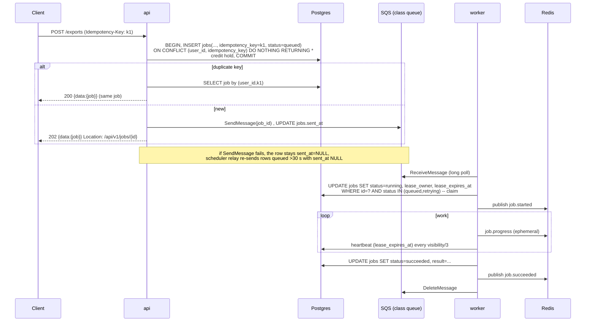
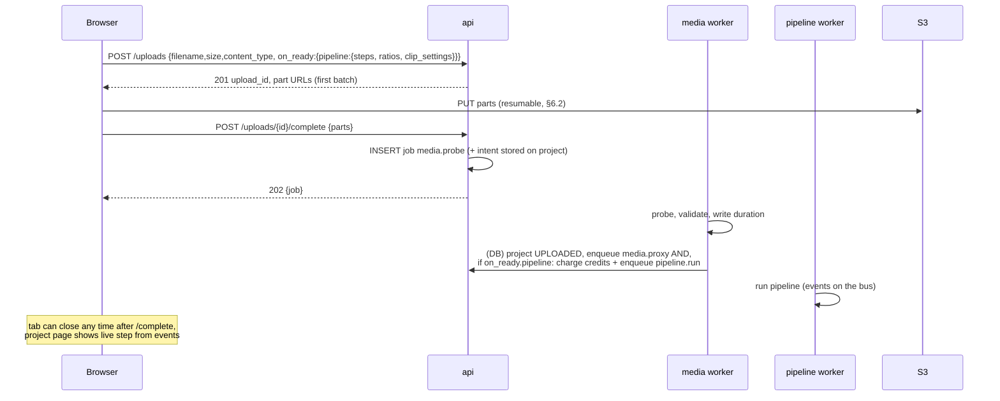
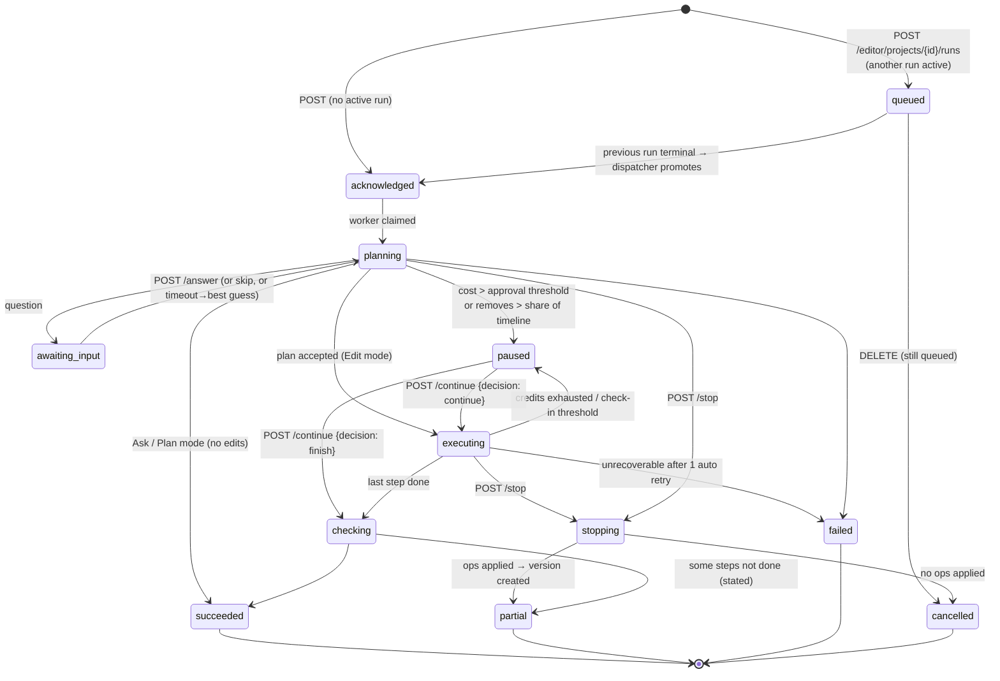
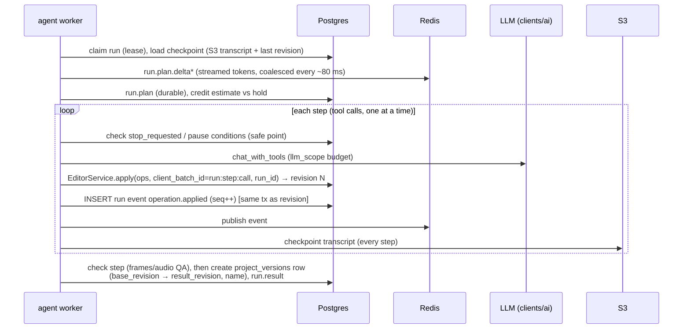
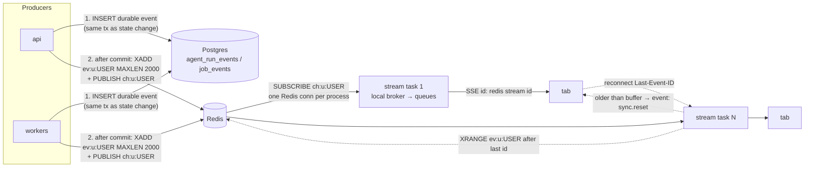
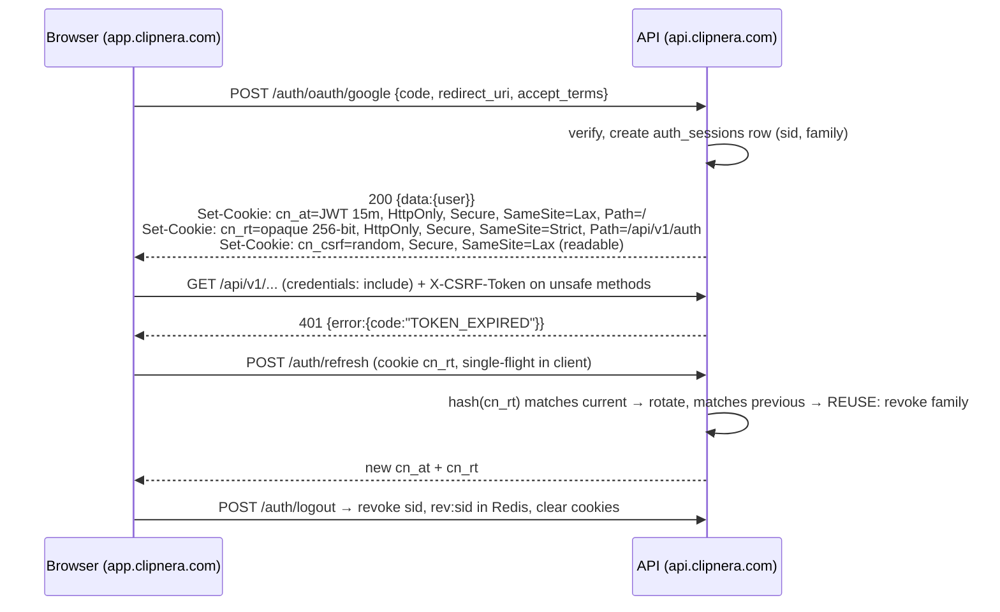

# Clipnera revamp, Wave 3: backend architecture

Date: 3 October 2026. Branch `clipnera` at `38f9bd5`. Author: Backend Architect (also covering platform/DevOps, database and security).

Inputs: [00-audit.md](../00-audit.md), [01-experience-principles.md](../01-experience-principles.md) (§5, §7, §9 and §13 especially), and [audit/02-data-layer.md](../audit/02-data-layer.md). Companion files: [openapi.yaml](openapi.yaml) (new and changed endpoints), [events.md](events.md) (run and job event schemas). The Frontend Architect writes `frontend.md`, and the Lead merges both into `04-architecture.md`.

All paths are relative to `backend/` unless stated otherwise. Each statement about today's code was checked by reading the source. Nothing was run.

---

## 0. Summary

**Today.** The backend is one uvicorn process on one EC2 host, run by systemd (`../update_ec2.sh:263-292`). Five pieces of state live in process memory: the rate limiter, the notification broker, pipeline progress, YouTube download progress and the list of active orchestrators. The defaults run heavy work (pipelines, downloads, upload probing, exports) inside the API process. A second API replica today would:

- lose progress events,
- split rate limits,
- drop notifications sent from workers,
- in `inprocess` mode, mark the other replica's running pipelines as failed when it starts.

**Target.** A stateless API tier and a separate SSE stream tier, both behind an ALB. Six worker pools, each fed by its own SQS queue with a dead-letter queue. Redis (ElastiCache) for rate limits, the event fan-out and replay buffer, and hot caches. Postgres (RDS) behind PgBouncer, plus one read replica. S3 with CloudFront and signed cookies for media.

Two new user-facing mechanisms:

- **Agent runs.** A server-owned prompt edit with a durable, numbered event log. Each run produces exactly one named version.
- **Jobs.** A table that is the single source of truth for every long-running task. It powers the activity indicator, retries and "your edit is still running".

**Contracts every team must follow** (detail in §11 and §12):

1. **Envelope.** `{data, message, error}` on every JSON response. `error` is an object: `{code, message, details, request_id, retryable}`.
2. **Auth.** Browsers use httpOnly cookies: a 15-minute access JWT and a 30-day rotating refresh token, with a CSRF double-submit header. Bearer tokens remain only for non-browser clients.
3. **Long work.** Anything that can take more than about 2 s returns `202` with a `Job` or `Run` and an `Idempotency-Key`. Progress arrives on one multiplexed SSE stream per tab, which resumes with `Last-Event-ID`.
4. **Events.** Events are versioned and numbered per run or job with a gapless `seq`. Postgres is the source of truth and Redis is a best-effort fan-out ([events.md](events.md)).

---

## 1. Current-state map

### 1.1 What exists



| Concern | Today | Evidence |
|---|---|---|
| Process model | One uvicorn process, no `--workers`, no `--proxy-headers` | `start_backend.sh:31-33`, `../update_ec2.sh:274` |
| Startup side effects | Marks all unfinished pipelines failed when the API starts (in `inprocess` mode), and starts the social publisher inside the API lifespan | `main.py:50-63`, `pipeline/service.py:66-81` |
| Static media | Local `generated_clips` directory publicly mounted, with no auth | `main.py:76-77` |
| Health | `/health` returns a constant; it checks neither the database nor dependencies | `main.py:142-145` |
| DB pool | `pool_size=20, max_overflow=30` per process, no PgBouncer | `core/database.py:8-19` |
| Redis | `REDIS_URL` is declared and never imported anywhere | `core/config.py:31` |
| Job queue | `Job(kind, payload)` has no id, no idempotency key, no trace context. Two backends: in-process `asyncio.create_task`, or SQS | `jobs/queue.py:31-45`, `:66-84` |
| Worker | One queue and one pool. A failure waits out the visibility timeout (no backoff). Redrive to the DLQ relies on the queue's policy | `jobs/worker.py:67-94` |
| Worker handlers | `load_handlers()` imports broll, pipeline, reels and creator_intro, **but not `edit_engine.jobs`**. In `sqs` mode, footage-reel analyse/plan/render jobs would likely raise `LookupError` until they reach the DLQ. Verify before switching to `sqs` | `jobs/worker.py:97-103`, `edit_engine/route.py:8` |
| Work run outside the queue | YouTube download, upload probe, free-plan activation, transcription progress, depth captions | `clip/service.py:153`, `uploads/route.py:47`, `auth/service.py:77,175`, `depth_captions/worker.py:621` |
| Work run inside the HTTP request | Social export (FFmpeg burn-in) and footage-reel chat (LLM call) | `pipeline/route.py:58-60` → `pipeline/service.py:1902-1936`; `edit_engine/service.py:270-295` |
| Pipeline start | The browser polls download progress every 500 ms, then calls `POST /pipeline/start`. The server returns 409 `VIDEO_NOT_READY` if called too early | `pipeline/service.py:1715-1740`, audit 02 §4.6 |
| Pipeline progress | In-memory `_progress_store`. Each SSE connection re-reads Postgres once a second when the run is on another process | `pipeline/service.py:1273-1275`, `:1423-1446`, `:1789-1798` |
| Download progress | Class-level dict in `YouTubeService` | `clip/youtube_service.py:59-85` |
| Notifications | Per-process broker. The comment says it "would need Redis pub/sub". A worker's `notify_pipeline_outcome` publishes into the worker's own memory, so open dashboards never get the push | `notifications/broker.py:3-7`, `notifications/service.py:64-84` |
| Rate limit | In-memory GCRA. The comment says the store would need to move to Redis. Identity comes from the bearer token or client IP | `core/rate_limit.py:16-20`, `:220-231` |
| Feature flags | Every `require_flag` call reads the whole `feature_flags` table, so there is one query per guarded request | `feature_flags/dependencies.py:19-25`, `feature_flags/service.py:33-55` |
| Editor | Timeline v1 stored whole on `editor_projects`. Each applied batch becomes one `version` and one `editor_ops` row (`FOR UPDATE` row lock, 409 `STALE_VERSION`) | `editor/model.py:19-44`, `editor/service.py:57-79` |
| Agent runtime | `run_turn` yields `text / tool_call / tool_result / done` events with step, time and dollar caps. Its docstring says the "API streams [events] to the browser over SSE", but no endpoint exists. `apply_edits` creates a new version **per tool call** | `agent_runtime/loop.py:6-7`, `:37-77`; `editor/agent_tools.py:73-76` |
| Proxies | Only footage reels get a 24 fps H.264 proxy (`ultrafast`, CRF 30). Clip projects have none. No HLS | `edit_engine/perception.py:179-185`, `edit_engine/jobs.py:149-152` |
| Uploads | Multipart presign of **all** part URLs up front, with a 6 h TTL. Parts and ETags are kept only in browser memory, so an upload cannot resume | `uploads/service.py:71-98`, `core/config.py:101-103` |
| Credits | `deduct_credits` reads the latest ledger balance and then inserts a row, with no lock. Two concurrent charges can both pass the balance check | `subscription/service.py:499-523`, `subscription/repository.py:166-183` |
| Tenancy | Every resource is filtered by `user_id`. Workspaces exist only for membership, and no resource has a `workspace_id` | `editor/service.py:88-93`, `workspace/model.py:45-56` |
| Auth | HS256 JWT valid for 7 days. No `typ`/`aud`/`sid` claims. Logout only writes a log line. `get_current_user` does not check `is_active` | `core/security.py:23-28`, `core/config.py:34`, `auth/service.py:185-186`, `auth/dependencies.py:30-50` |
| Reset tokens | A password-reset token is an ordinary access token (same key, no type), so any access token passes `reset_password`, and a leaked 7-day token can set a password. The "email" step prints the token to stdout | `auth/background_task.py:9-17`, `auth/service.py:188-213` |
| Admin | One `ADMIN` role, read from the database on every request (good). Only credit top-ups record the acting admin | `auth/model.py:19-21`, `auth/dependencies.py:53-65` |
| Envelope | `ApiResponse{data,message,error}` exists. About half the routers use it. Errors are `{error: CODE, message, ...extra}` with no `data`. There are no handlers for 422 or `HTTPException` | `core/responses.py:16-23`, `core/exceptions.py:14-19`, `main.py:115-139` |
| Logs | Plain-text formatter with context fields. Redaction exists. No JSON, no trace ids, no metrics | `core/logging_config.py:17-57`, `core/log_redaction.py` |
| Key reuse | `SECRET_KEY` signs both JWTs and the Starlette session cookie | `core/middleware.py:23`, `core/security.py:28` |

### 1.2 What is already right and must be kept

- **Typed Timeline operations** with optimistic concurrency (`editor/ops.py`, `editor/service.py:57-79`), mirrored in `frontend/lib/editor/timeline.ts`. This is the base for runs and versions.
- **Agent tool contract.** Tool errors go back to the model instead of failing the turn (`agent_runtime/tools.py:42-56`). Per-turn dollar caps use `RunBudget` (`usage/context.py:23-39`).
- **SQS worker design.** Visibility heartbeat, resume on redelivery (`pipeline/service.py:1516-1540` sets `resume=... or job.attempt > 1`), and cancel through a database flag (`pipeline/model.py:71-73`).
- **Direct-to-S3 multipart uploads.** The API never carries the bytes (`uploads/service.py:1-7`).
- **Social publisher claims with `FOR UPDATE SKIP LOCKED`** (`social/repository.py:208`), so it can already run as several instances.
- **Admin role re-read on every request** (`auth/dependencies.py:53-65`), so revocation is immediate.
- **Server-side entitlements**, and AI model routing per plan and per step (`clients/ai/__init__.py:58-143`).

---

## 2. Target architecture

### 2.1 Services and deployment



| Service | Entrypoint | Scales on | Capacity notes |
|---|---|---|---|
| `api` | `uvicorn main:app --proxy-headers --forwarded-allow-ips=<ALB CIDR>` with 2 processes per task, one per vCPU | ALB `RequestCountPerTarget` plus CPU 60% | Must not run FFmpeg, yt-dlp or LLM calls longer than about 2 s. Readiness probe `/ready` checks PgBouncer and Redis |
| `stream` | Same image, `STREAM_ONLY=1` mounts only `/api/v1/events/*` | Open-connection gauge (target about 4,000 per task) | Separate so long-lived connections never starve request workers, and so API deploys do not drop every stream at once |
| `worker-<class>` | `python -m jobs.worker --class media` (new flag) | SQS `ApproximateNumberOfMessagesVisible` per task (backlog-per-task target tracking) plus oldest-message age | Each class has its own concurrency, visibility timeout and instance type (§3.2) |
| `scheduler` | `python -m scheduler` (new). Wraps `social.worker` sweeps, the job outbox relay, the stale-lease reaper and retention jobs | Fixed at 2 tasks, using leader election via `pg_try_advisory_xact_lock` per sweep | Replaces the publisher started in the API lifespan (`main.py:61`) |

**Compute platform: ECS on EC2 capacity providers.** API and stream run on on-demand Graviton (`c7g`/`m7g`). Workers run on Spot Graviton across several instance families. The alternatives were weighed as follows:

- **Fargate** costs about 20–30% more per vCPU and has no Spot option on ARM in every region. It is still fine for `scheduler`.
- **EKS** adds a control-plane fee and operational load that a cost-sensitive solo owner does not need.
- **Lambda** is unsuitable for 10–40 minute FFmpeg jobs.

Spot is safe because every job is idempotent and resumable, which is already true for pipelines (§3.3). **To verify in Wave 6:** OpenCV, ONNX Runtime and static FFmpeg with libass on arm64. If any of them fails, run that pool on `c6i` (x86) Spot.

**Infrastructure as code:** AWS CDK in Python, so the whole stack is in the team's one language. The repo gets an `infra/` package, which the Wave 6 area-12 owner creates.

**Container image:** one image based on `python:3.12-slim`, with a static FFmpeg build that includes libass. `main.py:56-59` already checks for libass at startup. Uvicorn runs as a non-root user. YouTube cookies (`YOUTUBE_COOKIES_PATH`) come from Secrets Manager, not from a file copied by `update_ec2.sh`.

### 2.2 Removing in-process state

| In-memory today | Moves to | Phase |
|---|---|---|
| Rate-limit GCRA store (`core/rate_limit.py:131-161`) | Redis Lua script, one round trip, same `@rate_limit` decorator API | 11.0 |
| Notification broker (`notifications/broker.py`) | Redis pub/sub feeding the same per-process `NotificationBroker`, which becomes the local fan-out for every event type (§5) | 11.4 |
| Pipeline `_progress_store` (`pipeline/service.py:1273`) | Ephemeral `job.progress` events. The durable step state stays in `pipeline_step_logs` | 11.4 |
| `YouTubeService._progress_store` (`clip/youtube_service.py:59`) | `jobs.progress` column plus events | 11.2 |
| `_active_orchestrators` (`pipeline/service.py:1274`) | Not needed. Cancel already goes through `pipeline_states.cancel_requested` (`:1767-1781`) | 11.2 |
| `record_activity` per-process set (`auth/activity.py:19-38`) | Keep: duplicate inserts are no-ops. Optionally add a Redis `SETNX` per user per day | — |
| `/static/clips` on local disk (`main.py:77`) | Delete the mount. Outputs go to S3 under `w/{workspace_id}/...` and are served through CloudFront | 11.0 (security) |

**Hard rule:** with `JOB_QUEUE_BACKEND=inprocess`, the API must never run more than one replica, because `fail_interrupted_pipelines` (`pipeline/service.py:66-81`) would fail the other replica's runs. Production switches to `sqs` before the API tier scales out. `inprocess` stays for local development and tests only.

---

## 3. Jobs: queue, workers, submission

### 3.1 Decision: SQS standard queues, one per job class, with Postgres `jobs` as the source of truth

We build on `jobs/queue.py` rather than replacing it.

- **Celery or RQ on Redis:** rejected. It would make Redis durability-critical and add a broker to operate. SQS is already integrated, managed and cheap (about $0.40 per million requests).
- **SQS FIFO:** rejected. Its throughput limits are tighter, and per-project ordering is better enforced in Postgres (one active run per project, §4.4).
- **Step Functions:** rejected for now. Per-transition pricing does not suit chatty pipelines. It can be revisited if the pipeline is broken into steps that are each a separate job.

**Changes to `jobs/queue.py`:**

```python
@dataclass(frozen=True)
class Job:
    id: str                    # = jobs.id (UUIDv7, time-ordered)
    kind: str                  # "pipeline.run", "media.proxy", "agent.run", ...
    payload: dict[str, Any]
    job_class: str             # routing: media|transcribe|agent|pipeline|render|broll
    attempt: int = 1
    trace: dict[str, str] = field(default_factory=dict)  # W3C traceparent/tracestate
```

- `handler(kind, job_class=...)` records the class, so `enqueue` can choose `SQS_QUEUE_URL_<CLASS>`.
- Message attributes carry `job_id`, `kind` and `traceparent`. The body stays small (ids only). The worker loads the payload from `jobs.payload`, so a message can never carry stale or oversized data.
- `jobs.worker` takes a `--class` flag and loads only the handlers for that class. The fixed list in `load_handlers` (`jobs/worker.py:97-103`) becomes a registry module, and a test asserts that every `@handler` kind is reachable from it. That test closes the `edit_engine.jobs` gap.

### 3.2 Worker pools

| Class | Kinds (existing → new) | Profile | Visibility / max receives | Instance (start) | Min–max tasks at 1M users |
|---|---|---|---|---|---|
| `media` | **new:** `media.probe`, `media.proxy`, `media.hls`, `media.poster`, `media.waveform`, `import.youtube` (from `clip/service.py:153`) | CPU and network | 300 s / 5 | `c7g.large` Spot | 1–60 |
| `transcribe` | **new:** `transcribe.audio` (split out of the pipeline later) | Network-bound (Groq), short FFmpeg | 300 s / 5 | `c7g.medium` Spot | 1–20 |
| `agent` | **new:** `agent.run` | Async I/O, about 50 concurrent runs per process | 120 s / 3 | `m7g.large` on-demand | 2–20 |
| `pipeline` | `pipeline.run` | Mixed. The orchestrator is mostly LLM and STT calls plus clip cuts | 300 s / 4 | `c7g.xlarge` Spot | 1–40 |
| `render` | `edits.render`, `reels.render`, `creator_intro.render`, **new:** `export.clips` (from `pipeline/service.py:1902`), `run.render_full` | CPU-heavy FFmpeg with libass | 300 s / 3 | `c7g.xlarge` Spot | 1–80 |
| `broll` | `broll.ingest`, `broll.generate`, **new:** `broll.index` (see [05-broll.md](../05-broll.md)) | Bursty, low priority | 300 s / 5 | `c7g.medium` Spot | 0–10 |

`edits.analyze` and `edits.plan` move to `pipeline` (LLM plus perception). `reels.plan` moves to `agent`.

`JOB_WORKER_CONCURRENCY` (`core/config.py:109`) becomes per class: `JOB_CONCURRENCY_MEDIA` and so on. Render and media workers run one FFmpeg per vCPU. Agent workers run many coroutines.

### 3.3 Submission: idempotent, transactional, observable



**Rules.**

- **`Idempotency-Key` header** on every POST that creates a job or run or spends credits. The browser generates a UUID per user intent; a double click reuses it. `(user_id, idempotency_key)` is unique on `jobs` and `agent_runs`, and keys are kept for 24 h.
- For other POSTs, generic idempotency middleware keeps `idem:{user}:{key}` → `{status, body_hash, response}` in Redis for 24 h. The same key with a different body returns `422 IDEMPOTENCY_KEY_REUSED`.
- **Credits are reserved in the same transaction as the job row** (§7.5), so a failed send can never leave a charge without a job.
- **Claiming is a conditional update.** A message whose job is already `succeeded`, `cancelled` or `running` with a live lease is deleted or ignored. This makes SQS's at-least-once delivery safe.
- **Retries with backoff.** On a retryable error the worker sets `status=retrying` and `attempts += 1`, then calls `ChangeMessageVisibility` to `min(30 s × 2^attempt, 15 min)` with jitter instead of waiting out the full visibility timeout. Today's worker just waits (`jobs/worker.py:80-81`).
- **Permanent errors** (`CustomException` with a 4xx status, validation, unreadable file) mark the job `failed` and delete the message. No retries.
- **Dead-letter queue.** Each class queue has a redrive policy into `<class>-dlq` with the `maxReceiveCount` from §3.2. A message that lands there makes the scheduler's reaper mark the job `dead` and emit `job.failed{dead_letter: true}`. A CloudWatch alarm fires on DLQ depth > 0. Admins can redrive from the console (`StartMessageMoveTask`) after a fix.
- **Experience rule: one automatic retry for user-visible AI work** (01 §8). Agent runs set `max_attempts=2` for LLM failures. Infrastructure retries (worker crash, Spot interruption) do not count, because they resume rather than repeat.
- **Spot interruption.** The worker traps the 2-minute warning (`SIGTERM` from the ECS agent), stops claiming new work, and leaves running messages to be redelivered. This already happens: `jobs/worker.py:43-47`.

### 3.4 Moving pipeline start from the browser to the server (audit finding)

Today the browser waits for `/clips/progress` and then calls `/pipeline/start` (`frontend/components/dashboard/UploadModal.tsx:280-347`). Reloading during that window strands the project.

**Target.** The browser states its intent once, and the server chains the work:



- `POST /imports/youtube` takes the same `on_ready` object. The download becomes a `media`-class job (`import.youtube`), so it no longer runs as an in-process task.
- **Credits** are charged when the pipeline is enqueued, after the real duration is known, with the same `_plan_run` logic (`pipeline/service.py:1646-1713`). If the balance is too low at that point, the project is set to `awaiting_credits` and the user gets a notification with "Add credits and start". The cost estimate is shown before upload using the client-reported duration, as today.
- `POST /pipeline/start/{project_id}` stays for the "Start processing" button on an already-uploaded project. It also accepts projects that are still downloading: it records the intent and returns `202`, instead of `409 VIDEO_NOT_READY`.
- `fail_interrupted_pipelines` stays only for `inprocess` mode, for development.

---

## 4. Agent runs (prompt edits)

### 4.1 Concepts

| Term | Meaning | Storage |
|---|---|---|
| **Project** | An editor project (Timeline v1); run and version endpoints live under `/editor/projects/{project_id}/…`. Clip-studio clips and footage reels are opened into one through adapters, as `editor/reel_adapter.py` does today, so one run engine serves every editing surface | `editor_projects` (+ `workspace_id`) |
| **Revision** | Every applied batch of operations, from hand edits or tool calls. This is today's `editor_projects.version` / `editor_ops.version` | `editor_ops` (existing), plus new `run_id`, `client_batch_id` and `inverse` columns |
| **Version** | A user-visible, named point in history covering one or more revisions. **One prompt is one version** (01 §3.3). Hand edits are grouped into a version after 60 s idle or when the user leaves the editor | `project_versions` (new) |
| **Run** | One prompt's execution: lifecycle, events, cost and outcome | `agent_runs` (new), `agent_run_events` (new) |
| **Thread** | The project's conversation: the ordered runs plus each run's LLM transcript checkpoint | `agent_runs` ordered by `created_at`; transcripts in S3 |

In API paths and UI copy, "version" always means a named version. The integer that existing clients send as `base_version` is the revision. It keeps its wire name `base_version` in `POST /editor/projects/{id}/ops` for compatibility, and is documented as the revision.

### 4.2 Lifecycle



**Terminal statuses:** `succeeded`, `partial`, `failed`, `cancelled`. `partial` is not a failure: it is the honest result from 01 §3.6, "say what was not done". Any terminal status that has applied operations produces exactly one version.

**Active statuses:** `acknowledged`, `planning`, `awaiting_input`, `executing`, `paused`, `stopping`, `checking`. A unique partial index enforces at most one active run per project (§7.3).

Each moment in 01 §5 maps to an event ([events.md](events.md) has the schemas):

| 01 §5 moment | Event(s) | Producer and timing |
|---|---|---|
| 1 Send | none (client-local) | The client shows the message from its own state. The `POST` returns the run within the API budget (p95 under 150 ms) |
| 2 Understanding | `run.acknowledged` | Written by the API in the same transaction as the run row, so it always exists before the `202` returns |
| 3 Plan | `run.plan.delta` (ephemeral), then `run.plan` | Agent worker, streamed from the model. First delta target: p50 under 1.5 s, p95 under 3 s from `POST` |
| 4 Question | `run.question` / `run.answered` | Worker / API |
| 5 Steps | `run.step.started`, `run.step.progress` (ephemeral), `run.step.completed`, `run.step.failed` | Worker; at least one event every 5 s while a step runs |
| 6 Timeline updates | `run.operation.applied` (carries revision and ops) | Worker, after the revision commits |
| 7 Proxy preview | none: the client composes proxies from the Timeline | Client |
| 8 Check | `run.check.started` / `run.check.completed` | Worker |
| 9 Result | `run.result` (summary, not-done list, version id, suggestions) | Worker |
| 10 Full quality | `job.succeeded` for an optional `run.render_full` render job | Render worker |
| Paused | `run.paused` (reason, cost so far) / `run.resumed` | Worker / API |
| Failed | `run.failed` (error object, retry suggestion) | Worker |

### 4.3 Execution model in the agent worker



- **Built on `agent_runtime/loop.py`.** `run_turn` already yields `text`, `tool_call`, `tool_result` and `done`. The worker wraps it in a `RunDriver` that:
  1. maps those events to the public event types,
  2. checks the stop flag and the pause conditions **between** tool calls (the safe point), and
  3. writes a checkpoint after every step.

  `TurnLimits` (`agent_runtime/loop.py:23-28`) is filled from remote config per plan: `agent.max_steps`, `agent.seconds` and `agent.usd_cap` (§9.2).
- **Safe point.** Each `apply_edits` call is one database transaction (`editor/service.py:57-79`), so stopping between tool calls never leaves half an operation applied. A stop request sets `agent_runs.stop_requested` (the same pattern as `pipeline_states.cancel_requested`). The worker checks it before every LLM call and every tool call. An LLM call already in flight is abandoned and its cost still recorded.
- **Idempotent operations.** `editor_ops.client_batch_id` (unique per project) is `"{run_id}:{step}:{call_id}"`. A redelivered run that replays its last step gets the existing revision back instead of applying the operations twice.
- **Concurrent hand edits.**
  - The agent applies against the latest revision. If a hand edit landed in between (`STALE_VERSION`), the runtime **rebases automatically when the batches are disjoint**: the agent's operations reference no item id that any intervening revision touched (`editor_ops` from base+1 to head). Otherwise the tool returns the conflict to the model, which re-reads the timeline. This matches `agent_runtime/tools.py:42-56`.
  - Items a step is working on are announced with `run.lock.acquired {item_ids}`. While the lock is held, hand-edit operations on those items get `423 ITEM_LOCKED`. Locks are Redis keys `lock:{project}:{item}` holding the run id, with a TTL equal to the step deadline, and are released on `run.step.completed`. This is 01 §5's "a clip the run is working on shows a lock".
- **Resumability.**
  - A worker crash or Spot interruption causes SQS to redeliver the run. The new worker loads the last transcript checkpoint (`s3://…/w/{ws}/runs/{run_id}/transcript.json.gz`) and the run's `last_revision`, emits `run.resumed {reason: "worker_restart"}`, and continues.
  - At most one step's LLM call is repeated; its cost is recorded against the run and not charged twice to the user (§4.6).
  - A run whose lease has expired with no redelivery (for example, a poisoned message) is failed by the reaper with a plain-language error, and its applied revisions are still bundled into a version.
- **Check step.** A cheap validation pass: Timeline invariants are already enforced by `editor/timeline.py`. The pass also looks at sampled proxy frames and the audio-level summary, using a small or cheap model per plan. It produces the "what was not done" list. The check never applies operations.

### 4.4 Follow-up prompts: a queue per project

- `POST /editor/projects/{id}/runs` while a run is active creates the run with `status=queued` and a `queue_position`. The `202` response carries `queue_position`, so the client renders the numbered queue from 01 §5.
- `PATCH /runs/{id}` changes `prompt`, `chips` or `queue_position` while the run is queued; `DELETE /runs/{id}` removes it. Both return `409 RUN_NOT_QUEUED` once the run has started.
- **Dispatcher.** When a run reaches a terminal status, the worker, in the same transaction:
  1. selects the next queued run for that project (`ORDER BY queue_position, created_at LIMIT 1 FOR UPDATE SKIP LOCKED`),
  2. sets it to `acknowledged` with `base_revision = head`, and
  3. inserts its `agent.run` job.

  The unique active-run index makes double promotion impossible.
- **Limits from remote config:** `agent.max_queued_per_project` (default 10) and `agent.max_active_runs_per_user` per plan (Free 1, Pro 3). Requests beyond them get `429 RUN_QUEUE_FULL`.

### 4.5 Versions, undo, restore, compare

| Action | Server behaviour |
|---|---|
| **Version created** | At run end: a `project_versions` row with `kind=ai_run`, `run_id`, `base_revision`, `result_revision`, a name from the result step (fallback: the first 60 characters of the prompt), `author="agent:editor"`, a thumbnail job (media class), and a snapshot of the result Timeline in S3 (gzip JSON). Hand edits: the API groups revisions with `author=user` after 60 s idle, or on `POST /editor/projects/{id}/versions/checkpoint` (sent by the client when the user leaves the editor) |
| **Look** | `GET /editor/projects/{id}/versions/{vid}` returns the read-only Timeline. It comes from the snapshot, or from replaying `editor_ops` from the nearest snapshot (operations are deterministic) |
| **Restore** | `POST …/versions/{vid}/restore` writes the snapshot as a new revision (`editor_ops` row with `kind=restore`, `restored_from_version_id`) and a new version with `kind=restore`. Nothing is deleted |
| **Undo** | `POST /editor/projects/{id}/undo {version_id}`, where `version_id` defaults to the newest version. **Phase 1:** restore to the version's `base_revision`. If any non-run revisions came after it, respond `409 UNDO_WOULD_DISCARD` with `details.discarded_versions`, and the client asks for confirmation (`force: true`). **Phase 2:** `editor_ops.inverse` (computed by `apply_ops` from the prior state) allows selective revert of a run whose items were not touched later, with no confirmation |
| **Compare** | `GET /editor/projects/{id}/versions/compare?from=&to=` returns both revisions, `changed_ranges` in frames, and a `changes` list of operations described in plain words (from a shared `describe_op` that both runtimes use). The client renders the hold-to-compare and side-by-side views from proxies |
| **Edit and resend** | `POST /editor/projects/{id}/runs {prompt, rewind_to_version_id}`. The run first restores to that version (a restore revision), then executes. Both changes belong to the run's one version |
| **Bookmark / rename** | `PATCH /editor/projects/{id}/versions/{vid} {name?, bookmarked?}` |
| **Stated limits** | Restore does not unpublish posts and does not refund credits (01 §7). These are UI copy; the server enforces nothing extra |

### 4.6 Credits for runs

- **Estimate first.** `POST /editor/projects/{id}/runs/estimate` gives a heuristic estimate from the mode, chips, timeline duration and slash-command template. It makes no LLM call. The same estimate is shown in the prompt bar and stored on the run (`credit_estimate`).
- **Hold, then settle.** On creation, `credit_estimate` is reserved: a `credit_holds` row plus a balance decrement under a row lock, §7.5. At the end the run is charged its actual cost, as the larger of `ceil(llm_cost_usd × plan_markup / credit_value)` and the minimum fee, and the hold is released. Infrastructure retries never add charges, because cost is attributed to the run, not to attempts.
- **Pause, not fail** (01 §8).
  - The driver checks the held amount before each step. If the next step would exceed the hold and the balance cannot cover the increment, the run emits `run.paused {reason: "credits", spent, needed}`.
  - `POST /runs/{id}/continue {decision: "continue"}` retries the hold. `{decision: "finish"}` goes to `checking` with what has been done.
  - Approval pauses (`agent.approval_credit_threshold`, `agent.approval_remove_share`) use the same path with `reason: "approval"`.
- **Ask mode** is free within a daily allowance, using the same `consume_daily_quota` mechanism (`subscription/dependencies.py:39-46`) with `usage key = ask_prompts`. This is open question Q2 in 01; this default is applied unless the owner decides otherwise.

---

## 5. Real-time delivery

### 5.1 Decision: SSE over HTTP/2, one multiplexed stream per tab, backed by Redis

| | SSE (chosen) | WebSocket |
|---|---|---|
| Direction needed | Server → client only. Every client action is a REST `POST` with idempotency, so it gets validation, the envelope, rate limits and an audit trail for free | Two-way, which is unused here |
| Resume | Built in: `Last-Event-ID` and `retry:` | Hand-built |
| Auth after cookie migration | Native `EventSource(url, {withCredentials: true})` sends cookies. No more fetch-stream workaround (`frontend/lib/api.ts:789-836`) | Cookies at upgrade, plus a separate re-auth design |
| Infrastructure | Plain HTTP. ALB and HTTP/2 multiplex it. Already used for two streams | Sticky, stateful upgrades and separate load-balancer tuning |
| Connection cost | Same as WebSocket, about one socket per tab | Same |

One stream per tab, **not one per run**. Browsers allow 6 HTTP/1.1 connections per origin. HTTP/2 lifts that, but one stream per tab also bounds server connections (§10).

`GET /api/v1/events/stream?project_id=…` carries:

- every run, job, version and notification event for the user,
- with `project_id` as an optional server-side filter for the heavy `run.*` types. Job and notification summaries always flow, because they feed the header activity indicator and the toasts (01 §9).

### 5.2 Fan-out and replay



- **Durable vs ephemeral.**
  - Durable events (state changes, operations, results) are inserted into Postgres in the same transaction as the state they describe, with a per-run or per-job gapless `seq`.
  - Ephemeral events (`run.plan.delta`, `run.step.progress`, `job.progress`) go only to Redis.
  - Postgres is the truth. Redis is fan-out plus a short replay buffer.
- **Publishing** happens after commit, as `XADD` (bounded user stream) followed by `PUBLISH`. If Redis is down, durable events are still in Postgres, and clients see a `seq` gap and backfill from `GET /runs/{id}/events?after_seq=`. No outbox is needed for event fan-out.
- **Subscribing.** Each stream process holds **one** Redis pub/sub connection. It `SUBSCRIBE`s and `UNSUBSCRIBE`s `ch:u:{user}` as that user's first tab connects and last tab leaves, and fans out in-process through the existing `NotificationBroker` shape (`notifications/broker.py:19-42`), generalised to every event type. There is no per-connection Redis connection and no blocking `XREAD`.
- **Resume.**
  - The SSE `id:` is the Redis stream id of the user stream entry.
  - On reconnect with `Last-Event-ID`, the server subscribes **first**, then reads `XRANGE ev:u:{user} (last +`, sends the backlog, then switches to live, de-duplicating by entry id.
  - If the id is older than the buffer (about 2,000 entries, or 30 minutes), the server sends `event: sync.reset`. The client then refetches snapshots (`GET /runs/{id}`, `GET /jobs?status=active`, `GET /notifications`), which is the same "list is truth" pattern `useNotificationInbox` already uses.
- **Ordering.** Total order per run or job (`seq`). The user stream gives publish order across runs, which is good enough for display; the client orders run events by `seq`.
- **Heartbeat.** `: hb` comment every 15 s. Today's 25 s (`notifications/service.py:22`) is lowered to fit under a 60 s ALB idle timeout with margin, and under CloudFront if the stream is ever routed through it. `retry: 3000` is sent at open; the client adds jitter and exponential backoff to 30 s.
- **Auth on long streams.**
  - The stream checks the session at connect, and re-checks the session id against the Redis revocation set every 5 minutes. A revoked session gets `event: auth.expired` and the stream closes.
  - Access-token expiry during a stream does not close it. The session (refresh) lifetime governs, so a 15-minute JWT does not cause reconnect storms.
- **Fallback.** If SSE is blocked (some corporate proxies buffer `text/event-stream`), the client uses `GET /api/v1/events/poll?cursor=` as a long poll (up to 25 s) returning the same events and a cursor. The server picks the same backlog from Redis or Postgres.

### 5.3 Pipeline progress and notifications move onto the bus

- The pipeline's `_update_progress` (`pipeline/service.py:1401`) publishes `job.progress`. Step transitions publish durable `job.step` events.
- The four overlapping watchers (audit 02 §4.6) become one subscription, and `/pipeline/progress/{id}` and `/pipeline/status` polling are retired after the frontend migrates.
- `/pipeline/progress/{id}` stays as a thin adapter over the bus until then. It no longer polls Postgres every second (`pipeline/service.py:1789-1798`).
- `/notifications/stream` is kept as an alias that filters `notification.*` from the user stream, until `useNotificationInbox` moves to the shared stream.

---

## 6. Media: storage, CDN, proxies, uploads

### 6.1 Layout and delivery

- **Bucket layout** for new objects: `w/{workspace_id}/{area}/{id}/…`. Areas: `src`, `proxy`, `hls`, `poster`, `exports`, `runs`, `broll`. Existing keys (`videos/{user_id}/{project_id}/…`, `uploads/service.py:85`) stay readable, and a background copy job moves them later.
- **CloudFront `media.clipnera.com`** sits in front of the private bucket using Origin Access Control. Previews, proxies and HLS are authorised with **CloudFront signed cookies** whose policy covers `https://media.clipnera.com/w/{workspace_id}/*` for 6 h.
  - `GET /media/session` issues them. Its response sets `CloudFront-Policy`, `-Signature` and `-Key-Pair-Id` with `Domain=media.clipnera.com`, set through a same-site redirect or the API host's parent domain. See the open question on cookie domain.
  - Signed cookies fit HLS and the browser compositor, which fetch hundreds of segment and proxy ranges.
- **Downloads** use short-lived (15 min) CloudFront signed URLs with `response-content-disposition`, which replaces `generate_presigned_url(download_name=…)` (`clients/services/s3.py:128-149`).
- **Caching.** Proxies, HLS segments and posters are immutable (content-addressed by revision or asset id) and get `Cache-Control: max-age=31536000, immutable`. Playlists that can change get 10 s.
- **Lifecycle rules:**
  - incomplete multipart uploads aborted after 2 days,
  - `exports/` to Intelligent-Tiering after 30 days,
  - `runs/*/transcript*` expire after 90 days,
  - source originals of deleted projects removed by the deletion flow (as today).

### 6.2 Uploads

- `POST /uploads` creates an `uploads` row and a `media_assets` row, then returns `upload_id`, `part_size` and the **first batch** of part URLs (up to 50, 1 h TTL).
- `POST /uploads/{id}/parts {part_numbers}` signs more parts. This replaces signing every part up front with a 6 h TTL (`uploads/service.py:92-98`).
- `GET /uploads/{id}` returns the parts S3 already has (`ListParts`), so a reloaded tab can **resume**. The client keeps `upload_id` in IndexedDB; that is the Frontend Architect's side.
- Each part PUT carries `x-amz-checksum-sha256`. The URL is presigned with `ChecksumAlgorithm`, so S3 rejects corrupted parts.
- `POST /uploads/{id}/complete` compares the stored size, as today (`uploads/service.py:106-114`), then enqueues `media.probe`.
- **Validation in `media.probe`, before anything else touches the file:**
  1. Magic-byte sniff; the browser's `Content-Type` is not trusted.
  2. `ffprobe` with a timeout. Reject when there is no video stream, the duration is 0, the duration exceeds the plan limit, the resolution exceeds 8K, the codec is not on the allow-list, or the container is malformed.
  3. Decode-test the first and last second.
  4. Rejections produce `media.rejected` with a human message naming the fix ("Try an MP4 or MOV file", today's copy).
- **Malware scanning.** Video is always re-encoded before it is used: proxies, renders and exports are fresh FFmpeg outputs, never the original bytes. Images, logos, avatars, music and UPI screenshots are scanned with GuardDuty Malware Protection for S3 (priced per GB scanned), which is cheap because those files are small. Video is not scanned, because the cost scales with the largest files and the re-encode already neutralises them. The download of an original source is served with `Content-Disposition: attachment`. This decision is listed for the owner to confirm (Q5).
- **Single-part uploads** (reel images, footage-reel sources, avatar) move to the same `/uploads` flow. Footage-reel sources up to 2 GB use multipart, which removes three bespoke implementations (audit 02 §3.7).

### 6.3 Proxies and HLS (at upload, not on demand)

`media.probe` succeeds, then `media.proxy` and `media.poster` run in parallel. For sources longer than 2 minutes, `media.hls` follows.

| Output | Spec | Why |
|---|---|---|
| **Edit proxy** | H.264 Main, 540p on the short side, 24 fps, CRF 28, GOP 1 s (`-g 24 -keyint_min 24 -sc_threshold 0`), AAC 64k mono, `+faststart`, MP4 | The browser compositor (`ReelPreviewPlayer` approach, 01 §6) needs frame-accurate seeks on many short ranges. MP4 range requests with 1 s keyframes are simpler and seek faster than HLS. This upgrades today's proxy (`edit_engine/perception.py:179-185`: CRF 30, no fixed GOP) |
| **HLS** | fMP4 HLS, two renditions (360p about 400 kbps, 720p about 1.5 Mbps), 4 s segments | Long-source scrubbing and playback on mobile, and finished-export preview. Only segments that are watched get fetched, which matters for egress cost (§10.3) |
| **Poster and sprite** | JPEG poster, plus a 10×10 thumbnail sprite per 100 s | Hover and scrub previews |
| **Waveform** | JSON peaks at 100 per second | Timeline audio display |

- Every `editor/timeline.py` `Asset.proxy` (`:51`) is filled from `media_assets.proxy_key`. Clip-studio clips get proxies from the same job, which closes the audit's "proxies exist only for footage reels" gap.
- **Full quality after an AI edit** (01 §5 moment 10). This is an optional `run.render_full` job, only when the user opens Export or Preview at full quality. It is never rendered automatically after every run: renders are the most expensive CPU work, and the proxy preview is the experience.

---

## 7. Data

### 7.1 Topology and pooling

- **RDS for PostgreSQL 16**, Multi-AZ, Graviton (`db.r7g.large` at launch, `xlarge` at 1M users, §10), gp3 storage. One read replica, plus a second when analytics load needs it.
- **PgBouncer 1.21+ in transaction mode.** It runs as a two-task ECS service behind an NLB, or as a sidecar per API task. A small fleet stays cheaper than RDS Proxy at this size.
- **Why not RDS Proxy:** asyncpg always uses the extended protocol with prepared statements, which **pins** RDS Proxy connections and defeats pooling.
- **asyncpg caveats behind PgBouncer.** PgBouncer 1.21+ supports protocol-level prepared statements with `max_prepared_statements=200`. Also set SQLAlchemy `connect_args={"prepared_statement_name_func": lambda: f"__asyncpg_{uuid4()}__"}`, so names never collide across server connections. If an older PgBouncer has to be used, set `statement_cache_size=0` and `prepared_statement_cache_size=0` instead.
  - **No session state across transactions.** That means no `SET` without `LOCAL`, no session advisory locks (use `pg_advisory_xact_lock`), no `LISTEN/NOTIFY` (Redis replaces it), and no temporary tables across statements.
  - **App pool per process:** `pool_size=5, max_overflow=5`, down from 20+30 (`core/database.py:14-15`). PgBouncer `default_pool_size` per database is about 80 server connections to the primary.
  - **Streaming responses must not hold a session.** The SSE routes take no `get_db` dependency, which is already true at `notifications/route.py:31-40`. Owner checks open and close their own short session, as `pipeline/service.py:1783-1787` does.
- **Read routing.** A `get_read_db` dependency targets the replica, used for: admin lists and analytics, `GET /notifications`, catalogues, project lists, version history, and run event history older than the current session. Anything inside an active edit (Timeline, runs, jobs, credits) uses the primary, so replica lag never breaks read-your-writes in the editor.

### 7.2 Redis (ElastiCache, `cache.r7g.large`, primary plus replica, cluster mode off at launch)

| Use | Key pattern | TTL / size |
|---|---|---|
| Rate-limit GCRA | `rl:{bucket}:{rate}:{identity}` | Window length |
| Idempotency responses | `idem:{user}:{key}` | 24 h |
| Event fan-out | `ch:u:{user}` (pub/sub), `ev:u:{user}` (stream, `MAXLEN ~2000`) | Stream trimmed by `MINID` at 30 min |
| Flags and config snapshot | `cfg:snapshot:{version}` plus an invalidation channel `cfg:changed` | Until changed (owned by [06-flags.md](../06-flags.md)) |
| Entitlements cache | `ent:{user}` | 60 s; deleted on plan, credit or payment change |
| `/me` and workspace membership | `me:{user}`, `wsm:{ws}:{user}` | 60 s; deleted on change |
| Revoked sessions | `rev:sid:{sid}` | Access-token lifetime (15 min) |
| Item locks | `lock:{project}:{item}` | Step deadline |
| Run/step leases (fast path) | `lease:run:{id}` | Visibility / 3 heartbeat |

Redis is **not** a durability dependency. If it is lost, rate limits fail open with logging, caches miss, and real-time falls back to `seq` backfill. Nothing persistent is lost.

### 7.3 New and changed tables (SQLAlchemy 2.0 style)

Conventions:

- `String(36)` UUIDs, as in the existing code. New ids are UUIDv7 for index locality.
- `DateTime(timezone=True)`.
- JSON in `JSONB`. Existing tables use `Text` (for example `editor/model.py:28`); new tables use `JSONB` where the data is queried.
- Every table has `workspace_id`.

```python
# agent_runtime/model.py
class RunStatus(str, enum.Enum):
    QUEUED = "queued"; ACKNOWLEDGED = "acknowledged"; PLANNING = "planning"
    AWAITING_INPUT = "awaiting_input"; EXECUTING = "executing"; PAUSED = "paused"
    STOPPING = "stopping"; CHECKING = "checking"
    SUCCEEDED = "succeeded"; PARTIAL = "partial"; FAILED = "failed"; CANCELLED = "cancelled"

ACTIVE_RUN_STATUSES = ("acknowledged", "planning", "awaiting_input", "executing", "paused", "stopping", "checking")

class AgentRun(Base):
    __tablename__ = "agent_runs"
    __table_args__ = (
        UniqueConstraint("user_id", "idempotency_key", name="uq_agent_runs_idem"),
        Index("ix_agent_runs_project_created", "project_id", "created_at"),
        Index("ix_agent_runs_project_queue", "project_id", "queue_position",
              postgresql_where=text("status = 'queued'")),
        # One active run per project, enforced by the database.
        Index("uq_agent_runs_one_active", "project_id", unique=True,
              postgresql_where=text(f"status IN {ACTIVE_RUN_STATUSES}")),
        Index("ix_agent_runs_lease", "lease_expires_at",
              postgresql_where=text(f"status IN {ACTIVE_RUN_STATUSES}")),
    )
    id: Mapped[str] = mapped_column(String(36), primary_key=True, default=uuid7_str)
    workspace_id: Mapped[str] = mapped_column(String(36), ForeignKey("workspaces.id", ondelete="CASCADE"), index=True)
    project_id: Mapped[str] = mapped_column(String(36), ForeignKey("editor_projects.id", ondelete="CASCADE"))
    user_id: Mapped[str] = mapped_column(String(36), ForeignKey("users.id", ondelete="CASCADE"))
    mode: Mapped[str] = mapped_column(String(10))                       # edit | ask | plan
    prompt: Mapped[str] = mapped_column(Text)
    chips: Mapped[list] = mapped_column(JSONB, default=list)            # [{type, ref, label}] -- see openapi ContextChip
    status: Mapped[str] = mapped_column(String(20), index=True)
    queue_position: Mapped[int | None]
    idempotency_key: Mapped[str] = mapped_column(String(80))
    rewind_to_version_id: Mapped[str | None] = mapped_column(String(36))
    retry_of_run_id: Mapped[str | None] = mapped_column(String(36))
    base_revision: Mapped[int | None]                                    # set when acknowledged
    last_revision: Mapped[int | None]
    version_id: Mapped[str | None] = mapped_column(String(36))           # the one version this run made
    plan: Mapped[dict | None] = mapped_column(JSONB)                     # final plan (steps outline)
    question: Mapped[dict | None] = mapped_column(JSONB)                 # open question, if any
    pause_reason: Mapped[str | None] = mapped_column(String(20))         # credits | approval
    stop_requested: Mapped[bool] = mapped_column(default=False)
    summary: Mapped[dict | None] = mapped_column(JSONB)                  # result: done, not_done, suggestions
    error: Mapped[dict | None] = mapped_column(JSONB)                    # Error object
    credit_estimate: Mapped[int] = mapped_column(default=0)
    credits_charged: Mapped[int] = mapped_column(default=0)
    ai_cost_usd: Mapped[Decimal] = mapped_column(Numeric(10, 6), default=0)
    model_tier: Mapped[str] = mapped_column(String(10))                  # free | pro (resolved once, like pipeline)
    last_event_seq: Mapped[int] = mapped_column(default=0)               # seq allocator
    attempt: Mapped[int] = mapped_column(default=0)
    lease_owner: Mapped[str | None] = mapped_column(String(80))
    lease_expires_at: Mapped[datetime | None]
    transcript_key: Mapped[str | None] = mapped_column(String(500))      # S3 checkpoint
    created_at, acknowledged_at, started_at, finished_at: Mapped[datetime | None]

class AgentRunEvent(Base):
    """Durable run events. Partitioned by month on created_at; 90-day retention."""
    __tablename__ = "agent_run_events"
    run_id: Mapped[str] = mapped_column(String(36), primary_key=True)
    seq: Mapped[int] = mapped_column(primary_key=True)
    type: Mapped[str] = mapped_column(String(40))
    v: Mapped[int] = mapped_column(SmallInteger, default=1)
    data: Mapped[dict] = mapped_column(JSONB)
    created_at: Mapped[datetime] = mapped_column(server_default=func.now(), primary_key=True)  # partition key

# editor/model.py additions
class ProjectVersion(Base):
    __tablename__ = "project_versions"
    __table_args__ = (Index("ix_project_versions_project_created", "project_id", "created_at"),)
    id: Mapped[str] = mapped_column(String(36), primary_key=True, default=uuid7_str)
    workspace_id: Mapped[str]
    project_id: Mapped[str] = mapped_column(ForeignKey("editor_projects.id", ondelete="CASCADE"))
    kind: Mapped[str] = mapped_column(String(12))        # ai_run | hand | restore | undo | import
    name: Mapped[str] = mapped_column(String(120))
    author: Mapped[str] = mapped_column(String(60))      # "user" | "agent:editor"
    created_by: Mapped[str] = mapped_column(String(36))  # user id who triggered it
    run_id: Mapped[str | None]
    base_revision: Mapped[int]
    result_revision: Mapped[int]
    restored_from_version_id: Mapped[str | None]
    snapshot_key: Mapped[str | None] = mapped_column(String(500))   # S3 gzip Timeline at result_revision
    thumbnail_key: Mapped[str | None] = mapped_column(String(500))
    bookmarked: Mapped[bool] = mapped_column(default=False)
    created_at: Mapped[datetime]

# EditorProject: + workspace_id, + head_version_id
# EditorOp: + run_id (nullable), + client_batch_id (unique per project, nullable),
#           + kind ('ops' | 'restore'), + inverse (JSONB, phase 2), + touched_item_ids (ARRAY(String)) for rebase checks

# jobs/model.py
class Job(Base):
    __tablename__ = "jobs"
    __table_args__ = (
        UniqueConstraint("user_id", "idempotency_key", name="uq_jobs_idem"),
        Index("ix_jobs_ws_active", "workspace_id", "created_at",
              postgresql_where=text("status IN ('queued','running','retrying')")),
        Index("ix_jobs_unsent", "created_at", postgresql_where=text("status = 'queued' AND sent_at IS NULL")),
        Index("ix_jobs_subject", "subject_type", "subject_id", "created_at"),
    )
    id: Mapped[str] = mapped_column(String(36), primary_key=True, default=uuid7_str)
    workspace_id: Mapped[str]; user_id: Mapped[str]
    kind: Mapped[str] = mapped_column(String(40)); job_class: Mapped[str] = mapped_column(String(12))
    subject_type: Mapped[str | None] = mapped_column(String(20))   # project | editor_project | media_asset | run | reel | edit
    subject_id: Mapped[str | None] = mapped_column(String(36))
    parent_job_id: Mapped[str | None]; run_id: Mapped[str | None]
    status: Mapped[str] = mapped_column(String(12))   # queued|running|retrying|succeeded|failed|cancelled|dead
    idempotency_key: Mapped[str | None] = mapped_column(String(80))
    payload: Mapped[dict] = mapped_column(JSONB)
    progress: Mapped[dict | None] = mapped_column(JSONB)   # {step, step_label, percent, message, eta_s}
    result: Mapped[dict | None] = mapped_column(JSONB)
    error: Mapped[dict | None] = mapped_column(JSONB)      # Error object
    attempts: Mapped[int] = mapped_column(default=0); max_attempts: Mapped[int] = mapped_column(default=3)
    credit_hold_id: Mapped[str | None]
    last_event_seq: Mapped[int] = mapped_column(default=0)
    lease_owner: Mapped[str | None]; lease_expires_at: Mapped[datetime | None]
    cancel_requested: Mapped[bool] = mapped_column(default=False)
    created_at, sent_at, started_at, finished_at: Mapped[datetime | None]

class JobEvent(Base):        # same shape and partitioning as AgentRunEvent, keyed (job_id, seq)
    __tablename__ = "job_events"

# media/model.py
class MediaAsset(Base):
    __tablename__ = "media_assets"
    id, workspace_id, user_id
    kind: Mapped[str]            # video | image | audio
    origin: Mapped[str]          # upload | youtube | broll | render
    status: Mapped[str]          # uploading | validating | processing | ready | rejected
    original_key, proxy_key, hls_prefix, poster_key, sprite_key, waveform_key: Mapped[str | None]
    content_type, codec: Mapped[str | None]; size_bytes: Mapped[int | None]; sha256: Mapped[str | None]
    duration_ms, width, height, fps_milli: Mapped[int | None]; has_audio: Mapped[bool | None]
    rejection: Mapped[dict | None] = mapped_column(JSONB)
    created_at, ready_at

class Upload(Base):
    __tablename__ = "uploads"
    id, workspace_id, user_id, media_asset_id
    s3_key: Mapped[str]; s3_upload_id: Mapped[str]; part_size: Mapped[int]; parts_total: Mapped[int]
    size_bytes: Mapped[int]; status: Mapped[str]    # open | completing | completed | aborted | expired
    on_ready: Mapped[dict | None] = mapped_column(JSONB)   # {pipeline: {...}} (server-side start)
    expires_at, created_at, completed_at

# auth/model.py
class AuthSession(Base):
    __tablename__ = "auth_sessions"
    __table_args__ = (Index("ix_auth_sessions_user", "user_id", "revoked_at"),)
    id: Mapped[str]                         # = JWT "sid"
    user_id: Mapped[str]; family_id: Mapped[str]
    refresh_hash: Mapped[str] = mapped_column(String(64), unique=True)   # SHA-256 of the opaque token
    previous_hash: Mapped[str | None]       # last rotated token, for reuse detection
    created_at, last_used_at, expires_at, revoked_at: Mapped[datetime | None]
    revoked_reason: Mapped[str | None]      # logout | reuse_detected | admin | password_change | deleted
    ip: Mapped[str | None]; user_agent: Mapped[str | None]

# admin/model.py
class AdminAuditLog(Base):       # append-only; no UPDATE/DELETE grants for the app role
    __tablename__ = "admin_audit_log"
    __table_args__ = (Index("ix_admin_audit_target", "target_type", "target_id", "created_at"),
                      Index("ix_admin_audit_actor", "actor_id", "created_at"))
    id; actor_id; actor_role; action: Mapped[str]   # e.g. "payments.approve"
    target_type; target_id; before: Mapped[dict | None]; after: Mapped[dict | None]
    reason: Mapped[str | None]; request_id; ip; user_agent; created_at

class AdminRoleGrant(Base):
    __tablename__ = "admin_role_grants"
    user_id; role: Mapped[str]  # support | billing | content | flags | superadmin
    granted_by; created_at

# subscription/model.py additions (fix the deduct race, §7.5)
class CreditAccount(Base):
    __tablename__ = "credit_accounts"
    user_id: Mapped[str] = mapped_column(primary_key=True)
    balance: Mapped[int]; purchased_balance: Mapped[int]; held: Mapped[int] = mapped_column(default=0)
    updated_at
class CreditHold(Base):
    __tablename__ = "credit_holds"
    id; user_id; amount; reference_type; reference_id; status  # held | settled | released
    created_at; settled_at
```

**Tenancy columns.** `workspace_id` is added (nullable at first, then backfilled to each owner's personal workspace, then made `NOT NULL`) to:

- `video_projects`, `generated_clips`, `edit_projects`, `editor_projects`, `reels`, `brand_kits`, `creator_intros`, `notifications`, `social_posts`, and the broll user-library tables from 05-broll.

Every user already has a workspace through `workspace_members` (`workspace/model.py:45-56`). Each change gets an Alembic migration with the existing naming (`alembic/versions/2026MMDDhhmmss_*.py`), and the backfill runs as a batched data migration, not inside the DDL transaction.

**Partitioning.** `agent_run_events` and `job_events` use native monthly range partitions on `created_at`, created ahead of time by the scheduler; `pg_partman` is optional. Old partitions are dropped after 90 days. Runs and jobs keep their `summary`, `result` and `error`, so history stays readable.

### 7.4 Indexes for hot queries

| Query | Today | Add |
|---|---|---|
| Project list `WHERE user_id ORDER BY created_at DESC` (`/clips/projects`) | `user_id` only (`clip/model.py:26`) | `(workspace_id, created_at DESC)` |
| Latest ledger entry per user (`subscription/repository.py:166-174`), on every charge and every entitlements read | `user_id` only (`subscription/model.py:157`) | Replaced by `credit_accounts` (one row per user). Keep `(user_id, created_at DESC)` for history |
| Pipeline status batch (`/pipeline/status/batch`) | `pipeline_states.project_id` | `pipeline_step_logs (pipeline_id, status)` |
| Editor project list (`editor/service.py:46-51`) | `user_id` | `(workspace_id, updated_at DESC)` |
| Active jobs for the header indicator | — | `ix_jobs_ws_active` (partial) |
| Run history for a project | — | `ix_agent_runs_project_created` |
| Run replay `after_seq` | — | Primary key `(run_id, seq)` |
| Notifications inbox | `(user_id, created_at)` (`notifications/model.py:30`) | Partial index on unread: `(user_id) WHERE read_at IS NULL` for the badge count |
| LLM usage per user over time (admin) | `user_id`, `created_at` separately (`usage/model.py:21-23`) | `(user_id, created_at)` |
| Flags (`require_flag` on every request) | Whole-table read | Served from cache (06-flags); no index needed |

Every new index on a large existing table is created with `op.create_index(..., postgresql_concurrently=True)` inside an `autocommit_block()`.

### 7.5 Fixing the credit race

`deduct_credits` (`subscription/service.py:499-523`) does read-then-insert without a lock, so two concurrent runs can both pass the balance check.

**Target:**

- **The lock.** `credit_accounts` holds one row per user. Every balance change does `SELECT … FOR UPDATE` on that row, updates `balance`, `purchased_balance` and `held`, and inserts the `credit_ledger` entry in the same transaction. The ledger stays the audit trail; the account row is the lock and the cached balance.
- **Holds.** Runs and jobs reserve credits (`held += n`) and settle or release when they finish.
- **Refunds** (`subscription/service.py:526-545`) become releases of holds where possible.
- **Idempotency.** `credit_ledger (reference_type, reference_id, amount<0)` gets a unique partial index, so a retried charge for the same job cannot double-charge.
- **Migration.** Backfill `credit_accounts` from each user's latest ledger entry with the API in maintenance mode for about a minute, or with dual-write: write both for one deploy, then switch reads.

---

## 8. Security

### 8.1 Authentication and token transport

**Target:**



- **Access JWT** (HS256 → **EdDSA** with key ids, so keys can rotate and other services can verify without the signing key; the key comes from Secrets Manager).
  - Claims: `sub`, `sid`, `typ="access"`, `aud="clipnera-api"`, `iss`, `iat`, `exp=15 min`, `tv` (user `token_version`, for "sign out everywhere").
  - The JWT secret is separated from the Starlette session-middleware secret (`core/middleware.py:23`).
- **Refresh token.** Opaque, rotated on every use, with a 30-day sliding and 90-day absolute lifetime. Only a hash is stored. Presenting the previous token after rotation revokes the whole family (theft detection).
- **`get_current_user`** (`auth/dependencies.py:30-50`):
  - accepts the `cn_at` cookie first, then `Authorization: Bearer` (non-browser clients, MCP, and the migration window);
  - checks `typ`, `aud` and `exp`;
  - checks `rev:sid:{sid}` in Redis (an O(1) GET);
  - checks `tv` against the cached user, which also covers `is_active` and deleted accounts.
  - It returns a `Principal` (§8.2) instead of `{"user_id"}`.
- **CSRF.** All browser auth is cookie-based and same-site (`app.` and `api.` share `clipnera.com`). Unsafe methods require `X-CSRF-Token` equal to the `cn_csrf` cookie (double submit). CORS stays an exact allow-list with credentials, as `core/middleware.py:15-22` already does.
- **Reset and other purpose tokens** get their own `typ` (`pwd_reset`, `email_verify`), a single use (`jti` stored), and are never logged. The `print` at `auth/background_task.py:17` is removed, so the token never reaches stdout. Password auth is dead in the UI (audit 02 §1.20), so the recommendation is to **remove `/auth/register`, `/auth/login`, `/auth/forgot-password` and `/auth/reset-password`** once workspace invites move to Google accounts. Until then, at minimum fix the token type.
- **Sessions UI.** `GET /auth/sessions`, `DELETE /auth/sessions/{sid}` and `POST /auth/logout-all` (which bumps `token_version`).

**Migration path (no forced sign-out):**

1. **Backend, release A.** OAuth login sets the cookies **and** still returns `access_token` in the body. `get_current_user` accepts both. Add `/auth/refresh` and a real logout. Old 7-day bearer tokens keep working until they expire.
2. **Frontend, release B.** Use `credentials: 'include'`, stop writing `localStorage['token']` and delete any existing value, add a single-flight refresh on `401 TOKEN_EXPIRED`, add the CSRF header, and listen to `storage`/`BroadcastChannel` for cross-tab logout. A user with an old bearer token is exchanged once through `POST /auth/session/upgrade`: bearer in, cookies out. This is deliberately short-lived.
3. **Backend, release C, 7 days after B.** That is the old tokens' maximum life. Stop returning `access_token` in the body. Reject bearer tokens whose `typ` is missing, which covers every legacy token. Personal access tokens for MCP and the API use `typ="pat"`, are scoped, and are created from settings.
4. Set `ACCESS_TOKEN_EXPIRE_MINUTES=15` (`core/config.py:34`) and add `REFRESH_TOKEN_TTL_DAYS`, `REFRESH_TOKEN_ABSOLUTE_DAYS`, `JWT_SIGNING_KEYS` and `AUTH_COOKIE_DOMAIN`.

### 8.2 Authorisation and tenant isolation

- **One dependency for every non-public route:** `Principal = Depends(require_principal)`, which yields `{user_id, workspace_id, workspace_role, plan, sid, is_admin_roles}`.
  - The workspace comes from the `X-Workspace-Id` header and defaults to the personal workspace. Membership is checked from cache (`wsm:{ws}:{user}`).
- **Repositories take the principal**, not a raw `user_id`, and every query filters `workspace_id = principal.workspace_id`. Another workspace's resource returns 404 `NOT_FOUND`, never 403, so ids cannot be probed.
- **Role checks per action:** `owner` (billing, members), `member` (edit), `viewer` (read, compare and comment; no runs, no ops, no exports).
- **Defence in depth, phase 12+.** Postgres row-level security on the tenant tables, using `SET LOCAL app.workspace_id = …` per transaction. This is compatible with PgBouncer transaction mode, because `SET LOCAL` is scoped to the transaction.
- **Route coverage test.** A pytest walks `app.routes` and fails if any `APIRoute` lacks the principal dependency, unless it is on an explicit public allow-list: health, plans, legal and webhooks (which are signature-verified), OAuth start and callback, unsubscribe, and the data-deletion status. The same pattern applies to the envelope test (§11.4).
- **Credits and plan limits are checked on the server, always.** This is today's design (`subscription/dependencies.py:1-6`).

### 8.3 Admin roles and audit log

| Role | Can |
|---|---|
| `support` | Read users, projects, runs and jobs; force-disconnect social accounts; resend notifications |
| `billing` | Approve or reject payments; top up credits; change plans |
| `content` | B-roll curation (05-broll), music library |
| `flags` | Flags and remote config (06-flags) |
| `superadmin` | Grant roles; everything else |

- `require_admin("payments.approve")` maps permission to roles, reads grants on every request as today (`auth/dependencies.py:53-65`, cached 30 s), and **writes `admin_audit_log` in the same transaction as the change**, with before and after values and a mandatory `reason` for money and plan actions.
- Audit rows are append-only: the app database role has `INSERT` and `SELECT` only on that table.
- The existing `ADMIN` role migrates to `superadmin`.
- Admin endpoints get a stricter rate limit, and admin sign-in requires a session younger than 12 h (`auth_sessions.created_at`).

### 8.4 Other controls

- **WAF** (managed common rules plus an IP rate rule of 2,000 requests per 5 minutes) on the ALB, and Shield Standard (free).
- **Secrets** from AWS Secrets Manager, injected as environment variables at task start. `.env` files never ship in images.
- **Upload URLs** are signed per part, with checksums, short TTLs and workspace-scoped keys (§6.2).
- **Webhooks** (`/social/webhooks/*`) keep signature verification and are exempt from CSRF and principal checks by allow-list.
- **Logs** pass through `core/log_redaction.py`. Never log tokens, cookies, presigned URLs (they are bearer credentials), or prompt text at INFO level.

---

## 9. Gateway: rate limits, quotas and remote-config hooks

### 9.1 Layers

1. **WAF:** IP-level floods.
2. **App rate limits** (`core/rate_limit.py`, with the store moved to Redis): per route or bucket, identity = principal user (or IP when anonymous). The decorator API stays the same. `DEFAULT_RATE` (`:41`) becomes config-driven.
3. **Plan quotas and concurrency** (new `core/quotas.py`):
   - daily usage counters (the existing `consume_daily_quota`);
   - concurrent limits: active runs per user, queued prompts per project, parallel uploads, open SSE streams per user (default 5), and jobs in flight per class per user (so one user cannot fill the render pool).

   A refusal returns `429` with code `LIMIT_REACHED` (daily quota, which opens the upgrade prompt), `RATE_LIMITED` (burst, with `Retry-After`) or `CONCURRENCY_LIMIT` (with `details.limit` and `details.in_use`).
4. **Fair share in workers.** Each class queue is shared. A per-user in-flight cap is enforced at claim time: a job over the cap is returned to the queue with a short visibility delay. This prevents noisy neighbours without a queue per user.

### 9.2 Interface required from the flags and config service (designed in [06-flags.md](../06-flags.md))

```python
class EvalContext(TypedDict):
    user_id: str; workspace_id: str; plan: str; country: str | None; app_version: str | None

class RemoteConfig(Protocol):
    def flag(self, key: str, ctx: EvalContext) -> bool: ...
    def value(self, key: str, ctx: EvalContext, default: T) -> T: ...   # typed by registry
    def snapshot_version(self) -> int: ...  # for cache keys and the response header X-Config-Version
```

- **Evaluation is in-process** against a snapshot held in memory. The snapshot is refreshed when `cfg:changed` is published on Redis, and polled every 30 s as a backstop. The hot path makes **zero** network calls, which fixes the per-request flags query (`feature_flags/service.py:33-38`).
- **Keys this design reads** (the names are proposals; the owning agent finalises them):

| Key | Type | Default | Used by |
|---|---|---|---|
| `limits.rate.default` | rate string | `300/min` | gateway |
| `limits.sse.max_streams_per_user` | int | 5 | stream service |
| `agent.max_active_runs_per_user` | int by plan | Free 1, Pro 3 | runs API |
| `agent.max_queued_per_project` | int | 10 | runs API |
| `agent.turn.max_steps` / `.seconds` / `.usd_cap` | by plan | 24 / 300 / 0.25 (Pro) | agent worker `TurnLimits` |
| `agent.approval_credit_threshold` | int credits | cost of a 30-minute source (01 Q3) | run pause |
| `agent.approval_remove_share` | float | 0.4 | run pause |
| `agent.auto_retry_cap` | int | 1 | run driver |
| `agent.ask_daily_allowance` | int by plan | Free 20, Pro 200 | ask mode |
| `jobs.max_in_flight_per_user.<class>` | int by plan | render: Free 1, Pro 4 | worker claim |
| `notify.email_after_seconds` | int | 300 | notifications |
| `media.hls_min_duration_s` | int | 120 | media pipeline |
| `prompt_streaming_v2` | flag | off | runs API + stream (01 §13 Wave 5) |

---

## 10. Load model for 1M+ users

### 10.1 Assumptions (stated so they can be challenged)

| Assumption | Value | Basis |
|---|---|---|
| Registered users | 1,000,000 | target |
| DAU | 15% → 150,000 | typical for creator tools |
| Peak-hour share of daily activity | 12% | India-heavy audience, evening peak |
| Concurrent signed-in tabs at peak | about 25,000 | 150k × 12% × 1.4 tabs |
| Source videos per DAU per day | 0.4 → 60,000 per day, average 20 min | |
| Prompt runs per DAU per day | 4 → 600,000 per day | the prompt-first product |
| Run duration (Edit mode) | p50 25 s, p95 90 s | about 6 LLM steps |
| Durable events per run | about 25; ephemeral about 60 | plan, steps, operations |
| Exports per DAU per day | 0.8 → 120,000 per day, average 45 s clip | |
| API requests per active tab | about 1 per 8 s at peak | after the query cache (frontend) |

### 10.2 Capacity estimates (peak)

| Dimension | Calculation | Peak | Sized as |
|---|---|---|---|
| API RPS | 25k tabs ÷ 8 s | about 3,100 rps (bursts 6k) | 12–16 API tasks × 2 vCPU (about 250 rps per vCPU with DB work) |
| SSE connections | 1 per tab | about 25,000 | 6–8 stream tasks at about 4k connections each (around 50 KB per idle connection with uvloop, so about 1.2 GB across the fleet) |
| Run starts | 600k × 12% ÷ 3,600 | about 20 per s | |
| Concurrent runs | 20 per s × 40 s average | about 800 | agent workers: 50 runs per process → 16 processes → about 8 `m7g.large` |
| Durable events written | 800 runs × 25 ÷ 40 s, plus jobs | about 600 per s | Postgres inserts are fine on `r7g.xlarge`; batch writes per step |
| Ephemeral events | 800 × 60 ÷ 40 s | about 1,200 per s | Redis pub/sub is trivial at this rate |
| Events delivered to browsers | about 1.5k per s fanned to about 1.3 tabs | about 2k per s | stream fleet |
| Media proxy and HLS | 60k sources × 1.5 vCPU-min ÷ 1,440 × peak 2.5 | about 160 vCPU at peak, 60 average | Spot `c7g` |
| Render (exports) | 120k × about 40 vCPU-s ÷ 86,400 × 2.5 | about 140 vCPU at peak, 55 average | Spot `c7g` |
| Pipeline (clip finding) | 60k runs × about 3 vCPU-min (cuts, reframing, face detection) | about 300 vCPU at peak, 125 average | Spot `c7g`. This is the largest CPU consumer; Groq Whisper removes the transcription CPU |
| Postgres | about 6k qps (70% reads; replica takes about 40% of reads), about 1.5k writes per s | | `db.r7g.xlarge` primary, plus a replica `r7g.large` |
| Redis | about 15k ops per s | | `cache.r7g.large` with a replica. Far below the limit |
| LLM calls | 800 concurrent runs × about 1 call per 5 s | about 160 calls per s | **The real bottleneck is provider rate limits (tokens per minute), not our servers** (§10.4) |

### 10.3 Cost shape (order of magnitude, monthly at 1M users, us-east-1 or ap-south-1 list prices)

| Item | Estimate | Note |
|---|---|---|
| API, stream and scheduler (on-demand Graviton) | about $1.2k | Savings Plan reduces this by about 30% |
| Workers (Spot Graviton, about 250 vCPU average) | about $2.5–3.5k | Scales to near zero overnight |
| RDS (Multi-AZ xlarge plus replica, 1 TB gp3) | about $1.6k | |
| ElastiCache (2 × r7g.large) | about $0.4k | |
| SQS, CloudWatch, X-Ray (sampled) | about $0.6–1.2k | Logs are the risk: keep INFO logs sampled, 14-day retention |
| S3 storage (sources, proxies, exports; about 300 TB growing) | about $5–7k | Lifecycle rules matter. Delete sources N days after project inactivity (owner decision, Q7) |
| **CloudFront egress** | **about $8–25k** | **The largest infrastructure cost.** Assumes 50–150 MB of preview per DAU per day, which is 225–675 TB per month. India-edge egress is priced higher than US/EU |
| LLM and STT | Larger than all of the above; already budgeted per plan (`AI_BUDGET_PER_SOURCE_MINUTE_*`, `core/config.py:52-53`) | Unit economics are governed in `clients/ai` and `usage/` |

**Cost levers designed in:**

- 360p and 540p proxies;
- HLS, so only watched segments are fetched;
- immutable caching;
- no automatic full-quality renders after runs;
- Spot for every CPU pool, with scale-to-zero for `broll`.

**Open question Q6:** serve media from a zero-egress CDN or object store (for example Cloudflare R2 with its CDN) if egress dominates the bill.

### 10.4 Bottlenecks and how they are handled

| Bottleneck | Handling |
|---|---|
| LLM provider rate limits | Token-bucket per provider and model in Redis, consulted by `clients/ai` before each call. When saturated, runs queue (a visible "Waiting for capacity" step), and Free tier yields to Pro. Routing per plan in `STEP_MODELS` already permits failover to a second provider for the same step |
| Postgres connections | PgBouncer; small app pools; no sessions held by streams |
| Postgres write amplification from events | Only durable events persisted; partitioned; batched inserts per step; 90-day drop |
| Hot rows (`editor_projects` row lock per apply) | One writer per project at a time is by design (`FOR UPDATE`). Contention is per project, never global |
| SSE fan-out | One Redis subscription per user per process; local fan-out; heartbeats as comments |
| Thundering herd after a stream-tier deploy | Rolling deploy with connection draining (ALB deregistration delay 30 s). The server's `retry:` value plus client jitter spreads reconnections; `Last-Event-ID` avoids replay storms |
| CPU pools at peak | Queue-depth autoscaling with a 2–3 minute Spot launch. Experience budgets for renders are minutes, not seconds; runs do not wait on CPU pools (proxies are ready at upload) |
| YouTube imports from AWS IP ranges | Already fragile (cookies refreshed by hand, `../update_ec2.sh`). Isolated in `import.youtube` jobs with their own concurrency cap. If blocking increases, add a residential egress proxy for that one job kind. This is a risk, not a solution |
| Credits contention | Row lock per user on `credit_accounts` only |

---

## 11. Response envelope and errors

### 11.1 Canonical shapes

```jsonc
// success (2xx)
{ "data": { ... }, "message": "Saved", "error": null,
  "meta": { "next_cursor": "eyJ...", "has_more": true } }      // meta only on lists

// failure (4xx/5xx)
{ "data": null, "message": "This project changed since you loaded it.",
  "error": {
    "code": "STALE_VERSION",                 // stable, SCREAMING_SNAKE, documented in openapi ErrorCode
    "message": "This project changed since you loaded it.",
    "details": { "version": 42 },            // object or array; never free text
    "request_id": "01J9Z...",                // also in X-Request-ID response header
    "retryable": false
  } }
```

- `message` at the top level equals `error.message` on failure, so the toast logic is the same for both.
- `ok()` in `core/responses.py:22-23` gains `meta`. A new `fail()` builds error bodies.
- `CustomException.to_dict()` (`core/exceptions.py:14-19`) produces the error object, and `extra` moves into `details`.
- **Status rules:**
  - `400` malformed;
  - `401 UNAUTHORIZED | TOKEN_EXPIRED | INVALID_TOKEN`;
  - `402 INSUFFICIENT_CREDITS`;
  - `403 FORBIDDEN | PRO_REQUIRED | FEATURE_DISABLED`;
  - `404 NOT_FOUND` (also for another tenant's resource);
  - `409` conflicts (`STALE_VERSION`, `RUN_NOT_QUEUED`, `UNDO_WOULD_DISCARD`, `VIDEO_NOT_READY` (legacy));
  - `413 UPLOAD_TOO_LARGE`;
  - `422 VALIDATION_FAILED | IDEMPOTENCY_KEY_REUSED`;
  - `423 ITEM_LOCKED`;
  - `429 RATE_LIMITED | LIMIT_REACHED | CONCURRENCY_LIMIT | RUN_QUEUE_FULL`;
  - `500 INTERNAL_ERROR`;
  - `503 SERVICE_UNAVAILABLE` (with `Retry-After`).
- Streams (`text/event-stream`), `204`, file redirects and webhooks are exempt from the envelope. Every other response, including health (`{data:{status}}`), is enveloped.

### 11.2 The 422 handler (closes audit finding C3)

```python
@app.exception_handler(RequestValidationError)
async def validation_handler(request, exc):
    details = [{"field": ".".join(str(p) for p in e["loc"]),   # "body.audio_url"
                "issue": e["type"],                              # "missing", "string_too_long"
                "message": e["msg"]} for e in exc.errors()[:20]]
    return error_response(422, "VALIDATION_FAILED", "Some fields need attention.", details, request)

@app.exception_handler(StarletteHTTPException)   # 404 route not found, 405, etc.
async def http_handler(request, exc): ...        # code from status: NOT_FOUND, METHOD_NOT_ALLOWED, ...
```

The `TimeoutError` and unhandled `Exception` handlers (`main.py:124-139`) switch to `error_response` as well. A `RequestIdMiddleware` runs first: it accepts an inbound `X-Request-ID` when it is a valid UUID, otherwise generates a UUIDv7, binds it to the log context and the trace, and echoes it back.

### 11.3 Cursor pagination

- **Request:** `?limit=` (default 30, maximum 100) and `?cursor=` (opaque).
- **Response:** `meta: {next_cursor, has_more}`.
- **Cursor:** base64url JSON `{"k": [<sort key>, <id>], "v": 1}`, signed with HMAC so clients cannot forge arbitrary keyset positions. Keyset query: `WHERE (created_at, id) < (:k0, :k1) ORDER BY created_at DESC, id DESC`.
- Applies to every new list endpoint (runs, versions, jobs, activity, notifications) and is retrofitted to admin lists that use `limit&offset` today (audit 02 §1.18). Offset stays accepted on admin routes for one release.

### 11.4 Migrating existing endpoints

1. **Errors first, in one change.** The global handlers return the new error object for every route. The frontend ships **first** with a tolerant reader: `code = typeof body.error === 'string' ? body.error : body.error?.code`. During the transition the backend also mirrors `details` keys at the top level (as `extra` does today), so `feature` and `version` readers keep working. The mirror is removed in release C (§8.1).
2. **New endpoints** are enveloped from day one, and only `ApiResponse[...]` models are allowed in `response_model`.
3. **Router by router**, in the order the revamp rebuilds screens. The bare routers (audit 02 §2.3: `/auth/*`, `GET /me`, `/workspaces/*`, `/clips/*`, `/pipeline/*`, `/audio/*`, `/hook-transitions/*`, `/brand-kits/*`, `/subscription/*`, `/payments/*`, `/admin/payments/*`, `/admin/users`, `/admin/overview`, `/analytics/dashboard`) switch to `ok()`. Each frontend call flips from `authedRequest` to `envelopeRequest` in the **same PR**. Untyped bodies (`pipeline/route.py:17,33,49` use `body: dict`) get Pydantic schemas in the same change, as the AGENTS.md API-contract rule requires.
4. **Guard test.** It walks `app.routes` and asserts that `response_model` is `ApiResponse[...]` unless the route is on the shrinking allow-list file `tests/envelope_allowlist.txt`. CI fails if the allow-list grows.
5. **No `/api/v2`.** Each change is coordinated within the one repo, and a version prefix would double the surface for a single first-party client.

---

## 12. Contracts for other teams

| Contract | Rule |
|---|---|
| Envelope | §11.1. Every client call goes through one wrapper that returns `data` or throws a typed `ApiError {status, code, message, details, requestId, retryable}`. No string matching |
| Auth | Cookies plus `credentials: 'include'`, an `X-CSRF-Token` header on `POST`/`PUT`/`PATCH`/`DELETE`, and a single-flight `POST /auth/refresh` on `401 TOKEN_EXPIRED`, then retry once. `X-Workspace-Id` on every request once workspaces scope resources |
| Idempotency | `Idempotency-Key: <uuid>` on every POST that creates a run, job, upload, export, payment or post. The same key is reused when the user retries the same intent |
| Job submission | Long work returns `202` with `data.job` (or `data.run`) and `Location`. Status comes from events; `GET /jobs/{id}` is only for snapshots. Never poll in a loop while the stream is up |
| Events | One `EventSource('/api/v1/events/stream?project_id=…', {withCredentials:true})` per tab, shared by every hook. Ignore unknown event types and fields. Order and de-duplicate by `(stream, seq)`. On a gap, backfill from `GET /runs/{id}/events?after_seq=`. On `sync.reset`, refetch snapshots ([events.md](events.md)) |
| Versions | The client never creates versions directly, except `POST …/versions/checkpoint` when leaving the editor. Runs make versions. Undo, restore and compare are server calls |
| Hand edits | `POST /editor/projects/{id}/ops` with `base_version` (the revision) and `client_batch_id`. Handle `409 STALE_VERSION` (rebase or reload) and `423 ITEM_LOCKED` (show the lock) |
| Media | Call `GET /media/session` once per session (and again on any 403 from media) before loading proxies or HLS from `media.clipnera.com`. Downloads use the URL from the API, never a constructed S3 URL |
| Flags/config | From [06-flags.md](../06-flags.md). The backend reads only through `RemoteConfig` (§9.2) |
| B-roll | From [05-broll.md](../05-broll.md). Ingest and indexing run as `broll`-class jobs on the same queue and event contracts |

---

## 13. Observability

- **Logs.** JSON lines, through a `ContextFormatter` in JSON mode (`core/logging_config.py:17-57`).
  - Fields: `ts`, `level`, `logger`, `msg`, `request_id`, `trace_id`, `span_id`, `service`, `version`, `user_id`, `workspace_id`, `run_id`, `job_id`, `job_kind`, `route`, `status`, `duration_ms`.
  - Shipped to CloudWatch Logs, with 14-day retention for INFO and 90 days for WARN and above (through a subscription filter to a cheaper log group).
  - The redaction filter stays, and prompt text is logged only at DEBUG.
- **Tracing.**
  - OpenTelemetry SDK with auto-instrumentation for FastAPI, SQLAlchemy/asyncpg, botocore (SQS and S3), redis and httpx (LLM clients), exported to the **ADOT collector** sidecar and then to **AWS X-Ray**.
  - `traceparent` travels in SQS message attributes, so one trace covers the API request, the worker job and the events.
  - Tail sampling in the collector keeps 100% of errors and of slow traces (above p99), and 5% of everything else.
  - LLM spans carry `gen_ai.*` attributes: provider, model, step, tokens and cost.
- **Metrics.** CloudWatch EMF (no extra agent) from the collector:

| Metric | Labels | Purpose |
|---|---|---|
| `http_requests`, `http_duration_ms` (histogram) | route, method, status class | RED per route |
| `run_ttfe_ms` (POST → `run.acknowledged` delivered) | plan | 01 §5 moment 2 |
| `run_plan_first_token_ms` | plan, model | 01 §5 moment 3 (p50 1.5 s, p95 3 s) |
| `run_step_gap_ms` (maximum gap between events while active) | | Never more than 5 s |
| `run_outcome` | status, mode, plan | Success, partial and failure rates |
| `run_cost_usd`, `run_credits` | plan | Margin per run |
| `op_event_to_client_ms` (client beacon via `POST /telemetry`, sampled) | | 01 §5 moment 6, 250 ms budget |
| `jobs_in_state`, `job_duration_s`, `job_attempts` | class, kind | Queue health |
| SQS `ApproximateAgeOfOldestMessage`, DLQ depth | queue | Backlog and poison messages |
| `sse_connections`, `sse_reconnects`, `sse_resume_gap` (buffer misses → `sync.reset`) | task | Real-time health |
| `db_pool_wait_ms`, PgBouncer `cl_waiting` | | Connection pressure |
| `llm_requests`, `llm_429s`, `llm_latency_ms`, `llm_cost_usd` | provider, model, step | Provider capacity and spend |
| `upload_outcome`, `media_proxy_s` | | Ingest health |
| `credit_holds_open` | | Leaks |

- **Dashboards** (CloudWatch, defined in CDK):
  1. Edge and API (RED, 5xx by route, WAF blocks);
  2. Prompt experience (TTFE, plan first token, step gaps, outcomes, cost);
  3. Queues and workers (depth, age and in-flight per class, Spot interruptions, DLQ);
  4. Real-time (connections, reconnects, fan-out lag);
  5. Data (RDS CPU and IOPS, replica lag, PgBouncer, Redis memory and evictions);
  6. AI spend (by provider and plan, against budget);
  7. Business (signups, runs per DAU, exports).
- **Alerts** (SNS to email or Slack), as SLO burn-rate alerts where possible:

| Alert | Condition |
|---|---|
| API availability | 99.9% monthly SLO; fast burn (2% in 1 h) and slow burn (5% in 6 h) |
| API latency | p95 > 500 ms for 10 min (non-stream routes) |
| Prompt TTFE | p95 > 1 s for 10 min |
| Plan first token | p95 > 4 s for 15 min |
| Any DLQ | depth > 0 (warning); > 10 (page) |
| Queue age | `agent` > 30 s; `render` > 10 min; `pipeline` > 15 min |
| Run failure rate | > 5% over 30 min |
| LLM 429 rate | > 2% for 10 min on any provider |
| RDS | CPU > 75% for 15 min; replica lag > 30 s; free storage < 15% |
| Redis | memory > 75%; evictions > 0 |
| Credit holds | open for more than 24 h, count > 0 (leak) |
| Cost | AWS Budgets at 80% and 100% of the monthly budget; LLM spend per day over plan |

---

## 14. Phased migration plan (Wave 6, areas 11 and 12)

Each phase can ship on its own behind flags, and nothing user-visible breaks between phases. Phase numbers are referenced elsewhere in this document.

### Area 11: job queue, workers, real-time

| Phase | Scope | Depends on | Flag / switch | Done when |
|---|---|---|---|---|
| **11.0 Foundations** | Request ID middleware; error envelope plus 422 and `HTTPException` handlers (§11.2); Redis client module; rate-limit store to Redis; remove the `/static/clips` mount; fix `jobs/worker.load_handlers` (add `edit_engine.jobs` plus the registry test); `credit_accounts` and locked deductions (§7.5) | ElastiCache | none (internal) | Frontend shows real 422 messages; two API processes share limits |
| **11.1 Jobs table and submission** | `jobs`, `job_events` and partitions; `Job.id/class/trace`; per-class SQS queues and DLQs; idempotent `POST`; `--class` workers; scheduler relay and reaper; backoff on failure | 11.0 | `JOB_QUEUE_BACKEND=sqs` in production | Every existing job kind runs on workers; DLQ alarms live |
| **11.2 Move work out of the API** | `import.youtube` (from `clip/service.py:153`), `media.probe` (from `uploads/route.py:47`), `export.clips` as a 202 job (from `pipeline/service.py:1902`), free-plan activation (`auth/service.py:77,175`), depth captions worker, footage-reel chat becoming a run | 11.1 | `export_jobs_v2` | No FFmpeg, yt-dlp or long LLM call in the API process |
| **11.3 Server-side pipeline start** | `on_ready` on uploads and imports; `POST /pipeline/start` accepts not-ready projects; `awaiting_credits` state | 11.2 | `server_pipeline_start` | Closing the tab after upload still produces clips |
| **11.4 Event bus and stream** | Redis fan-out plus replay; `/events/stream`, `/events/poll`; pipeline and notification events on the bus; legacy `/pipeline/progress` and `/notifications/stream` as adapters | 11.1 | `realtime_v2` | One stream per tab; legacy polls removable |
| **11.5 Agent runs** | `agent_runs`, `agent_run_events`, `project_versions`, `editor_ops` columns; runs API; agent worker class; queue per project; stop, pause, answer and continue; versions, undo, restore, compare; item locks | 11.4 | `prompt_streaming_v2` (01 §13) | 01 §5 budgets met in staging load tests |
| **11.6 Media at upload** | `media_assets`, `uploads` (resumable); proxies (540p, 1 s GOP), posters, sprites, waveforms; HLS for long sources; clip-studio assets get proxies | 11.2, 12.4 | `media_v2` | Every new source is preview-ready without a render |

### Area 12: infrastructure, CDN, autoscaling, observability

| Phase | Scope | Depends on | Done when |
|---|---|---|---|
| **12.0 IaC and image** | CDK app (VPC, ECR, ECS cluster, ALB, SQS, ElastiCache, RDS, CloudFront, WAF, Secrets Manager); one Docker image (static FFmpeg plus libass, arm64 verified); CI builds and deploys | — | Staging stack from scratch in under 1 h |
| **12.1 Data tier** | RDS Multi-AZ, PgBouncer service, read replica, `get_read_db`; migrate data from the current database (`pg_dump`/`pg_restore` in a window, or DMS); concurrent indexes from §7.4 | 12.0 | App on RDS through PgBouncer; replica serving admin and lists |
| **12.2 Compute and autoscaling** | `api`, `stream`, `scheduler` and `worker-<class>` services; capacity providers (on-demand for API, Spot for workers); target tracking (RPS and CPU, connections, backlog per task); rolling deploys with draining | 12.0, 11.1 | Load test (k6 or Locust) reaches §10.2 peak ×1.2 in staging |
| **12.3 Observability** | JSON logs, OTel plus ADOT plus X-Ray, EMF metrics, the seven dashboards, alerts, AWS Budgets | 12.2 | Every alert in §13 fires in a staged drill |
| **12.4 CDN and media security** | `media.clipnera.com` with OAC and signed cookies; `/media/session`; signed download URLs; S3 lifecycle; GuardDuty Malware Protection for image and document uploads; WAF rules | 12.0 | No public S3 URLs; previews load through CloudFront |
| **12.5 Auth hardening** | `auth_sessions`, refresh rotation, cookies plus CSRF, typed tokens, real logout, sessions UI, admin roles plus audit log; releases A → B → C (§8.1) | 11.0 (Redis) | No token in `localStorage`; `admin_audit_log` covers every admin mutation |
| **12.6 Tenancy** | `workspace_id` backfill and `NOT NULL`; principal dependency; repository scoping; route-coverage test; optional RLS | 12.1 | Route test green with an empty allow-list |
| **12.7 Cutover and decommission** | DNS to ALB and CloudFront; retire the EC2 systemd services (`../update_ec2.sh`); runbook | all | Old host off; rollback plan tested |

The suggested order puts the work that unblocks the prompt experience first: **11.0 → 12.0 → 11.1 → 12.1/12.2 → 11.2 → 11.4 → 11.5 → 11.3 → 11.6/12.4 → 12.3 (start early, finish here) → 12.5 → 12.6 → 12.7.**

---

## 15. Risks

| Risk | Impact | Mitigation |
|---|---|---|
| CloudFront egress dominates cost | High monthly bill | Low-bitrate proxies, HLS, no automatic full renders, Q6 (zero-egress CDN) |
| LLM provider rate limits at peak | Runs wait, budgets missed | Per-provider token buckets, Pro priority, failover routing, a visible "Waiting for capacity" step |
| Concurrent hand plus AI edits confuse users | Lost work or surprise | Item locks, rebase only when disjoint, Undo with an explicit discard confirmation (phase 1) |
| Spot interruptions on long renders | Slower exports | Checkpoint per clip in `export.clips`; diversified instance pools; on-demand fallback when Spot is unavailable |
| Cookie auth across `app.` and `api.` subdomains in Safari (ITP) | Sign-in loops | Same-site cookies (not third-party). Test in Safari early in 12.5; fall back to proxying `/api` through the app origin if needed |
| PgBouncer plus asyncpg prepared statements | Production errors under load | PgBouncer ≥1.21 with `max_prepared_statements`, unique statement names, load test in 12.2 |
| Data migration to RDS | Downtime | Rehearse in staging; a short maintenance window (the user base is small today) |
| YouTube blocking AWS egress | Imports fail | Isolate in one job kind; residential proxy only if needed; clear user error with "Upload the file instead" |
| arm64 incompatibility (OpenCV, ONNX models, FFmpeg build) | Pools cannot use Graviton | Verify in 12.0; x86 Spot fallback per pool |
| Scope: area 11.5 is large | Wave 6 slips | 11.5 ships Edit mode with stop and versions first; Ask and Plan modes, pause on approval and inverse-op undo follow |

---

## 16. Open questions for the owner

| # | Question | Default if unanswered |
|---|---|---|
| Q1 | Approve the move from one EC2 host to ECS, RDS, ElastiCache and CloudFront (a higher fixed cost at today's scale, about $350–500 per month for a minimal staging plus production footprint)? | Yes, but staged: run production on minimal sizes (one API task, one worker per class with scale-to-zero, `db.t4g.medium`, `cache.t4g.small`) until load requires more |
| Q2 | Is Ask mode free within a daily allowance? (01 Q2) | Yes: Free 20 per day, Pro 200 per day |
| Q3 | Remove password auth routes now (the UI is Google-only)? | Yes after workspace invites use Google; fix the token-type bug immediately either way |
| Q4 | Domains: `app.clipnera.com`, `api.clipnera.com`, `media.clipnera.com` (same-site cookies)? | Yes |
| Q5 | Skip malware scanning for video (always re-encoded) and scan only images and documents? | Yes |
| Q6 | If egress dominates, may media move to a zero-egress provider (for example Cloudflare R2 with its CDN) while compute stays on AWS? | Stay on CloudFront; revisit at the first $5k egress month |
| Q7 | Retention for source originals of inactive projects (storage cost)? | Keep 90 days after last activity for Free, 1 year for Pro; proxies and exports are kept |
| Q8 | Region: `ap-south-1` (closest to Indian users, slightly higher prices) or `us-east-1`? | `ap-south-1` for API, workers and data; CloudFront global |
| Q9 | Full-quality preview after an AI edit: on demand only (cheaper) or automatic for Pro? | On demand only |

---

## 17. Points the Frontend Architect must agree with

1. **One `EventSource` per tab**, shared by every hook: runs, jobs, notifications and the activity indicator. It uses `withCredentials`, resumes with `Last-Event-ID`, handles `sync.reset`, de-duplicates by `(stream, seq)`, and backfills gaps from `/runs/{id}/events?after_seq=`. The four pipeline watchers and the nine polling loops are retired.
2. **Cookie auth migration** in the A → B → C order (§8.1). The client sends `credentials: 'include'` and `X-CSRF-Token`, refreshes once on `TOKEN_EXPIRED` (single flight), syncs logout across tabs, and never keeps tokens in `localStorage`.
3. **One API wrapper** that unwraps `data` and throws a typed `ApiError` with `code`. It reads `error` as either a string or an object until release C, and maps `VALIDATION_FAILED.details[].field` to form fields.
4. **`Idempotency-Key`** generated per user intent, on every creating POST.
5. **Upload resume.** The client stores `upload_id` and part progress in IndexedDB, and resumes using `GET /uploads/{id}` and `POST /uploads/{id}/parts`. It sends `on_ready` so the server starts the pipeline.
6. **Preview formats.** MP4 proxies (540p, 1 s GOP) drive the editor compositor. HLS (via hls.js, or natively in Safari) is used for long-source playback and export preview only. `GET /media/session` is called before media loads.
7. **Versions are server-made.** Runs create them; the client sends `POST …/versions/checkpoint` when leaving the editor so hand edits get grouped. Undo handles `409 UNDO_WOULD_DISCARD` with a confirmation.
8. **Hand edits** send `client_batch_id`, and handle `423 ITEM_LOCKED` and `409 STALE_VERSION`.
9. **Pagination** is cursor-based (`meta.next_cursor`) for every new list.
10. **Run UI states** map 1:1 to `RunStatus`, and the event types follow [events.md](events.md). The client renders a queued run's position from `queue_position`, and ignores unknown event types without failing.
