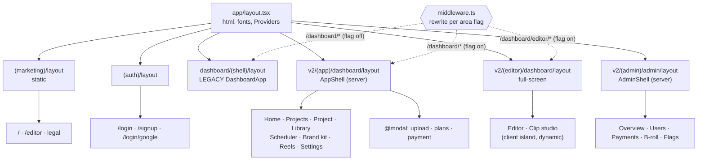
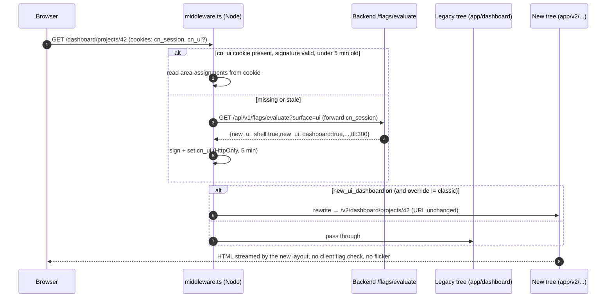
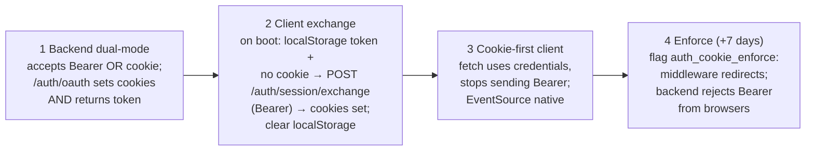
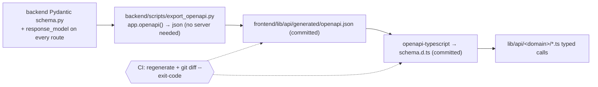
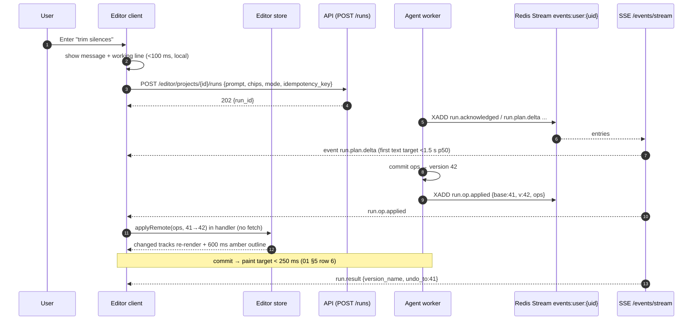
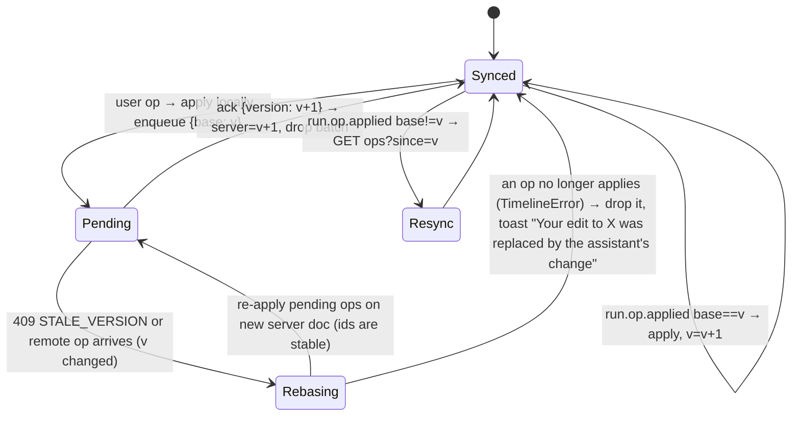
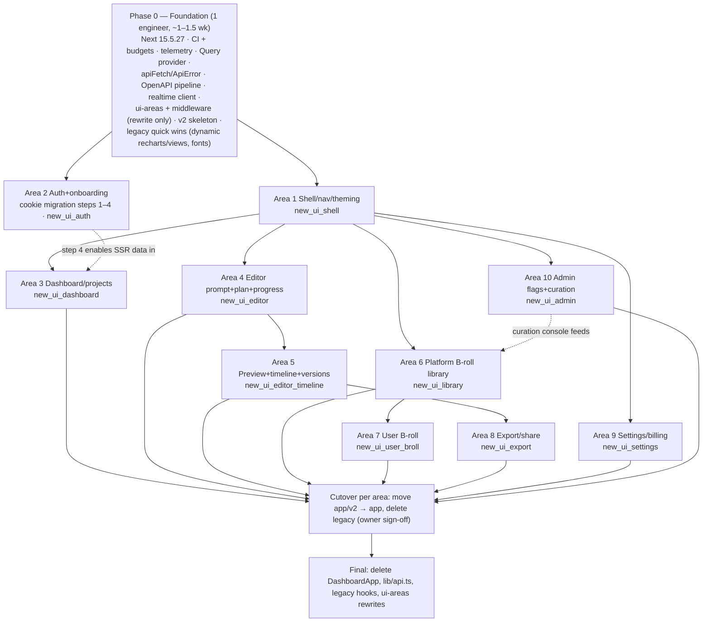

# Clipnera UI revamp: Wave 3 frontend architecture

Date: 3 October 2026. Branch `clipnera` at `38f9bd5`. Author: Frontend Architect (Wave 3).

This document covers the frontend only. The Backend Architect writes [backend.md](backend.md), and the Lead merges both into `04-architecture.md`. It builds on [00-audit.md](../00-audit.md), [01-experience-principles.md](../01-experience-principles.md) and the slice reports in [audit/](../audit/).

Paths are relative to `frontend/` unless they start with `backend/` or `docs/`. No source file was changed to write this. The baseline build ran in a throwaway git worktree that has since been removed.

---

## 0. Summary

| Topic | Decision |
|---|---|
| Framework | Upgrade Next.js `15.1.6` → `15.5.27` before anything else. The pinned version has 33 advisories, 4 of them critical, including a middleware authorization bypass (§6.4). Next 16 can wait until after the revamp. |
| App structure | Real nested layouts with route groups `(marketing)`, `(auth)`, `(app)`, `(editor)`, `(admin)`. `DashboardApp` is frozen and then deleted once every area has rolled out. Every route segment gets `loading.tsx`, `error.tsx` and `not-found.tsx`. |
| Old and new UI side by side | The new UI is built in a parallel tree, `app/v2/...`. `middleware.ts` rewrites each URL to the old or new tree based on per-area flags evaluated on the server, so the URL never changes and nothing flickers. When an area reaches 100%, its files move from `app/v2/` to their final place in one commit. |
| Auth | Move to httpOnly, Secure, SameSite=Lax cookies: a 15-minute access token and a rotating refresh token, with server-side sessions. The API is served on the same origin (path routing at the load balancer). Migration: the backend accepts both cookie and bearer, a one-time exchange turns the localStorage token into cookies, and auth redirects in middleware are only enforced 7 days later, once every old 7-day JWT has expired. |
| Rendering | Marketing and legal pages are static (SSG, with ISR for pricing). The app shell is server-rendered with streamed Suspense boundaries. The editor is a client island loaded with `next/dynamic`. Middleware handles flags and auth redirects only. |
| Data | TanStack Query v5 for server state, plus one typed `fetch` client that throws `ApiError` objects. Wire types are generated from the backend's OpenAPI schema with `openapi-typescript`, the generated file is committed, and CI fails if it drifts. `lib/api.ts` is replaced one domain at a time. |
| Real-time | Server-Sent Events: one stream per signed-in user carrying every job, run, notification and flag event, resumable with `Last-Event-ID` from a Redis Stream cursor. It replaces the four pipeline watchers and nine polling loops. Timeline operations from the agent are applied to the editor store directly in the event handler (target: under 250 ms from server commit to paint). |
| Editor state | An external store (Zustand) built on `lib/editor/timeline.ts`. It holds a pending-op queue that rebases on version conflicts. The playhead is moved by a clock outside React, so playback no longer re-renders the editor every frame. Preview uses fast-seek MP4 proxies composed in the browser, built from the `ReelPreviewPlayer` core. HLS (`hls.js`, lazy-loaded) is used for long sources and share pages. Long lists and the timeline are virtualised. |
| Budgets | LCP < 2.0 s, INP < 200 ms, CLS < 0.1 at p75. Initial JS under 200 KB gzipped on every non-editor route. Enforced by a custom route-budget script (Next's own table under-reports, §6.2), Lighthouse CI and `web-vitals` RUM. |
| Observability | A vendor-neutral `lib/telemetry` facade for errors, vitals, logs and spans. Events are batched to a Next route handler and forwarded over OTLP. Every API call carries an `X-Request-ID`. |
| Migration | Phase 0 (one engineer, foundation) is followed by ten Wave 6 areas working in parallel, each owning its own folders (§8.4). Shared files are written once in Phase 0 and then frozen. |

**Baseline, measured today** (§6.1). Every dashboard URL ships **368 KB gzipped of JavaScript**, while Next's build table reports 106 KB. Recharts alone is about 100 KB gzipped of that, sitting in the dashboard shell. `/admin/overview` ships 238 KB and the landing page 147 KB.

---

## 1. Target app structure

### 1.1 Why the current shape has to go

- `app/dashboard/(shell)/layout.tsx:9-11` renders `<DashboardApp />` and drops `children`. All 13 pages `return null`.
- `DashboardApp` (1,021 lines) is the auth gate (`components/dashboard/DashboardApp.tsx:119`), the data store, the router (`:52-69`), the view switch (`:745-893`) and the modal host. Its static imports (`:6-27`) pull every view into one 513 KB raw / 126 KB gzipped layout chunk (§6.1).
- There is no `middleware.ts`, `loading.tsx`, `error.tsx` or `not-found.tsx` anywhere ([01 §1](../audit/01-foundation-routes.md)).
- Admin chrome is repeated inside each view, so it remounts on every navigation (`app/admin/layout.tsx:3-5`, `components/admin/AdminLayout.tsx:30`).

### 1.2 Target tree

URLs do not change. Route groups (`(name)`) only choose the layout.

```
frontend/
  middleware.ts                         auth redirects + per-area UI rewrites (§1.4, §1.5)
  instrumentation.ts                    server-side telemetry hook (§7)
  app/
    layout.tsx                          <html>, UI fonts via next/font/local, tokens.css, <Providers> shell-free
    global-error.tsx                    last-resort boundary (renders its own <html>)
    not-found.tsx                       branded 404
    providers.tsx                       'use client': QueryClientProvider, FlagsProvider, TelemetryProvider
    api/
      telemetry/route.ts                beacon sink → OTLP (§7)
      ui/override/route.ts              sets the classic/new UI override cookie (§1.5)
    (marketing)/
      layout.tsx                        site header/footer, static
      page.tsx                          /            (static, prompt-first hero is a client island)
      editor/page.tsx                   /editor      (merged into / per audit decision 5; kept as URL)
      privacy|terms|refunds|cookies/    static legal pages
      data-deletion/page.tsx            server page; status box is a client island (?code=)
      unsubscribe/page.tsx              server page; confirm button is a client island (?token=)
    (auth)/
      layout.tsx                        AuthShell
      login/page.tsx                    /login  (+ ?next=)
      signup/page.tsx                   /signup
      login/google/page.tsx             OAuth callback, path registered with Google: DO NOT MOVE
    dashboard/                          LEGACY tree, frozen (bug fixes only), deleted at cutover
      (shell)/...                       unchanged
      connect/[platform]/page.tsx       OAuth return, path registered with YouTube/Meta: kept forever
    admin/                              LEGACY admin tree, frozen
    v2/                                 NEW tree, reachable only through middleware rewrites
      (app)/dashboard/
        layout.tsx                      server: session + flags → <AppShell> (sidebar, header, tab bar)
        loading.tsx  error.tsx  not-found.tsx
        page.tsx                        Home (prompt-first)
        projects/page.tsx               Projects list (canonical; /dashboard/folders maps here)
        projects/[projectId]/page.tsx   Project: progress + clips
        projects/[projectId]/loading.tsx  error.tsx  not-found.tsx
        library/...                     B-roll library (platform + mine)
        scheduler/  brand-kit/  reels/  analytics/  settings/[[...tab]]/
        @modal/(.)upload/page.tsx       intercepted route: upload as a modal, /dashboard/upload as a page
      (editor)/dashboard/
        layout.tsx                      full-screen, no shell; loads editor fonts + caption CSS
        editor/[editorProjectId]/page.tsx  + loading.tsx error.tsx
        projects/[projectId]/edit/[clipId]/page.tsx   clip studio URL, kept
      (admin)/admin/
        layout.tsx                      server: role check + AdminShell (chrome mounted once)
        overview|users|users/[id]|payments|credits|social|usage|broll|features|music/...
```

Three structural rules:

1. **One layout per kind of chrome.** `(app)` has the shell, `(editor)` is full-screen, and `(admin)` has the admin sidebar. Moving between pages that share a layout never remounts it (01 §10: "the shell never re-mounts").
2. **Pages are server components that own their data.** Each `page.tsx` prefetches its queries on the server and passes them through `HydrationBoundary` (§3.6). Interactive parts are client islands. No page returns `null`.
3. **Modals that have a URL are intercepted routes.** Upload, plan selection and payment get a URL (`@modal` slot), so Back closes them and a link can open them. Settings sub-tabs become path segments (`/dashboard/settings/billing`). The existing `?tab=` URL keeps working: middleware redirects it with a 308, because that URL is linked from emails and from the OAuth return (`app/dashboard/connect/[platform]/page.tsx`).



### 1.3 Per-segment `loading`, `error`, `not-found`

| Segment | `loading.tsx` | `error.tsx` | `not-found.tsx` |
|---|---|---|---|
| root | none (marketing is static) | `global-error.tsx`: plain page, "Reload" | branded 404 with a link to `/` or `/dashboard` |
| `(app)/dashboard` | shell-shaped skeleton; the shell itself streams in first, so only the main area shows the skeleton | in-shell error card: what happened, "Try again" (`reset()`), report id | "This page doesn't exist" inside the shell |
| `projects/[projectId]` | project header and grid skeleton | same card; a 403/404 `ApiError` calls `notFound()` instead | "Project not found or you don't have access" with a link to Projects |
| `(editor)/.../[editorProjectId]` | editor frame skeleton (top bar, empty preview, empty timeline) | full-screen error that keeps unsaved pending ops in IndexedDB (§5.2) and offers "Reload editor" | back to the projects list |
| `(admin)/admin` | table skeleton | admin error card | admin 404 |

Every `error.tsx` reports to telemetry with the segment name (§7). Skeletons put `role="status"` on the container only once, which fixes the ~80 duplicate live regions found in P-10 ([01 §6](../audit/01-foundation-routes.md)). They come from the Design System agent's components in `components/ui/`.

### 1.4 Middleware: auth redirects

`middleware.ts` runs on the Node runtime (stable from Next 15.5). Its matcher skips `_next/*`, `api/*`, static files and `icon.svg`. Its jobs, in order:

1. **Block direct `/v2/*` requests** with a 404. The new tree is reachable only through a rewrite.
2. **Legacy redirects (308):** `/dashboard/settings?tab=x` → `/dashboard/settings/x`; `/dashboard/folders` → `/dashboard/projects` (only for users on `new_ui_dashboard`, so that legacy users keep their page); `/admin` → `/admin/overview` (moved here from `app/admin/page.tsx`).
3. **Auth:** if there is no `cn_session` cookie (§1.6) on `/dashboard/**` or `/admin/**`, redirect to `/login?next=<path+query>`. With a session cookie, `/login` and `/signup` redirect to `/dashboard`. This is gated by the server flag `auth_cookie_enforce` (§1.6, step 4); until then, the client guards stay as they are.
4. **UI area rewrite** (§1.5).

**Exempt from the auth redirect:**
- `/login/google`: the OAuth code exchange.
- `/dashboard/connect/[platform]`: the social OAuth return. Redirecting would lose the `code`. The page shows its own error when signed out, as it does today (`app/dashboard/connect/[platform]/page.tsx:39`).
- `/unsubscribe` and `/data-deletion`: these are reached from emails and Meta.
- Every marketing and legal URL.

**Middleware is not the security boundary.** The API authorizes every request, and `(admin)/layout.tsx` checks the role on the server with `/me`. Middleware only stops signed-out users from seeing app chrome before the redirect (P-17).

The existing `Referrer-Policy: no-referrer` headers on the two callback paths (`next.config.mjs:9-21`) are kept. Security headers are added in the same file: CSP with nonces, HSTS, `X-Content-Type-Options`, `frame-ancestors 'none'` and `poweredByHeader: false` (P-24).

### 1.5 Old and new UI per route, behind server-evaluated flags

**Area flags.** One flag per Wave 6 area. They are declared once in Phase 0, in `lib/flags/ui-areas.ts`, and in the backend flag registry.

| Flag | URLs it moves to `app/v2` | Wave 6 area |
|---|---|---|
| `new_ui_shell` | none on its own. It is the parent every other `new_ui_*` flag needs | 1 |
| `new_ui_auth` | `/login`, `/signup`, `/`, `/editor` (the marketing hero with prompt carry-over) | 2 |
| `new_ui_dashboard` | `/dashboard`, `/dashboard/folders` → `/dashboard/projects`, `/dashboard/projects/[id]`, `/dashboard/analytics` | 3 |
| `new_ui_editor` | `/dashboard/editor`, `/dashboard/editor/[id]`, `/dashboard/projects/[id]/edit/[clipId]` | 4 (5 builds inside it) |
| `new_ui_editor_timeline` | none. A sub-flag checked inside the editor client: new timeline, preview and versions | 5 |
| `new_ui_library` | `/dashboard/library` (new URL) | 6 |
| `new_ui_user_broll` | none. A sub-flag inside the library: "My uploads" tab | 7 |
| `new_ui_export` | `/dashboard/scheduler`; the export dialog inside the editor | 8 |
| `new_ui_settings` | `/dashboard/settings/**`, `/dashboard/brand-kit` | 9 |
| `new_ui_admin` | `/admin/**` | 10 |
| `new_ui_reels` | `/dashboard/reels/**` | Lead to assign (proposal: 4) |

Evaluation must be hierarchical: a child is on only if every ancestor is on. Today's one-level check is bug B14 ([02 §8](../audit/02-data-layer.md)), which the backend must fix.

**How a request is routed:**



- **Why no flicker:** the tree is chosen before rendering starts. The same evaluated flags are serialised into `FlagsProvider` by the root layout, so client components read them synchronously on first render. This replaces today's "all off until loaded" pop-in (`hooks/useFeatureFlags.ts`, [02 §7.1](../audit/02-data-layer.md)).
- **Anonymous visitors** (`new_ui_auth` on `/`) are bucketed by an `cn_aid` cookie (random id, first-party, listed in the cookie policy). The backend's `/flags/evaluate` accepts an anonymous id.
- **Kill switch:** the backend publishes `flags.changed` on the event stream (§4). The client calls `POST /api/ui/override?refresh=1` to clear `cn_ui`, then `router.refresh()`. The next navigation is routed under the new flags. The worst case for a tab with no stream connection is the 5-minute cookie TTL.
- **Classic UI escape hatch:** `/api/ui/override?mode=classic|new|auto` sets the `cn_ui_override` cookie, which middleware applies on top of the flags. Support can send a link, and a "Switch to classic" menu item can call it. This keeps the old UI reachable until rollout completes. Whether users see that menu item is an owner question (§9).
- **Crossing areas mid-rollout:** a user on `new_ui_dashboard` but not `new_ui_settings` who clicks Settings goes from the v2 layout to the legacy layout. Next does a full layout swap: the legacy shell mounts and loads its data. That is acceptable during rollout. To keep it rare, areas are rolled out to the same cohorts in order (staff, then 1%, 10%, 50%, 100%), and the shell flag is the parent.
- **Cutover:** when an area is at 100% with no rollback for 14 days, one PR moves its `app/v2/...` files to the final path, removes its row from `ui-areas.ts` and deletes the legacy views it replaced. Deleting legacy UI requires the owner's sign-off under the UI rule in AGENTS.md.

### 1.6 Auth token transport and migration (needs the Backend Architect's agreement)

**Today:** a 7-day bearer JWT in `localStorage['token']`. There is no refresh, logout does nothing on the server, and a 401 clears the token without redirecting (`lib/auth.ts:25`, `lib/api.ts:23-25`, `:541-550`; `backend/core/config.py:34`).

**Decision:** httpOnly cookie sessions.

| Cookie | Contents | Attributes | Lifetime |
|---|---|---|---|
| `__Host-cn_session` | access JWT (`sub`, `sid`, `role`, `exp`) | HttpOnly, Secure, SameSite=Lax, Path=/ | 15 min |
| `__Host-cn_refresh` | opaque refresh token, rotated on every use, reuse detection | HttpOnly, Secure, SameSite=Strict, Path=/ (the `__Host-` prefix forces Path=/) | 30 days sliding |
| `cn_csrf` | random value, readable by JS | Secure, SameSite=Lax | session |

**Why:**
- Removes XSS token theft (S1).
- Lets middleware and server components see the session, which makes server rendering and redirects possible (P-17, S3).
- Server-side sessions (`sid`) make logout and "sign out everywhere" real (S2).
- `EventSource` sends cookies, so the stream can use the native API with built-in `Last-Event-ID` reconnect (§4).

**Topology:** serve the API on the same origin, with `/api/v1/*` routed by the load balancer to FastAPI and everything else to Next. This is what lets us use `__Host-` cookies (no `Domain` attribute), removes CORS, and avoids preflights on every call. If same-origin is not possible, the fallback is `api.<domain>` with `Domain=.<domain>` cookies and `credentials: 'include'`. That fallback loses the `__Host-` prefix and keeps CORS (`backend/core/middleware.py:16-19` already sets `allow_credentials=True`). This is owner question 1.

**CSRF:** SameSite=Lax blocks cross-site POSTs from forms. In addition, every unsafe method must send `X-CSRF-Token` matching the `cn_csrf` cookie (double submit). The fetch client adds it automatically.

**Refresh:** the client calls `POST /api/v1/auth/refresh` when it gets a `401` with code `ACCESS_EXPIRED`. It does this once, with a single in-flight refresh promise shared across all requests, then retries the original request. Middleware never refreshes; it only checks that the cookie exists. Server components that get `ACCESS_EXPIRED` render the client refresher boundary.

**Migration, in four shippable steps:**



- The 7-day JWT lifetime puts a hard limit on the migration. Seven days after step 2 ships, no valid localStorage token can still exist, so step 4 cannot sign out anyone who would not have been signed out anyway.
- Steps 1 to 3 change nothing visible. Step 4 replaces the client guards (`DashboardApp.tsx:119`, `AdminGate.tsx:14`) with middleware redirects.
- Signed-out users now consistently land on `/login?next=` instead of `/` or `/login` depending on the area (00 §3.3).
- Cross-tab sign-out uses `BroadcastChannel('cn-auth')`, which fixes R9.
- The logout endpoint revokes the `sid`.
- Bearer stays available for non-browser clients (CLI, tests) but is not issued to the web app after step 4.

---

## 2. Rendering strategy

| Surface | Mode | Why |
|---|---|---|
| `/`, `/editor`, legal pages | **Static** (SSG). Pricing data uses ISR (`revalidate: 3600`, `GET /subscription/plans` is public) | Fastest possible LCP from the CDN. Today `LandingPageView` is `'use client'` from the top (P-27), so static copy is hydrated for nothing. The new hero, prompt box and pricing toggle are client islands. |
| `/login`, `/signup` | Static shell, client island for Google | No data needed |
| `/login/google`, `/dashboard/connect/[platform]` | Client page (it has to read the code from the URL in the browser and strip it) | Unchanged behaviour |
| `/data-deletion`, `/unsubscribe` | Server page with metadata; the form is a client island | P-28 |
| App shell `(app)/dashboard/layout` | **Dynamic server render** on Node, in the same region as the API. It reads the session, `/me`, entitlements and flags in parallel (`Promise.all`, deduped with `cache()`), then streams sidebar and header HTML. Page content streams in under `Suspense`. | First paint shows real chrome and the user's name, not a skeleton (today the whole page waits for `/me`: `DashboardApp.tsx:734`) |
| Dashboard pages | Server prefetch of the page's queries, then `HydrationBoundary`, then client components with TanStack Query | Data is on screen on first paint and stays live afterwards |
| Editor | Server page fetches the project document. The editor client is loaded with `next/dynamic(() => import(...), { ssr: false, loading: EditorSkeleton })`. | Heavy, interactive, uses media APIs; no value in server-rendering it |
| Admin | Server layout and pages for tables; charts are dynamic islands | Admin views are data tables |

**Edge vs Node.** Only middleware does work on every request. Server components run on Node next to the API, so a cross-region hop to an edge function would make them slower, not faster. Marketing is static and served from the CDN either way. If the frontend is self-hosted on EC2 (the backend deploys there via `update_ec2.sh`), put a CDN in front for `/_next/static/*` and static pages. Where the frontend is hosted is owner question 2.

**Route-level code splitting and dynamic imports.** Required in the new tree; the ones marked "legacy" are also cheap fixes in Phase 0.

| What | Today | Target |
|---|---|---|
| `recharts` (~100 KB gzipped, chunk `7644`) | Static import from `ViralAnalyticsView.tsx:31` and `admin/DailyBarChart.tsx:4`, which pulls it into the dashboard shell | `next/dynamic` chart components, loaded only on analytics and admin overview. **Legacy fix in Phase 0**, invisible to users. |
| Clip studio, Editor, Reels, Scheduler, Settings, BrandKit views | Static imports in `DashboardApp.tsx:6-27` | In the new tree, separate routes split them automatically. In legacy, `next/dynamic` per view inside `DashboardApp` (Phase 0). The only visible change is a loading skeleton on first open, which needs the owner's OK under the UI rule. |
| Modals (Upload, Plan, Payment, CommandPalette, AuthModal) | Always mounted | `next/dynamic`, prefetched on intent (hover or focus of the trigger, `⌘K` keydown) |
| `canvas-confetti` | Static in 3 files | `import('canvas-confetti')` at the moment of celebration |
| `hls.js` | not used | Dynamic, only when `!video.canPlayType('application/vnd.apple.mpegurl')` |
| `captionStyles.generated.ts` (887 lines), emoji catalogue | Pulled in by the studio | Split into editor and brand-kit chunks only |
| Caption fonts (7 `@fontsource` CSS imports in `app/layout.tsx:15-22`, 8 TTF `@font-face` in `globals.css:278-335`) | Font CSS on every page, including legal pages | Imported by the `(editor)` layout and brand kit only. Convert TTF to WOFF2 (2.65 MB → ~0.9 MB). UI fonts move to `next/font/local`, which preloads them and adds fallback metrics to prevent CLS. |
| `framer-motion` | Installed, unused (P-26) | Remove. Motion uses CSS and the Design System tokens. If an orchestrated sequence ever needs it, use `motion/react` with `LazyMotion` (~5 KB). |
| Dev React Grab script from unpkg (`app/layout.tsx:34-40`), Grammarly MutationObserver (`:41-68`) | In root layout | Remove both (P-29, P-30). |

Prefetching: `<Link>` keeps Next's default viewport prefetch for static routes. For dynamic dashboard routes, also call `queryClient.prefetchQuery` on `onPointerEnter`, so data and code arrive together.

---

## 3. Data layer

### 3.1 Choice: TanStack Query v5

| Option | Verdict |
|---|---|
| **TanStack Query v5** (~13 KB gzipped) | **Chosen.** Gives us keyed cache, deduplication, `AbortSignal` per query, retry with backoff, `refetchOnWindowFocus`, `refetchInterval` that pauses in hidden tabs, optimistic mutations with rollback, `HydrationBoundary` for server prefetch, `setQueryData` for pushed events, and devtools. Each of these maps to a problem in [02 §8](../audit/02-data-layer.md) (R3, R5, R6, W3, W4, W6, B5). |
| SWR | Smaller, but weaker mutation and optimistic-update support, no structured query-key invalidation, weaker SSR hydration story |
| RSC fetch + `router.refresh()` only | Not enough for a live, event-driven editor or progress views |
| Redux Toolkit Query | Heavier, and brings Redux for no gain |

Client-only state that is not server data (editor document, playhead, selection, panel layout) goes in small external stores (§5), not React Query and not context.

### 3.2 The client

```
lib/api/
  client.ts        apiFetch<T>(op, {params, body, signal, idempotencyKey}) → T | throws ApiError
  errors.ts        ApiError class + type guards (isPlanError, isStale, isNotFound, ...)
  envelope.ts      unwrap(): {data,message,error} → data; bare body passed through (migration only)
  generated/
    openapi.json   committed; exported from FastAPI
    schema.d.ts    committed; openapi-typescript output
  <domain>/        one folder per backend router, owned by one area (§8.4)
    keys.ts        query-key factory
    queries.ts     queryOptions(...) objects + hooks
    mutations.ts   useMutation hooks with invalidation rules
    mappers.ts     wire → view model (only where needed)
```

What `apiFetch` does:
- Uses the same-origin base `/api/v1`, or `NEXT_PUBLIC_API_URL` and fails loudly at boot if it is unset (E10).
- Sends `credentials: 'include'`, `X-CSRF-Token` on unsafe methods, `X-Request-ID` (uuid v7) on every call, and `Idempotency-Key` when the caller passes one.
- Default timeout of 15 s via `AbortSignal.timeout`, combined with the query's own signal (`AbortSignal.any`, with a small fallback for Safari < 17.4). Uploads and exports pass their own longer timeouts.
- Parses JSON safely. A non-JSON error body becomes `ApiError{code:'BAD_RESPONSE'}`, not `{}` (E4).
- Handles 401 `ACCESS_EXPIRED` with one shared refresh, then retries once. Any other 401 means the session is gone: it clears the query cache and sends the user to `/login?next=` (fixes B4, where only one call site handled 401).
- On plan error codes, still dispatches `clipnera:upgrade-required`. This is kept on purpose: it is "a genuinely good mechanism" ([02 §7.2](../audit/02-data-layer.md)).

Types come from `openapi-fetch`-style path typing over `schema.d.ts`: `apiFetch('/editor/projects/{project_id}/ops', 'post', ...)` checks params, body and response at compile time. We use our own ~2 KB wrapper rather than the `openapi-fetch` runtime, so that error, refresh and telemetry logic stays in one file.

### 3.3 Typed errors

```ts
// lib/api/errors.ts
export class ApiError extends Error {
  status: number;            // HTTP status, 0 for network failure
  code: string;              // backend error code: 'STALE_VERSION', 'LIMIT_REACHED', 'VALIDATION', 'NETWORK', 'TIMEOUT', ...
  feature?: string;          // plan/flag errors
  retryAfter?: number;       // seconds, from Retry-After
  fields?: Record<string, string[]>; // 422 field errors
  requestId: string;
}
```

This replaces string matching:

| Today | After |
|---|---|
| `err.message.startsWith('Unauthorized:')` (`DashboardApp.tsx:371`) | handled centrally in `apiFetch` |
| `err.message.includes('No active pipeline')` (`DashboardApp.tsx:504`) | `err.code === 'NO_ACTIVE_PIPELINE'` |
| `err.message === 'Session expired'` (`hooks/useNotificationInbox.ts:90`) | stream client handles 401 (§4) |
| Editor `409 STALE_VERSION` cannot be detected (E8) | `isStale(err)` → rebase (§5.2) |

User-facing copy comes from one map, `lib/api/messages.ts` (code → plain sentence plus one next action, as 01 §8 requires). Server `message` text is a fallback only.

**Backend dependency:** handlers for `RequestValidationError` (422) and `HTTPException` that return the same error envelope `{data:null, message, error:<CODE>, details?}`. Without them, 422s keep showing "Something went wrong" (C3).

### 3.4 Query keys, cache times, retries

Keys follow `[domain, scope, ...params]`. Each domain's `keys.ts` exports a factory:

```ts
export const projectKeys = {
  all:     ['projects'] as const,
  lists:   () => [...projectKeys.all, 'list'] as const,
  list:    (ws: string, f: ProjectFilter) => [...projectKeys.lists(), ws, f] as const,
  detail:  (id: string) => [...projectKeys.all, 'detail', id] as const,
  clips:   (id: string) => [...projectKeys.detail(id), 'clips'] as const,
};
```

The whole cache is cleared on sign-out and on user switch. This fixes R4: today, flag and catalogue caches survive a user switch in the same tab.

| Data | Key root | `staleTime` | `gcTime` | Live updates |
|---|---|---|---|---|
| Session user `/me` | `['me']` | 5 min | 30 min | `entitlements.changed`, `profile.changed` events |
| Entitlements / access | `['access']` | 60 s | 30 min | `entitlements.changed` event (replaces the 30 s pending-payment poll, `EntitlementsProvider.tsx:77`) |
| Flags (client copy) | `['flags']` | Infinity; seeded from server | — | `flags.changed` event |
| Projects list | `['projects','list',ws,filter]` | 30 s | 5 min | `job.*` events patch rows with `setQueryData` |
| Project detail and clips | `['projects','detail',id]` | 30 s | 5 min | `job.*` and `clip.*` events |
| Job / pipeline status | `['jobs',id]` | Infinity while streaming | 5 min | `job.progress`, `job.status` (§4) |
| Editor project document | `['editor','project',id]` | Infinity | 10 min | owned by the editor store (§5); the cache holds the last server-acked snapshot |
| Versions | `['editor','project',id,'versions']` | 30 s | 10 min | `run.result` and `version.created` events |
| Static catalogues (hook transitions, caption styles, plans) | `['catalog',name]` | Infinity | Infinity | — |
| Notifications | `['notifications']` | 60 s | 30 min | `notification.created` |
| B-roll search | `['broll','search',scope,q,filters]` | 5 min | 10 min | — |
| Admin tables | `['admin',resource,params]` | 15 s | 5 min | — |

Default options for queries:
- `retry`: up to 2 times for `NETWORK`, `TIMEOUT`, 5xx and 429 (waiting `retryAfter` when set); never for other 4xx.
- `retryDelay`: exponential with jitter, capped at 10 s.
- `refetchOnWindowFocus` is on for lists and `['access']`, off for the editor.
- `refetchInterval` is used only as a fallback when the event stream is down (§4.3), and only while the tab is visible (fixes W6).

Mutations:
- No automatic retry.
- Mutations that spend credits or create things (pipeline start, render, AI shot, payment, export) send an `Idempotency-Key` generated when the action is triggered. They also disable their trigger while pending, which fixes the ⌘E double export (05 B2) and the double-click spends in S7.
- Every mutation declares what it invalidates in `mutations.ts`. Components never decide that.

Request deduplication is built into the query cache. The `/me` × 3, `/social/connections` × 4 and `/creator-intro` × 3 fetches found in W4 collapse to one each.

### 3.5 Optimistic updates

| Action | Pattern |
|---|---|
| Timeline op (hand edit) | Editor store, not React Query: apply locally with `applyOps`, queue, send, rebase on conflict (§5.2) |
| AI edit undo / restore version | Optimistic insert into `versions` with `status:'pending'`; the store moves to that version's document when the server confirms; rollback on error |
| Rename project, mark notifications read, dismiss notice, flag toggle (admin) | `onMutate` snapshot → `setQueryData` → `onError` restore → `onSettled` invalidate (fixes R6, which has no rollback) |
| Pipeline start, export, render | Not optimistic. The job appears from the mutation response and then the stream takes over |

### 3.6 Server prefetch and hydration

```ts
// app/v2/(app)/dashboard/projects/[projectId]/page.tsx (server)
const qc = getQueryClient();                       // per-request, React cache()
await Promise.all([
  qc.prefetchQuery(projectQueries.detail(id)),     // server apiFetch forwards cookies
  qc.prefetchQuery(projectQueries.clips(id)),
]);
return <HydrationBoundary state={dehydrate(qc)}><ProjectView id={id} /></HydrationBoundary>;
```

Server `apiFetch` uses `cookies()` and an internal base URL, and sets `cache: 'no-store'` for user data. Public data uses `next: { revalidate }`. This needs the cookie migration (§1.6). Before step 3 of the migration, pages fall back to client-only fetching behind `loading.tsx`.

### 3.7 Migrating `lib/api.ts` incrementally

`lib/api.ts` today: 2,593 lines, 133 methods, 174 exported types, three wrappers (`request` `:163`, `authedRequest` `:524`, `envelopeRequest` `:1459`).

1. **Phase 0:** add `lib/api/client.ts`. The legacy wrappers are re-implemented on top of `apiFetch`: same signatures, same thrown `Error` messages for compatibility, but they now throw `ApiError`, which extends `Error`. Every legacy call immediately gets the request id, timeout, refresh, CSRF and network-error handling with no call-site changes. This is the only edit to `lib/api.ts` after Phase 0 other than bug fixes.
2. **Per domain:** the area that owns a domain creates `lib/api/<domain>/` on generated types. New UI imports only from there. Legacy views keep importing `lib/api.ts`.
3. **Deletion:** at an area's cutover, its section of `lib/api.ts` and its types are deleted along with the legacy views. The 18 dead methods (§1.20 of [02](../audit/02-data-layer.md)) are deleted in Phase 0. The file reaches zero at final cutover.
4. **View models:** `mapBackendClip` and the prototype fields in `ViralClip` and `VideoProject` (M4) are not carried over. New code renders wire types or slim mappers, and mappers with no source field are rejected in review.

### 3.8 Generated types from OpenAPI (needs the Backend Architect's agreement)

The AGENTS.md rule is "Request/response types on frontend must exactly match the backend schema". Generation is the only way to guarantee that across 133 methods. The repo already does this for caption styles and the emoji catalogue, and shares fixtures for timeline ops ([02 §6.5](../audit/02-data-layer.md)).



- **Generated, not hand-written.** Hand-written types are allowed only for view models and the Timeline model. `lib/editor/timeline.ts` stays hand-mirrored because it is import-free for Node tests and verified by shared fixtures. A CI check also compares its `TimelineOp` union with the OpenAPI schema's op union.
- **Backend prerequisites:**
  - `response_model` on every route, including those that have none today: `/clips/*`, `/pipeline/*`, `/analytics/dashboard`, `/audio/presets` (C5).
  - Typed bodies instead of `body: dict` (`backend/pipeline/route.py:17`, `:33`, `:49`).
  - Stable `operationId`s through FastAPI's `generate_unique_id_function` (`<router>_<function>`).
  - The `{data, message, error}` envelope on every route.
- **Envelope migration:** `envelope.ts` unwraps by response schema. If the operation's schema is `ApiResponse_*`, it unwraps; otherwise it passes the body through. When the backend finishes enveloping, the pass-through branch is deleted.
- **Contract tests:** run a Prism mock server from `openapi.json` in CI for Lighthouse and E2E on signed-in pages (§6.3).

---

## 4. Real-time

### 4.1 Choice: SSE, one stream per user

| | SSE | WebSocket |
|---|---|---|
| Direction we need | Server → client. Prompts, ops and cancels are ordinary POSTs. | Bidirectional (unused) |
| Reconnect and resume | Built in: `retry:`, `Last-Event-ID` header sent automatically by `EventSource` | Hand-written |
| Auth | Cookie sent automatically once §1.6 lands | Cookie on upgrade; needs its own reauth |
| Infra | Plain HTTP/2 through the load balancer, CDN bypass, existing FastAPI `StreamingResponse` code (`backend/pipeline/route.py:29`, `backend/notifications/service.py:53-61`) | Sticky sessions, upgrade support, separate scaling |
| Multiplexing | Many streams share one HTTP/2 connection | One socket |

**Decision: SSE.** WebSocket becomes worth it only if we add real-time multi-user co-editing, which is not in the revamp's scope.

The connection limit only matters on HTTP/1.1, so the load balancer must serve HTTP/2. On top of that, the client uses Web Locks leader election: one tab per browser profile holds the stream and fans events out over `BroadcastChannel('cn-events')`. With 1M users this keeps open connections at about one per active browser rather than one per tab.

### 4.2 Stream contract (proposal for backend.md)

`GET /api/v1/events/stream` gives the signed-in user's events across all projects. The client filters by topic.

```
id: 1727950000123-4            ← Redis Stream entry id of events:user:{uid}
event: run.op.applied
data: {"v":1,"topic":"run:7f3","project_id":"p1","run_id":"7f3","seq":12,"ts":"2026-10-03T09:00:00.123Z",
       "data":{"base_version":41,"version":42,"ops":[...],"step_id":"s2","summary":"Trimmed 3 silences"}}
```

| Type | Topic | Payload essentials | From |
|---|---|---|---|
| `run.acknowledged`, `run.plan.delta`, `run.question`, `run.step.started`, `run.step.progress`, `run.op.applied`, `run.check`, `run.result`, `run.failed`, `run.paused` | `run:{id}` | as listed in 01 §13 Wave 3; `seq` monotonic per run | agent runtime (`backend/agent_runtime/loop.py` `AgentEvent`, mapped) |
| `job.progress`, `job.status` | `job:{id}` | kind (`ingest`, `pipeline`, `render`, `export`, `reel`, `intro`, `ai_shot`), step, pct, eta, terminal status | workers |
| `version.created` | `project:{id}` | version, name, author, run_id | editor service |
| `notification.created` | `user` | the `InAppNotificationResponse` shape | notifications |
| `entitlements.changed`, `flags.changed`, `session.revoked` | `user` | none or keys | billing, flags, auth |
| `resync` | `user` | `{reason:'cursor_expired'}` | stream server |

- **Resume:** the server reads from `Last-Event-ID` with `XREAD`. The per-user stream is capped (`MAXLEN ~ 2000`, TTL 24 h). If the cursor is older than the cap, the server sends `resync`, and the client invalidates `['jobs']`, `['projects']`, `['editor', ...]` and `['notifications']`. This generalises the "reconnect then reload the list as the source of truth" logic in `useNotificationInbox` ([02 §4.6](../audit/02-data-layer.md)), which is the best real-time code in the app today.
- **Heartbeat:** the server sends a `: ping` comment every 15 s and `retry: 2000`. If 45 s pass without bytes, the client reconnects with backoff (2 s → 60 s, with jitter), as `useNotificationInbox` does today.
- **Server push, not polling:** today's pipeline SSE re-reads state once a second (`backend/pipeline/service.py:1789-1798`). The 250 ms budget needs publish-on-commit. Backend agreement item.

### 4.3 Client

```
lib/realtime/
  stream.ts        connect/reconnect/leader election/broadcast; exposes subscribe(topicPattern, handler)
  router.ts        type → domain handler registry
  handlers/
    jobs.ts        job.* → setQueryData(['jobs',id]) + patch project list/detail rows
    runs.ts        run.* → editor run store (§5) ; run.op.applied → editor store applyRemote()
    notifications.ts  notification.created → prepend + snackbar
    access.ts      entitlements.changed → invalidate ['access'],['me'] ; flags.changed → refresh ui cookie
  useJob.ts        useJob(id): reads ['jobs',id]; starts fallback polling only while stream is down
```

The four pipeline watchers (SSE plus 2 s, 3 s and 5 s polls, R1) and the other polling loops (W1, the 500 ms download poll; reels at 2 s; footage reels at 2.5 s; intro; B-roll; scheduler; entitlements) all become `useJob(id)` or a pushed query. Fallback polling is a single 5 s `refetchInterval`, used only while the stream is disconnected and the tab is visible. It stops on terminal status, which fixes B5's poll that never stops.



---

## 5. Editor client architecture

### 5.1 State model

The editor is `components/editor/EditorClient.tsx`, dynamically imported. It holds four stores. Each is a Zustand vanilla store (~1 KB) read through `useStore(store, selector)`, so components re-render only when their slice changes.

| Store | Holds | Writes come from |
|---|---|---|
| `docStore` (`lib/editor/store.ts`) | `server: {timeline, version}`, `pending: PendingBatch[]`, derived `view` = `applyOps(server.timeline, pending.flatMap(b => b.ops))` | user edits, `run.op.applied`, acks |
| `runStore` | active run, queued prompts, steps, plan text, question, locks per item id | `run.*` events, user actions |
| `selectionStore` | selected items, range, chips for the prompt bar | user |
| `playback` (`lib/editor/playback/clock.ts`) | **not React state**: `time` in a mutable clock with a subscribe/emit API | rAF loop |

`lib/editor/timeline.ts` stays the single source of operation semantics. It is pure and fixture-tested against `backend/editor/fixtures/timeline_ops.json`. The store never mutates a timeline except through `applyOps`.

### 5.2 Pending ops, versions and rebase



- Batches are sent one at a time, in order, each carrying `base_version` equal to the last acked version. This fixes 05 B11, where two edits shared a base version and the rollback used a stale snapshot.
- Ops address items by id. That makes rebasing a matter of re-applying them, and `applyOps` already throws a `TimelineError` with a code when an op cannot apply.
- Items the active run has locked (01 §5 "While it works") reject hand ops in the UI before they are queued.
- Unacked pending batches are written to IndexedDB (`idb-keyval`, ~0.6 KB) so a crash or reload does not lose them. On load they are rebased against the server version.
- **Versions:** the server groups the ops of a run into one version, so "one prompt, one version" holds. Undo of an AI edit is `POST .../versions/{v}/restore`, which creates a new version (01 §7: nothing is deleted). Hand edits are grouped into a version after 5 s idle or when leaving the editor. Viewing an old version loads `GET .../versions/{v}` into a read-only `previewDoc`; the live doc is untouched.
- **Backend needs:**
  - `run_id` and `name` on the `EditorOp` grouping (today one row per batch, `backend/editor/service.py:57-79`).
  - `GET /editor/projects/{id}/ops?since=v`
  - `GET .../versions`, `GET .../versions/{v}`, `POST .../versions/{v}/restore`
  - `POST .../runs`, `POST .../runs/{id}/cancel`, `POST .../runs/{id}/answer`

### 5.3 Fixing the per-frame re-render

Today `currentTime` is top-level React state, set on every animation frame (`components/dashboard/VideoEditorStudio.tsx:341-362`). That re-renders the top bar, transcript, timeline, canvas and inspector 60 times a second (05 P1, plus P2: every slider tick re-renders all of `DashboardApp`).

The target:
- **Playhead line and time ruler:** a ref subscribes to the clock and writes `style.transform = translateX(...)` directly. No React render.
- **Timecode text:** subscribes with a 100 ms throttle and writes `textContent`.
- **Active caption word, transcript highlight:** a selector over the clock gives the active word index and emits only when the index changes, a few times per second. Only the two affected word spans re-render, because they are memoised rows.
- **Preview canvas:** the video elements are the clock (§5.4). Overlays (captions, text items) render from `useClockFrame(fps)` inside the preview subtree only.
- **Transport and inspector:** never subscribe to time.
- **Document edits** update `docStore`. No parent re-renders, because there is no prop drilling from a shell.
- **Lint:** an ESLint rule bans `useState` for time in `components/editor/**`.

### 5.4 Preview: proxy playback built on `ReelPreviewPlayer`

`components/dashboard/ReelPreviewPlayer.tsx` already plays a compiled timeline from small proxies, with one muted picture element, one voice element and music underneath, and syncs on item boundaries (`:28-70`). We extract its core into a framework-free engine and generalise it to Timeline v1:

```
lib/media/
  engine.ts        PreviewEngine(timeline, assetUrls): play/pause/seek/rate; owns the clock
  scheduler.ts     per-track look-ahead: for item boundary at t+Δ, preload next source into a standby element
  pool.ts          2 <video> elements per visual track (A/B swap for gapless cuts), 1 <audio> per audio track
  overlays.ts      text/caption/transform/keyframe evaluation at frame f (pure; shared with the transcript)
  hls.ts           lazy hls.js attach when needed
```

- **Gapless cuts:** each visual track has an A/B element pair. The next clip is loaded and seeked about 500 ms ahead into the hidden element, then swapped at the boundary with `requestVideoFrameCallback` where available.
- **Proxies (backend):** 540p MP4 (H.264, AAC), a keyframe every 0.5 s for fast scrubbing, `faststart`, created at upload (01 §6). Plus a storyboard sprite and VTT for hover scrub and the timeline film strip. These replace the tiled poster (05 §6 "film strip is the poster tiled"), and a real waveform peaks JSON replaces the fake waveform.
- **HLS** is for long sources (the source monitor, over 10 min), share pages and render previews. Use native HLS on Safari, `hls.js` elsewhere. It is not used for composed editor playback, where MP4 proxies seek faster.
- **Quality swap:** when the full-quality render is ready, it is cross-faded on the same frame (01 §10), with a "Preview quality" badge until then.
- **Error states:** `onerror` on every element. If a signed URL has expired (05 B10), the engine re-fetches the asset URLs (`['editor','assets',id]`) and resumes.

### 5.5 Virtualisation

| Surface | Technique |
|---|---|
| Timeline | Horizontal windowing by time: render only items intersecting `[viewStart − margin, viewEnd + margin]`, found with a sorted interval index per track. Waveform and thumbnail strips are drawn on `<canvas>` per visible tile (256 px), cached as `ImageBitmap`. Words in the speech lane are drawn on canvas, not as 1 span per word (05 §6). Zoom changes the scale factor; it does not widen the DOM. |
| Transcript | `@tanstack/react-virtual` over segments (variable height, measured) |
| Asset and B-roll grids, projects, clip grids | `@tanstack/react-virtual` grid. Hover video is mounted only on intersection and hover; otherwise a poster. Fixes 05 P4: 30 `<video preload>` elements per project. |
| Admin tables | Server pagination plus virtual rows over 200 rows |

### 5.6 Editor bundle shape

The route shell (top bar, empty frames) loads first. These load as separate chunks:

- `EditorClient`
- `PreviewEngine`
- timeline canvas renderer
- prompt panel
- inspector panels (one chunk per panel, loaded on first open)
- caption fonts and styles
- `hls.js` (only when needed)

Editor budget: initial JS ≤ 300 KB gzipped (route plus shell). Interactive ≤ 450 KB gzipped after the first panel opens.

---

## 6. Performance budgets and CI

### 6.1 Baseline (measured 3 Oct 2026, `38f9bd5`)

How it was measured:
1. `git worktree add` into the scratchpad, `npm ci`, `next build` (Next 15.1.6). The build succeeded, with three lint warnings in `DashboardApp.tsx:384`, `:485` and `UploadModal.tsx:152`.
2. Per-route size computed from `.next/app-build-manifest.json`: root main files + the root layout + every ancestor layout + the page's chunks, each gzipped at level 9. Polyfills excluded.

**Next's own "First Load JS" column leaves out layout chunks for these routes. It reports 106 KB for every dashboard URL, while the real figure is 368 KB.** This is why CI must use our script (§6.3) and not the build table.

| Route | Initial JS gz (real) | Next table says | Budget | Over by |
|---|---|---|---|---|
| All 13 `/dashboard/**` URLs (one shell bundle) | **368 KB** (1,356 KB raw) | 106 KB | 200 KB | **+168 KB** |
| `/admin/overview` | **238 KB** | 240 KB | 200 KB | +38 KB |
| `/` (landing) | 147 KB | 148 KB | 130 KB (marketing) | +17 KB |
| `/admin/users`, `/admin/users/[id]`, `/admin/payments`, `/admin/social`, `/admin/credits`, `/admin/broll`, `/admin/usage`, `/admin/features` | 129–133 KB | 128–132 KB | 200 KB | — |
| `/data-deletion`, `/login/google`, `/dashboard/connect/[platform]`, `/unsubscribe` | 126–127 KB | 123–127 KB | 130 KB | — |
| `/editor` (marketing) | 119 KB | 118 KB | 130 KB | — |
| `/login`, `/signup` | 112 KB | 112 KB | 130 KB | — |
| `/privacy`, `/terms`, `/refunds`, `/cookies`, 404 | 110–111 KB | 107–109 KB | 120 KB | — |
| Shared framework baseline (React, Next runtime) | 106 KB | 106 KB | — | — |
| CSS (all routes, one bundle) | 19 KB gz (119 KB raw) | — | 30 KB | — |

Largest chunks:

| Chunk | Raw | Gzipped | What |
|---|---|---|---|
| `app/dashboard/(shell)/layout` | 513 KB | 126 KB | every dashboard view, statically imported |
| `7644` | 353 KB | 100 KB | recharts + its redux/immer, pulled into the dashboard shell and admin overview |
| `4bd1b696` | 163 KB | 52 KB | react-dom |
| `1517` | 196 KB | 50 KB | Next runtime |

**What this means.** The framework floor is 106 KB, which leaves about 94 KB of app JS per non-editor route under the 200 KB budget. Two Phase 0 legacy fixes, dynamic recharts and dynamic views inside `DashboardApp`, are expected to bring `/dashboard` from 368 KB to roughly 200–230 KB with no redesign. That is an estimate, to be confirmed by the first CI run.

**Not measured here:** Core Web Vitals. There is no deployed environment to test, and signed-in pages need a backend. The first Lighthouse CI run (§6.3) records the lab baseline. RUM (§7) records field data from the first deploy that includes it.

### 6.2 Budgets

| Metric | Target (p75, mobile, field) | Lab gate (Lighthouse CI, mobile preset) |
|---|---|---|
| LCP | < 2.0 s | < 2.0 s marketing, < 2.5 s app (lab throttling is harsher than field) |
| INP | < 200 ms | TBT < 200 ms (lab proxy) |
| CLS | < 0.1 | < 0.1 |
| Initial JS, non-editor routes | ≤ 200 KB gz | script gate, hard fail |
| Initial JS, marketing and legal | ≤ 130 KB gz | script gate, hard fail |
| Initial JS, editor route | ≤ 300 KB gz | script gate, hard fail |
| CSS | ≤ 30 KB gz | script gate |
| Per-route growth | ≤ +5 KB gz per PR without a `perf-budget-override` label | script gate, warn then fail |
| Fonts on first paint | ≤ 2 files preloaded | Lighthouse `resource-summary` |

### 6.3 Tools and the exact CI checks

There is no CI in the repo today (no `.github/`). Phase 0 adds `.github/workflows/frontend.yml`, triggered on PRs that touch `frontend/**` or `backend/**/schema.py`/`route.py`:

| Job | Command | Fails when |
|---|---|---|
| `typecheck` | `npx tsc --noEmit` | any type error |
| `lint` | `npx next lint --max-warnings 0` | any warning. Today there are 3, which Phase 0 fixes. Also re-enables `@next/next/no-img-element` (P-20) and adds a rule against `useState` for time in the editor |
| `unit` | `npm test` (`node --test lib/`, including the timeline fixtures) + `vitest run` for stores, client and handlers | any failure |
| `contract` | `python backend/scripts/export_openapi.py > frontend/lib/api/generated/openapi.json && npx openapi-typescript ... && git diff --exit-code frontend/lib/api/generated` | backend changed without regenerated types |
| `build` | `NEXT_DIST_DIR=.next-ci next build` (the dist dir override already exists, `next.config.mjs:8`) | build fails |
| `route-budgets` | `node scripts/route-budgets.mjs --budgets perf-budgets.json --baseline origin/clipnera` (the §6.1 method as a script: layouts included, gzip, per route) | any route over its budget, or over +5 KB without the override label. Posts a table as a PR comment. |
| `analyze` (manual or label) | `ANALYZE=true next build` with `@next/bundle-analyzer` | none; uploads treemaps as artifacts |
| `lighthouse` | `@lhci/cli autorun` against `next start`: `/`, `/login`, `/privacy`, and `/dashboard`, `/dashboard/projects/demo`, `/dashboard/editor/demo` with a test session cookie against a **Prism mock** of `openapi.json` with example fixtures; 3 runs each, median | assertions in `lighthouserc.json` (§6.2 lab column) |
| `e2e` (Wave 7) | Playwright, same mock, plus flag-matrix runs: each `new_ui_*` on and off | broken legacy or new route; every URL in §1.2 must return 200 or the expected redirect |
| `audit` | `npm audit --omit=dev --audit-level=high` | any high or critical advisory |

Why a custom script rather than `size-limit`: size-limit measures files or entry points, not App Router routes with their layout chain. The script reads `app-build-manifest.json` and is about 60 lines. `size-limit` is still useful for one thing, a package-level check on `lib/` so that new dependencies show their cost.

### 6.4 Next.js 15.1.6 advisories (`npm audit --omit=dev`, 3 Oct 2026)

- **Totals:** 3 vulnerable packages: `next` (critical), `postcss` (high, nested in `next`) and `sharp` (high, libvips and libheif CVEs).
- **`next@15.1.6` alone:** 33 advisories, of which 4 are critical, 11 high, 15 moderate and 3 low.
- **Fix:** `next@15.5.27`, the latest 15.x, which `npm audit` itself suggests. Not a semver-major change. Also bump `eslint-config-next` to match.

Critical and most relevant:

| Advisory | Severity | Fixed in | Why it matters here |
|---|---|---|---|
| GHSA-f82v-jwr5-mffw Authorization bypass in middleware | critical | 15.2.3 | **Blocks our middleware plan** until we upgrade |
| GHSA-9qr9-h5gf-34mp RCE in React flight protocol | critical | 15.1.9 | We are moving to server components |
| GHSA-2xp9-vwfh-vxw4 RCE in Image Optimization with AVIF | critical | 15.5.24 | Relevant once `next/image` is adopted |
| GHSA-p293-qw3h-jr36 RCE on Windows-hosted servers | critical | 15.5.24 | Not our platform; fixed anyway |
| GHSA-67rr-84xm-4c7r, GHSA-mwv6-3258-q52c, GHSA-h25m-26qc-wcjf, GHSA-q4gf-8mx6-v5v3, GHSA-8h8q-6873-q5fj | high (DoS) | ≤ 15.5.16 | server components and cache |
| GHSA-c4j6-fc7j-m34r, GHSA-89xv-2m56-2m9x, GHSA-p9j2-gv94-2wf4 | high (SSRF) | ≤ 15.5.21 | rewrites and server actions |

Upgrade path: bump to 15.5.27, run `tsc`, lint and the build, then smoke-test both OAuth callbacks. The 15.2 to 15.5 changes that affect this code are minor; the app has no `next/image` and no server actions today. Next 16 renames `middleware` to `proxy`; evaluate it after Wave 6.

---

## 7. Frontend observability

One facade, `lib/telemetry/`, with no vendor SDK in the bundle (~3 KB):

```ts
telemetry.error(err, { segment, requestId, runId })   // error boundaries, window.onerror, unhandledrejection
telemetry.vital(metric)                                 // web-vitals attribution build
telemetry.log(level, event, fields)                     // structured: {ts, level, event, route, release, session_hash, ...fields}
telemetry.span(name, fn)                                // timing for prompt→ack, ack→first plan text, op event→paint
```

| Concern | Design |
|---|---|
| Transport | Batched in memory. Flushed every 5 s or at 20 events, and on `visibilitychange: hidden` using `navigator.sendBeacon('/api/telemetry')` (Next route handler) |
| Sink | `app/api/telemetry/route.ts` validates the payload, strips PII, adds geo and user agent, and forwards as OTLP/HTTP logs and metrics to a collector. The vendor is chosen at the collector (Grafana stack, Honeycomb, Sentry, Datadog), not in the app. Owner question 4. |
| Errors | `error.tsx` in every segment, plus `global-error.tsx`, call `telemetry.error`. Hidden source maps (`productionBrowserSourceMaps: false`, with maps uploaded at build to the collector's symbolication store and never served publicly). Errors are grouped by message and top frame. |
| Web vitals | `useReportWebVitals` (`next/web-vitals`) with `web-vitals/attribution`. Records LCP element, INP interaction target and CLS sources, tagged with the route **pattern** (`/dashboard/projects/[projectId]`, never ids) and the `new_ui_*` flags active. That tagging lets RUM compare old and new UI per area. |
| Prompt latency (01 §5) | Custom spans: `prompt.ack` (send to local echo, under 100 ms), `prompt.first_text` (under 1.5 s p50), `op.paint` (event `ts` to painted, under 250 ms), `preview.ready` (last op to proxy playing, under 2 s). These are reported as metrics, and Wave 7 measures them. |
| Correlation | `X-Request-ID` on every API call, logged by the backend. Telemetry events carry the last request id, `run_id` and `release` (git sha). |
| Privacy | No prompt text, file names or emails in telemetry. The user id is HMAC-hashed. Sampling: errors 100%, vitals 100% (they are small), logs at `info` 10%. Respects the cookie policy, so the policy text needs one line added (owner). |
| Rollout gates | A flag ramp advances only when, for that area, error rate ≤ legacy + 0.1 pp, p75 LCP, INP and CLS are within budget, and the prompt spans are within their targets. Dashboards and alerts are defined in the collector. |

---

## 8. Migration plan

### 8.1 Order



Areas 3, 4, 6, 9 and 10 can start in parallel once the Area 1 shell layout and nav are merged, about one week into Area 1. They can build against the Phase 0 v2 skeleton layout earlier. Area 2's cookie steps 1–3 run alongside everything, and step 4 is time-gated (+7 days).

### 8.2 Phase 0 steps (each is a separate PR, each shippable on its own)

| # | Step | User-visible change |
|---|---|---|
| 0.1 | Upgrade `next` to 15.5.27 and `eslint-config-next`; fix the 3 lint warnings | none |
| 0.2 | Add `.github/workflows/frontend.yml`, `scripts/route-budgets.mjs`, `perf-budgets.json` (budgets set at today's numbers + 5 KB first, then lowered step by step), `lighthouserc.json` | none |
| 0.3 | Install all Wave 6 dependencies in **one** `package.json` change: `@tanstack/react-query`, `@tanstack/react-virtual`, `zustand`, `web-vitals`, `idb-keyval`, `hls.js`; dev: `openapi-typescript`, `@next/bundle-analyzer`, `@lhci/cli`, `@stoplight/prism-cli`, `vitest`. Remove `framer-motion`. | none |
| 0.4 | `lib/telemetry/*`, `app/api/telemetry/route.ts`, `instrumentation.ts`, root `global-error.tsx` and `not-found.tsx` | branded 404 instead of Next's default (owner OK) |
| 0.5 | `lib/api/client.ts`, `errors.ts`, `envelope.ts`, `messages.ts`; legacy wrappers in `lib/api.ts` rebuilt on `apiFetch`; delete the 18 dead methods | 401 now redirects to sign-in instead of leaving a dead page (B4) |
| 0.6 | OpenAPI pipeline: `backend/scripts/export_openapi.py` (backend PR), `lib/api/generated/*`, CI `contract` job | none |
| 0.7 | `app/providers.tsx` (QueryClient, FlagsProvider, Telemetry), mounted in root layout | none |
| 0.8 | `lib/realtime/*` behind `realtime_v2` flag (used by v2 only) | none |
| 0.9 | `lib/flags/ui-areas.ts` (the full area table from §1.5, written once), `middleware.ts` (v2 block, rewrites, legacy 308s; auth rules present but disabled), `app/api/ui/override/route.ts` | none while all flags are off |
| 0.10 | `app/v2/(app)/dashboard/layout.tsx` placeholder, `(editor)` and `(admin)` layouts, `loading/error/not-found` per segment, built on Design System `components/ui/*` | none (flags off) |
| 0.11 | Legacy quick wins: `next/dynamic` for recharts charts, for heavy views inside `DashboardApp`, and for modals and confetti; caption fonts moved out of the root layout into the views that need them | loading skeleton on first open of a heavy view: **needs owner confirmation** |

### 8.3 Per-area work, mapped to Wave 6

| Area | Flag | Builds | Retires (at cutover, with owner sign-off) |
|---|---|---|---|
| 1 Shell, nav, theming | `new_ui_shell` | `AppShell` (server layout, sidebar, header, tab bar, command palette as `/go`, activity indicator from `job.*`), theme switch on Design System tokens (dark first, light later per audit decision 7), `@modal` slot host, toasts | `Sidebar`, `Header`, `MobileTabBar`, `NotificationsDrawer`, `SnackbarStack`, `CreditsPopover`, `PlanBanner` legacy copies |
| 2 Auth and onboarding | `new_ui_auth`, `auth_cookie_enforce` | Cookie migration steps 2–4 (client side), middleware auth rules, `(auth)` pages, marketing hero with prompt and link carried through sign-in (`sessionStorage` draft, restored in the Home prompt bar), first-run onboarding | `AuthShell`, `SignInModal`, `GoogleSignIn` legacy copies, `lib/auth.ts` localStorage path, `AdminGate` client guard |
| 3 Dashboard and projects | `new_ui_dashboard` | Prompt-first Home, Projects (server folders when the backend has them), project page with live steps (`useJob`), upload as an intercepted route with server-owned pipeline start, `lib/api/projects`, `lib/api/jobs`, `lib/realtime/handlers/jobs.ts` | `DashboardHomeView`, `ProjectFoldersView`, `UploadModal`, `PipelineProgressTracker`, `PipelineStepIndicator`, `usePipelineProgress`, `useDownloadProgress` |
| 4 Editor: prompt, plan, progress | `new_ui_editor` | `EditorClient`, prompt bar with chips, slash menu, queue and modes, run timeline (plan, steps, question cards, result message), `runStore`, `docStore` with rebase, `lib/realtime/handlers/runs.ts`, `lib/api/editor` | `EditorView` scaffold, `FootageReelBoard` chat (if reels go to area 4) |
| 5 Preview, timeline, versions | `new_ui_editor_timeline` | `lib/media/*` engine from the `ReelPreviewPlayer` core, `lib/editor/playback/*`, canvas timeline, transcript (virtualised), history panel, compare, restore | `VideoEditorStudio`, `studio/*` (after clip-studio parity), `useHistory` |
| 6 Platform B-roll library | `new_ui_library` | `/dashboard/library` browse, filters, hover preview, favourites, drag to timeline (into the area 5 timeline through a documented drop contract), `lib/api/broll` | `ClipBrollPanel` search UI, studio `BrollPanel` (preview-only stills) |
| 7 User B-roll | `new_ui_user_broll` | Uploads tab, resumable multipart uploader in `lib/upload/` (one implementation, replacing three, [02 §3.7](../audit/02-data-layer.md)), quotas, processing state via `job.*` | `editsApi.uploadSources` single-PUT path |
| 8 Export, share, publish | `new_ui_export` | Export as a job (`job.*` progress, cancel, verify), share page (HLS, static OG), scheduler and composer rebuilt on provider rules | `ExportDialog`, `clipExport.ts`, `SocialSchedulerView`, `PublishComposer` legacy UI |
| 9 Settings and billing | `new_ui_settings` | `/dashboard/settings/[[...tab]]`, plans and payment as intercepted routes mounted once, brand kit, team invite by Google account | `SettingsView`, `PlanSelectionModal`, `PaymentModal` duplicates, `BrandKitView` |
| 10 Admin: flags and curation | `new_ui_admin` | `(admin)` server layout with `AdminShell` mounted once, flags console (targeting, percentage, history), B-roll curation console, music page | `AdminLayout`-per-view pattern, `FeatureSwitches`, `AdminBrollView` |

### 8.4 File ownership (so parallel engineers never edit the same file)

Rules:
1. **Write once, then freeze.** Phase 0 writes the shared files. After that they change only through a PR reviewed by the Phase 0 owner (the "platform owner").
2. **One folder, one owner.** Areas do not import from each other's internal folders. Shared needs go through `components/ui` (Design System) or a public `index.ts` the owner publishes.
3. **Registries are folders, not files.** Query keys, event handlers, API domains and messages are one file per domain, so adding one never touches another area's file.

| Path | Owner |
|---|---|
| `package.json`, `package-lock.json`, `next.config.mjs`, `tsconfig.json`, `tailwind.config.ts`, `middleware.ts`, `instrumentation.ts`, `.github/workflows/*`, `perf-budgets.json`, `lighthouserc.json`, `scripts/route-budgets.mjs` | Platform (Phase 0). Budget changes need the Lead. |
| `app/layout.tsx`, `app/providers.tsx`, `app/global-error.tsx`, `app/not-found.tsx`, `app/api/**` | Platform |
| `lib/api/client.ts`, `errors.ts`, `envelope.ts`, `lib/api/generated/**` (generated only) | Platform |
| `lib/api/messages/<domain>.ts` | the area owning the domain |
| `lib/query/**`, `lib/realtime/stream.ts`, `router.ts`, `lib/telemetry/**`, `lib/flags/**` | Platform (`lib/flags/admin/**` → Area 10) |
| `lib/design/tokens.ts`, `app/tokens.css`, `components/ui/**`, `app/design-system/**` | Design System agent (read-only for everyone else) |
| `lib/api.ts`, `components/dashboard/DashboardApp.tsx`, `hooks/*` (legacy) | Platform, **frozen**: bug fixes only, deletions at cutover |
| `components/shell/**`, `app/v2/(app)/dashboard/layout.tsx`, `loading.tsx`, `error.tsx`, `not-found.tsx`, `app/v2/(app)/dashboard/@modal/default.tsx` | Area 1 |
| `app/(marketing)/**`, `app/(auth)/**`, `components/marketing/**`, `components/auth/**`, `lib/auth/**`, middleware auth rules in `lib/routing/auth-rules.ts` (imported by `middleware.ts`) | Area 2 |
| `app/v2/(app)/dashboard/page.tsx`, `projects/**`, `analytics/**`, `@modal/(.)upload/**`, `components/home/**`, `components/projects/**`, `components/upload/**`, `lib/api/{projects,jobs,clips,pipeline}/**`, `lib/realtime/handlers/jobs.ts` | Area 3 |
| `app/v2/(editor)/**` (route files), `components/editor/{EditorClient.tsx,prompt,run,plan,progress}/**`, `lib/editor/{store,run-store,rebase,selection}.ts`, `lib/api/editor/**`, `lib/realtime/handlers/runs.ts` | Area 4 |
| `components/editor/{preview,timeline,transcript,versions,compare}/**`, `lib/editor/playback/**`, `lib/media/**` | Area 5 |
| `lib/editor/timeline.ts` + `timeline.test.mts` | **Shared contract**: changed only together with `backend/editor/` and its fixtures, reviewed by Area 4 and Area 5 owners and the Backend Architect |
| `app/v2/(app)/dashboard/library/**` (except `mine/`), `components/broll/library/**`, `lib/api/broll/**` | Area 6 |
| `app/v2/(app)/dashboard/library/mine/**`, `components/broll/uploads/**`, `lib/upload/**` | Area 7 |
| `app/v2/(app)/dashboard/scheduler/**`, `components/export/**`, `components/share/**`, `components/publish/**`, `app/(marketing)/s/[shareId]/**`, `lib/api/{export,social}/**` | Area 8 |
| `app/v2/(app)/dashboard/{settings,brand-kit}/**`, `@modal/(.){plans,payment}/**`, `components/settings/**`, `components/billing/**`, `lib/api/{account,billing,brand}/**`, `lib/realtime/handlers/access.ts` | Area 9 |
| `app/v2/(admin)/**`, `components/admin-v2/**`, `lib/api/admin/**`, `lib/flags/admin/**` | Area 10 |
| `lib/realtime/handlers/notifications.ts`, `components/shell/notifications/**` | Area 1 |
| `app/v2/(app)/dashboard/reels/**` | Lead to assign (proposal: Area 4) |

Two seams cross areas: the editor's export dialog (Area 8 inside Area 4's route) and the library drag to the timeline (Area 6 to Area 5). Each one is a typed contract in `components/editor/slots.ts`. Area 4 writes that file once in its first PR, defining slot components and drop payload types. Areas 8 and 6 implement against it without editing it.

---

## 9. Risks

| Risk | Likelihood / impact | Mitigation |
|---|---|---|
| Cookie migration breaks sign-in for some users (third-party cookie settings, the API on another domain) | M / H | Same-origin topology. Dual-mode for 7+ days. `auth_cookie_enforce` is a flag that can be switched off. Telemetry on exchange failures. |
| Middleware flag fetch adds latency to every navigation | M / M | Signed `cn_ui` cookie with a 5-minute TTL, so the backend is hit about once per 5 minutes per user. Node middleware in the same region as the API. 150 ms timeout, falling back to the legacy UI. |
| Layout swap when crossing a v2/legacy boundary mid-rollout feels like a reload | H / L | Cohort-aligned ramps. Shell flag as the parent. Accepted for the rollout window. |
| Two UIs double the maintenance during rollout | H / M | Legacy frozen to bug fixes. Cutover deadline per area (14 days at 100%). |
| SSE at scale (connections, LB timeouts, Redis memory) | M / H | HTTP/2, one stream per browser through the Web Locks leader, 15 s heartbeat, capped Redis Streams with 24 h TTL. Backend load test before 10%. |
| 250 ms op-to-paint target missed because the backend polls | M / M | Publish-on-commit is a backend agreement item, measured by the `op.paint` span. |
| Rebase drops a user's hand edit while the agent runs | M / M | Item locks during a run. Clear toast naming the replaced edit. Pending ops persisted. |
| OpenAPI generation blocked by untyped routes | H / M | Backend adds `response_model` per router before the matching area starts. Until then, that domain uses hand types marked `// TODO(openapi)` with a CI counter that may only go down. |
| Budgets fail on day 1 (dashboard is 368 KB today) | certain / L | Legacy routes get budgets at today's size + 5 KB, tightened after the Phase 0 quick wins. `app/v2` routes start at the target budgets. |
| Next 15.5 upgrade regressions | L / M | No `next/image` and no server actions today. Smoke test both OAuth callbacks. |

## 10. Owner questions

1. **Topology:** can the API be served on the same origin as the app (`/api/v1/*` routed at the load balancer)? This decides `__Host-` cookies and removes CORS. The fallback is `api.<domain>` with domain cookies.
2. **Frontend hosting:** Vercel, or self-hosted Node next to the EC2 backend (with a CDN in front)? This affects the middleware runtime, ISR and the region.
3. **"Switch to classic" visible to users** during rollout, or support-link only (`/api/ui/override`)?
4. **Telemetry sink:** self-hosted Grafana (Loki, Tempo, Mimir), Sentry, or another? The app is vendor-neutral either way. The cookie policy needs one added line.
5. **Clip studio vs new editor:** does `/dashboard/projects/[id]/edit/[clipId]` open the new Editor on that clip, or remain a separate studio? The URL keeps working either way.
6. **Canonical Projects URL:** `/dashboard/projects`, with `/dashboard/folders` 308-redirected once `new_ui_dashboard` is at 100%?
7. **Phase 0.11:** OK to show a loading skeleton the first time a heavy legacy view opens, in exchange for cutting about 140–170 KB from every dashboard page load?
8. **Owners for Reels, Scheduler, Analytics and Brand kit**, which are not named in the ten Wave 6 areas. Proposed: Reels → 4, Scheduler → 8, Analytics → 3 (behind a flag, audit decision 2), Brand kit → 9.

## 11. What the Backend Architect must agree to

| # | Item | Frontend proposal |
|---|---|---|
| B1 | Auth transport | `__Host-cn_session` (15-min JWT, `sid`), `__Host-cn_refresh` (rotating, reuse detection, server sessions), `cn_csrf` double submit with `X-CSRF-Token`; `POST /auth/refresh`; `POST /auth/session/exchange` (Bearer → cookies); `/auth/oauth/{provider}` sets cookies; logout revokes `sid`; dual-mode Bearer/cookie until `auth_cookie_enforce`; 401 bodies carry `ACCESS_EXPIRED` vs `SESSION_INVALID` |
| B2 | Same-origin routing | `/api/v1/*` → FastAPI at the load balancer, HTTP/2 enabled, SSE paths with buffering off and an idle timeout of at least 120 s |
| B3 | Event stream | `GET /api/v1/events/stream` per user; Redis Stream `events:user:{uid}` (`MAXLEN ~2000`, 24 h); `id` = stream entry id; `Last-Event-ID` resume; `resync` when the cursor has expired; 15 s ping; envelope `{v, topic, project_id?, run_id?, seq, ts, data}`; event types in §4.2; publish on commit (no 1 s polling) |
| B4 | Runs and versions | `POST /editor/projects/{id}/runs` (202 + `run_id`, idempotency key), `/runs/{id}/cancel`, `/runs/{id}/answer`; one version per run with `name` and `run_id`; `GET /ops?since=v`; `GET /versions`, `GET /versions/{v}`, `POST /versions/{v}/restore` |
| B5 | OpenAPI | `backend/scripts/export_openapi.py` (no server needed); `response_model` on every route; typed bodies (no `dict`); `generate_unique_id_function` → `<router>_<fn>`; envelope on every route; Pydantic field names are the wire names (snake_case everywhere, including fixing `BrandKitResponse` camelCase, C11) |
| B6 | Errors | One error envelope `{data:null, message, error:<CODE>, details?}` for `CustomException`, `RequestValidationError` (422 with field errors), `HTTPException`; `Retry-After` on 429; echo `X-Request-ID` |
| B7 | Flags | `GET /api/v1/flags/evaluate?surface=ui` (user, workspace, plan, role, anonymous id) → `{flags, ttl}`; hierarchical parents (fixes B14); `new_ui_*`, `auth_cookie_enforce` and `realtime_v2` keys in the registry; `flags.changed` event |
| B8 | Idempotency | `Idempotency-Key` header honoured on pipeline start, render, export, AI shot, payment submit, run create |
| B9 | Media | 540p MP4 proxies (keyframe every 0.5 s, faststart) at upload; storyboard sprite + VTT; waveform peaks JSON; HLS ladder for long sources and share pages; asset URL refresh endpoint |
| B10 | Jobs | Every long operation (ingest, pipeline, render, export, reel, intro, AI shot) is a server-owned job with `job.progress` and `job.status` events; pipeline start moves server-side (no browser orchestration, 04 §3.4) |
