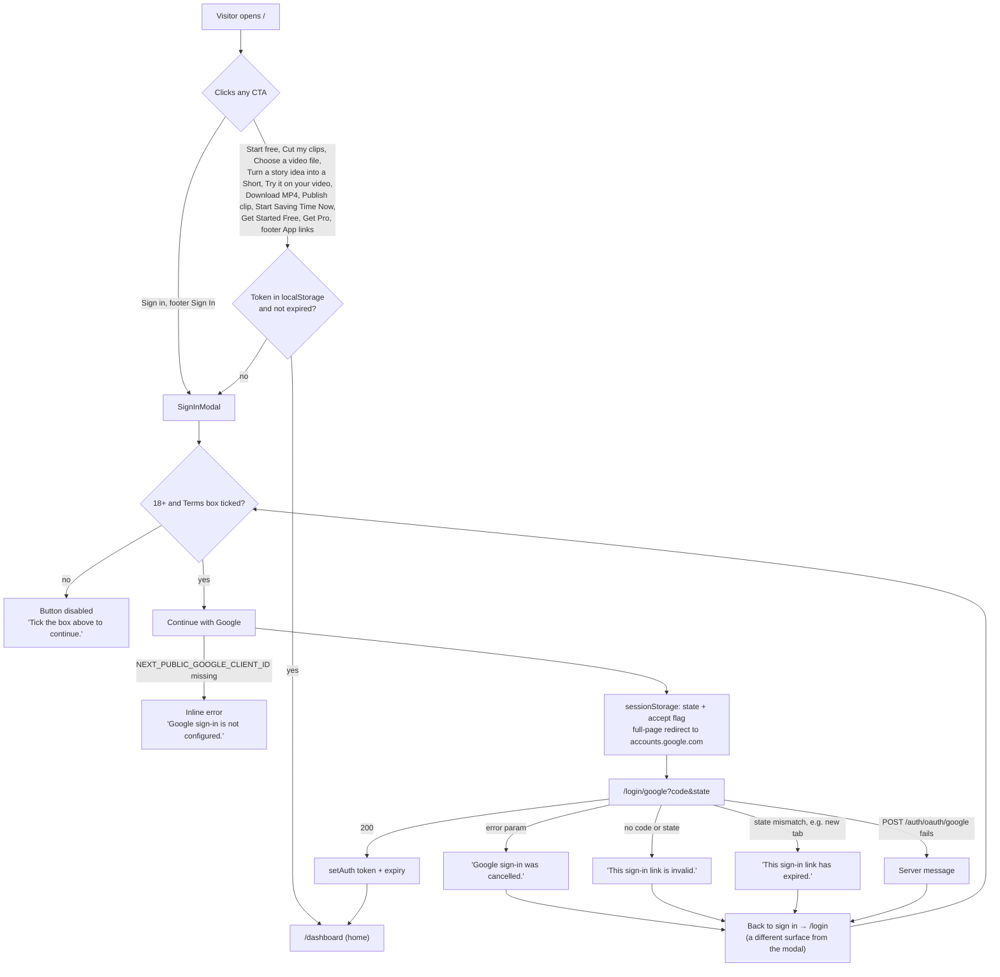
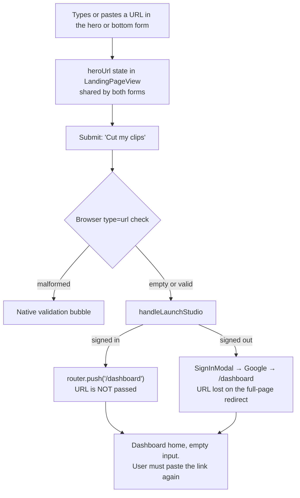
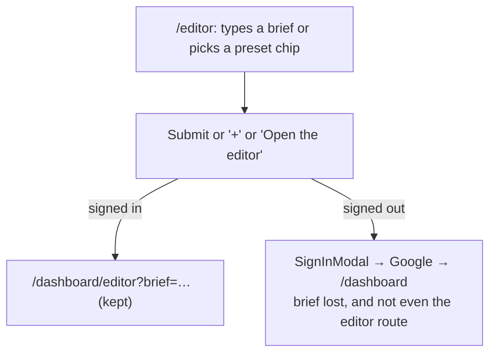
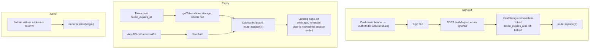

# 03 · Marketing, landing, auth and first-run — audit of the existing frontend

Wave 0, read-only. Audited 3 October 2026 on branch `clipnera` (HEAD `38f9bd5`).
All paths are relative to `frontend/` unless they start with `backend/`.

## 0. Scope and method

Every file below was read top to bottom. Stacking, layout and network behaviour described here is derived from the code; nothing was run in a browser, so items marked **(from code)** should be confirmed visually before they drive a design decision.

| Area | Files read (lines) |
|---|---|
| Landing | `components/landing/` — `LandingPageView` 96, `Navbar` 52, `HeroSection` 106, `HeroStage` 179, `VideoLinkForm` 42, `ClipWall` 124, `EngineSection` 167, `BeforeAfterShowcase` 94, `CaptionTypographyShowcase` 84, `ResultsPreview` 351, `RoiCalculator` 91, `PublishSection` 49, `PricingSection` 127, `FaqSection` 53, `BottomCta` 31, `Footer` 68, `SignInModal` 39, `LandingVideo` 70, `BurnedCaption` 31, `SectionIntro` 24, `BrandMark` 11 |
| Editor landing | `components/editor-landing/EditorLanding.tsx` 214 |
| Auth | `components/auth/AuthShell.tsx` 113, `components/auth/GoogleSignIn.tsx` 94, `components/dashboard/AuthModal.tsx` 123 |
| Pages | `app/page.tsx`, `app/login/page.tsx`, `app/login/google/page.tsx`, `app/signup/page.tsx`, `app/editor/page.tsx`, `app/unsubscribe/page.tsx`, `app/data-deletion/page.tsx`, `app/privacy/page.tsx`, `app/terms/page.tsx`, `app/cookies/page.tsx`, `app/refunds/page.tsx` |
| Lib | `lib/auth.ts` 53, `lib/googleAuth.ts` 48, `lib/landingMedia.ts` 26, `lib/landingMedia.json` 9 |
| Followed imports (read, not owned) | `components/legal/LegalPage.tsx`, `components/legal/CookieNotice.tsx`, `app/layout.tsx`, `components/ui/LogoMark.tsx`, `hooks/usePrefersReducedMotion.ts`, `scripts/fetch-landing-media.mjs`, `tailwind.config.ts`, `next.config.mjs`, parts of `app/globals.css`, `lib/api.ts`, `lib/utils/payments.ts`, `components/dashboard/DashboardApp.tsx`, `backend/auth/service.py` |

39 slice files, 3,132 lines, plus the followed imports.

Empty directories found in the slice: `components/landing/chapters/`, `lib/landing/`, `public/landing/` (all contain nothing).

---

## 1. Component inventory

Legend for the decision column: **KEEP** = reuse as is or with token changes; **REBUILD** = the idea stays, the implementation or design is replaced; **DELETE** = remove.

No component in this slice has zero importers. The dead code is at function and folder level (see 6.4).

### 1.1 Landing shell and shared primitives

| Component | Purpose | Props | State | API | Used by | Decision |
|---|---|---|---|---|---|---|
| `LandingPageView` `components/landing/LandingPageView.tsx:21` | Client root of `/`. Owns the sign-in modal flag, the shared URL field value and the FAQ copy; lays out all sections. | none | `isAuthModalOpen`, `heroUrl` | none (`isAuthenticated()` from localStorage) | `app/page.tsx:1` | **REBUILD** — the composition and the "launch studio" handler lose the visitor's intent (6.1 #1). |
| `Navbar` `Navbar.tsx:14` | Sticky top bar: logo, five links, "Sign in", "Start free". | `onOpenAuthModal`, `onLaunchStudio` | none | none | `LandingPageView.tsx:63`, `EditorLanding.tsx:75` | **REBUILD** — no mobile menu, logo does not go home from `/editor`. |
| `Footer` `Footer.tsx:12` | Brand line, four "app" buttons, legal links, business details. | `onLaunchApp`, `onOpenAuthModal` | none | none (reads `BUSINESS` env constants) | `LandingPageView.tsx:93`, `EditorLanding.tsx:211` | **REBUILD** — three of four buttons do the same thing. |
| `SignInModal` `SignInModal.tsx:8` | Dialog wrapping `GoogleSignIn`. | `open`, `onClose` | none (Escape listener effect) | none | `LandingPageView.tsx:61`, `EditorLanding.tsx:74` | **REBUILD** — no focus trap, no backdrop close, double card, stacking bug. |
| `LandingVideo` `LandingVideo.tsx:24` | Poster image with a muted looping video faded in over it; overlays as children. | `clip`, `position?`, `className?`, `mediaClassName?`, `paused?`, `children?` | `ready`, `failed`; reduced-motion hook; IntersectionObserver | none (network: poster from Pexels CDN, video from `/media/landing/<key>.mp4`) | `HeroStage`, `ClipWall`, `BeforeAfterShowcase`, `CaptionTypographyShowcase`, `ResultsPreview`, `BottomCta` | **KEEP (fix media)** — good pattern, but the videos it points at do not exist (6.1 #2). |
| `BurnedCaption` `BurnedCaption.tsx:10` | Static two-line caption, one word on an amber pill. | `lines`, `highlight?`, `className?` | none | none | `HeroStage`, `ClipWall`, `EngineSection`, `BeforeAfterShowcase` | **KEEP** — small, correct; duplicates the look of `CaptionStylePreview` though. |
| `SectionIntro` `SectionIntro.tsx:12` | Mono eyebrow, display `h2`, lead paragraph. | `eyebrow`, `title`, `children?`, `inline?` | none | none | `ClipWall`, `EngineSection`, `BeforeAfterShowcase`, `ResultsPreview`, `PublishSection` | **KEEP** — but four sections re-type the same markup instead of using it (6.3). |
| `BrandMark` `BrandMark.tsx:4` | `LogoMark` + lowercase "clipnera" wordmark in Syne. | `small?` | none | none | `Navbar`, `Footer` | **KEEP** — make it the only wordmark (auth pages draw a different one). |
| `VideoLinkForm` `VideoLinkForm.tsx:13` | URL input + "Cut my clips" button. | `id`, `url`, `setUrl`, `onSubmit` | none (controlled) | none | `HeroSection.tsx:77`, `BottomCta.tsx:24` | **REBUILD** — the value is never used after submit; no validation, no focus style. |

### 1.2 Landing sections

| Component | Purpose | Props | State | API | Decision |
|---|---|---|---|---|---|
| `HeroSection` `HeroSection.tsx:24` | Eyebrow, `h1`, lead, three promises, source-mode tabs, input, then `HeroStage`. | `heroUrl`, `setHeroUrl`, `onLaunchStudio` | `mode: 'link' \| 'upload' \| 'prompt'` | none | **REBUILD** — prompt-first redesign replaces the three fake tabs. |
| `HeroStage` `HeroStage.tsx:98` | Desktop: fixed 1312×660 stage (source player, waveform timeline, three phones, dashed connectors) scaled to width. Mobile: stacked player, waveform, three phones. | none | `scale` via `ResizeObserver` | none | **REBUILD** — strong idea, heavy and brittle implementation. |
| `ClipWall` `ClipWall.tsx:38` | Category chips over a horizontal "film strip" of seven vertical tiles; prev/next; CTA. | `onLaunchStudio` | `category`; `stripRef` | none | **REBUILD** — the filter only dims tiles. |
| `EngineSection` `EngineSection.tsx:144` | Six cards, one per pipeline stage, each with a small CSS visual. Server component. | none | none | none | **KEEP (restyle)** — clearest explanation on the page. |
| `BeforeAfterShowcase` `BeforeAfterShowcase.tsx:20` | Comparison table + phone with a draggable before/after divider. | none | `split` (0–100, default 45) | none | **KEEP** — accessible slider done properly. |
| `CaptionTypographyShowcase` `CaptionTypographyShowcase.tsx:15` | Phone preview that re-styles when one of four real caption presets is picked. | none | `preset` (default `karaoke`) | none (reads `lib/utils/captionStyles`) | **KEEP** — uses the real preset list and the dashboard's `CaptionStylePreview`. |
| `ResultsPreview` `ResultsPreview.tsx:123` | Fake app window: clip list, player, detail panel with editable title, toggles, two CTAs. | `onLaunchStudio` | `selected`, `playing`, `elapsed`, `titles[]`, `noiseReduction`, `autoEmoji`; 100 ms interval | none | **REBUILD** — it mimics the dashboard that is about to be redesigned; also a perf cost. |
| `RoiCalculator` `RoiCalculator.tsx:16` | Slider (1–20 videos/month) → clips, hours, rupees saved. | `onLaunchStudio` | `videoCount` (default 4) | none | **REBUILD or DELETE** — legacy styling, Title Case copy, only off-palette colour on the page. |
| `PublishSection` `PublishSection.tsx:12` | Four platform cards. Server component. | none | none | none | **REBUILD** — claims must match what social publishing really supports. |
| `PricingSection` `PricingSection.tsx:15` | Plans and credit packs fetched from the server. | `onLaunchStudio` | `offers`, `failed` | `GET /api/v1/subscription/plans` (public) via `subscriptionApi.getPublicPlans` (`lib/api.ts:1149`) | **REBUILD** — keep the server-driven data, replace the legacy card styling. |
| `FaqSection` `FaqSection.tsx:10` | Single-open accordion. | `faqs: {q,a}[]` | `openFaqIndex` (default 0) | none | **KEEP** — merge with the editor page's `
` FAQ into one component. |
| `BottomCta` `BottomCta.tsx:12` | Full-bleed video band with headline and a second URL form. | `heroUrl`, `setHeroUrl`, `onLaunchStudio` | none | none | **REBUILD** — same broken form as the hero. |

### 1.3 Editor landing, auth, account

| Component | Purpose | Props | State | API | Used by | Decision |
|---|---|---|---|---|---|---|
| `EditorLanding` `components/editor-landing/EditorLanding.tsx:56` | Whole `/editor` marketing page: prompt box hero, reel strip, three steps, six features, FAQ, CTA. | none | `signInOpen`, `brief` | none | `app/editor/page.tsx:2` | **REBUILD** — closest thing to the prompt-first direction; merge with `/` rather than keep two landings. |
| `Reel` (local) `EditorLanding.tsx:45` | CSS-gradient 9:16 card with a caption. | `caption`, `bg`, `tag?`, `className` | none | none | `EditorLanding` only | **DELETE** — placeholder art; use real footage. |
| `AuthShell` `components/auth/AuthShell.tsx:28` | Two-column `/login` and `/signup` frame: showcase aside + form column. Server component. | `mode: 'login' \| 'register'`, `children` | none | none | `app/login/page.tsx`, `app/signup/page.tsx` | **REBUILD** — only place with the violet glow, rainbow clip gradients, Anton and a different wordmark. |
| `GoogleSignIn` `components/auth/GoogleSignIn.tsx:22` | Card: heading, 18+/Terms checkbox, "Continue with Google". | `mode?: 'login' \| 'register'` (default `login`) | `loading`, `error`, `acceptTerms` | none directly; `startGoogleSignIn()` redirects to Google | `app/login/page.tsx`, `app/signup/page.tsx`, `SignInModal.tsx:35` | **REBUILD** — one sign-in surface, consent asked once. |
| `GoogleLogo` (local) `GoogleSignIn.tsx:11` | Inline four-colour Google "G". | none | none | none | `GoogleSignIn` | **KEEP** |
| `AuthModal` `components/dashboard/AuthModal.tsx:17` | Despite the name, an **account and workspace switcher with Sign Out**. Not an auth form. | `isOpen`, `onClose`, `currentUser`, `workspaces`, `onSelectWorkspace`, `onSignOut` | none | none (parent calls `authApi.logout`) | `DashboardApp.tsx:934`, opened from `Header.tsx:170` and `:253` | **REBUILD + rename** (e.g. `AccountSwitcher`); should be a menu, not a modal. |
| `GoogleCallbackPage` `app/login/google/page.tsx:17` | OAuth return: checks `state`, exchanges `code`, redirects. | none | `error`; `handled` ref | `POST /api/v1/auth/oauth/google` via `authApi.oauthLogin` (`lib/api.ts:567`) | route | **KEEP logic, REBUILD screen** |
| `LegalPage`, `ContactLine`, `BusinessDetails` `components/legal/LegalPage.tsx:31,53,62` | Prose frame for legal pages and the business identity block. | `title`, `children` | none | none | privacy, terms, refunds, cookies, unsubscribe, data-deletion, `Footer` | **KEEP (restyle)** — but stop using it as the frame for unsubscribe and data-deletion. |
| `CookieNotice` `components/legal/CookieNotice.tsx:12` | Bottom-right notice with an "OK" button, on every route. | none | `visible` | none (localStorage `cookie_notice_dismissed`) | `app/layout.tsx:72` | **KEEP** |

### 1.4 Visual states per component

"—" means the state does not apply. **Missing** means it applies and is not handled.

| Component | Default | Hover / active | Focus | Loading | Empty | Error | Disabled |
|---|---|---|---|---|---|---|---|
| `Navbar` | yes | links → white; CTA `amber-400` + `active:scale-[0.98]` | global amber ring | — | — | — | — |
| `VideoLinkForm` | yes | button hover/active | **Missing** on the input: `focus:outline-none` with no replacement (`VideoLinkForm.tsx:31`) | **Missing** | empty submit is accepted (no `required`) | native browser bubble only for a malformed URL | — |
| `HeroSection` tabs | selected / unselected (`aria-pressed`) | text → white | global ring | — | — | — | — |
| `LandingVideo` | poster | — | — | poster shown, video fades in over 500 ms | `bg-neutral-900` box if the poster fails (`text-transparent` hides alt) | video `onError` → falls back to poster silently | reduced motion → poster only |
| `ClipWall` | yes | chips border lighten; arrows border lighten | global ring | — | **Missing**: "Streams"/"Vlogs" etc. leave one lit tile, nothing scrolls it into view | — | **Missing**: arrows never disable at the ends |
| `BeforeAfterShowcase` | split at 45 % | `cursor-ew-resize` | amber inset ring on the phone via `peer-focus-visible` (`:88`) | — | — | — | — |
| `CaptionTypographyShowcase` | `karaoke` selected | border lighten | global ring | — | — | — | — |
| `ResultsPreview` | clip 0 playing | list border lighten; play button → white | title input `focus:border-amber-500` (`:293`) | — | — | — | paused state: equaliser bars hidden, caption animation paused (`:255`) |
| `RoiCalculator` | 4 videos | button hover, `active:scale-95` | global ring | — | — | — | — |
| `PricingSection` | plans | button hover, `active:scale-95` | global ring | two pulsing skeleton cards, `aria-busy` (`:45`) | **Missing**: `plans` empty renders an empty grid | text "Pricing could not be loaded. Sign in to see plans and prices." (`:40`), **no retry** | — |
| `FaqSection` | first item open | question → `amber-300` | global ring | — | — | — | — |
| `SignInModal` | open / closed | close button hover | close button autofocused | — | — | — | — |
| `GoogleSignIn` | checkbox unticked, button disabled, hint shown | button `neutral-100`, `active:scale-[0.98]` | global ring | spinner replaces label (`:71`); **never resets** if the visitor comes back with the Back button | — | red alert box (`:86`), only for "not configured" | `opacity-50`, `cursor-not-allowed` until the box is ticked |
| `AuthShell` | yes | link colour shifts | global ring | — | — | — | — |
| `GoogleCallbackPage` | spinner "Signing you in with Google…" | — | — | yes (default) | — | card "Could not sign you in" + reason + "Back to sign in" | — |
| `UnsubscribePage` | text + button | button hover | global ring | button text "Unsubscribing…" | "This unsubscribe link is incomplete." when there is no token | rose text, `role="alert"` | button disabled without a token or while working |
| `DataDeletionPage` | static prose | — | — | **Missing**: no indication while the status is fetched | no code → static prose only | rose text, **no `role="alert"`** (`:36`) | — |
| `AuthModal` (dashboard) | yes | rows and buttons hover | **no initial focus, no trap** | **Missing** | **Missing**: zero workspaces shows a bare label | **Missing** | — |
| `EditorLanding` prompt | empty textarea | chips border amber | **Missing**: textarea `focus:outline-none` (`:111`) | **Missing** | empty submit allowed | — | — |

### 1.5 Responsive behaviour

| Component | Behaviour |
|---|---|
| `Navbar` | Links `hidden md:flex` (`Navbar.tsx:27`); "Sign in" `hidden sm:inline` (`:39`). Below 640 px only the logo and "Start free" remain; there is **no hamburger or any other route to the links or to sign-in wording**. Height fixed at 76 px. |
| `HeroSection` | `h1` 44 px → `sm:text-6xl` → `xl:text-[76px]` (`lg:text-6xl` is redundant, `:36`). Lead and input stack below `lg`, sit side by side at `lg` with the input column fixed at 560 px. |
| `HeroStage` | Two separate trees: desktop stage `hidden lg:block` scaled with a CSS transform; mobile tree `lg:hidden`. Both are always in the DOM. |
| `ClipWall` | Horizontal scroll at all widths, scroll-snap, hidden scrollbar; tiles fixed 212×378. |
| `EngineSection` | 1 → 2 (`md`) → 3 (`xl`) columns; visual area fixed at 250 px tall. |
| `BeforeAfterShowcase` | Column below `lg`, table left / phone right at `lg`. Phone max 380 px. |
| `CaptionTypographyShowcase` | `flex-col-reverse` on mobile, so the text and preset buttons come **before** the phone they control; row at `lg`. |
| `ResultsPreview` | Stacked below `lg`; at `lg` a fixed `420px 380px 1fr` grid (`:174`). Between 1024 and about 1280 px the detail column is left with roughly 160–400 px **(from code)**, which is too narrow for the two-column toggle grid. Player fixed 300×533; on a 320 px viewport the container offers 288 px, so the player is clipped by `overflow-hidden`. |
| `RoiCalculator` | `max-w-4xl`, result cards 1 → 3 columns at `sm`. |
| `PublishSection` | 1 → 2 (`sm`) → 4 (`xl`) columns. |
| `PricingSection` | `max-w-7xl` wrapper, cards `max-w-3xl`, 1 → 2 columns at `md`. |
| `FaqSection` | Heading column 420 px beside the list at `lg`. |
| `BottomCta` | Form stacks input over button below `sm`. |
| `Footer` | Column on mobile, row at `sm`/`md`. |
| `AuthShell` | One column below `lg` with the **form first** and the showcase underneath; `1.1fr 1fr` at `lg`. Uses `min-h-[100dvh]`. |
| `EditorLanding` | Floating reels `hidden lg:block`. Reel strip scrolls horizontally. Steps 1 → 3 at `md`; features 1 → 2 → 3. |
| Legal pages | Single `max-w-3xl` column; the cookie table scrolls horizontally. |

Container widths are not consistent: most sections use `max-w-[1440px] px-4 sm:px-8 xl:px-16`; `RoiCalculator` uses `max-w-4xl px-4 sm:px-6 lg:px-8`; `PricingSection` uses `max-w-7xl px-4 sm:px-6 lg:px-8`; `EditorLanding` uses `max-w-[1200px]`.

### 1.6 Animations

| Where | What | Reduced motion |
|---|---|---|
| `HeroSection.tsx:33` | Red dot `animate-pulse` | **Not respected** |
| `HeroStage.tsx:130` | White playhead sweeps the timeline, 14 s linear loop (`globals.css:164`) | Respected (`globals.css:173`) |
| `LandingVideo` | Autoplaying muted loops, 500 ms opacity fade-in, paused off screen | Respected (video not rendered) |
| `ClipWall.tsx:87` | 300 ms opacity + grayscale on filtered tiles; smooth `scrollBy` | Not gated (minor) |
| `ResultsPreview.tsx:204` | Three `animate-pulse` equaliser bars; progress bar driven by a 100 ms `setInterval` (`:137`) | **Not respected**; the interval runs regardless |
| `CaptionStylePreview` (shared) | Word cycle 2.8 s | Respected (`globals.css:132`) |
| `PricingSection.tsx:47` | Skeleton `animate-pulse` | Not gated (minor) |
| `Navbar.tsx:22` | Smooth scroll to top | Not gated |
| Buttons | `active:scale-95` / `[0.98]` in some places only | — |
| `AuthModal.tsx:33` | `animate-in fade-in` (tailwindcss-animate) | — |
| `SignInModal` | **None**: appears and disappears instantly | — |

### 1.7 Accessibility notes

Good, and worth keeping:
- Skip link on `/` (`LandingPageView.tsx:55`); `main#main` landmark; labelled `nav`s.
- Tab-like groups use `role="group"` + `aria-pressed` (hero modes, clip filter, caption styles).
- Before/after slider is a real `input[type=range]` with a label and a focus ring.
- FAQ buttons carry `aria-expanded` / `aria-controls`.
- Pricing rows add screen-reader text "Included: / Not included:" (`PricingSection.tsx:92`).
- Decorative waveforms, connectors and icons are `aria-hidden`.
- `neutral-500` is lightened in `tailwind.config.ts` to meet AA on dark backgrounds.

Problems (severity in section 6):
- `SignInModal`: no focus trap, focus is not returned to the trigger, page behind still scrolls, no backdrop click.
- `AuthModal`: no `role="dialog"`, no `aria-modal`, no accessible name on the close button (`:36`), no Escape handler, a `<label>` not associated with any control (`:77`).
- Inputs with `focus:outline-none` and nothing in its place: `VideoLinkForm.tsx:31`, `EditorLanding.tsx:111`.
- `/editor` has `main#main` but no skip link.
- `/login`, `/signup` on mobile: the `h2` ("Welcome back") comes before the page `h1`, which sits in the aside below.
- `GoogleCallbackPage`: the loading text has no `role="status"`; there is no heading in the loading state.
- `ClipWall.tsx:99`: `aria-label` on an SVG icon inside a sentence; screen-reader output is unreliable.
- Legal links to external sites open in the same tab without indication; the consent links open a new tab without saying so (`GoogleSignIn.tsx:58`).
- No page-level metadata for `/`, `/login`, `/signup`, `/login/google`, `/unsubscribe`, `/data-deletion`; they all inherit "Clipnera — AI Video Editing & Shorts Creator" (`app/layout.tsx:25`).

---

## 2. Screen by screen

The whole public site is dark: page background `neutral-950` (#0a0a0a), body text `neutral-100`, accent `amber-500` (#f59e0b). Display type is Syne ExtraBold with tight tracking; eyebrows and data labels are JetBrains Mono, uppercase, letter-spaced; body is Plus Jakarta Sans.

A cookie notice floats bottom-right on every screen until dismissed: "Clipnera uses no advertising or tracking cookies. Your browser only stores what keeps you signed in. Cookie policy" with an amber **OK** button.

### 2.1 Landing page `/`

Section order (`LandingPageView.tsx:63-93`):

| # | Section | Anchor | Eyebrow as printed |
|---|---|---|---|
| 0 | Navbar | — | — |
| 1 | Hero | — | "Live demo · real footage, real output" |
| 2 | Clip wall | `#clip-wall` | "02 · The clip wall" |
| 3 | Engine | `#how-it-works` | "03 · What happens after you paste the link" |
| 4 | Before / after | `#before-after` | "04 · Before / after" |
| 5 | Captions | `#captions` | "05 · Captions" |
| 6 | Results preview | `#results` | "06 · What you get back" |
| 7 | ROI calculator | none | "Time-Saving Estimate" (unnumbered) |
| 8 | Publish | `#publish` | "07 · Publish" |
| 9 | Pricing | `#pricing` | "Pricing" (unnumbered) |
| 10 | FAQ | `#faq` | "FAQ" |
| 11 | Bottom CTA | — | — |
| 12 | Footer | — | — |

**Navbar.** 76 px, sticky, translucent black with blur and a hairline bottom border. Left: amber rounded-square logo with a sparkle, then "clipnera" in lowercase Syne. Centre (desktop only): "Clip wall", "How it works", "Editor" with a small amber **NEW** tag, "Captions", "Pricing". Right: text link "Sign in", amber button **"Start free"**.

**Hero.** Left-aligned, not centred.
- Eyebrow in amber mono with a pulsing red dot: "Live demo · real footage, real output".
- `h1`, two lines, up to 76 px: "One long video in." / "A week of **Shorts** out." ("Shorts" in amber).
- Below, two columns. Left: "Clipnera finds the moments worth posting, reframes them to 9:16 around the speaker, cleans the audio and burns in word-by-word captions. You review, then publish." Then three green-ticked promises: "Free plan, no card", "Free credits every 30 days", "Background noise reduction".
- Right (560 px): three small pill tabs "YouTube link" (selected, amber-on-dark-amber), "Upload a file", "Write a prompt". Under them one control that swaps with the tab:
  - link: a rounded bar with placeholder "Paste a YouTube link…" and an amber button with scissors **"Cut my clips"**;
  - upload: a dashed-border button **"Choose a video file"**;
  - prompt: a solid button **"Turn a story idea into a Short"**.
- The stage, full width. Left two-thirds: a 16:9 "source player" of two women recording a podcast, with chips "SOURCE · 16:9" and "PODCAST · 58:12", a dashed amber 9:16 crop box labelled "9:16 · TRACKING SPEAKER" with everything outside it dimmed, and a transcript line at the bottom with the middle sentence highlighted: "…and honestly, the day I stopped chasing views was the day the channel started growing. Nobody tells you that part…". Under the player: a timeline card with timecodes 00:00 → 58:12, a grey waveform with three amber regions boxed and labelled "CLIP 01 · 94", "CLIP 02 · 88", "CLIP 03 · 81", and a white playhead sweeping across. Right third: three overlapping phone frames (outer two tilted ±5°), each showing a crop of the same footage with an amber score pill ("94 · HOOK", "88 · STORY", "81 · TAKEAWAY"), a burned-in caption ("STOP CHASING VIEWS", "THE CHANNEL STARTED GROWING", "NOBODY TELLS YOU THIS") and a duration. Dashed amber curves run from each timeline region to its phone.
- Mobile: player, a short waveform, then three phones in a row.

**Clip wall.** Heading "Real footage in." / "Postable clips out." with the paragraph to its right: "Every tile is a finished 9:16 clip, labelled with the long video it was cut from. Pick what you make and see what you'd get." Seven pill filters: All (amber-filled when active), Podcasts, Interviews, Talking head, Cooking, Streams, Vlogs. Then a full-bleed darker band styled as a film strip (sprocket-hole pattern top and bottom) holding seven 212×378 tiles; each has a category chip, an amber score, a caption and a mono line such as "58:12 podcast → 0:41 clip". Below: "Sample outputs shown for illustration. Your clips come from your own footage.", two round arrow buttons, and the text link **"Try it on your video →"**.

**Engine.** Heading "Six editing jobs." / "Done before your coffee cools." Lead: "No timeline scrubbing. Each card is the real step your video goes through, in order, with you in control at the end." Six cards in a 3×2 grid, each a 250 px visual over a mono step label, a Syne title and a sentence:

| Step | Title | Visual |
|---|---|---|
| 01 · Listen | Every word, timestamped | word chips with timestamps, "chasing" in amber |
| 02 · Score | Moments ranked 0–100 | four horizontal bars (94, 88, 81, 46) + "Hook · emotion · takeaway · shareability" |
| 03 · Reframe | The frame follows the face | a still with a 9:16 amber box, chip "16:9 → 9:16 · FACE LOCK" |
| 04 · Clean audio | Hum out, voice in | grey noisy waveform over an amber clean one |
| 05 · Caption | Word-by-word, burned in | small phone with "HERE'S THE REAL REASON" |
| 06 · B-roll | Cutaways where they fit | A-roll strip with an amber-bordered cutaway below |

**Before / after.** Left: heading "Drag the line." / "That's the whole edit.", lead "Left of the line is what a plain vertical export gives you. Right of it is the same moment after Clipnera.", and a five-row table (Framing, Audio, Captions, Length, Posting) with columns "RAW EXPORT" (grey) and "CLIPNERA" (amber header, white text). Right: a large phone with a vertical white divider and a round white handle. Left of the divider the footage is desaturated with chips "BEFORE" and "CENTRE CROP · HUM · 46:30"; right of it full colour with "AFTER", the caption "I ALMOST QUIT THAT YEAR" and "VOICE CLEANED · 0:44".

**Captions.** Phone on the left (desktop), text on the right. Heading "Captions people" / "actually read." Lead: "Most Shorts are watched on mute. Pick a style and the phone updates. {N} presets, and every one lets you change colours, casing, line count and auto-emoji." Four selectable cards in a 2×2 grid (presets `karaoke`, `purple_pop`, `glitch`, `blur_in`), each with a live animated sample, its brand name and description. Below: outline chips "Auto-emoji on/off", "UPPERCASE", "1 or 2 lines", "Custom colours", and an amber-outlined "Brand kit with your logo · Pro". The phone shows "Watch this part" in the chosen style and a chip "PREVIEW · {style name}".

**Results preview.** Heading "Ranked, captioned," / "ready to review." Lead: "This is the screen you land on. Pick a clip to play it: each one is already cut, reframed and captioned, with a title and hashtags to edit before you publish." Then a mock app window: title bar with three grey dots, "Sample workspace · Latest uploads", "4 CLIPS", and a green "Clips ready". Three panes:
- list "Sorted by score · HIGH → LOW" with four rows (thumbnail, title, source and range, score pill, reason and length): "The day I stopped chasing views" 94, "Why the channel started growing" 88, "I almost quit that year" 81, "Here is the real reason" 67;
- a 300×533 player with "VOICE CLEANED" / score chips, animated caption, play/pause, progress bar and time;
- details: editable "Title · suggested", "Hashtags · suggested" chips, "Caption style" and "Framing: Follow speaker" tiles, "Noise reduction" and "Auto-emoji" switches, a "Why this clip scored N" box, then **"Download MP4"** (outline) and **"Publish clip"** (amber).
Footnote: "Sample clips for illustration. Scores help you choose; they don't predict views."

**ROI calculator.** A tinted full-width band, centred, visibly from an earlier design generation. "Time-Saving Estimate" / **"How much time & money will you save?"** A card with a slider "Long Videos Created per Month:" and three result tiles: "Shorts Created: 20 Clips — Ready for TikTok & Reels" (amber), "Editing Hours Saved: ~20 Hours" (green), "Editor Cost Saved: ~₹10,000 — vs a freelance editor" (**purple**). Disclaimer, then the amber button **"Start Saving Time Now"**.

**Publish.** Heading "Straight to where" / "people scroll." Lead: "AI suggests a title and hashtags for each clip. Edit them, then post, or download the MP4 for anywhere else." Four cards, each a small vertical still plus a name, a note and a tag: YouTube Shorts, TikTok, Instagram Reels ("DIRECT PUBLISH") and X ("PRO").

**Pricing.** Centred. "Pricing" / **"Start free."** / **"Upgrade when it's working."** Sub-line: "Start free. Prices in Indian rupees; the amount shown is the amount you pay. Pro does not renew automatically." Two cards: Free (plain, "₹0", grey button **"Get Started Free"**) and the paid plan (amber border, soft amber glow, a monthly and a yearly price stacked, amber button **"Get {plan name}"**). Each lists about 15 capability rows with a green tick or a grey cross. Below: "Need more? One-time credit packs that never expire: … See our Refund Policy."

**FAQ.** Left: "FAQ" / **"Straight answers."** Right: four questions, first open:
1. "How does the AI choose the most viral moments from long videos?"
2. "What does background noise reduction do?"
3. "Can I customize font styles, colors, and auto-emojis for captions?"
4. "Which social platforms can I publish to?"

**Bottom CTA.** A 380 px band of footage (podcast host at a microphone) under a left-to-right dark gradient. "Your next Shorts are" / **"already recorded."** (amber). The same URL bar and **"Cut my clips"** button. "Free plan, no card needed."

**Footer.** Row 1: small logo + "Long videos in, Shorts out."; text buttons "App Dashboard", "Project Folders", "Settings & Billing", "Sign In". Row 2: "Terms of Service", "Privacy Policy", "Refund Policy", "Cookie Policy", "Delete your data"; right: "© 2026 {legal name or 'Clipnera AI'}. All rights reserved." and, when the env values are set, address · GSTIN · contact email.

### 2.2 Editor landing `/editor`

Same navbar and footer. Everything is centred, unlike `/`.

1. **Hero.** Four tilted gradient "reel" cards float at the sides on desktop ("Goa diaries", "Nobody tells you", "Yeh sach hai", "Sunset run"). Eyebrow "New · Clipnera Editor". `h1` "Describe it." / **"We'll cut it."** (amber). Lead: "Drop in footage or a YouTube link and say what you want. The agent builds the edit on a real timeline: cuts, captions, B-roll and music. You direct the rest." A 640 px prompt box with a faint amber glow: two-row textarea, placeholder "Make a 30 s reel from my Goa trip, cut to the beat, Hinglish captions…", a small "+" button bottom-left and an amber "↑" button bottom-right. Under it six chips: "Podcast to Shorts", "Travel reel", "Product launch", "Talking head", "Tutorial tips", "Wedding teaser" — clicking one writes "{chip}: " into the box.
2. **"Made with Clipnera"** / "Finished, captioned, ready to post." — a scrolling row of five gradient reels with tags such as "Travel · 0:30", "Hinglish · 0:38".
3. **"How it works"** / "Your first edit in **three moves**." — three cards: "Drop and describe", "Direct the edit", "Export or post".
4. **"Inside the editor"** / "Everything you need, in **one place**." — a bordered 3×2 grid: Search, First cut, Timeline, Captions ("21 caption styles"), B-roll + music, Your agent ("Bring your own Claude").
5. **"Questions"** — four native `
` rows.
6. **Final CTA** on an amber radial glow: "Clipnera Editor" / "Start with one sentence." / button **"Open the editor"**.

### 2.3 Sign-in modal (from `/` and `/editor`)

Black 80 % overlay with blur. A 448 px dark card with a round close button top-right, and **inside it a second identical card** (the `GoogleSignIn` card brings its own background, border, padding and shadow: `SignInModal.tsx:26` + `GoogleSignIn.tsx:39`). Content: "Welcome back" / "Sign in to continue to Clipnera"; a boxed checkbox "I am 18 or older and I agree to the Terms of Service and Privacy Policy."; a white button with the Google "G" **"Continue with Google"**, greyed until the box is ticked; hint "Tick the box above to continue."

The modal always says "Welcome back", including when it was opened by "Start free" or "Get Started Free".

### 2.4 `/login` and `/signup`

Two columns on desktop.
- **Left (showcase):** amber glow top-left and a **violet** glow bottom-right; logo + "Clip**nera**" (mixed case, second half amber, not Syne); three tilted gradient phones (orange→rose→violet, sky→teal→emerald, pink→amber→orange), each with a dark head-and-shoulders silhouette, a ringed score (94, 87, 80) and an Anton caption with one yellow word ("MOST STARTUPS NEVER MAKE IT", "THE 3AM ROUTINE", "ONE HABIT, DOUBLE FOCUS"); `h1` "Long videos in. **Scroll‑stopping** clips out."; three icon bullets: "Finds the moments worth posting in long videos", "Adds captions, hooks and B-roll in your brand style", "Publishes and schedules to YouTube, Instagram and TikTok".
- **Right (form):** the `GoogleSignIn` card. On `/login`: "Welcome back" / "Sign in to continue to Clipnera". On `/signup`: "Create account" / "Start creating viral clips with AI". Same checkbox and Google button on both. Under the card: "New to Clipnera? Create an account" or "Already have an account? Sign in", then small links Privacy · Terms · Refunds · Cookies.

On mobile the form comes first with a centred logo above it; the showcase follows underneath.

The two pages are functionally identical: one button, one endpoint.

### 2.5 Google callback `/login/google`

A centred 384 px card on black. While working: a spinner and "Signing you in with Google…". On failure: "Could not sign you in", one line of reason, and an amber button **"Back to sign in"**. Reasons: "Google sign-in was cancelled.", "This sign-in link is invalid.", "This sign-in link has expired. Please try again.", or the server's message (for a new account without consent: "Confirm you are 18 or older and accept the Terms and Privacy Policy to create an account.", `backend/auth/service.py:36`).

### 2.6 Legal pages `/privacy`, `/terms`, `/refunds`, `/cookies`

No navbar, no footer. A single 768 px column: a small "← Clipnera" link, a Syne `h1`, "Last updated 27 September 2026", prose in 14 px `neutral-300` with white bold `h2`s and amber underlined links, then a row of the five legal links above a hairline.

| Page | `h2` sections |
|---|---|
| Privacy Policy | Information you give us · Information we collect automatically · Connected publishing platforms · How we use information · Service providers · Children · Retention and deletion · Your rights · Third-party terms · Changes · Contact |
| Terms of Service | Who can use Clipnera · Your content · AI output · Connected platforms · Plans, credits and payments · Acceptable use · Ending your account · Disclaimer and liability · Changes · Governing law · Contact |
| Refund Policy | Failed processing: credits back automatically · When we refund your money · No automatic renewal · How to ask for a refund · Contact |
| Cookie Policy | What your browser stores (a 4-column table) · Third parties · Controlling storage · Contact |

### 2.7 `/unsubscribe`

Rendered inside the legal frame, so it shows "← Clipnera", the title "Unsubscribe from Clipnera emails" and, oddly, "Last updated 27 September 2026". Body: "Stop emails about failed posts and accounts that need reconnecting. Clipnera never sends marketing emails." and an amber **"Unsubscribe"** button (it does not act on load, by design). After success: "Done. You will no longer receive account emails from Clipnera. You can turn them back on in Settings → Profile." Without a token the button is disabled and the page says "This unsubscribe link is incomplete."

### 2.8 `/data-deletion`

Same frame. "Delete your data" with two sections, "Delete your Clipnera account" (link to Settings → Profile → Delete account, and an email fallback) and "Remove Clipnera from a connected platform". When opened with `?code=…` (Meta's link) a bordered box shows "Confirmation code", "Requested" and "Status: Completed — the data has been deleted." or "In progress."

---

## 3. User flows

### 3.1 First visit to the dashboard

Facts behind the chart:
- **Google only.** There is no password field anywhere in the slice. Remnants: `authApi.login`, `register`, `forgotPassword`, `resetPassword` and their payload types still exist in `lib/api.ts:27-47,562-574` with no callers; the privacy policy mentions old password accounts (`app/privacy/page.tsx:18`); `SettingsView.tsx:393` still asks for a password when adding a team member (outside this slice).
- **Consent.** One combined checkbox covers 18+, Terms and Privacy (`GoogleSignIn.tsx:49`). The value travels through `sessionStorage` (`lib/googleAuth.ts:23`) to the callback and to the backend, which requires it only when the sign-in creates the account (`backend/auth/service.py:163`). The UI, however, disables the button for **everyone**, so returning users must re-tick it on every sign-in.
- **Destination is always `/dashboard`** (`app/login/google/page.tsx:41`). Nothing about what the visitor clicked or typed survives the trip.
- There is **no first-run or onboarding screen** in this slice. A new account lands on the same dashboard home as a returning one.

### 3.2 Pasting a video link on the landing page

`heroUrl` is written (`LandingPageView.tsx:24`) and displayed, and never read by anything else: `handleLaunchStudio` (`:48-51`) ignores it. The same is true of the "Upload a file" and "Write a prompt" tabs, which are plain buttons that call the same handler.

The editor landing does slightly better: a signed-in visitor is sent to `/dashboard/editor?brief=…` and `EditorView.tsx:35` reads it. A signed-out visitor still loses the brief, because sign-in ends at `/dashboard`.

### 3.3 Sign-out and session expiry

### 3.4 Dead ends, loops and inconsistent paths

| # | Path | What happens | Ref |
|---|---|---|---|
| F1 | Paste link → "Cut my clips" | Link discarded for every visitor. | `LandingPageView.tsx:48` |
| F2 | "Upload a file" / "Write a prompt" tabs | No file picker, no prompt field; both just open sign-in or the dashboard home. | `HeroSection.tsx:78-97` |
| F3 | Signed-out brief on `/editor` | Lost; lands on `/dashboard`, not the editor. | `EditorLanding.tsx:64`, `app/login/google/page.tsx:41` |
| F4 | Session expires in the dashboard | Silent bounce to `/` with no explanation and no sign-in prompt. | `DashboardApp.tsx:119,373` |
| F5 | `/login` or `/signup` while already signed in | No redirect; the form is shown again. | `app/login/page.tsx`, `app/signup/page.tsx` |
| F6 | Reaching `/login` or `/signup` | Nothing on `/` or `/editor` links to them. They are reachable only from a failed Google callback, the admin gate, or by typing the URL. The "sign-up" page is effectively orphaned. | grep of `/login`, `/signup` |
| F7 | Three sign-in surfaces, two guard targets | Modal (public pages), `/login`, `/signup`; the dashboard guard sends people to `/`, the admin guard to `/login`. | `DashboardApp.tsx:120`, `AdminGate.tsx:15` |
| F8 | Callback opened in a different tab or after closing the tab | State is in `sessionStorage`, so the callback reports "expired". Recoverable, but the wording blames the link. | `lib/googleAuth.ts:37` |
| F9 | Back button from Google's screen | Likely restores the page with the spinner still showing and the button disabled **(from code: `loading` is never reset)**. | `GoogleSignIn.tsx:29` |
| F10 | Navbar logo on `/editor` | Scrolls to top; there is no way back to `/` except the section links. | `Navbar.tsx:22` |
| F11 | Navbar section links from `/editor` | Plain `<a href="/#…">`: a full document load rather than client navigation. | `Navbar.tsx:29` |
| F12 | Pricing fails to load | "Sign in to see plans and prices." with no retry and no link. | `PricingSection.tsx:40` |
| F13 | Legal pages | No navbar or footer; "← Clipnera" is the only exit, and it always goes to `/` even for signed-in users who came from the app. | `LegalPage.tsx:35` |
| F14 | Footer "Project Folders", "Settings & Billing" | Both go to the dashboard home, not to those screens. | `Footer.tsx:26-31` |

No redirect loop was found.

---

## 4. Modals and overlays

| Overlay | File | Trigger | Close | z-index | Notes |
|---|---|---|---|---|---|
| Sign-in modal | `components/landing/SignInModal.tsx` | Navbar "Sign in"; footer "Sign In"; any CTA when signed out (list in 3.1) | Close button, Escape | `z-50` | No backdrop click, no focus trap, no scroll lock, no transition. |
| Account & Workspace modal | `components/dashboard/AuthModal.tsx` | Dashboard header avatar/account buttons (`Header.tsx:170,253`) | Close button; selecting a workspace; Sign Out | `z-50` | No Escape, no dialog role. |
| Cookie notice | `components/legal/CookieNotice.tsx` | Every route until "OK" | "OK" | `z-[60]` | Sits above both modals; covers the bottom of the sign-in card on small screens **(from code)**. |
| Skip link | `LandingPageView.tsx:55` | Keyboard focus | — | `z-[70]` | Landing only. |
| Sticky navbar | `Navbar.tsx:16` | Always | — | `z-50` | Same layer as the sign-in modal. |

**Stacking bug (from code).** `SignInModal` (fixed, `z-50`) is rendered *before* `Navbar` (sticky, `z-50`) in both `LandingPageView.tsx:61-63` and `EditorLanding.tsx:74-75`. With equal z-index the later element paints on top, so the navbar should remain visible and clickable above the modal's dark overlay. Needs a visual check; the fix is a higher layer or a portal.

There are no toasts, drawers, popovers or tooltips in this slice.

---

## 5. Styling

### 5.1 Colour actually used

| Role | Value | Where |
|---|---|---|
| Page background | `neutral-950` | everywhere |
| Raised surfaces | `neutral-900`, `neutral-900/90`, `neutral-900/40`, plus raw hex `#111`, `#121212`, `#141414`, `#161616`, `#0d0d0d`, `#1a1408` | `ClipWall.tsx:68`, `EngineSection.tsx:154-155`, `ResultsPreview.tsx:155,156,190,236`, `PublishSection.tsx:22`, `CaptionTypographyShowcase.tsx:60`, `HeroStage.tsx:107` |
| Borders | `neutral-800` (default), `-700`, `-900`, `-800/80` | everywhere |
| Text | white, `neutral-100/200/300/400/500` | everywhere |
| Accent | `amber-500` fill, `amber-400` text and hover, `amber-300` links, `amber-900` / `amber-950/60` for selected chips, `#f59e0b` in SVG | everywhere |
| Success | `emerald-400` | `HeroSection.tsx:51`, `ResultsPreview.tsx:168`, `PricingSection.tsx:87`, `RoiCalculator.tsx:63` |
| "Live" dot | `red-500` | `HeroSection.tsx:33` |
| Error | `red-400` on `red-500/10` in `GoogleSignIn.tsx:87`; `rose-300` text in `unsubscribe/page.tsx:59` and `data-deletion/page.tsx:36` | two different error colours |

The landing page is already amber-on-neutral. The legacy, off-palette items are few and specific:

| Legacy item | Where |
|---|---|
| Violet radial glow `rgba(139,92,246,0.14)` behind the auth showcase | `AuthShell.tsx:32` |
| Rainbow clip gradients: `orange-400 → rose-500 → violet-600`, `sky-500 → teal-500 → emerald-500`, `pink-500 → amber-500 → orange-400`; `yellow-300` highlight word | `AuthShell.tsx:13-15,53` |
| `purple-400` result figure | `RoiCalculator.tsx:68` |
| Gradient card `from-neutral-900 via-neutral-900 to-neutral-950` with `shadow-amber-500/10` | `PricingSection.tsx:63` |
| Hard-coded multi-colour CSS "footage" (sky, teal, rose, indigo `#4338ca`) | `EditorLanding.tsx:15-19` |
| Global token `--primary: 262 83% 58%` is **violet** | `app/globals.css:17` (not used in this slice, but any `bg-primary` would render violet) |
| A featured caption preset named `purple_pop` | `CaptionTypographyShowcase.tsx:9` (product content, not chrome; fine) |

### 5.2 Type

| Face | How it is applied | Inconsistency |
|---|---|---|
| Plus Jakarta Sans (body) | `font-['Plus_Jakarta_Sans',sans-serif]` repeated on `body` (`layout.tsx:70`) and again on every page root (`LandingPageView.tsx:54`, `EditorLanding.tsx:73`, `LegalPage.tsx:33`, `login/google/page.tsx:46`, `CookieNotice.tsx:37`); `font-jakarta` in `BurnedCaption.tsx:13` | Three spellings of one font; the per-page ones are redundant. |
| Syne 700/800 (display) | `font-syne` in new sections; `font-['Syne',sans-serif]` in `RoiCalculator.tsx:25,28`, `PricingSection.tsx:68`, `LegalPage.tsx:38` | Two spellings. `AuthShell` and `GoogleSignIn` headings do not use Syne at all. |
| JetBrains Mono (labels, data) | `font-jetbrains` | `RoiCalculator` and `PricingSection` use `font-mono` (system monospace) for figures and prices instead (`RoiCalculator.tsx:37,48,58`, `PricingSection.tsx:73,80`). |
| Anton | `font-['Anton',Impact,sans-serif]` | `AuthShell.tsx:52` only. |

Heading scale is also split: new sections use `text-[28px] → sm:text-5xl → lg:text-[54px]`; `RoiCalculator` uses `text-2xl sm:text-3xl`; `EditorLanding` uses `text-3xl sm:text-[44px]`; `FaqSection` tops out at 44 px; `PricingSection` at `text-5xl`.

Wordmark: "clipnera" lowercase Syne (`BrandMark.tsx:8`) on marketing pages, "Clip**nera**" mixed-case two-tone Jakarta on auth pages (`AuthShell.tsx:35,81`), a letter "C" in an amber tile in the dashboard account modal (`AuthModal.tsx:45`), and "← Clipnera" plain text on legal pages.

### 5.3 Spacing, radius and one-offs

- Section padding: `py-20 lg:py-24` (most), `py-16` (`RoiCalculator`), `py-20` only (`FaqSection`), `pb-20 pt-10 lg:pt-12` (hero), `py-28` (editor final CTA).
- Radii in use: 6, 8, 10, 12, 14, 16, 18, 20, 22, 30 and 34 px plus `rounded-full`. Buttons alone use `rounded-xl`, `rounded-[10px]`, `rounded-lg` and `rounded-full`.
- Primary button heights: 44 px (`Navbar`), 48 px (`VideoLinkForm`, `ResultsPreview`), 62 px (hero upload/prompt), `py-2.5` ≈ 36 px with 12 px text (`RoiCalculator`, `PricingSection`), `h-11` (`EditorLanding`), `py-2` (`unsubscribe`, callback).
- Many arbitrary pixel values: `h-[76px]`, `py-[50px]`, `px-[18px]`, `bottom-[58px]`, `text-[9.5px]`, `text-[11.5px]`, and the whole absolute-positioned hero stage (`HeroStage.tsx:105-152`).
- Press feedback is inconsistent: `active:scale-[0.98]`, `active:scale-95`, or none.
- Copy casing: sentence case in the new sections, Title Case with trailing colons in `RoiCalculator` ("Long Videos Created per Month:") and the footer ("Sign In", "App Dashboard").

---

## 6. Problems

Severity: **P0** breaks the core promise or misleads; **P1** significant UX, a11y or performance defect; **P2** inconsistency or polish; **P3** cleanup.

### 6.1 Bugs and broken flows

| # | Sev | Problem | Ref |
|---|---|---|---|
| 1 | **P0** | The landing page's main action does nothing with its input. The pasted link is held in state and discarded on submit, for signed-in and signed-out visitors alike. | `LandingPageView.tsx:24,48-51`, `VideoLinkForm.tsx:16-19` |
| 2 | **P0** | **No landing video exists.** `LandingVideo` requests `/media/landing/<key>.mp4`, but `public/media/` is absent from the working tree and from git; the files only appear after someone runs `npm run media:landing` with a Pexels API key. Every `<video>` 404s, `onError` fires, and the page shows still posters. The hero then says "Live demo" over a still image, and the Results "player" animates a progress bar over a photo. Unless production has a separate asset step, this is what visitors see. | `lib/landingMedia.ts:22`, `LandingVideo.tsx:53-65`, `scripts/fetch-landing-media.mjs:11` |
| 3 | **P1** | Intent is lost across sign-in: link, upload choice, prompt choice, editor brief and the chosen plan all end at `/dashboard`. | `app/login/google/page.tsx:41` |
| 4 | **P1** | "Upload a file" and "Write a prompt" are decorative tabs with no function. | `HeroSection.tsx:78-97` |
| 5 | **P1** | Sign-in modal and navbar share `z-50` and the navbar comes later in the DOM, so the navbar should paint above the overlay (from code). | `LandingPageView.tsx:61-63`, `SignInModal.tsx:24`, `Navbar.tsx:16` |
| 6 | **P1** | Session expiry sends the user to `/` with no message and no sign-in prompt. | `DashboardApp.tsx:119-121,371-374` |
| 7 | **P1** | Returning users must tick "I am 18 or older…" on every sign-in, although the backend needs it only at account creation. | `GoogleSignIn.tsx:66`, `backend/auth/service.py:163` |
| 8 | **P2** | Sign-out removes `token` but leaves `token_expires_at`; it bypasses `clearAuth()`. Harmless today, wrong by construction. | `DashboardApp.tsx:696`, `lib/auth.ts:29` |
| 9 | **P2** | `GoogleSignIn` never clears `loading` after a successful redirect start, so a Back-button return can show a permanent spinner (from code). | `GoogleSignIn.tsx:27-36` |
| 10 | **P2** | `/login` and `/signup` do not redirect signed-in users. | `app/login/page.tsx`, `app/signup/page.tsx` |
| 11 | **P2** | Clip-wall filter does not filter: other tiles are dimmed to 30 % and the matching tile is not scrolled into view; on mobile the lit tile can be off screen. | `ClipWall.tsx:81-89` |
| 12 | **P2** | Results grid fixes two columns at 800 px, squeezing the detail pane between 1024 and ~1280 px; the 300 px player is clipped on 320 px phones (from code). | `ResultsPreview.tsx:174,242` |
| 13 | **P2** | Feature grid on `/editor` draws `border-r border-b` on every cell inside a bordered box, doubling the right and bottom edges. | `EditorLanding.tsx:172-174` |
| 14 | **P2** | Pricing error state has no retry and tells signed-out visitors to sign in to see prices. An empty `plans` array renders nothing. | `PricingSection.tsx:38-42,54` |
| 15 | **P3** | Comment says the stage is 1312×640; the constant is 660. | `HeroStage.tsx:7,10` |
| 16 | **P3** | Redundant class `lg:text-6xl` after `sm:text-6xl`. | `HeroSection.tsx:36` |

### 6.2 Copy and claims

| # | Sev | Problem | Ref |
|---|---|---|---|
| 17 | **P1** | "Live demo · real footage, real output" with a pulsing red "live" dot, and "Real footage in. Postable clips out.", sit on stock Pexels footage with hand-typed captions and invented scores. Two sections later the page itself says "Sample outputs shown for illustration." The claims contradict each other. | `HeroSection.tsx:34`, `ClipWall.tsx:46,109`, `ResultsPreview.tsx:347` |
| 18 | **P1** | Platform claims differ by surface: the landing says direct publish to YouTube Shorts, TikTok and Instagram Reels with X on Pro (`PublishSection.tsx:6-9`, FAQ at `LandingPageView.tsx:41`); the auth page says "YouTube, Instagram and TikTok" (`AuthShell.tsx:21`); the ROI card says "Ready for TikTok & Reels" (`RoiCalculator.tsx:59`). Product memory records the social plan as YouTube + Instagram only. The real supported set must be confirmed and stated once. | as cited |
| 19 | **P2** | "Welcome back" greets brand-new visitors who clicked "Start free". | `SignInModal.tsx:35`, `GoogleSignIn.tsx:42` |
| 20 | **P2** | "Start creating viral clips with AI" and "choose the most viral moments" conflict with the careful "scores … do not predict views" wording used everywhere else. | `GoogleSignIn.tsx:45`, `LandingPageView.tsx:28` |
| 21 | **P2** | "Start free." appears as the pricing headline and again as the first words of the sentence under it. | `PricingSection.tsx:29,34` |
| 22 | **P2** | Section numbering is broken: there is no "01", the ROI band sits unnumbered between 06 and 07, and Pricing and FAQ are unnumbered. The Engine cards restart at 01–06 inside section 03. | `ClipWall.tsx:46` … `PublishSection.tsx:16`, `EngineSection.tsx:41-118` |
| 23 | **P2** | Caption-style count is computed on `/` (`presetCount`) but hard-coded as "21 caption styles" on `/editor`. | `CaptionTypographyShowcase.tsx:18`, `EditorLanding.tsx:32` |
| 24 | **P2** | Footer shows three labels for one action, in Title Case, next to "Sign In" (navbar says "Sign in"). | `Footer.tsx:23-34`, `Navbar.tsx:40` |
| 25 | **P2** | Three taglines for the same idea: "One long video in. A week of Shorts out.", "Long videos in, Shorts out.", "Long videos in. Scroll‑stopping clips out." | `HeroSection.tsx:37`, `Footer.tsx:19`, `AuthShell.tsx:61` |
| 26 | **P2** | Mixed spelling: British in new sections ("colours", "centre") and American in the FAQ ("customize", "colors"). | `CaptionTypographyShowcase.tsx:12,46`, `LandingPageView.tsx:36-37` |
| 27 | **P2** | Unsubscribe and data-deletion pages print "Last updated 27 September 2026", which only makes sense on a policy. | `LegalPage.tsx:39` |
| 28 | **P2** | The legal fallback text "the contact address shown in the app" appears when `NEXT_PUBLIC_CONTACT_EMAIL` is unset; there is no such address in the app. The footer falls back to "Clipnera AI" as the legal name. | `LegalPage.tsx:57`, `Footer.tsx:48` |
| 29 | **P3** | Root metadata title uses an em dash and a generic description; no Open Graph or Twitter tags; six public routes have no title of their own. | `app/layout.tsx:24-27` |

### 6.3 Duplication and inconsistency

| # | Sev | Problem | Ref |
|---|---|---|---|
| 30 | **P1** | Three sign-in surfaces (modal, `/login`, `/signup`) for one Google button, plus a fourth component called `AuthModal` that is not about signing in. | `SignInModal.tsx`, `app/login`, `app/signup`, `components/dashboard/AuthModal.tsx` |
| 31 | **P1** | Two landing pages with different layouts, hero patterns, FAQ components and container widths: `/` (left-aligned, URL-first) and `/editor` (centred, prompt-first). The revamp direction is prompt-first, so `/editor` is closer to the target than the home page. | `LandingPageView.tsx`, `EditorLanding.tsx` |
| 32 | **P2** | Double card in the sign-in modal (card inside card). | `SignInModal.tsx:26`, `GoogleSignIn.tsx:39` |
| 33 | **P2** | Section heading markup is re-typed instead of using `SectionIntro` in `CaptionTypographyShowcase.tsx:38-47`, `FaqSection.tsx:17-20`, `PricingSection.tsx:27-32` and all of `EditorLanding`. | as cited |
| 34 | **P2** | Two FAQ implementations: a custom accordion on `/` and native `
` on `/editor`. | `FaqSection.tsx`, `EditorLanding.tsx:188-193` |
| 35 | **P2** | `RoiCalculator` and `PricingSection` are from an older design generation (container, type scale, `font-mono`, Title Case, purple, gradient card). | `RoiCalculator.tsx`, `PricingSection.tsx` |
| 36 | **P2** | Four different wordmarks (see 5.2). | `BrandMark.tsx`, `AuthShell.tsx:35`, `AuthModal.tsx:45`, `LegalPage.tsx:36` |
| 37 | **P2** | Two caption renderers on one page: static `BurnedCaption` and animated `CaptionStylePreview`. | `BurnedCaption.tsx`, `ResultsPreview.tsx:256` |
| 38 | **P2** | Two error colours and two error patterns (boxed red with icon vs bare rose text). | `GoogleSignIn.tsx:87`, `unsubscribe/page.tsx:59` |
| 39 | **P3** | FAQ copy lives in the page root while every other section owns its copy. | `LandingPageView.tsx:26-43` |

### 6.4 Dead code

| # | Sev | Item | Ref |
|---|---|---|---|
| 40 | **P3** | Empty folders `components/landing/chapters/`, `lib/landing/`, `public/landing/`. | filesystem |
| 41 | **P3** | `isTokenExpired()` has no callers. | `lib/auth.ts:35` |
| 42 | **P3** | Password-era API methods and types with no callers: `authApi.login`, `register`, `forgotPassword`, `resetPassword`, `LoginPayload`, `RegisterPayload`, `ForgotPayload`, `ResetPayload`. | `lib/api.ts:27-47,562-574` |
| 43 | **P3** | `heroUrl` / `setHeroUrl` are plumbed through three components and never consumed. | `LandingPageView.tsx:24`, `HeroSection.tsx:9`, `BottomCta.tsx:7` |
| 44 | **P3** | `AuthShell`'s `mode` only switches one line of link text; `/signup` duplicates `/login`. | `AuthShell.tsx:87-101` |
| 45 | **P3** | "Noise reduction" switch in the results mock only swaps a chip label. | `ResultsPreview.tsx:250,315` |

### 6.5 Performance

| # | Sev | Problem | Ref |
|---|---|---|---|
| 46 | **P1** | About 20 `LandingVideo` instances on `/`: hero desktop 4 and hero mobile 4 (both trees are always mounted, one hidden with CSS), clip wall 7, before/after 2, captions 1, results 1, bottom CTA 1. Each mounts a `<video preload="metadata">`, so each issues a request, including the hidden tree. Today those are 20 failed requests; once the files exist it is up to 20 concurrent decoders, with the `podcast` clip playing in up to five places at once. | `HeroStage.tsx:59,75,160,168`, `ClipWall.tsx:83`, `BeforeAfterShowcase.tsx:57,65`, `LandingVideo.tsx:59` |
| 47 | **P1** | Posters are hot-linked from `images.pexels.com` at `w=1280` and used in tiles as small as 63 px wide. Plain ``, no `next/image`, no `srcset`, no width/height. A third-party request on first paint also contradicts the cookie policy's "Fonts and all other files are served by Clipnera itself." | `lib/landingMedia.ts:21`, `ResultsPreview.tsx:194`, `PublishSection.tsx:23`, `app/cookies/page.tsx:51` |
| 48 | **P1** | The hero poster is the LCP element and is `loading="lazy"` with no priority hint. | `LandingVideo.tsx:51` |
| 49 | **P2** | `ResultsPreview` runs a 100 ms `setInterval` that re-renders the whole section ten times a second from page load, on or off screen, and under reduced motion. | `ResultsPreview.tsx:135-139` |
| 50 | **P2** | Layout shift: the desktop hero stage renders at scale 1 and is resized after the first `ResizeObserver` callback; pricing swaps two 384 px skeletons for cards of a different height. | `HeroStage.tsx:44,103`, `PricingSection.tsx:47` |
| 51 | **P2** | `LandingPageView` is a client component, so the entire landing page (including the otherwise static `EngineSection` and `PublishSection`) ships as client JavaScript and is not streamed as server HTML. Only the handler and two pieces of state need the client. | `LandingPageView.tsx:1` |
| 52 | **P2** | Seven caption display fonts and nine UI font files are imported in the root layout and therefore loaded on every public page, including legal pages. | `app/layout.tsx:6-22` |
| 53 | **P3** | Pricing is fetched on mount even though it sits ten sections down; it could be server-rendered or deferred. | `PricingSection.tsx:19-21` |

### 6.6 Accessibility

| # | Sev | Problem | Ref |
|---|---|---|---|
| 54 | **P1** | No navigation on small screens: section links are hidden below 768 px and "Sign in" below 640 px, with no menu. | `Navbar.tsx:27,39` |
| 55 | **P1** | Sign-in modal: no focus trap, no focus return, no scroll lock; focus starts on Close rather than the first field. | `SignInModal.tsx:19-37` |
| 56 | **P1** | Dashboard account modal: no `role="dialog"`, unlabeled icon-only close button, no Escape, orphan `<label>`. | `AuthModal.tsx:33-41,77` |
| 57 | **P1** | The two primary inputs remove the focus outline and replace it with nothing. | `VideoLinkForm.tsx:31`, `EditorLanding.tsx:111` |
| 58 | **P2** | Decorative motion ignores reduced-motion: hero red dot, equaliser bars, progress timer. | `HeroSection.tsx:33`, `ResultsPreview.tsx:137,204` |
| 59 | **P2** | Heading order on mobile auth pages (`h2` before `h1`); no heading at all in the callback loading state; status text not announced. | `AuthShell.tsx:60,77`, `app/login/google/page.tsx:60` |
| 60 | **P2** | `/editor` has no skip link; legal pages have no landmarks beyond `main`. | `EditorLanding.tsx:73-77` |
| 61 | **P2** | Data-deletion error is not announced (`role="alert"` missing) and there is no loading state. | `app/data-deletion/page.tsx:36` |
| 62 | **P2** | 10–11 px mono text is used for meaningful information (scores, durations, sources, chips) throughout the hero, clip wall and results mock. | e.g. `HeroStage.tsx:64-68`, `ClipWall.tsx:92-101` |
| 63 | **P3** | Consent links open a new tab with no indication; `aria-label` on an inline SVG. | `GoogleSignIn.tsx:58-59`, `ClipWall.tsx:99` |

---

## 7. Summary for the redesign

1. The landing page looks finished but its central interaction is a prop: the link field, the upload tab and the prompt tab all discard the visitor's input. A prompt-first redesign should start by making that input real and carrying it through sign-in.
2. The page was designed around looping video that is not in the repository. Decide where landing media lives (committed, CDN, or build step) before designing around it.
3. Consolidate to one sign-in surface, ask for consent once, and return people to what they were doing.
4. `/` and `/editor` are two generations of the same page; `/editor` already has the prompt-first shape. Merge them.
5. The palette on public pages is mostly on-brand already. The off-palette items are confined to `AuthShell` (violet glow, rainbow gradients, Anton), one purple number in `RoiCalculator`, the pricing gradient card, and the violet `--primary` token.
6. Worth keeping as built: `LandingVideo` (pattern), `BeforeAfterShowcase`, `CaptionTypographyShowcase`, `EngineSection`, `SectionIntro`, `BrandMark`, server-driven pricing data, the Google OAuth state/consent handling, and the legal copy.
