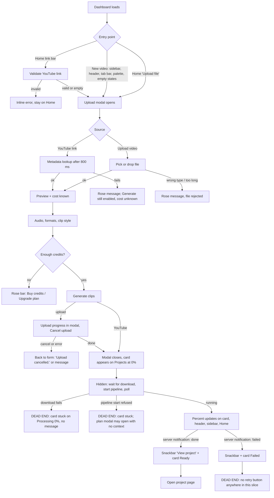
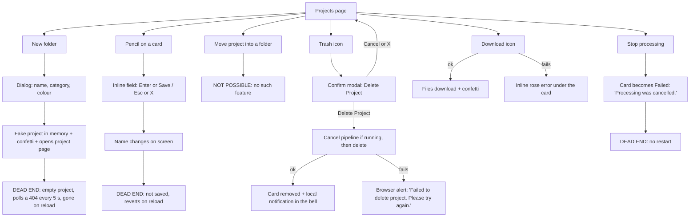
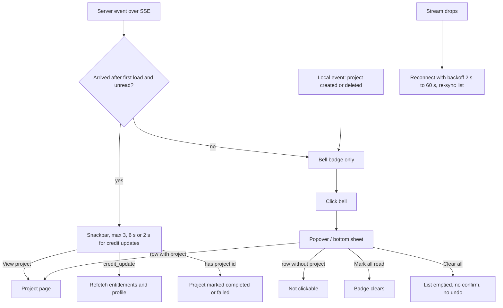
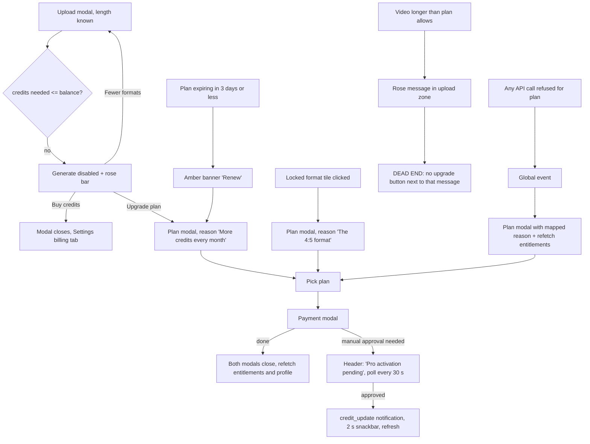

# 04 — Dashboard shell, home, projects and upload

Wave 0 audit of the existing frontend. Read-only; nothing in the code was changed.

**Scope read end to end (23 files, 5,974 lines):**
`frontend/components/dashboard/` — `DashboardApp.tsx` (1021), `Sidebar.tsx` (499), `Header.tsx` (263), `MobileTabBar.tsx` (88), `CommandPalette.tsx` (251), `NotificationsDrawer.tsx` (153), `SnackbarStack.tsx` (99), `EntitlementsProvider.tsx` (111), `CreditsPopover.tsx` (109), `PlanBanner.tsx` (86), `ProLockBadge.tsx` (53), `Avatar.tsx` (50), `DashboardHomeView.tsx` (717), `ProjectFoldersView.tsx` (855), `UploadModal.tsx` (1075), `PipelineProgressTracker.tsx` (226), `PipelineStepIndicator.tsx` (103), `OutputFormatPicker.tsx` (125)
`frontend/app/dashboard/` — `(shell)/layout.tsx` (11), `(shell)/page.tsx` (3), `(shell)/folders/page.tsx` (3), `(shell)/projects/[projectId]/page.tsx` (3), `connect/[platform]/page.tsx` (70)

Also read to follow imports (not documented here): `hooks/useEntitlements.ts`, `hooks/usePlan.ts`, `hooks/useFeatureFlags.ts`, `hooks/useNotificationInbox.ts`, `hooks/usePipelineProgress.ts`, `components/ui/{StatusPill,PageHeader,NotWiredBadge,LogoMark}.tsx`, `components/skeletons/DashboardSkeleton.tsx`, `components/dashboard/ChannelIntroNudge.tsx`, `lib/auth.ts`, parts of `lib/api.ts` and `lib/utils/urlParser.ts`.

Paths below are relative to `frontend/` unless they start with `components/dashboard/`, in which case the short file name is used (`DashboardApp.tsx:105`).

---

## 0. The ten things to know first

1. **One 1,021-line component owns everything.** `DashboardApp` is mounted by the route-group layout and holds every piece of app state (user, workspaces, projects, active project, selected clip, pipeline steps, six modal flags, notifications, snackbars). The `page.tsx` files return `null`; they exist only to register URLs (`app/dashboard/(shell)/layout.tsx:3-8`).
2. **Routing is half URL, half memory.** The view comes from the pathname (`DashboardApp.tsx:52-69`), but the Settings sub-tab, the selected clip, the "active project" on non-project pages and every modal live only in React state.
3. **"Folder" and "project" are the same thing.** The route is `/dashboard/folders`, the page title is "Projects", the code says `folderName`. Real folders do not exist: "New folder" makes a fake project in memory that vanishes on reload (`ProjectFoldersView.tsx:143-176`, badge at `:599`).
4. **Rename is not saved.** There is no rename endpoint in `lib/api.ts`; `handleRenameFolder` only edits local state (`DashboardApp.tsx:610-620`). The name typed into the upload modal's "Project name" field is not sent to the server either. Both revert to the server title on reload, with no warning badge.
5. **The detailed pipeline tracker is unreachable.** `PipelineProgressTracker` sits behind a branch that cannot be hit in a normal run (`UploadModal.tsx:941-1023`, explained in 7.1). The user only ever sees a percentage.
6. **A processing project cannot be opened.** Every entry point routes to the Projects list instead, so the step list in `PipelineStepIndicator` is only seen after a failure or by typing the URL.
7. **Only one project is polled.** The status poll follows `activeProject` alone (`DashboardApp.tsx:386-485`); other processing projects keep the percentage from page load until a server notification flips them to done.
8. **Several failures are silent.** A failed initial load leaves the skeleton up forever (`DashboardApp.tsx:370-374, 733`). A failed YouTube download or pipeline start leaves the card on "Processing 0%" with no message (`UploadModal.tsx:306-317, 388-390`).
9. **The credit balance goes stale.** Header and sidebar read the profile; the upload modal reads entitlements. Neither is refetched after a run is charged.
10. **Three upload options do nothing.** "Auto filler & silence cut", "Auto sound effects" and "Dynamic auto-zoom" are never sent to the pipeline (already badged "Not wired", `UploadModal.tsx:848, 882, 925`).

---

## 1. Component inventory

Legend for the decision column: **KEEP** = reuse mostly as is, **REBUILD** = keep the behaviour, rewrite the component, **DELETE** = remove.

### 1.1 Summary table

| Component | Lines | Used by | Decision | Reason |
|---|---|---|---|---|
| `DashboardApp` | 1021 | `app/dashboard/(shell)/layout.tsx:1` | REBUILD | God component; split into providers, a layout and per-route pages |
| `Sidebar` | 499 | `DashboardApp.tsx:6` | REBUILD | Renders its whole tree two or three times; duplicate DOM ids; tablet rail has no way to expand |
| `Header` | 263 | `DashboardApp.tsx:7` | REBUILD | Too many chips fighting for space at seven different breakpoints |
| `MobileTabBar` | 88 | `DashboardApp.tsx:26` | KEEP | Small, correct, good a11y; restyle only |
| `CommandPalette` | 251 | `DashboardApp.tsx:27` | KEEP | Solid combobox pattern; add missing pages, focus trap |
| `NotificationsDrawer` | 153 | `DashboardApp.tsx:19` | REBUILD | Misnamed (it is a popover / bottom sheet); no per-item read, no focus management |
| `SnackbarStack` | 99 | `DashboardApp.tsx:20` | KEEP | Good pause-on-hover and tab-visibility logic; needs more tones than success/fail |
| `EntitlementsProvider` | 111 | `DashboardApp.tsx:24` | KEEP | Right idea and right place; small fixes (7.2) |
| `CreditsPopover` | 109 | `Header.tsx:9` | REBUILD | Third copy of the credit bar; merge with sidebar and Home credit cards |
| `PlanBanner` | 86 | `DashboardApp.tsx:23` | KEEP | Works; fix "Pro" hard-coding and unhandled rejection |
| `ProLockBadge` (+ `UpgradeHint`) | 53 | 9 importers (Settings, BrandKit, OutputFormatPicker, ChannelIntroPanel, HookTransitionPanel, studio top bar, Captions/Format panels, `social/PublishComposer`) | KEEP | Clean primitive; move to `components/ui` |
| `Avatar` | 50 | `Header`, `Sidebar`, `SettingsView`, `AuthModal` | KEEP | Fine; add image-error fallback; move to `components/ui` |
| `DashboardHomeView` | 717 | `DashboardApp.tsx:9` | REBUILD | Seven unrelated sections in one file; will be replaced by the prompt-first home |
| `ProjectFoldersView` | 855 | `DashboardApp.tsx:10` | REBUILD | Card, row, toolbar and a fake-folder dialog in one file; dead filters |
| `UploadModal` | 1075 | `DashboardApp.tsx:8` | REBUILD | Form, uploader, downloader and pipeline orchestration in one function with unreachable tail |
| `PipelineProgressTracker` | 226 | `UploadModal.tsx:30` only | DELETE (or rebuild as the real progress page) | Imported once, but in a branch that normal flow never reaches — effectively dead |
| `PipelineStepIndicator` | 103 | `ClipGeneratorView.tsx:23` (other slice) | REBUILD | Useful, but duplicates the tracker's label map and hides itself when healthy |
| `OutputFormatPicker` | 125 | `UploadModal.tsx:31` | KEEP | Good, self-contained, plan-aware |
| `(shell)/layout.tsx` | 11 | Next router | REBUILD | Should render `children`; today it discards them |
| `(shell)/page.tsx`, `folders/page.tsx`, `projects/[projectId]/page.tsx` | 3 each | Next router | REBUILD | Return `null`; should own their views |
| `connect/[platform]/page.tsx` | 70 | Next router (OAuth return) | KEEP | Careful and small; restyle |

**Zero-importer components in this slice:** none. **Effectively dead:** `PipelineProgressTracker` (see 7.1), plus `UploadModal.tsx:392-440`.

### 1.2 `DashboardApp` — `DashboardApp.tsx`

**Purpose.** Auth gate, data loader, router, state store, modal host and layout for every signed-in page.

**Props.** None (default export).

**State (all `useState`, no reducer, no store).**

| State | Line | Notes |
|---|---|---|
| `isAuthed: boolean \| null` | 116 | `null` until the token check runs after mount |
| `activeSettingsTab` | 128 | `'account' \| 'billing' \| 'social' \| 'team'`; seeded from `?tab=` on each pathname change (134-137) |
| `projects`, `projectsLoaded` | 140-142 | Whole project list with clip summaries |
| `activeProject`, `selectedClip` | 143-144 | "What is open"; defaults to the newest project even on Home (337-342) |
| `pipelineSteps` | 145 | Steps for the active project only |
| `isAudioReverted` | 146 | Global, not per project |
| `isSidebarCollapsed`, `isMobileMenuOpen` | 164-165 | Collapse is not persisted |
| `currentUser`, `workspaces` | 168-169 | |
| `isNotificationsOpen`, `snackbars` | 172-173 | Snackbars capped at 3 (180) |
| `isAuthModalOpen` | 199 | Account / workspace switcher |
| `isUploadOpen`, `uploadOptions` | 202-203 | |
| `isPaletteOpen` | 210 | |
| `isPlanModalOpen`, `entitlementsRefreshKey`, `upgradeReason` | 223-226 | |
| `isPaymentModalOpen`, `selectedPlan` | 233-234 | |
| `isDeleteModalOpen`, `deleteTargetId` | 237-238 | |

Hooks: `useRouter`, `usePathname`, `useParams` (106-113), `useFeatureFlags` (129), `useNotificationInbox` (174-193).

**Effects.**

| Lines | What it does |
|---|---|
| 118-124 | Token check; no token → `router.replace('/')` |
| 134-137 | Reads `?tab=` for Settings on every pathname change |
| 211-220 | Global ⌘K / Ctrl+K toggles the palette |
| 240-253 | Syncs `activeProject` / `selectedClip` from the URL; unknown id → `/dashboard/folders` |
| 256-384 | Initial load: profile + workspaces + projects in parallel, paint, then one batched status call |
| 386-485 | For the active project: fetch playable clips if finished, else poll status every 5 s |

**API calls.** `userApi.getMe` (263, 711), `workspaceApi.list` (264), `clipApi.listProjects` (265), `pipelineApi.getStatusBatch` (347), `clipApi.listClips` (397), `pipelineApi.getStatus` (469, 491), `pipelineApi.revertStep` (490, 848), `pipelineApi.cancel` (500, 575), `pipelineApi.resume` (856), `clipApi.deleteProject` (580), `authApi.logout` (692). Notifications via `useNotificationInbox` (list + SSE).

**Visual states.**

| State | Present? | Detail |
|---|---|---|
| Loading | Yes | `DashboardSkeleton` until auth and profile resolve (733-735) |
| Error (load failed) | **Missing** | Non-auth errors are swallowed (370-374); `currentUser` stays `null`, skeleton never goes away |
| Empty | Delegated | Home and Projects render their own |
| Feature flag off for current route | **Missing** | `/dashboard/scheduler`, `/reels`, `/editor` render an empty `<main>` (865, 879, 881) |
| Delete confirm | Yes | Inline modal (965-1006); no busy state, failure uses `alert()` (605) |

**Responsive.** Flex row: sidebar + column. Main is `max-w-[1600px]`, padding `px-4 pt-5 pb-28` on phones (room for the tab bar), `sm:px-6 sm:pt-6`, `md:pb-10`, `lg:px-8` (797). The clip editor replaces the whole shell (745-755).

**Keyboard.** ⌘K / Ctrl+K only. Delete modal has no Escape and no focus trap.

**A11y.** Delete modal lacks `role="dialog"`, `aria-modal`, a label, and uses a literal "✕" with no `aria-label` (978-983).

### 1.3 `Sidebar` — `Sidebar.tsx`

**Purpose.** Brand, workspace switcher, primary "New video" button, navigation, recent projects, admin links, credit meter, signed-in user.

**Props** (36-54): `activeTab`, `onTabChange(tab)`, `onOpenUpload`, `user`, `workspaces`, `projects?`, `projectsLoading?`, `activeProject?`, `onSelectProject?`, `selectedClip?`, `onOpenAuthModal`, `onOpenBilling?`, `isCollapsed`, `onToggleCollapse`, `isMobileOpen`, `onCloseMobile`.

**State.** None of its own. Reads `useEntitlements()` and `useFeatureFlags()` (81-82).

**Effects / API.** None.

**Visual states.** Active item: `bg-neutral-800/80`, white bold text, amber icon, 3 px amber bar on the left edge (162-170). Hover: `hover:bg-neutral-900`. Loading: three skeleton rows for recent projects (311-322); plan badge hidden while the plan loads (202). Empty: the "Recent projects" block is simply absent with no projects (324). Error / disabled: none.

**Responsive** (472-497).

| Width | Behaviour |
|---|---|
| `< md` | No sidebar; a 288 px drawer (`w-72 max-w-[85vw]`) opens from "More" in the tab bar |
| `md` to `< lg` | Fixed 72 px icon rail, always collapsed, **no expand button** (both toggles are `hidden lg:flex`, 215 and 461) and no way to open the drawer (the only trigger is in the `md:hidden` tab bar) |
| `>= lg` | 256 px (`w-64`), collapsible to 76 px with a 300 ms width transition |

**Keyboard.** Native buttons only. Drawer has no Escape handler and no focus trap.

**A11y.** `nav aria-label="Main"`, `aria-current="page"`, drawer has `role="dialog" aria-modal`. Collapsed items rely on `title` for their name. Credit bar is `role="img"` with a full label (425-426). **Duplicate ids:** the rail and the desktop sidebar are both always in the DOM, so `sidebar-nav-<tab>` appears twice, three times with the drawer open (154).

### 1.4 `Header` — `Header.tsx`

**Purpose.** Sticky top bar: breadcrumb, search trigger, background-job chip, workspace, plan, credits, upgrade, notifications, "New video", avatar.

**Props** (11-25): `activeTab`, `onOpenUpload`, `user`, `workspaces`, `projects`, `activeProject?`, `selectedClip?`, `unreadNotificationsCount`, `onOpenNotifications`, `onOpenAuthModal`, `onOpenCommandPalette`, `onNavigateTab`, `onUpgradePlan?`.

**State.** None. Reads `useEntitlements()` (77).

**Visual states.** Plan chip shows a skeleton while loading (179-181). Paid plan = amber chip with crown; free = neutral chip. Free with pending payment = static "Pro activation pending" pill (204-212). Notification badge shows a count, "9+" past nine (233-237). No error or disabled states.

**Responsive.** Height 56 px, 64 px from `md`. What appears when:

| Element | Visible from |
|---|---|
| Logo mark | below `md` only |
| Breadcrumb parents and chevrons | `md` |
| Search as icon button | `sm` (plain icon below `sm`) |
| Search as a labelled field with ⌘K | `lg` (224 px), `xl` (288 px) |
| Job chip project name | `xl` |
| Workspace chip | `2xl` |
| Plan chip | `md` |
| Credits chip | always; the word "credits" from `sm` |
| Upgrade / pending pill | `lg` |
| Bell | always |
| "New video" | `md` |
| Avatar | `sm` |

**Keyboard / a11y.** `nav aria-label="Breadcrumb"` with `aria-current`. Search button has `aria-keyshortcuts`. Bell label includes the unread count. The job chip lists all jobs only in a `title` attribute (158), which touch and screen-reader users will not get.

### 1.5 `MobileTabBar` — `MobileTabBar.tsx`

**Purpose.** Phone navigation: Home, Projects, a raised centre "New video" button, a fourth tab, More.

**Props** (7-13): `activeTab`, `onTabChange`, `onOpenUpload`, `onOpenMore`. **State:** none; reads flags (20).

**Fourth tab** (24-28): Scheduler if `social_publishing`, else Reels if `broll_studio.reels`, else Brand.

**States.** Active = amber text. "Projects" is active for `folders`, `generator` and `editor` (32). "More" lights up for any tab not otherwise covered (36). No hover (touch); `active:` tint.

**Responsive.** `md:hidden`, fixed bottom, 64 px plus the safe-area inset (60).

**A11y.** `nav aria-label="Main"` (the same label as the sidebar nav), `aria-current`, centre button has `aria-label="New video"`.

### 1.6 `CommandPalette` — `CommandPalette.tsx`

**Purpose.** ⌘K search over pages, actions, loaded projects and their clips, all client-side.

**Props** (23-32): `isOpen`, `onClose`, `projects`, `onNavigate`, `onOpenUpload`, `onOpenBilling`, `onOpenProject`, `onOpenClip`.

**State.** `query`, `activeIndex` (62-63); refs for the input and the list (64-65).

**Effects.** Reset and focus on open (67-74); reset the index on query change (137-139); scroll the active row into view (141-145).

**Behaviour.** Empty query shows Actions, Projects, Pages (no clips). With a query the order is Projects, Clips, Actions, Pages. Six results per group (44, 123-135). All terms must match label + keywords + group name.

**Visual states.** Active row `bg-neutral-800` with a return-key glyph. Empty: `No matches for “{query}”` (209). No loading (data is already in memory).

**Keyboard.** Up/Down, Enter, Escape (154-169). Mouse move sets the active row.

**A11y.** `role="dialog" aria-modal`, input `role="combobox"` with `aria-activedescendant`, list `role="listbox"`, rows `role="option"`. Group headings are plain `div`s inside the listbox. No focus trap; Tab leaves the dialog.

### 1.7 `NotificationsDrawer` — `NotificationsDrawer.tsx`

**Purpose.** Notification list. A popover under the bell from `md`; a bottom sheet on phones (despite the name).

**Props** (6-14): `isOpen`, `onClose`, `notifications`, `onMarkAllRead`, `onClearAll`, `onView?`.

**State.** None. **Effect:** Escape closes (36-43).

**Visual states.** Empty: bell in a circle, "You’re all caught up", "We’ll let you know when clips are ready or a post goes out." (92-98). Unread: white title plus an amber dot. Rows without a project are `disabled` buttons with `cursor-default` (108, 115). "Mark all read" disabled at zero unread. Loading and error states are **missing** (the list silently stays empty if the fetch fails).

**Icon and tint per kind** (16-22): render complete = green check, render failed = rose triangle, scheduled post = sky calendar, virality alert = amber flame, credit update = violet bolt.

**Responsive.** Phone: full-width sheet, `max-h-[80dvh]`, grab handle, `bg-black/60` scrim. Desktop: 400 px wide, `top-[4.5rem] right-4`, `max-h-[70vh]`, lighter scrim.

**A11y.** `role="dialog"` with a label but no `aria-modal` and no focus move or trap.

### 1.8 `SnackbarStack` — `SnackbarStack.tsx`

**Purpose.** Toasts for server notifications that arrive while the dashboard is open.

**Props** (10-15): `items`, `onDismiss(id)`, `onView(notification)`.

**State (per toast).** `isHovered`, `isTabVisible`, `remainingMs` ref (22-24). Auto-dismiss 6 s; 2 s for credit updates (6-8). The timer pauses on hover and while the tab is hidden (34-42).

**Visual states.** Only two looks: failed (rose border, triangle) and everything else (green border, check) (44-59). "View project" link appears when the notification has a project (63-73).

**Responsive.** Phone: full width, 16 px from the bottom — on top of the tab bar. Desktop: 384 px, bottom-right.

**A11y.** Container `aria-live="polite"` and each toast `role="status"` (may announce twice). Dismiss has a label. No hover-equivalent pause for keyboard focus.

### 1.9 `EntitlementsProvider` — `EntitlementsProvider.tsx`

**Purpose.** Fetches plan capabilities and exposes `{ entitlements, isLoading, promptUpgrade, refresh }`.

**Props** (18-26): `children`, `isAuthed`, `onPromptUpgrade(reason?)`, `refreshKey?`.

**State.** `entitlements` (starts as a Free-shaped fallback), `isLoading` (34-36).

**Effects.** Load on mount and when `refreshKey` changes (56-65). Refetch when the tab becomes visible; poll every 30 s while a payment is pending (70-83). Listen for the global `clipnera:upgrade-required` event, open the plan modal with a reason, and refetch (87-94).

**API.** `subscriptionApi.getEntitlements` (45).

**States.** Loading yes. Error: falls back to Free silently (47-50) — a paid user with a network blip sees locks and "Upgrade".

### 1.10 `CreditsPopover` — `CreditsPopover.tsx`

**Purpose.** Header credit chip with an explainer panel.

**Props:** `remaining`, `total`, `onManagePlan`. **State:** `isOpen`, container ref. **Effect:** outside click and Escape close it (19-33).

**States.** Default / hover / open. No loading (shows whatever the profile holds). Bought-credit line only when there are any (76-80).

**Responsive.** Panel `w-72 max-w-[calc(100vw-2rem)]`, anchored right.

**A11y.** `aria-expanded`, `aria-haspopup="dialog"`, panel `role="dialog"`. Focus does not move into the panel. Buttons lack `type="button"`.

### 1.11 `PlanBanner` — `PlanBanner.tsx`

**Purpose.** A strip above every view: renewal reminder within 3 days of expiry, or a one-time "features moved to Pro" notice.

**Props:** none. **State:** `dismissing` (23). **API:** `userApi.dismissPlanNotice` then `refresh()` (28-29).

**States.** Hidden (default), expiring (amber), notice (violet), dismiss button disabled while saving. Error **missing**: `dismissNotice` has `try/finally` with no `catch` (25-33).

### 1.12 `ProLockBadge` and `UpgradeHint` — `ProLockBadge.tsx`

**Purpose.** A small amber "PRO" pill with a lock, and an inline "locked — Upgrade" row.

**Props.** `ProLockBadge`: `feature?`, `className?`, `size?: 'sm' | 'md'`. `UpgradeHint`: `message`, `onUpgrade`, `className?`.

Stateless. The explanation is in `title` only.

### 1.13 `Avatar` — `Avatar.tsx`

**Props:** `initials`, `src?`, `alt`, `className?`. Shows the image if there is one, otherwise initials on one of eight gradients picked by hashing the name (11-28). Rounded square (`rounded-xl`), not a circle. No fallback if the image fails to load.

### 1.14 `DashboardHomeView` — `DashboardHomeView.tsx`

**Purpose.** The Home page.

**Props** (43-55): `user`, `projects`, `workspaces`, `projectsLoading?`, `onSelectProject`, `onOpenClip`, `onScheduleClip`, `onOpenUpload(options?)`, `onCancelPipeline`, `onNavigateTab`, `onUpgradePlan?`. Also exports `OpenUploadOptions` (38-41).

**State** (83-90): `stats`, `link`, `linkError`, `upcoming`, `hasConnectedAccount`, `brandCustomized`, `checklistDismissed` (starts `true` to avoid a flash), `greeting`.

**Effects.** Greeting and checklist flag after mount (94-103). Stats and brand kit (105-122). Social posts and connections when publishing is on (124-146).

**API.** `analyticsApi.getDashboardStats`, `brandKitApi.getMe`, `socialApi.listPosts(['scheduled','publishing','published'], 10)`, `socialApi.getConnections`.

**localStorage.** `clipnera.setupChecklistDismissed` (57).

**Visual states.**

| Section | Loading | Empty | Error |
|---|---|---|---|
| Link form | — | — | Inline rose text |
| Processing | — | "Nothing processing" card | — |
| Credits | **Missing** (renders the profile numbers immediately) | — | — |
| Stats | `StatsSkeleton` | — | **Masked**: on failure shows zeros and "7:00 PM" as if real (110-114) |
| Top clips | **Missing** (shows "No clips yet" while projects load) | Dashed card | — |
| Up next | Spinner "Loading posts…" | "Nothing scheduled…" | Treated as empty |
| Checklist | Hidden while loading | Hidden when all done | — |
| Recent projects | **Missing** (shows "No projects yet" while loading) | Dashed card with a button | — |

**Responsive.** Processing + Credits: one column, then `1.6fr / 1fr` at `lg`. Stats: 2 columns, 4 at `lg`. Top clips: 2 / 3 (`sm`) / 4 (`lg`) / 5 (`xl`). Recent projects: 1 / 2 / 3. Header buttons hidden below `sm`.

**A11y.** Sections have `aria-label` or `aria-labelledby`; the link input has a hidden label, `aria-invalid` and `aria-describedby`; progress bars have `role="progressbar"`.

### 1.15 `ProjectFoldersView` — `ProjectFoldersView.tsx`

**Purpose.** The Projects page: summary, search and filters, grid or list, rename, download all, delete, and the local-only "New folder" dialog.

**Props** (87-98): `projects`, `isLoading?`, `activeProject?`, `onSelectProject`, `onOpenFolder`, `onCreateFolder`, `onRenameFolder`, `onDeleteFolder`, `onOpenUploadModal`, `onCancelPipeline?`.

**State** (112-123): `searchQuery`, `categoryFilter`, `statusFilter`, `viewMode`, `renamingProjectId`, `renameValue`, `isNewFolderModalOpen`, `newFolderName`, `newFolderCategory`, `newFolderColor`, `exportingProjectId`, `exportError`.

**Effects.** Restore grid/list from `clipnera.projectsView` (125-132).

**API.** None directly. `exportAllProjectClips` from `lib/utils/clipExport` (182).

**Visual states.**

| State | Detail |
|---|---|
| Loading | Summary skeleton only; the project area renders **nothing** (713) though `ProjectCardGridSkeleton` exists |
| Empty | "No projects yet" + "New video" |
| Filtered empty | "No projects match these filters" + "Clear filters" |
| Card hover | Border lightens, thumbnail scales to 1.03, rename pencil fades in |
| Selected card | Amber border and ring, green check in "Open project" |
| Processing card | Dimmed thumbnail, progress bar on its bottom edge, "Stop processing" replaces "Open project" |
| Failed card | Rose message box |
| Export error | Inline `role="alert"` text under the card |
| Rename saving / delete busy | **Missing** |

**Responsive.** Grid 1 / 2 (`sm`) / 3 (`xl`) / 4 (`2xl`). Toolbar stacks below `md`. Filter chips scroll sideways and bleed to the screen edge on phones (702). The rename pencil is always visible on touch, hover-only from `sm`. New-folder dialog is a bottom sheet on phones.

**Keyboard.** Rename: Enter saves, Escape cancels (259-272). New-folder dialog: no Escape.

**A11y.** Good: `aria-pressed` on filters and layout toggles, `role="radiogroup"` for colours, labelled icon buttons. Colour swatches are named only by colour word.

### 1.16 `UploadModal` — `UploadModal.tsx`

**Purpose.** "New video": pick a source, set options, see the cost, start. Also uploads the file, waits for the download, starts the pipeline and polls it — after the modal has closed.

**Props** (46-54): `isOpen`, `initialUrl?`, `initialMode?`, `onClose`, `onProjectCreated(project)`.

**State** (63-106), 27 `useState` and 2 refs:

| Group | State |
|---|---|
| Source | `sourceMode`, `urlInput`, `uploadFile`, `uploadDuration`, `uploadError`, `uploadAbortRef` |
| Naming | `customTitle`, `customFolderName` |
| Formats | `outputRatios` (default `['9:16']`) |
| Clip style | `autoBroll`, `autoSfx`*, `removeFillers`*, `autoZoom`*, `captionScript` (* never sent) |
| Audio | `aiDenoise`, `noiseSuppressionStrength` (90), `deReverb`, `vocalClarityEq`, `humFilter` |
| Run | `isProcessing`, `processingStep` (written, never read), `processingLogs`, `downloadProgress`, `downloadUnsubRef` |
| Metadata | `metadataLoading`, `ytMeta`, `ytMetaError` |
| Pipeline | `pipelineStarted`, `pipelineProjectId`, `pipelineSteps`, `creditsDeducted`, `pipelineError` |

**Effects.** Debounced (800 ms) YouTube metadata fetch (108-141). Apply `initialMode` / `initialUrl` on open (144-148). Abort and unsubscribe on unmount (150-155).

**API.** `clipApi.fetchYoutubeMetadata` (118), `uploadApi.uploadVideo` (196), `clipApi.downloadYoutube` (243), `clipApi.subscribeDownloadProgress` (282), `pipelineApi.start` (347), `pipelineApi.getStatus` every 2 s (358).

**Visual states.** See section 3.4. Missing: any visible error for a failed YouTube download or a failed pipeline start; a drag-over highlight; a busy state on the primary button.

**Responsive.** Bottom sheet on phones (`max-h-[94dvh]`, rounded top), centred `max-w-3xl` dialog from `sm`. "Cancel" hidden on phones.

**Keyboard.** None. No Escape, no focus trap, focus is not moved into the dialog.

**A11y.** `role="dialog" aria-modal aria-labelledby`. Source switch uses `role="tablist"` / `tab` with no tab panels. The caption-script `radiogroup` has no label. The strength slider and the three audio checkboxes have visual labels; the slider has no `aria-label` or associated `<label>`.

### 1.17 `PipelineProgressTracker` — `PipelineProgressTracker.tsx`

**Purpose.** Full step-by-step progress with live messages, driven by `usePipelineProgress` (SSE plus a 3 s poll).

**Props** (6-12): `projectId`, `selectedSteps`, `creditsDeducted`, `isDownloadComplete?`, `downloadProgress?`.

**States.** Pre-pipeline (upload/download bar), running step list (pending ring / spinner / green check / rose cross), live message line, error box. No empty or completed summary state.

**Status: unreachable in normal use** (7.1). Contains engineer-facing copy: "Fast parallel upload to S3 (10 workers, 50MB chunks)" (84), "Uploading to S3..." (110).

### 1.18 `PipelineStepIndicator` — `PipelineStepIndicator.tsx`

**Purpose.** Compact progress card on the project page (rendered by `ClipGeneratorView`, another slice).

**Props:** `steps`, `onRevert?(step)`.

**Behaviour.** Returns `null` with no steps or when every step finished cleanly (31, 42). Otherwise shows "PROCESSING", a percentage, a bar (amber, green at 100, rose on failure), and one row per failed or reverted step. Reverted rows get a "Re-run" button (90-98). Failed rows have **no action**.

### 1.19 `OutputFormatPicker` — `OutputFormatPicker.tsx`

**Purpose.** Choose output shapes with plan gating and a live cost line.

**Props** (30-36): `value: AspectRatio[]`, `onChange`, `durationSeconds: number | null`.

**States.** Selected (amber border and ring, filled glyph), unlocked, locked (70 % opacity + PRO pill; click opens the upgrade modal with "The 4:5 format" etc.). Cannot deselect the last format (53).

**Responsive.** 2 columns, 4 from `sm`.

**A11y.** `role="group"` with a label, `aria-pressed`, `aria-disabled` on locked tiles (which are still clickable by design).

### 1.20 Route files

| File | What it renders |
|---|---|
| `app/dashboard/(shell)/layout.tsx` | `<DashboardApp />`. Does **not** accept or render `children` (9-11) |
| `(shell)/page.tsx`, `(shell)/folders/page.tsx`, `(shell)/projects/[projectId]/page.tsx` | `return null` |
| `app/dashboard/connect/[platform]/page.tsx` | Standalone OAuth return screen outside the shell. Reads `code` / `state` once, strips them from the address bar (30), calls `socialApi.completeConnect`, then goes to `/dashboard/settings?tab=social`. States: connecting spinner; error card with "Back to settings". Accepts `youtube`, `tiktok`, `instagram`, `x` (9) |

---

## 2. How the shell works

### 2.1 Which view shows

URL decides the view; one layout stays mounted so data survives navigation.

| URL | `TabType` | View rendered | Gate |
|---|---|---|---|
| `/dashboard` | `dashboard` | `DashboardHomeView` | — |
| `/dashboard/folders` | `folders` | `ProjectFoldersView` | — |
| `/dashboard/projects/:projectId` | `generator` | `ClipGeneratorView` | Unknown id → redirect to `/dashboard/folders` |
| `/dashboard/projects/:projectId/edit/:clipId` | `editor` | `VideoEditorStudio`, **full screen, no sidebar/header/tab bar** | — |
| `/dashboard/scheduler` | `scheduler` | `SocialSchedulerView` | `flags.social_publishing`, else blank |
| `/dashboard/analytics` | `analytics` | `ViralAnalyticsView` | — |
| `/dashboard/brand-kit` | `brand_kit` | `BrandKitView` | — |
| `/dashboard/reels`, `/reels/:reelId`, `/reels/footage/:editId` | `reels` | `ReelsView` | `flags['broll_studio.reels']`, else blank |
| `/dashboard/editor`, `/editor/:editorProjectId` | `video_editor` | `EditorView` | `flags.agent_editor`, else blank |
| `/dashboard/settings` | `settings` | `SettingsView` | Sub-tab in state; `?tab=billing\|social\|team` read on arrival |
| anything else under `/dashboard` | `dashboard` | Home | — |

Mapping in `DashboardApp.tsx:52-69`; reverse mapping in `:71-103`; render switch in `:745-893`.

**What is not in the URL:** Settings sub-tab after arrival, the selected clip (except in the editor route), the active project on non-project pages, search and filter state on Projects, grid/list (localStorage), every modal, sidebar collapse.

`navigateToTab(tab, projectId?, clipId?)` (148-161) fills in the active project and selected clip when the caller omits them, so "Clips" in the sidebar means "clips of whatever was last open".

### 2.2 Navigation items

**Sidebar** (`Sidebar.tsx:85-123`)

| Group | Label | Target | Badge | Gate |
|---|---|---|---|---|
| (top) | Logo "Clipnera" + plan pill | Home | Plan name | — |
| (top) | Workspace card | Opens account / workspace modal | "{Plan} plan · N workspaces" | Expanded only |
| (top) | **New video** | Opens upload modal | — | — |
| Create | Home | `/dashboard` | — | — |
| Create | Projects | `/dashboard/folders` | Project count | — |
| Create | Reels | `/dashboard/reels` | — | `broll_studio.reels` |
| Create | Editor | `/dashboard/editor` | "New" | `agent_editor` |
| {Active project name} | Clips | `/dashboard/projects/:id` | Clip count | Only when a project is active (in practice always, once any project exists) |
| {Active project name} | Edit clip | `/dashboard/projects/:id/edit/:clipId` | "Open" when a clip is selected | Same |
| Publish | Scheduler | `/dashboard/scheduler` | — | `social_publishing` |
| Brand & account | Brand kit | `/dashboard/brand-kit` | — | — |
| Brand & account | Settings & billing | `/dashboard/settings` | — | — |
| Recent projects | Up to 4 projects | Project page; a processing one goes to Projects | Clip count or `NN%` | Expanded only |
| Recent projects | View all | `/dashboard/folders` | — | — |
| Admin | Overview, Users, Payments, Credits, Social accounts, AI usage | `/admin/overview`, `/admin/users`, `/admin/payments`, `/admin/credits`, `/admin/social`, `/admin/usage` | — | `user.role === 'admin'` |
| (bottom) | Credits card: "Buy credits" | Settings → billing | — | — |
| (bottom) | User row | Account / workspace modal | — | — |
| (bottom) | Collapse / expand | — | — | `lg` and up |

**Not in the sidebar:** Analytics (reachable only from a Home shortcut card or by URL), Notifications.

**MobileTabBar** (`MobileTabBar.tsx:24-34`): Home · Projects · (+) New video · fourth tab (Schedule / Reels / Brand by flag) · More (opens the drawer).

**CommandPalette** (`CommandPalette.tsx:78-94`)

| Group | Label | Hint | Target | Gate |
|---|---|---|---|---|
| Actions | New video | Paste a link or upload | Upload modal | — |
| Actions | Buy credits | Plan & billing | Settings → billing | — |
| Actions | Connect a social account | Settings | `/dashboard/settings?tab=social` | `social_publishing` |
| Pages | Home | | `/dashboard` | — |
| Pages | Projects | | `/dashboard/folders` | — |
| Pages | Reels | | `/dashboard/reels` | `broll_studio.reels` |
| Pages | Scheduler | | `/dashboard/scheduler` | `social_publishing` |
| Pages | Brand kit | | `/dashboard/brand-kit` | — |
| Pages | Settings | | `/dashboard/settings` | — |
| Projects | each project | `NN%` or "N clips" | Project page (Projects list if processing) | — |
| Clips | each clip | "score NN" | Clip editor | Only when a query is typed |

**Not in the palette:** Analytics, Editor (`agent_editor`), notifications, sign out, workspace switch.

### 2.3 Header contents, left to right

Logo (phones) → breadcrumb → search → job chip (when anything is processing: spinner, name, `NN%`, `+N`) → workspace chip (`2xl`) → plan chip (goes to Settings, whichever sub-tab was last open) → credits chip with popover → "Upgrade" or "Pro activation pending" (free plan only) → bell with unread badge → "New video" → avatar.

Breadcrumbs (`Header.tsx:45-58`): single label on most pages; `Projects › {project}` on a project; `Projects › {project} › Edit clip` in the editor (never seen — the editor hides the header). On the editor route a virality score chip would show at `xl` (118-125), also never seen.

### 2.4 Global overlays

Rendered by `DashboardApp` regardless of view, including on top of the full-screen clip editor (905-1017): CommandPalette, NotificationsDrawer, SnackbarStack, AuthModal, UploadModal, PlanSelectionModal, delete confirmation, PaymentModal.

Stacking order in use:

| Layer | z-index |
|---|---|
| Header | 20 |
| Sidebar; credits popover (inside the header's stacking context) | 30 |
| Mobile tab bar | 40 |
| Modals, drawer, notifications, delete, new folder, upload | 50 |
| Command palette, snackbars | 60 |

### 2.5 Auth and entitlements

- **Auth** is client-only. `isAuthenticated()` reads a token and expiry from localStorage (`lib/auth.ts`). No token → `router.replace('/')` (118-124). An `Unauthorized:` error during the first load clears auth and redirects (371-374). There is no server-side guard, so the skeleton always paints first.
- **Shell blocks on the profile.** Nothing renders until `userApi.getMe` returns (733).
- **Entitlements** wrap the whole tree (738-742). Until they load, a Free-shaped placeholder is used; the header and sidebar hide the plan label during that window, other consumers do not.
- **Upgrade prompts** come from two places: a component calling `promptUpgrade(reason)`, or any API call rejected for plan reasons, which fires `clipnera:upgrade-required` and opens the plan modal automatically (`EntitlementsProvider.tsx:87-94`).
- **Feature flags** (`useFeatureFlags`) are all off until loaded, so flagged nav items pop in after first paint, and a deep link to a flagged page is blank until then.
- **Admin** links show for `role === 'admin'`; the API re-checks.

---

## 3. Screen by screen

All screens: near-black background (`neutral-950`), cards one step lighter (`neutral-900` at 60–80 % opacity) with a 1 px `neutral-800` border and 16 px radius, white headings, grey body text, amber as the only accent for primary actions. Font: Plus Jakarta Sans.

### 3.1 Home (`/dashboard`)

Top to bottom:

1. **Plan banner** (only when relevant). Amber strip: "Your Pro plan expires in N days." / "Your Pro plan expires today." with a "Renew" button. Or a violet strip: "Some features are now part of Pro" + a sentence listing the features, "Your existing brand kits, team members and clips are kept.", a "See plans" link and a close X.
2. **Page header.** Title: "Good morning, {FirstName}" (or "Good afternoon" / "Good evening"; "Welcome back" before mount). Subtitle: "{Workspace} · N projects · N clips". Right: outline button "Upload file", amber button "New video" (both hidden on phones).
3. **Link bar.** One card containing a field with a link icon and placeholder "Paste a YouTube link to get clips", and an amber "Get clips" button with a sparkle icon. Helper text below: "2 credits per minute of video · you’ll confirm formats and cost before anything is charged". Invalid link: "That doesn’t look like a YouTube link. Try one like youtube.com/watch?v=…". Submitting empty opens the modal on the YouTube tab; a valid link opens it prefilled.
4. **Two cards side by side** (stacked below `lg`).
   - **Processing** (wider). Up to three jobs, each: amber "Processing" pill, name, percentage, an 8 px amber progress bar, buttons "View progress" and "Cancel", and right-aligned "We’ll notify you when the clips are ready". More than three: "+N more processing". Nothing running: green check tile, "Nothing processing", "Paste a link or upload a video and it will show up here while it runs."
   - **Credits.** Heading "Credits" with a plan pill ("Pro", "Pro Plus" with a crown, or "Free plan"). Big number "{remaining} of {total} left". A two-colour bar: amber for plan credits, violet for bought credits. Line: "≈ N min of video · resets in N days · N bought credits never expire". Buttons: "Buy credits" and, on Free, "Upgrade to Pro" or the text "Pro activation pending".
5. **Four stat tiles** (2×2 on phones): "Clips created" (hint "ready to post"), "Editing time saved" ("N hours", "compared with cutting by hand"), "Average virality" ("N / 100", "across all clips"), "Best time to post" (e.g. "7:00 PM", "TikTok and Instagram peak").
6. **Top clips.** Heading "Top clips", sub-label "ranked by virality", link "All projects →". Up to five portrait cards: poster with a score ring top-right and "{n}s" bottom-right; title (two lines), project name, an "Edit" button and a square calendar button ("Schedule post"). Empty: dashed box, film icon, "No clips yet", and either "Your first clips will appear here as soon as processing finishes." or "Paste a YouTube link above or upload a long video to get your first ranked clips."
7. **Up next** (only with social publishing on) and **Get set up** (until dismissed or complete), side by side.
   - Up next: heading, "Open scheduler" link, up to three rows (platform tile, clip title, time and handle, status pill "Scheduled" / "Publishing" / "Published"). Empty: "Nothing scheduled. Pick a clip and choose when it goes out."
   - Get set up: "N of M done", a green progress bar, rows with a round checkbox and a "Start" button: "Create your first clips", "Connect a social account"*, "Set your brand colors and watermark", "Schedule or publish a clip"* (* publishing flag). Close X hides it for good on this browser.
8. **Recent projects.** Heading, link "Browse all (N) →". Three horizontal cards: 80 px thumbnail, name, status pill (or `NN%`), "N clips · 3h ago". Empty: "No projects yet", "Each video you add becomes a project with its clips, captions and exports inside.", button "Create your first project".
9. **Shortcuts.** Two wide cards: "Brand kit — Fonts, watermark, colors and caption style" and "Analytics [SAMPLE DATA] — Retention curves and hook tester".

### 3.2 Projects (`/dashboard/folders`)

1. **Page header.** "Projects" / "One project per long video. Its clips, captions and exports live inside." Buttons: "New folder" with a red dashed "LOCAL ONLY" badge, and amber "New video".
2. **Summary strip.** One bordered row split in four: "{N} projects", "{N} clips", "{N} average virality", "{N} min of source video".
3. **Toolbar.** Search field "Search by title, channel or tag". Segmented control "All N / Processing N / Ready N / Failed N". Grid / list toggle.
4. **Filter chips.** "All sources", "YouTube", "Uploads"; a divider; then inside a red dashed outline "Podcasts", "Keynotes", "Masterclasses", "AI prompt stories" with a "NOT WIRED" badge (they never match).
5. **Grid card.**
   - 16:8 thumbnail with a dark gradient; status pill top-left ("Ready", "Failed", "No clips yet", "Processing 42%"); duration bottom-right; a thin amber progress line on the bottom edge while processing.
   - Title (two lines) with a pencil that appears on hover. Editing swaps in a field, "Save" and an X.
   - Meta line: "{channel or Upload} · {relative time}".
   - Optional pills: "Denoised", "⚡ N credits", "Source ↗" (the first two only for projects created in this session).
   - Failed: rose box with the reason or "Processing stopped before clips were ready."
   - Up to four overlapping portrait clip thumbnails + "N clips · average score NN".
   - Up to three `#tag` chips — always `#YouTube #AI #Shorts` or `#Upload #AI #Shorts`, because the tags are hard-coded (`DashboardApp.tsx:313`).
   - Footer: "Open project →" (or "Stop processing" while running), a download icon button, a trash icon button.
6. **List row.** Thumbnail, name with pencil, pill + "N clips · m:ss · 3h ago", then icon buttons: stop (if running), source link, download, delete.
7. **Empty states.** "No projects yet" — "Paste a YouTube link or upload a long video, and it becomes a project with its clips inside." — "New video". Filtered: "No projects match these filters" — "Try a different search or clear the filters." — "Clear filters".
8. **New folder dialog.** Folder icon, "New folder", "Group clips by show, topic or series". Red dashed warning: "LOCAL ONLY — This folder is kept in this tab only and disappears when you reload." Fields: Name (placeholder "e.g. Founder Podcast season 2"), Category (YouTube Ingest, Podcast, Keynote Speech, Webinar, Interview, Masterclass, Custom Upload), Color (six swatches: amber, sky, emerald, rose, purple, indigo). Buttons: "Cancel", "Create and open". Confetti on submit.

### 3.3 Project page (`/dashboard/projects/:projectId`)

The body is `ClipGeneratorView`, which belongs to another slice. What the shell contributes:

- Breadcrumb "Projects › {project name}".
- Sidebar gains a section titled with the project name and a status dot, with "Clips (N)" and "Edit clip".
- Phone tab bar keeps "Projects" highlighted.
- The shell passes the pipeline steps, so `PipelineStepIndicator` shows a "PROCESSING NN%" card with a bar while running, and rows for failed or reverted steps (a reverted row has "Re-run"). It disappears completely once every step is clean.
- Clip data: the list call returns clip summaries without video URLs, so the shell fetches the full clips after opening (up to three retries at 2 s, 4 s, 6 s) (`DashboardApp.tsx:393-430`).

### 3.4 Upload modal ("New video")

Centred dialog up to 768 px wide (bottom sheet on phones). Header: sparkle tile, "New video", "Turn one long video into short clips. You’ll see the cost before anything is charged.", close X. It is one scrolling form with four numbered headings, not a wizard.

**Optional top nudge** (Pro users without a channel intro, once): "Create your channel intro first" … "Create intro" / dismiss.

**① Source**

- Two-way switch "YouTube link | Upload video" — only when the `video_upload` flag is on.
- *YouTube:* label "YouTube link", right note "Creates a new project", URL field with placeholder `https://www.youtube.com/watch?v=dQw4w9WgXcQ`.
  - Not a YouTube link: "Only YouTube video links are supported (youtube.com/watch, youtu.be, or Shorts)."
  - After 800 ms a preview card: skeleton → thumbnail with duration, green "Link verified — confirm it's correct", title, channel in amber, the original link, and a "1080p · 16:9" style chip.
  - Lookup failed: "Could not fetch this YouTube link. Check the URL or your connection."
- *Upload:* dashed drop zone: "Drop a video here or click to choose", "MP4, MOV, WebM or MKV · up to N min on your plan" (30 min on Free). After picking: file row with name, size · duration, green check.
  - Wrong type: "Use an MP4, MOV, WebM or MKV video."
  - Too long: "This video is N min. Your plan supports up to N min per video."
- **Project name** field: "Filled from the video title"; placeholder "Uses the video title if left empty" / "Uses the file name if left empty".

**② Clean up audio**

- "Studio voice" toggle (default on): "Removes room echo, microphone hiss, fan hum and background noise".
- When on: "Strength" slider 30–100 in steps of 5, default 90, readout "90% · Maximum" (≥ 80 Maximum, ≥ 55 Balanced, else Light).
- Three checkboxes, default on: "Remove echo", "Voice clarity EQ", "50/60 Hz hum filter".

**③ Output formats**

- Free: "Every plan renders 9:16. More formats come with Pro." + PRO pill.
- Four tiles: **9:16** Vertical "Shorts · TikTok · Reels"; **4:5** Portrait "Instagram & Facebook feed"; **1:1** Square "Feeds · LinkedIn · X"; **16:9** Landscape "YouTube · Web". Locked tiles are dimmed with a PRO pill; clicking opens the upgrade modal.
- Cost row: "Base 2 credits/min, first format included · +50% per extra format" (or "2 credits per video minute" on Free) and "N credits" once the length is known.
- Not enough credits: rose bar "This video needs **N credits**; you have **N**. Pick fewer formats or get more credits." with "Buy credits" and "Upgrade plan".

**④ Clip style** (right note "Reframed 9:16 · 1:1")

| Option | Default | Sent to server? |
|---|---|---|
| Auto filler & silence cut — "Cut 'um', 'uh', & pauses >0.5s" | On | **No** (badged Not wired) |
| AI B-roll cutaways — "Auto-match footage to concepts · 5 credits per clip that gets B-roll" | On | Yes; shown only with `broll_studio.cutaways` |
| Auto sound effects — "Whooshes, dings, and sub drops" | On | **No** (badged) |
| Hindi / Telugu caption script — Auto / Roman / Native; "Auto writes Hinglish & Tenglish in Roman letters" | Auto | Yes |
| Dynamic auto-zoom — "Zooms in on key words" | On | **No** (badged) |

**Footer.** Left: "**N credits** · N left after" and "N formats · studio voice on"; before the length is known: "Paste a YouTube link to see the cost" / "Checking the video length…" / "Choose a video to see the cost" / "Reading the video length…". Right: "Cancel" and the amber button "Generate clips · N credits".

**Validation and limits in one place**

| Rule | Where |
|---|---|
| URL must parse as a YouTube video id | `UploadModal.tsx:159, 167` |
| File type must be MP4, MOV, WebM or MKV | 174-177 |
| Duration ≤ plan maximum (skipped if the browser cannot read the duration) | 178-183 |
| Estimated credits ≤ balance (skipped while the length is unknown) | 163-167 |
| At least one output format | `OutputFormatPicker.tsx:53` |
| File size | **No client check** |
| Project name length | **No check** |

**What happens after "Generate clips"**

- *Upload:* the form is replaced by a spinner, "Setting up your project", "Uploading your video. Keep this tab open until the upload finishes.", a progress card ("Uploading to cloud... NN%", "Size: …") with "Cancel upload", and a log box with green-check lines. When the upload finishes the modal closes.
- *YouTube:* the same spinner flashes ("Fetching the video from YouTube.") and the modal closes as soon as the server returns a project id.
- In both cases the user lands on Projects with a new "Processing 0%" card. The download wait, the pipeline start and a 2 s status poll continue inside the closed modal (`UploadModal.tsx:280-387`).

### 3.5 Pipeline progress, as actually seen

| Where | What is shown |
|---|---|
| Header chip | Spinner, first job name (`xl`), `NN%`, `+N` |
| Sidebar recent projects | Amber dot, `NN%` |
| Home "Processing" card | Pill, name, `NN%`, bar, "View progress", "Cancel" |
| Projects card / row | "Processing NN%", bar on the thumbnail, "Stop processing" |
| Command palette | `NN%` as the hint |
| Project page (URL only) | "PROCESSING NN%" bar, failed / reverted rows |
| Finish | Snackbar (green) with "View project"; bell badge; card turns "Ready" |
| Failure | Snackbar (rose); card turns "Failed" with a rose message |

The eleven steps requested for every run (`UploadModal.tsx:328-340`): audio extraction, AI noise cancellation, transcription, topic research, visual analysis, content classification, highlight detection, scoring, metadata generation, aspect-ratio render, clip generation. Their names are never shown to the user in the normal flow.

---

## 4. User flows

### 4.1 New video, start to finish

### 4.2 Projects: create, rename, move, delete

### 4.3 Notifications

### 4.4 Out of credits or over a plan limit

### 4.5 Errors and retries

```mermaid
flowchart TD
  A[First load fails, not an auth error] --> X1[DEAD END: skeleton forever, no message, no retry]
  B[First load 401] --> B1[Clear token, go to landing page]
  C[Status batch fails] --> C1[List still shown, percentages stay 0]
  D[Clip fetch fails] --> D1[Retry 3 times: 2 s, 4 s, 6 s] --> D2[Then silent]
  E[Status poll fails] --> E1[Steps cleared, retry in 5 s, forever]
  F[Entitlements fetch fails] --> F1[Silently treated as Free plan]
  G[Stats fetch fails] --> G1[Zeros and '7:00 PM' shown as real numbers]
  H[Delete fails] --> H1[Browser alert]
  I[Cancel pipeline fails] --> I1[Console only; card unchanged]
  J[Revert audio / apply audio fails] --> J1[Unhandled promise rejection]
  K[Project URL with unknown id] --> K1[Redirect to Projects]
  K2[Project URL, account has zero projects] --> X2[DEAD END: no redirect, empty project view]
  L[Flagged page while flag off] --> X3[DEAD END: blank main area]
  M[OAuth return invalid or denied] --> M1[Error card + 'Back to settings']
```

### 4.6 Dead ends, collected

| # | Dead end | Where |
|---|---|---|
| 1 | Initial load error → permanent skeleton | `DashboardApp.tsx:370-374, 733` |
| 2 | YouTube download error after the modal closed → card stuck at 0 % | `UploadModal.tsx:306-317` |
| 3 | Pipeline start error → swallowed, card stuck | `UploadModal.tsx:388-390` |
| 4 | Failed or cancelled project → no retry / restart | `ProjectFoldersView.tsx:428-434`, `PipelineStepIndicator.tsx:90` |
| 5 | Processing project cannot be opened; "View progress" goes to the list | `DashboardHomeView.tsx:308`, `ProjectFoldersView.tsx:202`, `Sidebar.tsx:350-353` |
| 6 | "New folder" → throwaway project | `ProjectFoldersView.tsx:143-176` |
| 7 | Rename and custom project name not saved | `DashboardApp.tsx:610-620`, `UploadModal.tsx:685-692` |
| 8 | Topic filter chips never match | `ProjectFoldersView.tsx:54-59` |
| 9 | Home "Schedule" button with publishing off → blank page | `DashboardHomeView.tsx:477-485`, `DashboardApp.tsx:865` |
| 10 | Home "Upload file" with uploads off → opens the YouTube form | `DashboardHomeView.tsx:218-225`, `UploadModal.tsx:160` |
| 11 | Tablet rail: no recent projects, no expand, no drawer | `Sidebar.tsx:475-477` |
| 12 | Video over the plan length → no upgrade action | `UploadModal.tsx:180-183` |
| 13 | Zero projects + project URL → no redirect | `DashboardApp.tsx:241` |
| 14 | Analytics has no nav entry | `Sidebar.tsx:85-113` |

---

## 5. Modals, drawers, popovers, toasts

| Overlay | Type | File | Trigger | Closes on |
|---|---|---|---|---|
| Upload ("New video") | Modal / bottom sheet | `UploadModal.tsx:443` | Sidebar, header, tab bar "+", palette "New video", Home link bar, Home "Upload file" / "New video", Home and Projects empty states, checklist "Start" | X, "Cancel", backdrop (not while processing), success |
| Delete project | Modal | `DashboardApp.tsx:965` | Trash icon on a card or row | "✕", "Cancel", confirm |
| New folder | Modal / bottom sheet | `ProjectFoldersView.tsx:749` | "New folder" | X, "Cancel", backdrop, submit |
| Command palette | Modal | `CommandPalette.tsx:174` | ⌘K / Ctrl+K, header search | Esc, backdrop, choosing an item, ⌘K |
| Notifications | Popover (`md`+) / bottom sheet | `NotificationsDrawer.tsx:50` | Bell | Esc, backdrop, X, choosing a row |
| Mobile menu | Left drawer | `Sidebar.tsx:489` | Tab bar "More" | X, backdrop, any nav click |
| Credits | Popover | `CreditsPopover.tsx:55` | Header credit chip | Esc, outside click, its button |
| Snackbars | Toast stack | `SnackbarStack.tsx:86` | New unread server notification | Timer, X, "View project" |
| Plan banner | Inline strip | `PlanBanner.tsx:35, 58` | Expiry ≤ 3 days, or `show_plan_notice` | X (notice only) |
| Channel intro nudge | Inline card in the upload modal | `UploadModal.tsx:484` | Pro user without an intro | X, "Create intro" |
| Plan selection | Modal (other slice) | `DashboardApp.tsx:953` | `promptUpgrade`, global upgrade event, banner buttons | — |
| Payment | Modal (other slice) | `DashboardApp.tsx:1009` | Choosing a plan | — |
| Account / workspace ("AuthModal") | Modal (other slice) | `DashboardApp.tsx:934` | Sidebar workspace card, sidebar user row, header workspace chip, header avatar | — |
| Browser `alert()` | Native | `DashboardApp.tsx:605` | Delete failed | OK |
| Confetti | Effect | `ProjectFoldersView.tsx:174, 183` | New folder, download all | — |

Shared gaps: no focus trap in any of them; only the palette, notifications, credits popover and inline rename respond to Escape; none restores focus to its trigger; body scroll is not locked.

---

## 6. Styling

### 6.1 Palette in use

| Role | Classes |
|---|---|
| Page | `bg-neutral-950` |
| Card | `bg-neutral-900/80` (Home, cards), `bg-neutral-900/60` (strips, shortcuts), `bg-neutral-900` (dialogs), `bg-neutral-950/80` (panels inside the upload modal) |
| Border | `border-neutral-800` default, `neutral-700` on hover and on secondary buttons, `neutral-800/80` on header and sidebar |
| Text | `text-white`, `neutral-200/300` body, `neutral-400` secondary, `neutral-500` tertiary (overridden to `#8c8c8c` in `tailwind.config` for contrast) |
| Accent | `amber-500` fill, `amber-400` hover / icon, `amber-300` text on tints, `amber-500/10–15` tint backgrounds |
| Success | `emerald-400/500` |
| Danger | `rose-300/400/500` |
| Info | `sky-400` (scheduled) |
| Violet | bought credits (`Sidebar.tsx:429`, `DashboardHomeView.tsx:364`), plan notice (`PlanBanner.tsx:58`), admin icons (`Sidebar.tsx:392`), credit-update notifications |
| Off-palette | `text-red-400` YouTube icon (`UploadModal.tsx:518`); eight avatar gradients incl. blue, purple, pink, cyan, lime (`Avatar.tsx:11-20`); six folder colours (`ProjectFoldersView.tsx:61-68`); `amber-400` used as a second primary in `ProLockBadge.tsx:47` |

The revamp brief locks the palette to amber and neutral. Violet, sky, the avatar gradients and the folder colours are the things to decide on.

### 6.2 Type scale

Fourteen distinct sizes in this slice, most of them arbitrary values: `text-[9px]`, `[10px]`, `[10.5px]`, `[11px]`, `[11.5px]`, `text-xs`, `[12.5px]`, `[13px]`, `[13.5px]`, `text-sm`, `[15px]`, `text-base`, `[17px]`, `text-lg`, `text-xl`, `text-2xl`. Body text in the upload modal is mostly 10–11 px, which is small for a form.

### 6.3 Radii and spacing

- Radii: `rounded-2xl` (cards, dialogs), `rounded-xl` (buttons, inputs, chips, avatar), `rounded-lg` (small buttons, nav items), `rounded-[10px]` (segmented control inner), `rounded-[9px]` (logo), `rounded-md`, `rounded-full` (pills).
- Control heights: 28, 32, 36, 40, 44 px (`h-7` … `h-11`) with no clear rule: primary buttons are 36 px on pages, 40 px in the modal footer, 44 px in the Home link bar.
- Card padding: `p-4 sm:p-5` on Home, `p-4` on project cards, `p-5 sm:p-6` or `p-6` in dialogs, `p-3` for inner panels.

### 6.4 Repeated class strings that should be components

| Pattern | Seen at | Proposed |
|---|---|---|
| Primary button `bg-amber-500 hover:bg-amber-400 text-neutral-950 font-bold rounded-xl shadow-md shadow-amber-500/20` | `Sidebar.tsx:263`, `Header.tsx:245`, `DashboardHomeView.tsx:229, 263, 387, 639`, `ProjectFoldersView.tsx:604, 734, 844`, `UploadModal.tsx:1065`, `PlanBanner.tsx:46`, `connect/[platform]/page.tsx:56` | `<Button variant="primary">` |
| Secondary button `border border-neutral-700 bg-neutral-900 hover:bg-neutral-800 text-white font-semibold` | `DashboardHomeView.tsx:221, 309, 374, 473`, `ProjectFoldersView.tsx:485, 595` | `<Button variant="secondary">` |
| Icon button `h-8 w-8 … rounded-lg border border-neutral-800` | `ProjectFoldersView.tsx:310, 322, 559, 571`, `DashboardHomeView.tsx:482` | `<IconButton>` |
| Card `rounded-2xl bg-neutral-900/80 border border-neutral-800 p-4 sm:p-5` | `DashboardHomeView.tsx:283, 332, 343, 407, 508, 560` | `<Card>` |
| Dashed empty state | `DashboardHomeView.tsx:492, 630`, `ProjectFoldersView.tsx:714` | `<EmptyState>` (one already exists in `components/skeletons/EmptyState.tsx`, unused here) |
| Group label `text-[10.5px] font-bold text-neutral-500 uppercase tracking-[0.08em]` | `Sidebar.tsx:145, 290, 327`, `CommandPalette.tsx:218` | `<SectionLabel>` |
| Progress bar `h-2 w-full rounded-full bg-neutral-800` + amber fill | `DashboardHomeView.tsx:296, 362, 578`, `Sidebar.tsx:424`, `CreditsPopover.tsx:70`, `UploadModal.tsx:972`, `PipelineProgressTracker.tsx:117`, `PipelineStepIndicator.tsx:58` | `<ProgressBar>` |
| Credit meter (number + two-colour bar + reset line) | `Sidebar.tsx:415-437`, `DashboardHomeView.tsx:343-393`, `CreditsPopover.tsx:61-80` | `<CreditMeter>` + one `useCredits()` hook |
| Dialog shell (scrim, panel, header with icon tile, X) | `DashboardApp.tsx:966`, `ProjectFoldersView.tsx:750`, `UploadModal.tsx:444`, `CommandPalette.tsx:174`, `NotificationsDrawer.tsx:50` | `<Dialog>` / `<Sheet>` with focus trap |
| Segmented control | `ProjectFoldersView.tsx:653-698`, `UploadModal.tsx:490, 899` | `<SegmentedControl>` |
| Option row with a checkbox on the right | `UploadModal.tsx:844, 861, 878, 921` | `<OptionRow>` |
| Toggle switch (hand-rolled `peer` CSS) | `UploadModal.tsx:717-726` | `<Switch>` |
| Icon tile `w-9 h-9 rounded-xl bg-amber-500/10 text-amber-400` | `Sidebar.tsx:240`, `DashboardHomeView.tsx:333, 690, 703`, `ProjectFoldersView.tsx:761`, `UploadModal.tsx:459, 702`, `PipelineProgressTracker.tsx:74` | `<IconTile>` |
| Log list with green checks | `UploadModal.tsx:995-1002, 1014-1021` (identical twice) | one component, or drop |
| `STEP_LABELS` map | `PipelineProgressTracker.tsx:14-31`, `PipelineStepIndicator.tsx:11-28` (identical) | one `lib/pipelineSteps.ts` |

### 6.5 Inconsistencies

| Issue | Evidence |
|---|---|
| Scrim opacity differs per overlay | `black/80` delete, `/75` upload, `/70` new folder and drawer, `/60` palette and notifications (phone), `/20` notifications (desktop) |
| Three names for the same balance | "Credits" (`Sidebar.tsx:417`), "AI Credits" (`CreditsPopover.tsx:64`), "AI credits remaining" (`:43`); the field is called `aiCreditsMinutesRemaining` though a credit is not a minute |
| Title Case vs sentence case | "Delete Project", "Project Folder Ready", "AI Pipeline Processing", "Uploading Video to Cloud" vs "New video", "Brand kit" everywhere else |
| Close buttons | lucide X in most; a literal "✕" in the delete modal (`DashboardApp.tsx:982`) |
| Font declared inline | `font-['Plus_Jakarta_Sans',sans-serif]` (`DashboardApp.tsx:743`) though `font-jakarta` exists in the Tailwind config |
| Two amber primaries | `amber-500` almost everywhere; `amber-400` in `ProLockBadge.tsx:47` and the intro nudge |
| Avatar shape and border | Rounded square with an amber border for photos but a white border for initials (`Avatar.tsx:38, 45`) |
| Arbitrary one-offs | `aspect-[16/8]`, `aspect-[9/13]`, `w-[72px]` vs `w-[76px]` rail widths, `top-[4.5rem]`, `rounded-[10px]`, `stroke-[2.5]`, `!h-5 !text-[10px]` overrides on `StatusPill` (`ProjectFoldersView.tsx:405, 410`) |
| Engineer copy shown to users | "Fast parallel upload to S3 (10 workers, 50MB chunks)", "Uploading to S3...", "Ingesting YouTube video stream and initializing project folder...", "Using local simulation fallback..." |
| Buttons without `type="button"` | `CreditsPopover.tsx:40, 95`, `PlanBanner.tsx:44, 71, 75`, `SnackbarStack.tsx:64, 75`, `UploadModal.tsx:471, 1055, 1061`, `DashboardApp.tsx:978, 991, 997` |
| Tags and descriptions invented client-side | `DashboardApp.tsx:312-314` |

---

## 7. Problems

Severity: **Critical** = data loss or a user stuck with no way out; **High** = wrong or misleading behaviour in a main flow; **Medium** = edge case, inconsistency or debt that will bite the redesign; **Low** = polish.

### 7.1 Bugs and races

| # | Sev | Problem | Where |
|---|---|---|---|
| B1 | Critical | **Initial load failure hangs the app.** Any non-401 error from profile, workspaces or projects is swallowed; `currentUser` stays `null`, so the skeleton never leaves. No message, no retry. | `DashboardApp.tsx:370-377, 733` |
| B2 | Critical | **The pipeline is started by a closed modal in the browser.** After the modal closes, the same async function waits for the download, then calls `pipelineApi.start`. A reload, tab close or navigation to a page outside the shell during the download means the pipeline never starts and the project sits at "Processing" forever. This belongs on the server. | `UploadModal.tsx:273-353` |
| B3 | High | **Silent failure after the modal closes.** A download error sets `pipelineError`, which nothing renders; `uploadError` is only set for uploads that had not yet published. A pipeline-start error is caught and logged as "Using local simulation fallback...". The card stays at 0 %. | `UploadModal.tsx:306-317, 388-390` |
| B4 | High | **YouTube start errors are invisible in the form too.** If `downloadYoutube` throws, the form comes back with no message (only `uploadError` is displayed, and only in upload mode). | `UploadModal.tsx:306-316, 666-671` |
| B5 | High | **Stale closure overwrites the project list.** `handleProjectCreated` does `setProjects([newProject, ...projects])` with the `projects` captured when "Generate" was clicked. After a multi-minute upload this drops every change made since (status refinements, deletes, loaded clips). `confirmDelete` has the same pattern after its `await`. | `DashboardApp.tsx:518, 581-582` |
| B6 | High | **Rename and project name are not persisted** and nothing says so. | `DashboardApp.tsx:610-620`; `UploadModal.tsx:250-251, 347` |
| B7 | High | **Only the active project is polled.** With two videos processing, one percentage is frozen until its completion notification. The header chip, Home card and Projects card all show the frozen number. | `DashboardApp.tsx:386-485` |
| B8 | High | **Credit balance stale after a run.** Nothing refetches the profile or entitlements when a pipeline starts and charges credits; `refreshAccount` runs only after a payment. The header and sidebar read the profile while the upload modal reads entitlements, so the two can also disagree with each other. | `DashboardApp.tsx:708-716`; `Header.tsx:198`; `UploadModal.tsx:166` |
| B9 | High | **Fake folders poll a 404 forever.** A "New folder" project has no `processingStatus`, so the poll effect calls `pipelineApi.getStatus('proj-custom-…')` every 5 s until another project is opened. It also pushes a "Project Folder Ready … initialized with 0 viral clips" notification and navigates twice. | `ProjectFoldersView.tsx:147-175`; `DashboardApp.tsx:388-477, 517-537` |
| B10 | High | **Blank pages.** Scheduler, Reels and Editor render nothing when their flag is off or still loading; Home's "Schedule" button and `handleScheduleClip` lead there regardless of the flag. | `DashboardApp.tsx:865, 879, 881`; `DashboardHomeView.tsx:477-485` |
| B11 | Medium | **Second run shows the first run's tracker.** `pipelineStarted` and `pipelineProjectId` are never reset when a new run begins, so reopening the modal and starting another upload shows `PipelineProgressTracker` (with its S3 copy and no "Cancel upload") instead of the upload card. This is the only way the tracker is ever seen. | `UploadModal.tsx:232-237, 345, 941` |
| B12 | Medium | **Stuck metadata skeleton.** If the URL is cleared or made invalid while a lookup is in flight, the cancelled request never clears `metadataLoading`, and the early return skips resetting it. | `UploadModal.tsx:108-141` |
| B13 | Medium | **"You'll see the cost before anything is charged" is not enforced.** For YouTube, "Generate clips" is enabled as soon as the URL parses — while the length is still loading or after the lookup failed — so the credit check is skipped. | `UploadModal.tsx:163-167` |
| B14 | Medium | **Stale prefill.** Projects' "New video" calls `setIsUploadOpen(true)` without resetting `uploadOptions`, so a link pasted on Home earlier is re-applied. | `DashboardApp.tsx:827` vs `:204-207`; `UploadModal.tsx:144-148` |
| B15 | Medium | **Double navigation.** `openProject` calls `onSelectProject` and `onOpenFolder`, which are the same function; each does a `router.push`. Likely two history entries per open. | `ProjectFoldersView.tsx:201-205`; `DashboardApp.tsx:822-823` |
| B16 | Medium | **Any notification with a project id marks the project completed**, unless its type is `render_failed`. Fine today, fragile as kinds are added. | `DashboardApp.tsx:185-192` |
| B17 | Medium | **Cancel can be undone by the poll.** `handleCancelPipeline` sets "failed", but the running poll for the same project is not stopped (the effect depends only on the id) and can write "processing" back on its next tick. | `DashboardApp.tsx:498-514, 449-452, 485` |
| B18 | Medium | **Entitlement fetch failure downgrades the UI to Free.** Every visibility change refetches; one failure shows locks and "Upgrade" to a paying user until the next success. | `EntitlementsProvider.tsx:47-50, 72-74` |
| B19 | Medium | **Stats failure shows fake values** (zeros and "7:00 PM"). | `DashboardHomeView.tsx:110-114` |
| B20 | Medium | **Three progress formulas.** Batch load counts whole steps; the poll adds the running step's fraction; the indicator clamps it. The number jumps when a project becomes active. | `DashboardApp.tsx:294-301, 439-447`; `PipelineStepIndicator.tsx:45-47` |
| B21 | Medium | **Sign-out leaves the expiry key behind.** Uses `localStorage.removeItem('token')` instead of `clearAuth()`. | `DashboardApp.tsx:696` |
| B22 | Medium | **Project URL with zero projects never redirects** because the effect returns early on an empty list. | `DashboardApp.tsx:241` |
| B23 | Low | `PlanBanner.dismissNotice` has no `catch`; a failed call is an unhandled rejection. Same for the audio revert / apply promises. | `PlanBanner.tsx:25-33`; `DashboardApp.tsx:848-858` |
| B24 | Low | Renewal banner says "Pro" for Pro Plus users. | `PlanBanner.tsx:41-42` |
| B25 | Low | Re-picking the same file after a rejection does nothing: the input value is never cleared. | `UploadModal.tsx:643-649` |
| B26 | Low | The plan duration check is skipped when the browser cannot read the file's duration. | `UploadModal.tsx:178-183` |
| B27 | Low | Notification timestamps ("Just now", "5m ago") are computed once and never update. | `hooks/useNotificationInbox.ts` (consumed at `NotificationsDrawer.tsx:129`) |
| B28 | Low | The X button closes the upload modal mid-upload while the backdrop is blocked; the upload continues invisibly. | `UploadModal.tsx:447, 472` |
| B29 | Low | `isAudioReverted` is one flag for all projects. | `DashboardApp.tsx:146` |
| B30 | Low | Snackbars sit on top of the phone tab bar. | `SnackbarStack.tsx:92` |

### 7.2 Dead and unreachable code

| # | Sev | What | Where |
|---|---|---|---|
| D1 | High | **Unreachable tail of `startAiProcessing`.** If there is no project id the function throws and returns; if there is, `projectPublished` is true and line 392 returns. Lines 394-440 (second project object, `processingStep(5)`, the "viral clips ready" log) never run. | `UploadModal.tsx:392-440` |
| D2 | High | **`PipelineProgressTracker` is effectively dead** (only reachable through bug B11), along with its `usePipelineProgress` SSE subscription. | `UploadModal.tsx:1004-1022` |
| D3 | Medium | State written but never read or never sent: `processingStep`, `autoSfx`, `removeFillers`, `autoZoom`, `pipelineSteps` / `creditsDeducted` (only used in the dead tail and dead tracker), `processingLogs` after the modal closes. | `UploadModal.tsx:81-84, 94-95, 104-105` |
| D4 | Medium | Topic filter chips and the Category / Color fields of "New folder" drive nothing real. | `ProjectFoldersView.tsx:54-59, 802-830` |
| D5 | Low | Unused import `subscriptionApi`; unused locals in `handleDeleteFolder` (needlessly `async`). | `DashboardApp.tsx:32, 558-563` |
| D6 | Low | `cancelled` flag in the load effect does nothing. | `EntitlementsProvider.tsx:56-65` |
| D7 | Low | `handleUrlChange` is a one-line pass-through; `audioConfig` duplicates `audioEnhanceConfig`; a `type` is declared between imports. | `UploadModal.tsx:220-222, 224-230, 319-325, 29` |
| D8 | Low | Header virality chip and the editor breadcrumb can never render (the editor hides the header). | `Header.tsx:50-56, 118-125` |
| D9 | Low | Leftover fields with no meaning: `syncStatus`, `offlineAvailable`, `genre`, `tags`, hard-coded `description`. One of those descriptions is compared by string to decide the failed message. | `DashboardApp.tsx:312-321`; `ProjectFoldersView.tsx:430` |
| D10 | Low | `handleSelectProject` is identical to `handleOpenFolder`. | `DashboardApp.tsx:549-555, 652-658` |

### 7.3 Duplicated logic

| What | Copies |
|---|---|
| Credit maths (total, bought, plan share) | `Sidebar.tsx:136-139`, `DashboardHomeView.tsx:202-204`, `CreditsPopover.tsx:35` |
| Active workspace lookup | `Sidebar.tsx:83`, `Header.tsx:78`, `DashboardHomeView.tsx:148` |
| `STEP_LABELS` | `PipelineProgressTracker.tsx:14`, `PipelineStepIndicator.tsx:11` |
| Building a `VideoProject` by hand | `DashboardApp.tsx:279-329`, `UploadModal.tsx:248-271, 402-435`, `ProjectFoldersView.tsx:149-169` |
| Pipeline status polling | `DashboardApp.tsx:466-479` (5 s), `UploadModal.tsx:356-386` (2 s), `usePipelineProgress` (3 s + SSE) — up to three polls for one project |
| "Go to billing" | `navigateToBilling` (`DashboardApp.tsx:684`), `router.push('/dashboard/settings?tab=billing')` (`UploadModal.tsx:817`), `onNavigateTab('settings')` (`Header.tsx:184`) — three behaviours |
| Flag-gated nav lists | `Sidebar.tsx:85-113`, `MobileTabBar.tsx:24-34`, `CommandPalette.tsx:78-94`, `Header.tsx:27-38` — four hand-kept lists, already out of step (Analytics, Editor) |
| Plan label | `planLabel()` vs an inline `user.plan === 'pro_plus' ? 'Pro Plus' : 'Pro'` (`DashboardHomeView.tsx:350`) |
| Local "notification" objects | `DashboardApp.tsx:524-531, 594-601` |

### 7.4 Components to split

**`DashboardApp` (1021 lines).** Suggested shape:

| New piece | Takes over |
|---|---|
| `app/dashboard/(shell)/layout.tsx` rendering `{children}` | The view switch at 745-893; each `page.tsx` renders its own view |
| `AuthGate` / session provider | 116-124, 371-374, 690-698 |
| `ProjectsProvider` (or a query library) | `projects`, `activeProject`, load, batch status, clip fetch, CRUD handlers (140-145, 256-485, 517-677) |
| `usePipelineStatus(projectIds)` | One poll for every processing project, replacing the three pollers |
| `NotificationsProvider` | 172-196, 700-705 |
| `OverlayHost` / modal store | Upload, plan, payment, delete, auth, palette open flags (199-238) |
| `ConfirmDialog` | The inline delete modal (965-1006) |
| `nav.ts` | One nav definition consumed by sidebar, tab bar, palette, header titles (52-103) |

**`UploadModal` (1075 lines).** `SourceStep` (YouTube field + preview, drop zone), `AudioCleanupSection`, `OutputFormatPicker` (exists), `ClipStyleSection`, `CostFooter`, and a `useStartProject()` hook holding upload → download → start. The orchestration should move server-side so one request creates the project and queues the run.

**`ProjectFoldersView` (855 lines).** `ProjectCard`, `ProjectRow`, `ProjectsToolbar`, `ProjectsSummary`, `InlineRename`, and delete `NewFolderDialog` until real folders exist.

**`DashboardHomeView` (717 lines).** `LinkBar`, `ProcessingCard`, `CreditsCard`, `StatTiles`, `TopClips`, `UpNext`, `SetupChecklist`, `RecentProjects`, each fetching its own data.

**`Sidebar` (499 lines).** `SidebarNav`, `RecentProjectsList`, `CreditMeter`, `UserRow`, and one rendered tree whose width responds to a container state instead of `renderContent()` being called for rail, desktop and drawer.

### 7.5 Performance

| # | Sev | Problem | Where |
|---|---|---|---|
| P1 | Medium | Every 5 s poll tick sets `projects` and `activeProject`, re-rendering the sidebar (twice), header, current view, tab bar and palette. No `React.memo`; most callbacks are new arrows each render. | `DashboardApp.tsx:539-546, 758-914` |
| P2 | Medium | `CommandPalette` rebuilds its full item list (every clip of every project) on each `projects` change even while closed; the `useMemo` dependencies are unstable. | `CommandPalette.tsx:76-121` |
| P3 | Medium | Sidebar content is built for the rail and the desktop sidebar on every render, plus the drawer when open. | `Sidebar.tsx:475-494` |
| P4 | Medium | The project list ships all clips for all projects, and filter / stat maths run over them on every render without memoisation. | `ProjectFoldersView.tsx:207-231` |
| P5 | Low | Raw `` everywhere: no `next/image`, no sizes. | `DashboardHomeView.tsx:658`, `ProjectFoldersView.tsx:357, 445, 520`, `UploadModal.tsx:572`, `Avatar.tsx:35` |
| P6 | Low | Home fires four requests on every visit (stats, brand kit, posts, connections), uncached; returning to Home repeats them. | `DashboardHomeView.tsx:105-146` |
| P7 | Low | Entitlements refetch on every tab focus. | `EntitlementsProvider.tsx:72-75` |
| P8 | Low | All views and all modals are statically imported into one client bundle; no route-level code splitting. | `DashboardApp.tsx:6-27` |

### 7.6 Missing states

| Sev | Missing | Where |
|---|---|---|
| High | App-level error screen with retry | `DashboardApp.tsx:733` |
| High | "Not available" page for flagged routes | `DashboardApp.tsx:865-881` |
| High | Failed-project recovery (retry, see why) | `ProjectFoldersView.tsx:428-434` |
| Medium | Project list skeleton on Projects | `ProjectFoldersView.tsx:713` |
| Medium | Loading state for Top clips and Recent projects on Home (shows the empty state while loading) | `DashboardHomeView.tsx:443, 629` |
| Medium | Busy state on delete, rename, stop, "Generate clips" | `DashboardApp.tsx:565-607`; `UploadModal.tsx:1061` |
| Medium | Notifications loading and error | `NotificationsDrawer.tsx:91` |
| Medium | Drag-over highlight on the drop zone | `UploadModal.tsx:629-637` |
| Low | Toast tones beyond success / failure (warnings such as an expiring social connection render as green success) | `SnackbarStack.tsx:44-59` |
| Low | Avatar image-error fallback | `Avatar.tsx:33-40` |
| Low | Persisted sidebar collapse | `DashboardApp.tsx:164` |

### 7.7 Accessibility

| # | Sev | Problem | Where |
|---|---|---|---|
| A1 | High | No focus trap or focus restore in any overlay; background stays tabbable. | All of section 5 |
| A2 | High | Upload modal, delete modal, new-folder dialog and the mobile drawer do not close on Escape. | `UploadModal.tsx:443`; `DashboardApp.tsx:965`; `ProjectFoldersView.tsx:749`; `Sidebar.tsx:489` |
| A3 | High | Delete modal has no dialog role or label; its close button is an unlabelled "✕". | `DashboardApp.tsx:966-983` |
| A4 | Medium | Duplicate element ids from the double-rendered sidebar. | `Sidebar.tsx:154` |
| A5 | Medium | No visible focus styles: inputs use `focus:outline-none` with only a border colour change, and buttons define no `focus-visible` ring. | e.g. `UploadModal.tsx:535, 691`; `CommandPalette.tsx:195` |
| A6 | Medium | Information only in `title` tooltips: collapsed nav labels, the job list, lock reasons, the "Not wired" reasons (those also have screen-reader text). | `Sidebar.tsx:157`; `Header.tsx:158`; `ProLockBadge.tsx:23` |
| A7 | Medium | Text at 9–10.5 px throughout the upload modal and tracker. | `UploadModal.tsx:582, 640, 711`; `PipelineProgressTracker.tsx:180, 194` |
| A8 | Medium | `role="tablist"` without panels; unlabelled `radiogroup`; slider without an accessible name. | `UploadModal.tsx:490, 899, 741` |
| A9 | Low | Two landmarks both named "Main" (`nav` in sidebar and tab bar) and no skip link. | `Sidebar.tsx:275`; `MobileTabBar.tsx:59` |
| A10 | Low | Toasts announce twice (`aria-live` container plus `role="status"`); hover pauses the timer but keyboard focus does not. | `SnackbarStack.tsx:48, 91` |
| A11 | Low | Listbox contains non-option heading `div`s. | `CommandPalette.tsx:217-221` |
| A12 | Low | Disabled notification rows are focus-skipped buttons, so their text is harder to reach by keyboard. | `NotificationsDrawer.tsx:105-108` |
| A13 | Low | Colour swatches are announced only as "amber", "sky"…; processing thumbnails are `disabled` buttons with a changing label. | `ProjectFoldersView.tsx:822, 352-354` |
| A14 | Low | Motion (`animate-in`, spinners, confetti, pulsing dots) ignores `prefers-reduced-motion`. | throughout |

---

## 8. What to carry into the redesign

- **Keep the behaviour of:** the command palette, snackbar timing, the entitlements provider and the global upgrade event, `OutputFormatPicker`, `ProLockBadge`, `StatusPill` / `projectStatus`, the Home link bar (it is already the "prompt-first" seed), the cost line in the upload footer, the OAuth return page.
- **Fix before or during the rebuild:** B1, B2, B3, B5, B6, B7, B8 — these are correctness problems a new skin would inherit.
- **Decide with the user (UI removal needs explicit confirmation per project rules):** "New folder" and its dialog, the four topic chips, the three unwired clip-style switches, `PipelineProgressTracker`, the hard-coded `#tags`, the Analytics shortcut with sample data.
- **Open product questions:** Are folders a real feature? Should a processing project have its own page with the step list? Where does Analytics live? Is violet (bought credits, plan notice, admin) allowed in an amber / neutral palette?
