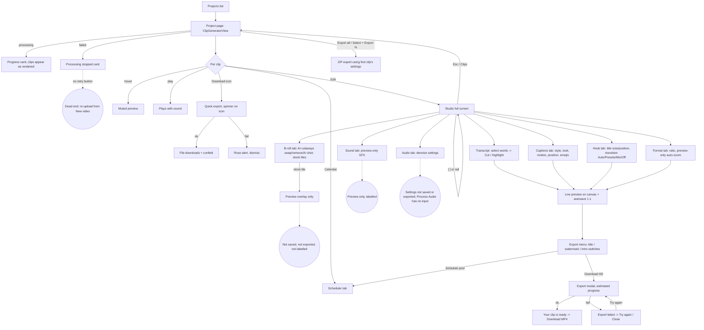
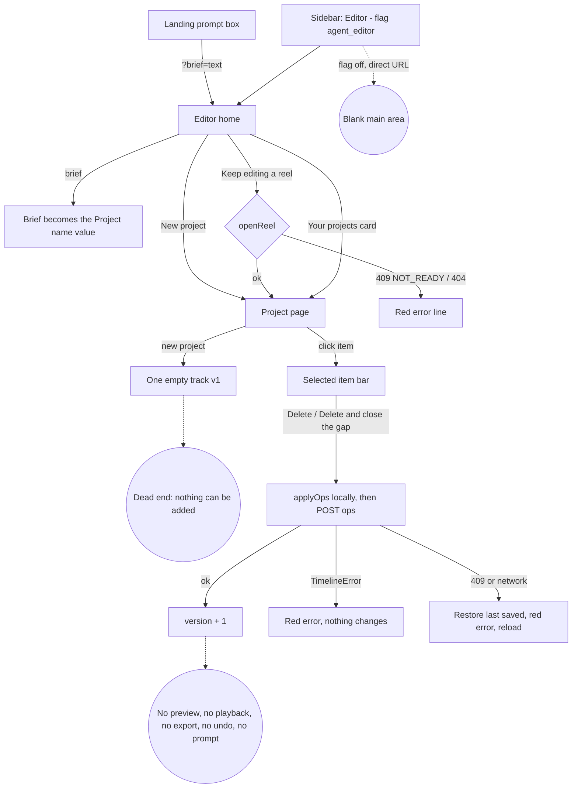
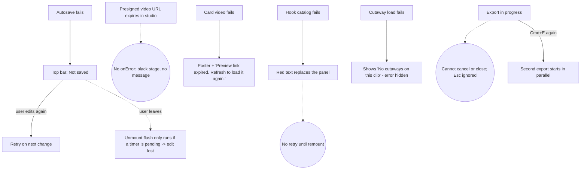

# 05 — Clips, clip studio and the new Editor (Wave 0 audit)

Audit date: 2026-10-03. Branch `clipnera` @ `38f9bd5`. Read-only audit; no source was changed.

All paths are relative to `frontend/` unless they start with `backend/`.

## 0. Scope and what was read

34 slice files read top to bottom (5,862 lines):

| Group | Files | Lines |
|---|---|---|
| Studio shell | `components/dashboard/VideoEditorStudio.tsx` | 1025 |
| Studio parts (`components/dashboard/studio/`) | `ClipRail`, `ExportDialog`, `Inspector`, `PlatformOverlay`, `ShortcutsDialog`, `StudioCanvas`, `StudioTopBar`, `Timeline`, `TranscriptPanel`, `Transport`, `controls`, `studioUtils.ts`, `useHistory.ts`, `useStudioLayout.ts` | 2272 |
| Studio panels (`studio/panels/`) | `CaptionsPanel`, `BrollPanel`, `FormatPanel`, `SoundPanel`, `HookPanel` | 536 |
| Clip list | `ClipGeneratorView`, `ClipCard`, `ClipPoster` | 927 |
| Feature panels | `ClipBrollPanel`, `HookTransitionPanel`, `AudioEnhancerPanel`, `AudioBeforeAfter`, `CaptionStylePreview` | 1292 |
| New Editor | `components/dashboard/editor/EditorView.tsx`, `lib/editor/timeline.ts`, `lib/editor/timeline.test.mts` | 829 |
| Route pages | `app/dashboard/(shell)/editor/page.tsx`, `editor/[editorProjectId]/page.tsx`, `projects/[projectId]/edit/[clipId]/page.tsx` | 9 |

Followed (outside the slice, not documented in full): `components/dashboard/DashboardApp.tsx` (routing and wiring), `lib/api.ts` (clipApi, audioApi, hookTransitionApi, brollApi, editorApi), `lib/utils/clipExport.ts`, `hooks/useHookTransitionCatalog.ts`, `lib/types.ts` (`ClipEditorSettings`), `backend/editor/{route,service,agent_tools}.py`, `backend/agent_runtime/loop.py` (header), `backend/audio/enhancement/schema.py`.

Things the brief expected that do not exist in the frontend:

- There is no `lib/editor/` agent or prompt runtime. `lib/editor/` holds only the Timeline model and its operation applier.
- The three route pages are stubs that `return null`. `app/dashboard/(shell)/layout.tsx:9` mounts `DashboardApp` for every route and it picks the view from the pathname (`DashboardApp.tsx:55-66`).

---

## 1. Component inventory

Legend for the decision column: KEEP = reuse mostly as is; REBUILD = keep the behaviour, rewrite the UI or structure; DELETE = remove.

### 1.1 Clip list

| Component | Purpose | Props | State / effects | API | Used by | Decision |
|---|---|---|---|---|---|---|
| `ClipGeneratorView` (`ClipGeneratorView.tsx:70`) | Project detail page: header, pipeline status, source map, clip grid, batch export | `project`, `onSelectClipForEdit`, `onScheduleClip`, `onOpenUpload`, `onRenameFolder?`, `onNavigateTab?`, `pipelineSteps?`, `onRevertPipelineStep?`, `audioBeforeUrl?`, `audioAfterUrl?`, `isAudioReverted?`, `onRevertAudio?`, `onApplyAudio?` (`:54-68`) | `selectedClip`, `filterScore`, `sortMode`, `quickExportingId`, `isBatchExporting`, `exportError`, `isRenaming`, `newFolderName`, `selectMode`, `checkedIds`, `idCopied` (`:86-97`). One effect keeps `selectedClip` inside the visible set (`:178-186`). `visibleClips` memoised (`:168-176`) | `clipApi.exportProject` (`:111`), `exportAllProjectClips` (`:135`) | `DashboardApp.tsx:834` | REBUILD — good information, but 13 props, export logic inline, and a "selected clip" that does nothing |
| `ClipCard` (`ClipCard.tsx:42`) | One clip: 9:16 video preview, rank, score, hook, two score bars, Edit / Schedule / Download | `clip`, `index`, `isSelected`, `isExporting`, `onSelect`, `onEdit`, `onSchedule`, `onExport`, `selectMode?`, `checked?`, `onToggleChecked?` (`:17-30`) | `isPlaying`, `withSound`, `copied`, `failed`; module-level `audibleVideo` singleton (`:40`) so one card is audible at a time | none | `ClipGeneratorView.tsx:525` | REBUILD — hover-to-preview and single-audible logic are worth keeping; markup is not keyboard reachable |
| `ClipPoster` (`ClipPoster.tsx:28`) | Still for a clip: poster image → first video frame (`#t=0.1`) → shimmer placeholder | `clip` (title, posterUrl, presignedUrl), `aspect?`, `className?`, `pendingLabel?`, `children?` | `posterFailed` | none | `ClipCard.tsx:151`, `studio/ClipRail.tsx:32,84`, `DashboardHomeView.tsx:456` | KEEP — small, correct, three-step fallback |

Visual states:

| Component | Default | Hover | Loading | Empty | Error | Disabled | Missing |
|---|---|---|---|---|---|---|---|
| `ClipGeneratorView` | Header + map + grid | Buttons only | "Finding the best moments" card with % bar (`:345-359`); batch button "Exporting…" (`:329`) | "No clips yet" / "Finding your best moments" (`:552-564`); filter-empty with "Show all scores" (`:543-550`) | "Processing stopped" card (`:361-371`); dismissible export alert (`:335-343`) | Export all disabled with 0 clips (`:325`) | Skeleton for the grid; retry button on failure; progress for batch export (spinner only) |
| `ClipCard` | Poster/video, badges, body | Muted autoplay preview, play button fades in, border lightens | Download spinner (`:283`); "Rendering…" shimmer via `ClipPoster` | n/a | "Preview link expired. Refresh to load it again." (`:154`) | Download disabled when no `presignedUrl` (`:279`) | Focus-visible ring on the card; touch equivalent of hover preview; play-button visibility on touch (it is `opacity-0` until hover/focus, `:189`) |
| `ClipPoster` | Image | — | Shimmer + sparkles + label | Same as loading | Falls through to video then shimmer | — | none |

Responsive: grid is `grid-cols-2 md:3 xl:4 2xl:5` (`ClipGeneratorView.tsx:523`); header actions wrap; the thumbnail in the map heading hides below `sm` (`:391`). The sticky select bar pins at `top-16` (`:490`).

Keyboard and a11y:

- The card is an `<article onClick>` with no `tabIndex`, role or key handler (`ClipCard.tsx:113-114`); selecting a card or toggling its checkbox is mouse-only. The select-mode checkbox is a non-focusable `` (`:163-172`).
- Buttons nested in the clickable article rely on `stopPropagation`.
- "Copy hook" has `title` but no `aria-label` (`:219-225`); Schedule and Download likewise (`:264-284`).
- Rename form is good: label, Esc cancels, autofocus (`ClipGeneratorView.tsx:206-235`).
- Source-map blocks are real buttons with `aria-label` and `aria-pressed` (`:411-417`).

### 1.2 Clip studio (`VideoEditorStudio` + `studio/*`)

| Component | Purpose | Props | State / effects | API | Used by | Decision |
|---|---|---|---|---|---|---|
| `VideoEditorStudio` (`VideoEditorStudio.tsx:103`) | Thin wrapper: "no clip" screen, and keys `StudioContent` by `clip.id:full\|summary` so it remounts when the clip changes or its full record arrives (`:125-126`) | `clip?`, `clips`, `projectTitle?`, `onUpdateClip`, `onBackToGenerator`, `onScheduleClip`, `onSelectClip` (`:51-60`) | none | none | `DashboardApp.tsx:746` | REBUILD (with `StudioContent`) |
| `StudioContent` (`:129-1025`) | Everything: the undoable document, playback clock, autosave, export, keyboard, and three layouts | same, `clip` required | 17 `useState`, 12 refs, 12 effects. See §3 and §6 | `brandKitApi.list` (`:207`), `creatorIntroApi.get` (`:521`), `clipApi.saveEditorSettings` (`:375`), `clipApi.exportProject` (`:576`) | wrapper only | REBUILD — split into hooks (see §7) |
| `StudioTopBar` (`studio/StudioTopBar.tsx:107`) | Back, clip switcher button (tablet), score ring, title, undo/redo, save indicator, shortcuts, Export menu | 26 props (`:24-54`) | Outside-click closes the menu (`:117-124`) | none | `VideoEditorStudio.tsx:691` | REBUILD — prop count shows the export options belong in their own component |
| `ClipRail` / `ClipDrawer` (`studio/ClipRail.tsx:14,48`) | Desktop left rail of posters and scores; tablet slide-over list | `clips`, `activeId`, `onSelect` (+ `onClose`, `projectTitle`) | none | none | `VideoEditorStudio.tsx:1000,1017` | KEEP |
| `TranscriptPanel` (`studio/TranscriptPanel.tsx:41`) | Word-level transcript: click to seek, drag/shift-click to select, cut/restore, highlight, search, "Cut fillers" | `segments`, `removed`, `currentTime`, `isPlaying`, `onSeek`, `onCut`, `onHighlight`, `onCutFillers`, `tapToExtend?`, `showHeading?` | `selection`, `query`, `matchCursor`; auto-scroll effect (`:98-101`); un-deps'd layout effect to position the popover (`:104-114`); capture-phase key listener while a selection exists (`:130-143`) | none | `VideoEditorStudio.tsx:765` | REBUILD — strongest interaction in the slice; needs keyboard selection and memoisation |
| `StudioCanvas`, `CanvasToolbar`, `CaptionSafetyNote` (`studio/StudioCanvas.tsx:77,305,365`) | Video stage with DOM overlays (title card, captions, B-roll, safe zones, platform chrome); toolbar above; one-line safety note below | canvas: 18 props (`:40-61`) | `dragging`; `ResizeObserver` width hook (`:64-75`) | none | `VideoEditorStudio.tsx:724,964,973` | KEEP the approach, REBUILD the composition |
| `PlatformOverlay` (`studio/PlatformOverlay.tsx:7`) | Mock TikTok / Reels / Shorts chrome over the preview | `platform`, `title`, `hashtags` | none | none | `StudioCanvas.tsx:285` | REBUILD — hard-coded `@clipnera` handle and fake counts, emoji as icons |
| `Transport` (`studio/Transport.tsx:30`) | Restart, ±2 s, play/pause, time readout, speed, mute | 10 props | none | none | `VideoEditorStudio.tsx:750` | KEEP |
| `Timeline` (`studio/Timeline.tsx:28`) | Read-only six-lane ruler (Title, Video, Captions, B-roll, Sound, Speech) with scrub; phone "strip" variant | 12 props + `variant` | `zoom`, `scrubbing` | none | `VideoEditorStudio.tsx:939,998,1021` | REBUILD — nothing on it can be dragged, trimmed or selected |
| `Inspector`, `ToolBadge`, `TOOLS` (`studio/Inspector.tsx:38,21,6`) | Right-hand tab strip (6 tools) and panel container | `tool`, `onTool`, `badges`, `children` | none | none | `VideoEditorStudio.tsx:979` | KEEP |
| `ExportDialog` (`studio/ExportDialog.tsx:19`) | Modal: progress bar, stage text, done / error actions | 9 props | none | none | `VideoEditorStudio.tsx:870` | REBUILD — blocking, no cancel, fake progress |
| `ShortcutsDialog` (`studio/ShortcutsDialog.tsx:18`) | Static list of 10 shortcuts | `onClose` | none | none | `VideoEditorStudio.tsx:889` | KEEP |
| `controls.tsx` (`Section`, `RangeField`, `Switch`, `Chip`, `ColorSwatches`, `Note`) | Inspector primitives | see file | `Section` holds `open` | none | all five panels + `StudioTopBar.tsx:18` | KEEP — promote to `components/ui/` |
| `studioUtils.ts` | `StudioDoc` type, safe zones, export sizes, clock formatters, caption grouping, cut ranges, caption CSS mirrors of the ASS burner | — | — | — | 8 studio files | KEEP — the burner-mirroring logic is valuable |
| `useHistory.ts` | Generic undo/redo with coalescing | `init` | `history`, `lastCommit` ref | none | `VideoEditorStudio.tsx:143` | KEEP |
| `useStudioLayout.ts` | `'desktop' \| 'tablet' \| 'phone'` from two media queries | — | `layout` (starts `'desktop'`) | none | `VideoEditorStudio.tsx:138` | KEEP, fix first-render flash |
| `CaptionsPanel` (`panels/CaptionsPanel.tsx:36`) | Style grid, colours, size, shadow, motion, position, emojis, background | `config`, `onChange`, `onPickPreset`, `captionsOn`, `onTurnCaptionsOff`, `preview`, `aspectRatio` | `showAllStyles` | none | `VideoEditorStudio.tsx:798` | KEEP |
| `HookPanel` (`panels/HookPanel.tsx:16`) | Read-only title, title size/position, then `HookTransitionPanel` | 6 props | none | none | `VideoEditorStudio.tsx:810` | REBUILD — title cannot be edited |
| `BrollPanel` (`panels/BrollPanel.tsx:42`) | Optional "AI cutaways" (server), list of local overlays, four hard-coded Unsplash stock tiles | 7 props | none | none directly | `VideoEditorStudio.tsx:821` | REBUILD — stock half is a mock |
| `SoundPanel` (`panels/SoundPanel.tsx:25`) | Preview-only sound effects at the playhead | 5 props | none | none | `VideoEditorStudio.tsx:833` | DELETE or finish — honestly labelled preview-only, never saved or exported |
| `FormatPanel` (`panels/FormatPanel.tsx:25`) | Aspect ratio (plan-gated) and preview-only auto-zoom | 4 props | none | none | `VideoEditorStudio.tsx:855` | KEEP ratio picker; DELETE or finish auto-zoom |

Visual states (studio):

| Area | Default | Loading | Empty | Error | Disabled | Missing |
|---|---|---|---|---|---|---|
| Wrapper | Studio | — | "No clip selected. Pick a clip to open the editor." + "Back to clips" (`VideoEditorStudio.tsx:106-115`) | — | — | Loading state while the full clip record is fetched: the studio mounts with the summary and remounts (state reset) when `presignedUrl` arrives (`:125`) |
| Canvas | Video + overlays | none (poster only) | "Video not available" (`StudioCanvas.tsx:150`); "No transcript yet for this clip" chip (`:278`) | none | — | Buffering/stalled indicator; video `onError` handler (an expired presigned URL fails silently) |
| Transcript | Words | — | "No transcript yet for this clip." (`TranscriptPanel.tsx:243`); search "No match" (`:231`) | — | Cut disabled for words without timing, with a title (`:292-293`) | Focus state for words |
| Save indicator | "Autosave on" → "Saving" → "Saved" | spinner | — | "Not saved" with tooltip "Check your connection. Your next change will retry." (`StudioTopBar.tsx:67`) | — | A retry action; the tooltip is the only explanation |
| Export | Progress modal | bouncing icon, staged copy | — | "Export failed" + message + "Try again" / "Close" (`ExportDialog.tsx:29,43-56`) | Download disabled without a URL | Cancel while in progress; background export |
| Inspector panels | — | `HookTransitionPanel` "Loading hook transitions…"; `ClipBrollPanel` "Loading cutaways…" | per-panel copy (see §2) | red text lines | Plan-locked styles/ratios show a lock and open the upsell | Skeletons |

Responsive behaviour (chosen in JS, `useStudioLayout.ts:7-11`):

| Layout | Breakpoint | Arrangement |
|---|---|---|
| Desktop | ≥ 1180 px | CSS grid `"top top top top" / "rail tx center insp" / "rail tl tl insp"`; columns `72px clamp(260px,20vw,300px) 1fr 360px`; rows `56px 1fr clamp(160px,24vh,236px)` (`VideoEditorStudio.tsx:1007-1015`) |
| Tablet | 768–1179 px | `"top top" / "center insp" / "tx insp" / "tl tl"`; inspector 340 px; clip rail becomes a drawer opened from "Clips N" (`:984-1004`) |
| Phone | ≤ 767 px | Column: 52 px top bar, canvas, compact transport, two-lane timeline strip, bottom dock of 7 tools; a tool opens a 55dvh bottom sheet that replaces transport, strip and dock (`:895-959`) |

Keyboard shortcuts (one window listener, `VideoEditorStudio.tsx:649-681`; ignored while typing, `studioUtils.ts:286`):

| Key | Action | Where |
|---|---|---|
| Space | Play / pause | `:670` |
| J / L | Back / forward 2 s | `:671-672` |
| ⌘/Ctrl+Z, ⇧⌘Z, ⌘/Ctrl+Y | Undo / redo | `:655-661` |
| ⌘/Ctrl+E | Export immediately (skips the options menu) | `:662-664` |
| [ / ] | Previous / next clip | `:673-674` |
| ? | Shortcuts dialog | `:675` |
| Esc | Closes, in order: finished/failed export dialog, shortcuts, export menu, phone sheet, clip drawer; otherwise leaves the studio (`:636-644`) | |
| ⌫ / Delete | Cut selected words (only while a transcript selection exists) | `TranscriptPanel.tsx:134` |
| H | Highlight selected words | `TranscriptPanel.tsx:135` |
| ↑ / ↓ on the caption | Move captions 1% (`StudioCanvas.tsx:226-231`) | |
| Enter / ⇧Enter in transcript search | Next / previous match | `TranscriptPanel.tsx:216-218` |

Missing: arrow-key frame stepping, K for pause, Home/End, split, any timeline key.

Accessibility notes (studio):

- Good: `role="switch"` with `aria-checked` (`controls.tsx:92-95`), `role="slider"` caption handle with value text (`StudioCanvas.tsx:218-224`), `aria-pressed` chips, `role="status"` save indicator and safety note, labelled icon buttons, `aria-current` on the active clip.
- Transcript words are plain ``s (`TranscriptPanel.tsx:265-273`): not focusable, no keyboard selection, so cutting and highlighting are pointer-only.
- Dialogs (`ExportDialog`, `ShortcutsDialog`, `ClipDrawer`, phone sheet) set `role="dialog"` but none trap or restore focus; `ClipDrawer` and the phone sheet lack `aria-modal`.
- `Inspector` uses `role="tablist"`/`tab`/`tabpanel` without `aria-controls`, `id`s or arrow-key movement (`Inspector.tsx:51-74`). The phone dock has no selected state.
- Export menu uses `role="menu"` but contains switches and has no arrow-key handling (`StudioTopBar.tsx:126-190`).
- Timeline is `role="group"`/`section` with pointer-only scrubbing (`Timeline.tsx:93,177`); the zoom slider is the only keyboard control.
- Colour alone marks cut (rose, struck through — fine) vs highlighted (violet) vs current word.
- `PlatformOverlay` icons are emoji with no text alternative (decorative, but read by screen readers).

### 1.3 Feature panels

| Component | Purpose | Props | State / effects | API | Used by | Decision |
|---|---|---|---|---|---|---|
| `HookTransitionPanel` (`HookTransitionPanel.tsx:59`) + private `AutoSummary`, `PresetGallery`, `MixBuilder`, `Field`, `PartSelect`, `ChipGrid`, `Recipe` | Choose the bridge between hook and clip: Auto / Presets / Mix / Off, with a server-resolved "Renders as" recipe | `clipId`, `config`, `onChange` | `resolved`, `resolveError`; 300 ms debounced resolve effect keyed on `JSON.stringify(config)` (`:67-90`); gallery `query`, `group` | `hookTransitionApi.getCatalog` via `useHookTransitionCatalog` (module cache), `hookTransitionApi.resolveForClip` (`:76`) | `panels/HookPanel.tsx:43` | REBUILD — solid logic, off-palette fuchsia, no visual preview |
| `AudioEnhancerPanel` (`AudioEnhancerPanel.tsx:35`) | Denoise master switch, strength slider, three toggles, "Process Audio", "Preview" | `config`, `onConfigChange`, `onProcessed?` | `isProcessing`, `isPreviewing`, `lastResult`, two audio refs | `audioApi.process` (`:66`), `audioApi.preview` (`:95`, unreachable) | `VideoEditorStudio.tsx:844` | REBUILD — currently not connected to the clip (see §7 B1) |
| `AudioBeforeAfter` (`AudioBeforeAfter.tsx:18`) | Before/after card for pipeline noise cancellation with Revert / Re-apply | `beforeUrl?`, `afterUrl?`, `isReverted?`, `onRevert?`, `onApply?` | `playing`, `muted` | none | `ClipGeneratorView.tsx:376` | REBUILD — play buttons play nothing, waveforms are fake |
| `ClipBrollPanel` (`ClipBrollPanel.tsx:88`) + private `Thumb`, `PlacementRow` | Server-side AI cutaways for a clip: swap, remove, search the library, generate an AI shot | `clipId` | `placements`, `busy`, `error`; fetch on mount (`:95-97`); 3 s poll while any placement is generating (`:100-107`) | `brollApi.getClip`, `updatePlacement`, `search`, `generatePlacement` | `panels/BrollPanel.tsx:47` (behind flag `broll_studio.cutaways`) | KEEP logic, REBUILD UI |
| `CaptionStylePreview` (`CaptionStylePreview.tsx:54`) | Looping CSS-only sample of a caption template | `config`, `words?`, `className?`, `fontSize?`, `overlay?` | none (pure CSS, staggered `animation-delay`) | none | `panels/CaptionsPanel.tsx:86`, `BrandKitView.tsx:292`, `landing/ResultsPreview.tsx:256`, `landing/CaptionTypographyShowcase.tsx:29,64` | KEEP |

Missing states: `HookTransitionPanel` has no retry after a catalog error (`:92-94`) and no loading state for the recipe; `ClipBrollPanel` swallows the initial load error and shows the empty copy instead (`:96`), and its search has no loading state (`:39-41`); `AudioEnhancerPanel` shows a raw URL on success (`:369`).

### 1.4 New Editor

| Component | Purpose | Props | State / effects | API | Used by | Decision |
|---|---|---|---|---|---|---|
| `EditorView` (`editor/EditorView.tsx:29`) | Switch between list and project | `projectId?` | none | — | `DashboardApp.tsx:881`, only when flag `agent_editor` is on (default off, `hooks/useFeatureFlags.ts:21`) | REBUILD — it is a scaffold |
| `EditorHome` (`:33`) | New-project form, "Keep editing a reel", project list | — | `projects`, `reels`, `title`, `aspect`, `busy`, `error`; one load effect (`:43-47`) | `editorApi.list`, `editsApi.list`, `editorApi.create`, `editorApi.openReel` | `EditorView` | REBUILD |
| `EditorProject` (`:150`) | Header, read-only timeline, selected-item bar with two delete actions | `projectId` | `project`, `selected`, `saving`, `error`; load effect (`:157-164`) | `editorApi.get`, `editorApi.applyOps` | `EditorView` | REBUILD |
| `TimelineView` (`:245`) | Tracks as rows, items as absolutely positioned buttons | `timeline`, `selected`, `onSelect` | none | none | `EditorProject` | REBUILD |
| `lib/editor/timeline.ts` | Timeline v1 types, `normalise`, `check`, `applyOps` and 13 operations, mirrored field for field from `backend/editor/` | — | — | — | `EditorView.tsx:14`, `lib/api.ts:19`, `timeline.test.mts` | KEEP — the right foundation |
| `lib/editor/timeline.test.mts` | Runs the backend's shared fixtures through the browser applier (`npm test` → `node --test lib/`) | — | — | — | — | KEEP |

Dead code (zero importers or unreachable):

| Item | Where | Note |
|---|---|---|
| `handlePreview` | `AudioEnhancerPanel.tsx:91-117` | Never called; the Preview button calls `startLocalPreview` (`:337`) |
| `DEFAULT_CONFIG`, `getZoneLabel` | `AudioEnhancerPanel.tsx:27-33, 56-60` | Unused; the default is duplicated in `studioUtils.ts:74` |
| `analyserRef` + analyser node | `AudioEnhancerPanel.tsx:46,123-125` | Created, never read |
| `muted` / `setMuted`, `Volume2` import | `AudioBeforeAfter.tsx:26,3` | `setMuted` never called, so the "Preview muted" line can never show |
| `playing` state | `AudioBeforeAfter.tsx:25` | Toggles an icon; no audio element exists |
| `selectedClip` in the list | `ClipGeneratorView.tsx:86` | Only changes a border and the map highlight |
| `Sparkles` etc. | — | No unused top-level components: every file in the slice has at least one importer |

No component file in the slice is fully dead.

---

## 2. Screen-by-screen description

### 2.1 Project clip list — `/dashboard/projects/[projectId]`

Rendered inside the normal dashboard shell (sidebar + header).

1. **Page header** (`ClipGeneratorView.tsx:202-333`).
   - Back link "Projects".
   - Eyebrow pills: either "Processing 42%", "Failed", or "N clips ready"; then the folder category (fallback "Project"); then "N credits used" with a bolt when credits were charged.
   - Title: the folder name with a pencil button. Rename swaps the title for an input with "Save" and "Cancel".
   - Description line, dot-separated: source channel (fallback "Original source") · duration · "average virality **87**" · "Original video ↗" · "Copy ID" (becomes "Copied").
   - Actions: outlined "Add more" and solid amber "Export all N" ("Exporting…" with a spinner while running).
2. **Export error alert**, rose, dismissible.
3. **Processing card** (amber border): spinner, "Finding the best moments", "Clips show up here as soon as they are rendered. You can leave this page.", percent and a bar.
4. **Failure card** (rose): "Processing stopped" / "Something went wrong while processing this video. Add it again from New video to retry."
5. **Pipeline step indicator** (other slice) and **`AudioBeforeAfter`** card when the project has audio URLs: heading "AI Noise Cancellation Result", button "Revert to Original" or "Re-apply Denoising", two tiles ("Original · BEFORE" and "Denoised · AFTER") each with 20 static bars, a play button and a caption ("Original Audio" / "AI Enhanced" / "Awaiting Processing").
6. **Source map** (`:386-438`): "Where the clips come from" with a small source thumbnail, hint "each block is a clip, numbered by rank", and the range "0:00 – 12:34". A 44 px track with quarter marks; each clip is a numbered block positioned by start time and tinted by score; the selected one is amber with a white border. Five tick labels below.
7. **Clips section** (`:441-565`): heading "Clips" with a count pill ("12" or "5 of 12"), a "Select" toggle ("Done" when on), a sort select ("Highest score", "Video order", "Longest first") and a score filter ("All scores", "Standard (70+)", "High (85+)", "Ultra viral (90+)").
   - Select mode adds a sticky amber bar: "Tap clips to select them" or "3 selected", "Select all", "Clear", "Export 3".
   - Grid of clip cards, 2 to 5 columns.
   - Filter-empty: "No clips match this score filter." + "Show all scores".
   - Empty: icon, "No clips yet" / "Run the pipeline on this project to generate clips." (or the processing variant).

### 2.2 Clip card (`ClipCard.tsx:112-288`)

- Rounded 2xl card, neutral-900, 1 px border; amber border and ring when selected or checked.
- **Top: 9:16 preview.** A muted looping `<video>`; hovering plays it silently and leaving rewinds it. A dark gradient covers top and bottom.
  - Top-left: rank chip "#1" in mono, or a checkbox in select mode.
  - Top-right: score ring.
  - Centre (on hover/focus): a 48 px round play button; clicking plays with sound and pauses any other audible card.
  - Bottom: "2:14–2:58" on the left, "44s" on the right, both mono chips.
- **Body.** Two-line bold title. Hook box (italic, two lines) with a copy icon that turns into a green check. Two labelled bars: "HOOK 82" (amber) and "ENGAGE 76" (emerald).
- **Actions.** Wide "Edit" with scissors; calendar icon (title "Schedule post"); download icon (title "Download clip" or "Not ready to download yet"), spinner while exporting.

### 2.3 Clip studio — `/dashboard/projects/[projectId]/edit/[clipId]`

Full screen; the dashboard sidebar and header are not rendered (`DashboardApp.tsx:744-754`). Dark neutral-950 with neutral-900 panels and amber accents.

**Top bar (56 px)** — `StudioTopBar.tsx:229-280`. Left to right:
"← Clips" (title "Back to clips (Esc)") | divider | tablet only: "Clips 12" | a 30 px conic-gradient viral-score ring | a small grey subtitle ("Project name · clip 3 of 12", or "44 s · 9:16") above the bold clip title | spacer | Undo, Redo | save indicator ("Autosave on", "Saving", "Saved", "Not saved") | divider | desktop only: keyboard icon | amber "Export ▾".
Phone: back arrow, title over save indicator, Undo only, Export.

**Export menu** (290 px popover) — `StudioTopBar.tsx:126-190`.
Heading "IN THE VIDEO", then three switches:

| Label | Hint |
|---|---|
| "Title text" | "The headline at the top of the video" / "Pick a caption style to use it" |
| "Clipnera watermark" | "Shown in the exported video" / "Paid plans can turn it off" (+ lock badge) |
| "Channel intro" | "Plays before the clip" / "Create it in Brand kit first" / "Your intro before every clip" (+ lock badge) |

Divider, then two rows: "Download HD — MP4 · 1080×1920" and "Schedule post — Pick a time and platforms".

**Clip rail (desktop, 72 px)** — heading "CLIPS", then a 46 px poster and the score number for every clip; the active one has an amber outline (`ClipRail.tsx:14-45`). Tablet drawer: 340 px slide-over titled "Clips in {project}", rows of poster, title and "Score 91 · 44 s".

**Transcript column** — `TranscriptPanel.tsx:189-333`.
- Header "Transcript" and a rose "Cut fillers" button (title "Cut every um, uh and like").
- Search field "Search the transcript" with a "2/7" or "No match" counter.
- Body: one paragraph per segment with a mono timestamp gutter. Word states: plain grey; past (dimmer); current (white pill, dark text); highlighted (violet); selected (sky); cut (rose, struck through); search hit (amber ring).
- Selecting words floats a toolbar above the first one: "Cut ⌫" (or "Restore"), "Highlight H" (or "Unhighlight"), and ✕.
- Footer: "**3 cut** · 4.2 s removed", "**12 words** highlighted", "Drag or shift-click to select". On phones the header reads "Tap a word, then tap another to select a range".

**Centre** — `VideoEditorStudio.tsx:962-976`.
- Toolbar: "Preview on" + segmented "Clean / TikTok / Reels / Shorts"; on the right a "Safe zones" toggle (disabled off 9:16, title "Safe zones apply to 9:16 videos") and a ratio chip.
- Stage: the largest box of the chosen ratio that fits, rounded, black, on a radial dark backdrop. Layers, bottom to top: video (scaled by auto-zoom), B-roll image with a sky "B-roll · title" chip, rose hatched safe-zone bands (top, bottom, right), the white headline card for the first 5 s, the caption block (dashed sky outline on hover/drag, with a "Safe area edge" guide while dragging), platform chrome, and on phones a "👁 Clean" chip that cycles the platform.
- Safety line: "✓ Captions are clear of Instagram Reels buttons and text" or "⚠ TikTok covers the captions here. Drag them between 13% and 74%."
- Transport pill: restart, « 2 s, white round play/pause, 2 s », "0:14.3 / 0:44.0", speed select (0.75× to 2×), mute.

**Timeline (bottom, 160–236 px)** — `Timeline.tsx:176-238`.
- Strip: "Click or drag to move the playhead · hatched = cut from the clip" and a small zoom slider (1× to 4×).
- A 92 px label column and a scrollable lane area with a time ruler. Lanes:

| Lane | Content |
|---|---|
| Title | One fuchsia block spanning the whole clip with the title |
| Video (taller) | The poster image tiled as a film strip, with rose hatched blocks over cuts |
| Captions | One amber block per caption group with its words; the current one brighter |
| B-roll | Sky blocks with titles |
| Sound (tagged "PREVIEW") | Dashed rose diamonds |
| Speech | One green bar per word (rose if cut), pseudo-random heights; a "Denoise on" chip at the right |

- White playhead with a pentagon head. Nothing on the lanes is selectable or draggable.

**Inspector (360 px)** — six tabs: Captions, Hook, B-roll, Sound, Audio, Format. B-roll shows a count badge, Sound a dashed rose "preview only" dot, Audio a green dot when denoise is on.

- **Captions** (`CaptionsPanel.tsx`): sections "Style" (3-column grid; first tile "No captions"; five styles then "See all 21"; each tile is a live `CaptionStylePreview` of "MOST NEVER" with the style name; locked styles carry a Pro badge), "Look" (Active word / Highlighted words / Word box swatches with a custom-colour "+", Size and Shadow sliders), "Motion" (11 chips: pop, karaoke, wave, glow, land, bounce, grow, breathe, blur, shake, glitch; Speed slider), "Position" (Top / Middle / Lower third chips, slider, "Or drag the caption on the video. It snaps to the safe area.", and a clear/covered note), "Emojis" (switch, collection chips), "Background" (switch, one-line explanation). When captions are off: "Captions are off, so the video exports without them. Pick a style to add them back."
- **Hook** (`HookPanel.tsx` + `HookTransitionPanel.tsx`): "Title overlay" shows the title in a read-only box with Size and Position sliders. "Transition into the clip" then repeats its own heading "Hook Transition" and the blurb "The bridge between your hook and the clip: footage, effects, sound, an impact on the cut and an on-screen line. Applied when you export."
  - Segmented "Auto / Presets / Mix / Off" (Presets and Mix carry Pro badges on Free).
  - Auto: "Auto picks a transition and bridge line that fit this clip's content and hook." and "Customize this pick →".
  - Presets: search "Search N presets", shuffle button, group chips, two-column list of presets (name, group, "Freeze frame + Zoom · Whoosh"), "Tweak this preset in Mix →".
  - Mix: "Start from" select; "Gap footage" chips; "Effects (1/3) — one zoom/motion at a time" chips; "Gap sound", "Impact on the cut", "Impact sound", "Bridge text" ("Auto — match the hook", "No text", "Write my own…", phrases), "Text style" selects; a text input "e.g. Part 2 is crazier"; "Bridge length: 0.8s" slider.
  - Off: "The hook cuts straight into the clip with no bridge."
  - Recipe: "Renders as **Preset name**" and a row of chips: Hook → look · sound · length (+ quoted text) → impact → Clip. Or "This clip has no hook teaser, so it plays without a bridge."
- **B-roll** (`BrollPanel.tsx` + `ClipBrollPanel.tsx`): behind a flag, "AI cutaways" with "Cutaways the AI placed on this clip. Swap or remove any; the next export uses your changes." and per-placement rows ("3.2s–6.0s · “query”", thumbnails, a search box, "AI shot · 120 credits"). Then "On this clip" ("No stock shots yet. Add one below at the playhead.") and "Add stock footage at 0:14.3" with four fixed Unsplash tiles ("Analytics Surge Spike", "AI Cyber Matrix Code", "Cash & Financial Growth", "Shocked Viral Reaction").
- **Sound** (`SoundPanel.tsx`): rose dashed banner "**Preview only.** Sound effects play here but aren't saved or exported yet.", "On this clip" list, "Add at 0:14.3" with six effects (Whoosh, Ding, Pop, Sub drop, Glitch, Shutter).
- **Audio** (`AudioEnhancerPanel.tsx`): heading "AI BACKGROUND NOISE REMOVAL & STUDIO VOICE", status chip "DENOISE ACTIVE" / "BYPASS", "AI Denoise — Master toggle for the entire noise-removal pipeline", "Noise Suppression Strength 90%" with zones "Mild (Room Hum) / Balanced Studio / Max Vocal Isolation", three checkboxes ("De-Reverb / Echo", "Vocal Clarity EQ", "50/60Hz Hum Filter"), "N free enhancements left today. Pro is unlimited.", buttons "Process Audio" and "Preview", and a result box ("Processing complete in 1.2s" / "Processing failed: …").
- **Format** (`FormatPanel.tsx`): four ratio tiles with a drawn outline, the ratio, a name and pixel size ("9:16 Vertical 1080×1920"); an upgrade hint "Unlock 1:1, 4:5 and 16:9 exports with a paid plan."; "Auto-zoom" with a "Preview only" badge, a switch, "Punches in on emphasised words. Shows in the preview; the export doesn't include it yet." and a Zoom slider.

**Export dialog** (`ExportDialog.tsx`): centred card over an 85% black blur. Bouncing download icon; "Exporting your clip..." with a stage line ("Preparing your clip...", "Burning in captions and title...", "Encoding the video...", "Almost done, uploading your file..."); amber bar and "42% complete". Done: "Your clip is ready!", a summary such as "Hormozi captions · title · Clipnera watermark · 9:16 HD", "Download MP4 (1080×1920)", "Close", plus confetti. Failed: "Export failed", the message, "Try again", "Close".

**Shortcuts dialog**: "Keyboard shortcuts" with ten rows of `kbd` chips.

### 2.4 New Editor — `/dashboard/editor` and `/dashboard/editor/[editorProjectId]`

Inside the dashboard shell; sidebar item "Editor" with a "New" badge (`Sidebar.tsx:90`), only with the `agent_editor` flag.

**List page** (`EditorView.tsx:62-147`).
- Header: eyebrow "New", title "Editor", description "Build a video on a timeline. Start a project, or open one of your reels to keep editing it."
- Form card: "Project name" input (placeholder "Goa trip reel"), a "Shape" radio group (9:16, 1:1, 4:5, 16:9), amber "+ New project".
- Optional "Keep editing a reel": chips with a clapperboard icon and the reel title.
- "Your projects": "Loading…", "No projects yet. Start one above.", or cards with the title and "12.4 s · version 3 · edited 2 hours ago".

**Project page** (`:200-228`).
- Header: back "All projects", title, description "1080×1920 · 12.4 s · version 3 · saving…".
- Timeline box: a mono ruler, then one 44 px row per track with a 112 px label ("v1 video"); items are coloured rounded blocks (clip sky, text violet, music amber, sfx rose) labelled with the item id or text.
- Clicking an item shows a bar: a description ("Clip c1 · a1 · 1.5×"), "0.00–4.20 s", and two buttons: "Delete" and "Delete and close the gap".

That is the whole editor: no video, no playhead, no prompt box, no way to add media.

---

## 3. The prompt / AI experience today

**There is no prompt input anywhere in this slice.** No surface accepts a natural-language editing instruction.

| Where a user types | What it is | What happens |
|---|---|---|
| Transcript search (`TranscriptPanel.tsx:209`) | Literal substring search | Local, instant; Enter cycles matches and seeks |
| Hook preset search (`HookTransitionPanel.tsx:217`) | Local filter | Instant |
| Bridge text "Write my own…" (`:385`) | 60-character literal | Saved into the hook config, resolved by the server after 300 ms |
| B-roll query (`ClipBrollPanel.tsx:60`) | Library keyword search | `brollApi.search`; no spinner; errors become "No shots match." |
| Editor "Project name" (`EditorView.tsx:75`) | Title | Creates a project |
| Rename project | Title | `onRenameFolder` |

The nearest things to AI interaction:

| Feature | Trigger | Feedback | Preview | Errors |
|---|---|---|---|---|
| Hook transition "Auto" | Opening the panel or changing config | None while resolving; the recipe appears or changes silently | Text recipe only; the bridge is never shown on the canvas | Red line under the panel (`HookTransitionPanel.tsx:458`) |
| AI shot for a cutaway | "AI shot · 120 credits" | Button label "Generating AI shot…" with a spinning icon; 3 s polling until done (`ClipBrollPanel.tsx:100-107`) | Thumbnail updates when the poll returns; not shown on the canvas | Red line "Could not start the AI shot" |
| "Cut fillers" | One click | A ding sound (`VideoEditorStudio.tsx:468`); struck-through words | Immediate | Silent no-op when there is nothing to cut (`:466`) |
| Marketing brief | `/dashboard/editor?brief=…` from `components/editor-landing/EditorLanding.tsx:68` | The brief is truncated to 300 characters and placed in the **Project name** field (`EditorView.tsx:35,38`) | none | none |

The last row is the baseline for the revamp: the only prompt a user can type today (on the landing page) becomes a project title and is otherwise discarded.

**Backend agent runtime exists but is not reachable.** `backend/agent_runtime/loop.py` describes one agent turn reported "as events, which the API streams to the browser over SSE", and `backend/editor/agent_tools.py:79-85` defines two tools (`get_timeline`, `apply_edits`) that edit through the same operations as hand edits under author `agent:editor`. Nothing but tests imports them (`backend/tests/test_editor_db.py:21`, `test_agent_runtime.py:10`), and `backend/editor/route.py` has no chat or turn endpoint. `lib/api.ts` has a generic `subscribeEvents` SSE helper but `editorApi` (`lib/api.ts:2585-2593`) has no streaming call. So: no streaming, no step progress, no chat history, no prompt-driven preview update.

### 3.1 Undo, history and versions

Two unrelated mechanisms:

**Studio — `useHistory` (client-only snapshots)** (`studio/useHistory.ts`)

- State is `{ past[], present, future[] }` of whole `StudioDoc` snapshots, capped at 100 steps (`:7,33`).
- `commit(update, coalesceKey?)` pushes the present onto `past` and clears `future`. Commits with the same key within 800 ms merge into one step (`:6,26-28`), used for sliders, colour pickers and the caption drag (`positionY`, `fontSize`, `highlightColor`, `audioEnhancement`, …).
- `replace(update)` changes the present without a step, used for plan fallbacks and brand-kit defaults (`VideoEditorStudio.tsx:189-228`).
- Everything in `StudioDoc` is undoable, including preview-only things (B-roll overlays, sound effects, auto-zoom, audio config).
- History lives in memory inside `StudioContent`, which is keyed by clip, so it is lost on clip switch, on leaving the studio and on reload. There is no history list, no named versions, no server versions.
- Server-side AI cutaway edits (`ClipBrollPanel`) and audio processing are **not** in the history and cannot be undone.

**Editor — server versions (no UI)** (`EditorView.tsx:166-191`, `backend/editor/service.py:57-79`)

- Every accepted batch of operations increments `project.version` and stores an `EditorOp` row (version, author, ops JSON). A stale `base_version` is refused with 409 `STALE_VERSION`.
- The version number is shown in the header and on list cards. There is no undo, redo, history list or revert in the UI, and no endpoint to read the op log.

### 3.2 Optimistic vs blocking

| Action | Behaviour |
|---|---|
| Any studio edit | Instant local state; debounced autosave 1 s after the last change (`VideoEditorStudio.tsx:378-395`); flushed on unmount (`:398-405`) and before export (`:568-573`) |
| Studio save failure | "Not saved" indicator; no automatic retry until the next edit |
| Studio export | Blocking modal for the full length of one HTTP request; progress is a time-based estimate easing to 95% (`:554-560`) |
| Card quick export / batch export | Non-blocking spinner on the button; one long request |
| Hook resolve | Non-blocking, debounced 300 ms |
| AI cutaway swap / remove | Blocking per panel (`busy`), server-confirmed, no optimistic update |
| Editor operation | Optimistic: applied locally with `applyOps`, then posted; on failure the previous project is restored, an error is shown and the project is reloaded (`EditorView.tsx:176-190`) |
| Editor create / open reel | Blocking button spinner, then navigation |

---

## 4. The three editing surfaces

| | `ClipGeneratorView` | `VideoEditorStudio` + `studio/` | `editor/EditorView` + `lib/editor` |
|---|---|---|---|
| Route | `/dashboard/projects/:id` | `/dashboard/projects/:id/edit/:clipId` | `/dashboard/editor[/:id]` (flag) |
| Object | A project's AI-picked clips | One rendered clip (a single MP4) | A multi-track Timeline of assets |
| Document | `ViralClip` list in `DashboardApp` state | `StudioDoc` (flat settings object) | `Timeline` v1 (tracks, items, assets, captions, markers) |
| Edits | Rename, sort, filter, select | Word cuts, highlights, caption style/position, title size/position, hook transition, aspect ratio, watermark/title/intro toggles, AI cutaway swap; preview-only: stock B-roll, SFX, auto-zoom, audio | Delete item, ripple delete (2 of 13 operations exposed) |
| Preview | Hover video on cards | Real video with DOM overlays | None |
| Persistence | — | `PUT /clips/item/:id/editor-settings` | `POST /editor/projects/:id/ops` with versions |
| Undo | — | In-memory snapshots | None in UI; op log on server |
| Export | Quick (one clip) and ZIP (all) | Options menu + modal | None |
| AI | — | Auto hook, AI shot | Tools exist on backend, unreachable |
| Maturity | Shipped | Shipped, the most complete surface | Scaffold |

Shared logic: `ClipPoster` (list and studio rail), `clipApi.exportProject` (both), caption style utilities (`lib/utils/captionStyles`), `CaptionStylePreview`.

Duplicated logic:

| What | Copies |
|---|---|
| Clock formatting | `ClipGeneratorView.tsx:46`, `ClipCard.tsx:32`, `studioUtils.ts:83`, inline in `EditorView.tsx:257` |
| Download-by-anchor | `VideoEditorStudio.tsx:605-617` vs `lib/utils/clipExport.ts:7-14` |
| Export option assembly | `VideoEditorStudio.tsx:576-585`, `ClipGeneratorView.tsx:111-116`, `clipExport.ts:29-35` — three call sites sending different subsets (see §7 B3) |
| Default audio config | `AudioEnhancerPanel.tsx:27` vs `studioUtils.ts:74` |
| Toggle switch | `controls.tsx:78` vs hand-rolled peer checkbox in `AudioEnhancerPanel.tsx:224-232` |
| Score ring | `StudioTopBar.tsx:251-259` (inline conic gradient) vs `components/ui/ScoreRing` used by `ClipCard.tsx:181` |
| Timeline rendering | `studio/Timeline.tsx` vs `TimelineView` in `EditorView.tsx:245` — same idea (percent-positioned blocks on a ruler), no shared code |
| Aspect-ratio list | `FormatPanel.tsx:11`, `EditorView.tsx:18`, `StudioCanvas.tsx:24`, `studioUtils.ts:67` |

Which is the future: the Editor's document model. `lib/editor/timeline.ts` is the only one with validated operations, a shared fixture suite with the backend, server versions, authorship per change and agent tools written against it. The studio has the UX (canvas, transcript editing, inspector, shortcuts, responsive layouts) but a flat document that cannot express trims, multiple clips, tracks or keyframes. The revamp should keep the studio's interaction design and move it onto the Timeline + operations model, so hand edits and agent edits go through one path. Note that the Timeline has no word-level cut or caption-style-detail concept yet (`Captions` is `{enabled, style, language, follow}`, `timeline.ts:102-108`), so the studio's `removedWords`, highlights and `CaptionConfig` have no home in it today.

---

## 5. User flows

### 5.1 Clip flow: project → clip → edit → export

### 5.2 Editor flow

### 5.3 Error and retry paths

Dead ends, summarised:

1. Failed project: no retry action on the page (`ClipGeneratorView.tsx:361-371`).
2. Export in progress: no cancel, no close (`ExportDialog.tsx:43,58`; `VideoEditorStudio.tsx:637-638`).
3. Stock B-roll, sound effects, auto-zoom and audio settings never reach the export; only two of the four say so.
4. Clip title cannot be edited anywhere in the studio (`HookPanel.tsx:20-22`).
5. No trim of the clip's start or end, no reframe/crop control (`autoReframe` exists on `ViralClip` but has no UI), no transcript text correction.
6. New Editor project: empty timeline with no way to add anything.
7. Editor with the flag off: `/dashboard/editor` renders an empty main area (`DashboardApp.tsx:881`).

---

## 6. Video playback, preview and export

**Loading.** Direct progressive MP4 from a presigned URL in a plain `<video src>`. No HLS/DASH, no proxy or low-res rendition, no MSE, no service worker.

| Surface | Element | Notes |
|---|---|---|
| Card | `<video muted loop playsInline preload="metadata">` (`ClipCard.tsx:128-149`) | One per card, all mounted at once |
| Poster fallback | `<video src="…#t=0.1" preload="metadata">` (`ClipPoster.tsx:51-58`) | Used when there is no poster image |
| Studio | One `<video playsInline preload="metadata">` with `poster` (`StudioCanvas.tsx:133-147`) | Always the raw cut (`presignedUrl`), never the burned export, so captions are not doubled (`VideoEditorStudio.tsx:589-592`) |
| Editor | none | `Asset.proxy` exists in the model (`timeline.ts:17`) but nothing plays it |

**Clock.** While playing, a `requestAnimationFrame` loop reads `video.currentTime` every frame and calls `setCurrentTime` (`VideoEditorStudio.tsx:341-362`). It also jumps over cut ranges by assigning `video.currentTime = cut.end` (`:327-347`) and fires synthesised sound effects (`:331-339`). A wall-clock fallback runs when there is no video. Volume is fixed at 0.8 (`:64,310`).

**Preview rendering.** DOM overlays, not canvas or WebGL:

- Captions are HTML text styled by `captionTextStyle` / `captionWordStyle`, with CSS keyframes that mirror the ASS burner (`studioUtils.ts:105-174`, `app/globals.css:181+`). Sizes are authored against a 1080 px frame and scaled by the measured stage width (`StudioCanvas.tsx:21,89-90`).
- Grouping mirrors the burner (`groupCaptionWords`, `studioUtils.ts:250-266`), as does the title card's wrap-and-shrink, which uses a throwaway 2D canvas only to measure text (`:232-241`).
- Cuts are simulated by seeking; the word-level cut is not sample-accurate in preview.
- Auto-zoom is a CSS `scale` with a 700 ms transition (`StudioCanvas.tsx:129-130`).
- B-roll is a full-frame `` (`:155-162`).
- The stage sizes itself with container query units (`min(100cqw, calc(100cqh * ratio))`, `:122-126`). The video uses `object-contain`, so a non-9:16 ratio shows letterboxing rather than the crop the export will produce.
- Not previewed at all: hook transition bridge, watermark, channel intro, AI cutaways, audio enhancement.

**Timeline rendering.** Plain absolutely positioned DOM, percentages of duration (`Timeline.tsx:34-35`). No virtualisation and no canvas: every word is a `` in the Speech lane (`:156-165`) and every caption group a `` (`:67-83`), all re-rendered on each clock tick. Zoom widens the lane container up to 4× inside a horizontal scroller (`:210-215`). The "film strip" is the poster tiled with `repeat-x` (`:54-63`); the "waveform" heights are derived from word length and index (`:162`), not audio. The Editor's `TimelineView` is likewise un-virtualised with a `min-w-[640px]` scroller.

**Export.** Server-side render, synchronous HTTP.

1. The studio flushes the autosave (`VideoEditorStudio.tsx:568-573`) because the server reads transcript edits from saved settings.
2. `POST /pipeline/export/{projectId}` with clip ids, ratio, caption config, hook transition, watermark, `burn_subtitles`, `show_title`, `channel_intro` (`lib/api.ts:634-670`). `platforms` is hard-coded to `['tiktok']`.
3. The request returns once, when the file exists. The progress bar is `3 + 92·(1 − e^(−elapsed/expected))`, capped at 95%, with `expected = max(15 s, clip duration)` (`:555-560`); stage labels are derived from that number (`studioUtils.ts:96-103`).
4. The response's `burned_presigned_url` is downloaded through a temporary `<a download>` (`:605-617`). The URL is signed as an attachment.
5. Batch export asks for `bundle: true` and downloads one ZIP (`clipExport.ts:21-41`).

No job id, no polling, no SSE, no resumability: closing the tab or a proxy timeout loses the export.

---

## 7. Problems

Severity: **H** blocks or misleads users; **M** degraded experience or a latent bug; **L** polish or cleanup.

### 7.1 Bugs and races

| # | Sev | Problem | Where |
|---|---|---|---|
| B1 | H | "Process Audio" sends `audioUrl: ''` — no clip audio is ever passed. The body key is camelCase while the backend schema requires `audio_url` (`backend/audio/enhancement/schema.py:6`), so the call should be rejected; verify. The audio config is also absent from `editorSettingsFor` and from the export payload, so the whole Audio tab affects nothing. | `AudioEnhancerPanel.tsx:66-75`; `VideoEditorStudio.tsx:83-97, 576-585` |
| B2 | H | ⌘/Ctrl+E has no in-flight guard. Pressed during an export it starts a second request and a second ticker; results race on `exportedUrl`. | `VideoEditorStudio.tsx:546-603, 633, 662-664` |
| B3 | H | The three export call sites disagree. Card quick-export omits `watermarkEnabled`, `burnSubtitles`, `showTitle` and `channelIntro`, so API defaults (`true`) are sent: a clip saved with captions or title off in the studio exports with them on from the card. Batch export applies the first clip's ratio, caption style and hook to every clip. | `ClipGeneratorView.tsx:111-116`; `lib/utils/clipExport.ts:28-35`; `lib/api.ts:636` |
| B4 | H | Stock B-roll looks like a real feature but is preview-only: overlays are not in `ClipEditorSettings` (`lib/types.ts:198-206`), not exported, reset on reload (`mapBackendClip` sets `bRollOverlays: []`). Unlike Sound and Auto-zoom it carries no "preview only" label; the timeline lane and tab badge reinforce the impression. Images hot-link Unsplash. | `panels/BrollPanel.tsx:9-30, 81-98`; `VideoEditorStudio.tsx:485-498` |
| B5 | M | Export modal cannot be cancelled or dismissed while running; Esc is ignored. A hung request traps the user in the studio. | `ExportDialog.tsx:43-72`; `VideoEditorStudio.tsx:636-638` |
| B6 | M | A failed autosave is not retried and is not flushed on exit: the unmount flush only runs when a timer is pending. Edits made before a transient failure are lost if the user leaves. | `VideoEditorStudio.tsx:386-404` |
| B7 | M | Opening an unedited clip silently writes settings: the brand-kit and entitlement `replace` calls change `doc.captionConfig`, which trips the autosave effect. The clip then counts as `hasSavedSettings`, so later brand-kit changes never apply to it. | `VideoEditorStudio.tsx:189-228, 378-395` |
| B8 | M | The studio mounts with a summary clip and remounts when the full record arrives (`key` flips `summary`→`full`); anything done in between, including undo history, is discarded, and there is no loading state. | `VideoEditorStudio.tsx:125-126` |
| B9 | M | `useStudioLayout` starts as `'desktop'` and corrects after mount. Phones and tablets render the desktop grid for one frame, then remount the video element. | `studio/useStudioLayout.ts:18-26`; `VideoEditorStudio.tsx:300-304` |
| B10 | M | No `onError` on the studio video. An expired presigned URL leaves a black stage with a working-looking transport driven by the wall-clock fallback. | `studio/StudioCanvas.tsx:133-147`; `VideoEditorStudio.tsx:350-360` |
| B11 | M | Editor: two edits before the first response share one `base_version`; the second gets 409, and the rollback restores a snapshot that predates the first edit before `load()` corrects it. `saving` disables nothing. | `editor/EditorView.tsx:167-191, 218-223` |
| B12 | M | The landing "brief" is written into the project name and truncated to 300 characters; the user's instruction is otherwise dropped. | `editor/EditorView.tsx:35-38` |
| B13 | M | `ClipBrollPanel` maps a failed load to an empty list, so a network error reads as "No cutaways on this clip." Search errors read as "No shots match." | `ClipBrollPanel.tsx:96, 40` |
| B14 | L | `AudioEnhancerPanel` "Preview" plays a synthetic 220 Hz tone with added hum, not the clip; `isPreviewing` is never set, so its spinner and disabled state never show; repeated clicks stack `AudioContext`s. | `AudioEnhancerPanel.tsx:119-182, 336-347` |
| B15 | L | `AudioBeforeAfter` play buttons only flip an icon; `beforeUrl`/`afterUrl` are never played. `onRevert` has no pending or error state (`DashboardApp.tsx:846-852`). | `AudioBeforeAfter.tsx:79-84, 111-116` |
| B16 | L | Platform preview shows a fixed "@clipnera" handle and invented counts; `hashtags` is always empty from `mapBackendClip`. | `studio/PlatformOverlay.tsx:18-29`; `StudioCanvas.tsx:285` |
| B17 | L | `handleCopyHook` calls `navigator.clipboard.writeText` unguarded and shows the success tick even if it rejects. | `ClipCard.tsx:102-110` |
| B18 | L | Transcript selection keys only exclude `HTMLInputElement`; with a selection active, Backspace or H pressed while focus is on a slider or custom select still cuts/highlights. | `studio/TranscriptPanel.tsx:133` |
| B19 | L | Preview letterboxes non-9:16 ratios (`object-contain`) while the export reframes, so the Format tab's preview is not what is exported. | `studio/StudioCanvas.tsx:137` |
| B20 | L | Card quick-export file name uses the project title plus the clip id; the studio uses the clip title. | `ClipGeneratorView.tsx:121`; `VideoEditorStudio.tsx:613` |

### 7.2 Structure: components to split

| # | Sev | Component | How to split |
|---|---|---|---|
| S1 | H | `StudioContent` (900 lines, 17 state values, 12 effects) `VideoEditorStudio.tsx:129-1025` | `useStudioDocument(clip)` (history, patch helpers, plan/brand fallbacks); `usePlayback(videoRef, cuts, sfx)` (clock, seek, speed, mute) exposing time through a ref or external store; `useAutosave(doc, clipId)`; `useClipExport(clip, doc)`; `useStudioShortcuts(actions)`; then three layout components (`DesktopStudio`, `TabletStudio`, `PhoneStudio`) that receive slots |
| S2 | M | `StudioTopBar` (26 props) | Extract `ExportMenu` with its own option state object; pass `exportOptions` and one `onChange` |
| S3 | M | `ClipGeneratorView` (568 lines, 13 props) | `ProjectHeader`, `ProjectStatus` (processing/failed/pipeline/audio), `ClipSourceMap`, `ClipGridToolbar`, `ClipGrid`; move exports into a `useClipExport` shared with the studio |
| S4 | M | `HookTransitionPanel` (490 lines, 7 private components in one file) | One file per mode under `hook/`; keep the resolve effect in a `useResolvedHookTransition` hook |
| S5 | M | `AudioEnhancerPanel` (377 lines, 60 lines of dead DSP) | Reduce to a settings form on shared `controls`; remove the synthetic preview |
| S6 | L | `EditorView` (four components in one file) | Separate `EditorHome`, `EditorProject`, `TimelineView`; share the ruler with the studio timeline |

### 7.3 Performance

| # | Sev | Problem | Where |
|---|---|---|---|
| P1 | H | `currentTime` is React state at the top of the studio and is set every animation frame during playback. Each tick re-renders the top bar, transcript (every word span, with a `Map` lookup and state computation per word), timeline (every word and caption span), canvas, inspector and the open panel. Nothing is wrapped in `React.memo`, and props such as `timelineProps`, `badges`, and inline callbacks are rebuilt every render. Long clips will drop frames. | `VideoEditorStudio.tsx:159, 341-362, 690-865`; `TranscriptPanel.tsx:245-279`; `Timeline.tsx:156-165` |
| P2 | M | Every document change calls `onUpdateClip`, which sets three pieces of state in `DashboardApp` (`selectedClip`, `activeProject`, `projects`) and re-renders the whole app — on every slider tick. | `VideoEditorStudio.tsx:414-431`; `DashboardApp.tsx:661-676` |
| P3 | M | Undo snapshots hold the full `transcriptSegments` array; up to 100 copies. Structural sharing limits the cost except for highlight edits, which rebuild every segment (`:451-457`). | `studio/useHistory.ts:33` |
| P4 | M | The clip grid mounts one `<video preload="metadata">` per card with no intersection gating; a 30-clip project opens 30 media requests. `ClipRail` can add more through `ClipPoster`'s video fallback. | `ClipCard.tsx:128-136`; `ClipPoster.tsx:49-58` |
| P5 | L | `TranscriptPanel`'s popover-positioning `useLayoutEffect` has no dependency array, so it measures layout on every render, including every clock tick while a selection exists. | `studio/TranscriptPanel.tsx:104-114` |
| P6 | L | `fitTitleFontPx` creates a new canvas on each call (memoised per width/title, so acceptable); `getAllCaptionStyles()` is called on every `CaptionsPanel` render and inside the export summary. | `studio/studioUtils.ts:233`; `panels/CaptionsPanel.tsx:39`; `VideoEditorStudio.tsx:876` |
| P7 | L | `CaptionsPanel` with "See all" open runs 21 looping CSS animations while the video plays. | `panels/CaptionsPanel.tsx:71-93` |

### 7.4 Missing states and UX gaps

| # | Sev | Gap | Where |
|---|---|---|---|
| U1 | H | No prompt or instruction input on any editing surface; the agent backend has no endpoint. | §3 |
| U2 | H | Editor has no preview, playback, media import, add/move/trim/split UI, export or undo; 11 of 13 operations are unreachable. | `editor/EditorView.tsx:150-229` |
| U3 | M | No clip trim (start/end), no reframe/crop, no transcript text correction, no title editing in the studio. | `panels/HookPanel.tsx:20-22`; `studio/Timeline.tsx` |
| U4 | M | Hook transition, watermark, channel intro and AI cutaways are never previewed; users export to find out. | §6 |
| U5 | M | Export progress is invented; stage text ("Encoding the video...") is a function of elapsed time. | `studio/studioUtils.ts:96-103` |
| U6 | M | Phone layout has no Redo, no shortcuts, no safe-zone toggle and no safety note. | `studio/StudioTopBar.tsx:211-226`; `VideoEditorStudio.tsx:895-959` |
| U7 | M | Failed project has no retry action. | `ClipGeneratorView.tsx:361-371` |
| U8 | L | Clip grid has no skeleton; `EditorHome` and `EditorProject` show plain "Loading…". | `ClipGeneratorView.tsx:522`; `editor/EditorView.tsx:128, 194` |
| U9 | L | Selecting a card in the list has no consequence beyond a border. | `ClipGeneratorView.tsx:86, 529-531` |
| U10 | L | Hook panel shows two stacked headings ("Transition into the clip" then "Hook Transition"). | `panels/HookPanel.tsx:42`; `HookTransitionPanel.tsx:118-121` |
| U11 | L | Success result prints a raw URL: "Output ready: https://…". | `AudioEnhancerPanel.tsx:368-370` |

### 7.5 Design-system drift

| # | Sev | Problem | Where |
|---|---|---|---|
| D1 | M | Off-palette accents against the locked amber/neutral palette: fuchsia throughout `HookTransitionPanel` (`:119, 134, 170, 240, 258, 402, 442, 476`), violet AI-shot button (`ClipBrollPanel.tsx:71`), violet highlights (`TranscriptPanel.tsx:31`), sky caption handle and B-roll, emerald SFX hover, fuchsia title lane (`Timeline.tsx:115`), rose shadow on an amber button (`AudioEnhancerPanel.tsx:325`). Some are meaningful (cut = rose); most are not. |  |
| D2 | M | Two visual dialects: `studio/*` uses compact arbitrary sizes (`text-[11.5px]`, `rounded-[9px]`) and shared `controls`; `AudioEnhancerPanel`, `HookTransitionPanel`, `AudioBeforeAfter` use an older card style with uppercase headings and their own toggles, and are dropped into the inspector unchanged (double padding at `VideoEditorStudio.tsx:843`). |  |
| D3 | L | Arbitrary pixel values everywhere instead of scale tokens (`h-[34px]`, `w-[46px]`, `text-[9.5px]`). | all `studio/*` |
| D4 | L | Emoji used as icons in `PlatformOverlay` and `SoundPanel` (`:9-14`). |  |
| D5 | L | Many buttons lack `type="button"` in the older panels (`HookTransitionPanel.tsx:131, 225, 237, 254, 437`; `AudioBeforeAfter.tsx:39, 47, 80, 112`; `ClipCard.tsx:187, 220, 255, 265, 275`). Harmless today, a trap inside a form. |  |

### 7.6 Accessibility

| # | Sev | Problem | Where |
|---|---|---|---|
| A1 | H | Transcript editing is pointer-only: words are unfocusable spans. | `studio/TranscriptPanel.tsx:265-273` |
| A2 | H | Clip cards cannot be selected or checked by keyboard; the checkbox is an unfocusable span. | `ClipCard.tsx:113-114, 163-172` |
| A3 | M | No focus trap or focus return in any dialog, drawer or sheet. | `ExportDialog.tsx:21-22`; `ShortcutsDialog.tsx:20-27`; `ClipRail.tsx:51-56`; `VideoEditorStudio.tsx:910-914` |
| A4 | M | Timeline scrubbing has no keyboard equivalent and no slider semantics. | `studio/Timeline.tsx:93, 211-215` |
| A5 | M | Tab and menu roles without the required keyboard model or `aria-controls`. | `studio/Inspector.tsx:51-74`; `studio/StudioTopBar.tsx:126-190` |
| A6 | L | Icon-only buttons with `title` but no accessible name. | `ClipCard.tsx:219, 264, 274`; `HookTransitionPanel.tsx:224`; `ClipBrollPanel.tsx:49, 65`; `AudioBeforeAfter.tsx:79, 111` |
| A7 | L | Unlabelled inputs: B-roll query, hook preset search, bridge text. | `ClipBrollPanel.tsx:60`; `HookTransitionPanel.tsx:217, 385` |
| A8 | L | Confetti and looping caption previews do not check `prefers-reduced-motion` in this slice (a hook exists: `hooks/usePrefersReducedMotion.ts`). | `VideoEditorStudio.tsx:597`; `ClipGeneratorView.tsx:122, 136` |
| A9 | L | Small text (9–10.5 px) in neutral-500 on neutral-900 throughout the studio is likely below contrast and size guidance. | `studio/*` |

---

## 8. Baseline summary for the revamp

- **Keep:** `lib/editor/timeline.ts` and its shared-fixture tests; `useHistory`; `studioUtils` burner mirrors; `controls.tsx`; `CaptionStylePreview`; `ClipPoster`; the transcript-as-editor interaction; the three-layout studio idea; the keyboard map.
- **Rebuild:** `StudioContent` into hooks and layouts on top of the Timeline + operations model; one export module with job-based progress; the list page; the hook, audio and B-roll panels on shared controls and the locked palette.
- **Remove or finish:** preview-only Sound, Auto-zoom and stock B-roll; the Audio tab as it stands; `AudioBeforeAfter`'s non-playing players.
- **Build new:** the prompt surface. Today the measurable baseline is zero: no instruction box, no streaming, no step progress, no agent-authored change visible in the UI, and no version history the user can see or revert.
