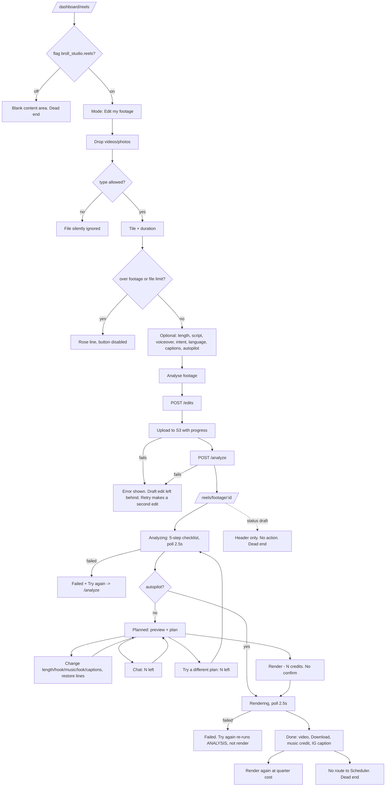
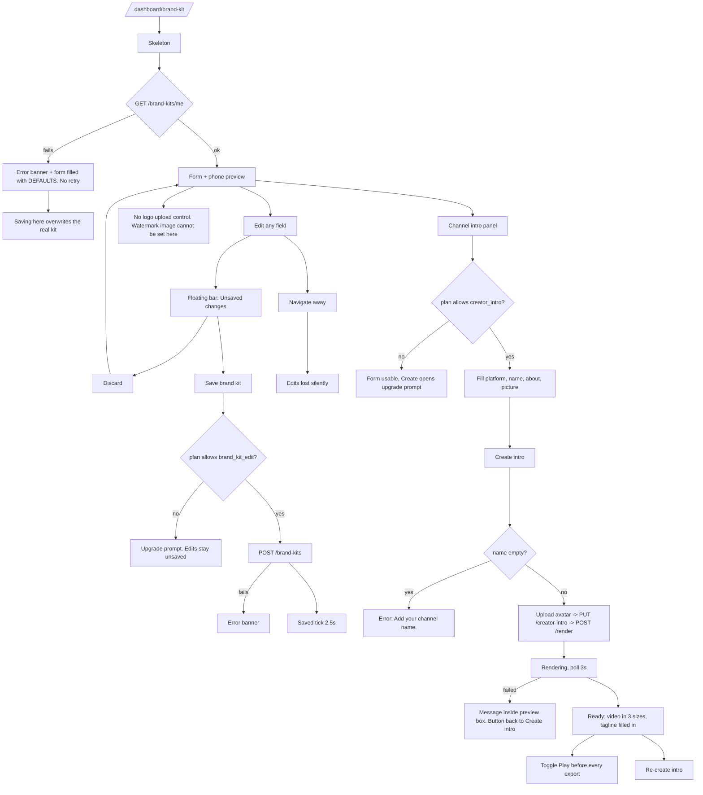
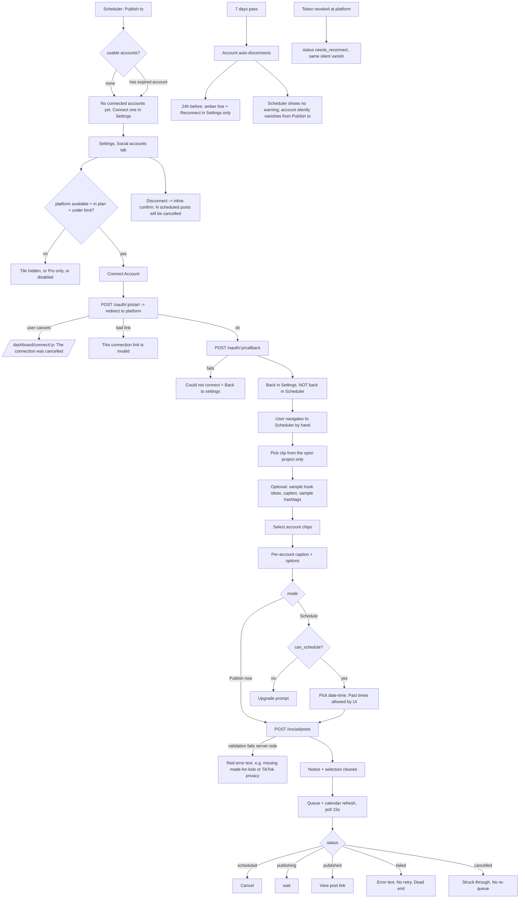
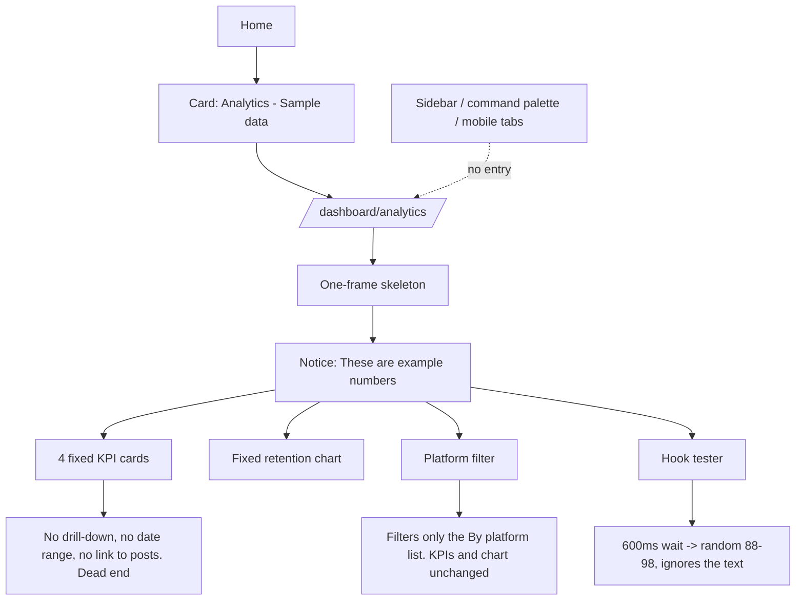

# Wave 0 audit 06: Reels / B-roll studio, Brand kit, Publishing, Analytics

Scope: the existing frontend only, as it stands on branch `clipnera` (commit `38f9bd5`). Read-only audit; nothing was changed.

All paths are relative to the repo root. `FE/` = `frontend/`, `BE/` = `backend/`.

## 0. What was read

**Slice files, read completely (21):**

| File | Lines |
|---|---|
| `FE/components/dashboard/ReelsView.tsx` | 502 |
| `FE/components/dashboard/FootageReelBoard.tsx` | 336 |
| `FE/components/dashboard/FootageReelForm.tsx` | 273 |
| `FE/components/dashboard/ReelPreviewPlayer.tsx` | 196 |
| `FE/components/dashboard/BrandKitView.tsx` | 392 |
| `FE/components/dashboard/ChannelIntroPanel.tsx` | 349 |
| `FE/components/dashboard/ChannelIntroNudge.tsx` | 66 |
| `FE/components/dashboard/ViralAnalyticsView.tsx` | 403 |
| `FE/components/dashboard/SocialSchedulerView.tsx` | 349 |
| `FE/components/social/ConnectedPlatformsPanel.tsx` | 285 |
| `FE/components/social/PostCalendar.tsx` | 143 |
| `FE/components/social/PublishComposer.tsx` | 436 |
| `FE/components/social/ReelsCoverPicker.tsx` | 142 |
| `FE/components/social/ScheduledPostsQueue.tsx` | 118 |
| `FE/components/social/platforms.ts` | 20 |
| `FE/app/dashboard/(shell)/reels/page.tsx` | 3 |
| `FE/app/dashboard/(shell)/reels/[reelId]/page.tsx` | 3 |
| `FE/app/dashboard/(shell)/reels/footage/[editId]/page.tsx` | 3 |
| `FE/app/dashboard/(shell)/brand-kit/page.tsx` | 3 |
| `FE/app/dashboard/(shell)/scheduler/page.tsx` | 3 |
| `FE/app/dashboard/(shell)/analytics/page.tsx` | 3 |

**Read outside the slice to follow imports (not audited, only used as evidence):**
`FE/app/dashboard/(shell)/layout.tsx`, `FE/app/dashboard/connect/[platform]/page.tsx`, `FE/components/dashboard/ClipBrollPanel.tsx`, `FE/components/dashboard/studio/panels/BrollPanel.tsx`, `FE/components/admin/AdminBrollView.tsx`, `FE/components/ui/NotWiredBadge.tsx`, `FE/lib/utils/footageReels.ts`, `FE/lib/utils/timezones.ts`, `FE/hooks/useFeatureFlags.ts`, the relevant regions of `FE/lib/api.ts`, `FE/components/dashboard/DashboardApp.tsx`, `Sidebar.tsx`, `VideoEditorStudio.tsx`; and all of `BE/broll/` except three source adapters that were only sampled (`sources/nasa.py`, `sources/pixabay.py`, `sources/wikimedia.py`). Route tables only for `BE/reels`, `BE/edit_engine`, `BE/social`, `BE/analytics`, `BE/brand_kit`. Setting **names** from `BE/core/config.py` (no values, no `.env`).

**Not verified:** nothing was run in a browser. Every "what the user sees" below is derived from the JSX and class names, not from a screenshot. Backend behaviour beyond the files listed is inferred from route signatures and comments.

---

## 1. How the pages are mounted (important for the redesign)

The six page files in this slice are empty registrations. Each one is exactly:

```tsx
export default function DashboardReelsPage() { return null; }
```

The real mount is the route-group layout, `FE/app/dashboard/(shell)/layout.tsx:9-11`, which renders `<DashboardApp />` for every URL. `DashboardApp` picks the view from the pathname:

| URL | Tab | Mounted at | Gate |
|---|---|---|---|
| `/dashboard/reels` | `reels` | `DashboardApp.tsx:879` | flag `broll_studio.reels` |
| `/dashboard/reels/[reelId]` | `reels` | same, `reelId` prop | flag `broll_studio.reels` |
| `/dashboard/reels/footage/[editId]` | `reels` | same, `editId` prop | flag `broll_studio.reels` (+ `.footage` for the list/form) |
| `/dashboard/brand-kit` | `brand_kit` | `DashboardApp.tsx:877` | none |
| `/dashboard/scheduler` | `scheduler` | `DashboardApp.tsx:865` | flag `social_publishing` |
| `/dashboard/analytics` | `analytics` | `DashboardApp.tsx:874` | none |

Consequences:

- With a flag off, a direct visit to `/dashboard/reels` or `/dashboard/scheduler` renders the shell with an **empty content area**: no redirect, no "not available" message (`DashboardApp.tsx:865`, `:879`).
- **Analytics has no sidebar entry.** `Sidebar.tsx:85-112` lists Home, Projects, Reels, Editor, Clips, Edit clip, Scheduler, Brand kit, Settings. Analytics is reached only from a card on Home (`DashboardHomeView.tsx:700-713`) or by typing the URL. It is also absent from the command palette and the mobile tab bar.
- Mobile tab bar slot 4 is Scheduler if publishing is on, else Reels, else Brand kit (`MobileTabBar.tsx:22-28`), so on mobile with publishing on, Reels and Brand kit have no tab.

---

## 2. Component inventory

Decision key: **KEEP** = logic and structure survive, restyle only. **REBUILD** = behaviour is wanted, the component is not. **DELETE** = remove.

No component in this slice has zero importers. Nothing is dead at file level; dead code inside files is listed in section 8.

### 2.1 Reels

#### `ReelsView` (`ReelsView.tsx:410-502`)

| | |
|---|---|
| Purpose | Router for the Reels area: list + create form, or an image-reel board, or a footage-reel board. |
| Props | `reelId?: string`, `editId?: string` |
| State | `mode: 'footage' \| 'images'` (default `'footage'`), `reels: ReelCard[] \| null` |
| Effects | One: on list view, `Promise.all([reelsApi.list(), editsApi.list()])`, merged and sorted by `created_at` desc (`:417-423`). No polling, no cancellation. |
| API | `GET /reels`, `GET /edits` (the latter only when flag `broll_studio.reels.footage` is on) |
| Used by | `DashboardApp.tsx:879` |
| Responsive | 1 column below `lg`; `lg` = 420px form column + fluid list. List grid 2 / 3 (`sm`) / 4 (`xl`) columns. |
| Decision | **REBUILD.** One file holds four components and three screens; the list has no error state, no refresh and no actions. |

States:

| State | Present? | Notes |
|---|---|---|
| Loading | Yes | spinner + "Loading reels…" (`:457`) |
| Empty | Yes | dashed card, "No reels yet" (`:459-463`) |
| Error | **Missing** | both fetches `.catch(() => [])` (`:420-421`), so an API failure looks like "No reels yet" |
| Hover | Yes | border lightens, cover scales 1.03 |
| Focus | Default browser ring only | |
| Flag-loading | **Missing** | title flips from "Reels from images" to "Reels" when flags resolve (see P-R3) |

Internal components in the same file:

**`NewReelForm`** (`:49-197`): props `onCreated(id)`. State: `title`, `mode ('topic'|'script')`, `text`, `language` (`'en'`), `style` (`'bold'`), `images: File[]`, `voice: File|null`, `busy`, `error`. Effects: object-URL previews created in `useMemo` and revoked in an effect (`:63-64`). API chain on submit: `POST /reels` → S3 presign + PUT (`reelsApi.uploadAssets`) → `POST /reels/{id}/plan` → navigate. Image cap 5 on Free, 30 when `entitlements.pro_ai_provider` (`:51`). States: default, busy ("Building…"), disabled (empty text), error (`role="alert"`). Missing: upload progress, drag-over highlight, "limit reached" message (extra images are silently dropped at `:68`), rejected-file message (wrong types silently filtered at `:67`). Decision: **REBUILD** (belongs in a prompt-first create flow).

**`SceneCard`** (`:205-276`): props `reel, scene, number, isPro, aiShots, onChange, onGenerate`. State: `headline`. No effects. States: default, generating overlay, AI button disabled. Missing: per-card busy state, per-card error, hover video preview. Decision: **REBUILD**.

**`ReelBoard`** (`:278-396`): props `reelId, onBack`. State: `reel`, `error`. Effects: initial load; 2 s polling while status is `planning`/`rendering` or any scene is `generating` (`:290-294`). API: `GET /reels/{id}`, `POST /reels/{id}/render`, `/plan`, `/scenes/{i}`, `/scenes/{i}/generate`. States: loading, load-error (stuck under the title "Loading reel…"), planning, ready, rendering, done, failed. Missing: `draft` (renders header only, see P-R5), in-flight/disabled state for Render (see P-R1). Decision: **REBUILD**.

#### `FootageReelForm` (`FootageReelForm.tsx:53-273`)

| | |
|---|---|
| Purpose | Create a reel from raw footage: pick files, length, optional script/voiceover, intent, language, captions, autopilot. |
| Props | `onCreated(id: string)` |
| State | `limits`, `title`, `media: Picked[]`, `voice`, `script`, `scriptMode`, `intent`, `language`, `captionStyle`, `target`, `autopilot`, `showScript`, `showVoice`, `progress: number[]\|null`, `busy`, `error` |
| Effects | `GET /edits/limits` on mount (`:73-75`); revoke previews when `media` changes (`:76`) |
| API | `GET /edits/limits`, `POST /edits`, `POST /edits/{id}/sources/init` → XHR PUT to S3 with progress → `POST /edits/{id}/sources/complete`, `POST /edits/{id}/analyze` |
| Used by | `ReelsView.tsx:448` |
| Responsive | Single column, fixed inside the 420px form column. Language/Captions sit in a 2-column grid at every width. |
| A11y | Good: labelled inputs, `aria-expanded`/`aria-controls` on collapsibles, `aria-pressed` on length chips, `role="alert"` on error, focus ring on the toggle. Gaps: remove button nested inside a `<label>` (`:223-227`); file chips have no keyboard reorder; over-limit text relies on colour (rose vs emerald). |
| Decision | **KEEP the logic, REBUILD the shell.** The validation (limits, duration probing, per-file progress) is the most complete in the slice. |

States:

| State | Present? |
|---|---|
| Default / hover / focus | Yes |
| Uploading | Yes: button reads "Uploading 42%", each thumb gets an amber progress underline |
| Starting | Yes: "Starting…" |
| Disabled | Yes: no media, over footage limit, over file limit, busy |
| Over-limit | Yes: rose line "· too much footage for your plan" / "· your plan takes up to N files" |
| Locked option | Yes: length chips above plan max are disabled and read "60 s · Pro" |
| Error | Yes |
| Limits failed to load | **Missing**: hint shows "up to … on your plan" forever and no limit is enforced client-side |
| Rejected file type | **Missing**: silently filtered (`:89`) |
| Drag-over | **Missing** |

#### `FootageReelBoard` (`FootageReelBoard.tsx:85-336`)

| | |
|---|---|
| Purpose | The plan-and-preview screen for a footage reel: status, analysis progress, in-browser preview, plan controls, chat-to-edit, render, result. |
| Props | `editId: string`, `onBack: () => void` |
| State | `edit`, `error`, `working`, `hook`, `message`, `maxOutput` (45), plus `useStablePreview(edit)` |
| Effects | load (`:97-99`); 2.5 s poll while `analyzing`/`rendering` (`:100-104`); sync `hook` from plan (`:105-107`); `GET /edits/limits` (`:108-110`) |
| API | `GET /edits/{id}`, `GET /edits/limits`, `POST /edits/{id}/changes`, `/chat`, `/plan` (replan), `/render`, `/analyze` |
| Used by | `ReelsView.tsx:425` |
| Responsive | Below `lg`: preview stacked above plan. `lg`: 300px preview + fluid plan (max 2xl). Done block is column on mobile, row from `md`. |
| A11y | Every select has an `sr-only` label; error is `role="alert"`. Gaps: plan rows are `div`s not a description list; "Restore"/"Leave them out" text buttons have no visible focus style; the amber non-failure message (`:185`) is not announced. |
| Decision | **KEEP the logic, REBUILD the layout.** This is the closest thing in the app to the prompt-based editor the revamp wants (plan + chat + instant preview). |

States: loading, load-error, analyzing (4-step checklist), planned, working (all controls disabled via `canEdit`), rendering, done, failed (+ "Try again"). Missing: `draft` (header only, dead end, see P-R5); chat history (the user's message disappears and the reply is never shown); confirmation before spending credits on Render; "show more" for removed lines beyond 8 (`:250`).

Internal: `Row` (`:31-38`), `CopyButton` (`:40-49`), `Progress` (`:51-70`), `useStablePreview` (`:73-83`).

#### `ReelPreviewPlayer` (`ReelPreviewPlayer.tsx:30-196`)

| | |
|---|---|
| Purpose | Plays the compiled timeline in the browser from low-res proxies so plan changes can be watched without a server render. |
| Props | `timeline: EditTimelineResponse`, `sources: EditSourceResponse[]`, `musicUrl: string \| null` |
| State | `t` (seconds), `playing`; refs for 2 `<video>`, 2 `<audio>`, a wall clock and the last shown items |
| Effects | `requestAnimationFrame` loop while playing (`:93-110`); reset to 0 when `timeline` changes (`:113-118`) |
| API | None (plays signed URLs handed in) |
| Used by | `FootageReelBoard.tsx:215` |
| Responsive | `w-full max-w-[300px]`, 9:16 |
| A11y | Play/pause, restart and scrubber are labelled. Gaps: two buttons with the same label (the full-frame overlay and the transport button, `:162` and `:172`); no captions-off; no mute/volume; no keyboard shortcuts. |
| Decision | **KEEP (core), REBUILD (chrome).** The timeline-driven player is reusable for any drag-to-timeline B-roll preview. |

States: paused (big play disc), playing, ended (stops at duration). Missing: buffering, media-load error (every `play()` rejection is swallowed, `:53`, `:64`, `:77`, `:82`), mute, fullscreen.

### 2.2 Brand kit

#### `BrandKitView` (`BrandKitView.tsx:66-392`)

| | |
|---|---|
| Purpose | Edit the single brand kit: name, watermark position/opacity/size, font, two colours, default caption style, auto-emoji, end-card CTA; live phone preview. |
| Props | None |
| State | `brandKit`, `savedKit`, `loading`, `saving`, `savedSuccess`, `error` |
| Effects | `GET /brand-kits/me` on mount (`:92-94`) |
| API | `GET /brand-kits/me`, `POST /brand-kits` (used as upsert) |
| Used by | `DashboardApp.tsx:877` |
| Responsive | 1 column below `lg`; `lg` = 7/12 form + 5/12 sticky preview. Floating "Unsaved changes" bar spans the bottom on mobile (above the tab bar), bottom-right pill from `md`. |
| A11y | Sections have `aria-labelledby`; pickers use `role="radiogroup"`/`role="radio"`/`aria-checked`; unsaved bar is `role="status"`. Gaps: radios have no roving tabindex or arrow-key handling; position tiles are 3.5px dots with only `title`/`aria-label`. |
| Decision | **REBUILD.** Useful logic (dirty tracking, plan gate) is small; the page is missing its headline feature (logo upload) and the preview does not show the chosen caption style. |

States: loading (`BrandKitSkeleton`), default, dirty (floating bar), saving, saved (2.5 s check), error banner, locked (Free: Save shows a Pro badge and opens the upgrade prompt). Missing: load-failed state (the form renders with defaults and can be saved, see P-B1), retry, field validation, leave-page guard.

#### `ChannelIntroPanel` (`ChannelIntroPanel.tsx:75-349`)

| | |
|---|---|
| Purpose | Create / re-create the 6-second channel intro and toggle whether it plays before exports. Pro only. |
| Props | `brandName: string` (seeds the channel name) |
| State | `intro`, `form`, `avatarFile`, `avatarPreview`, `removeAvatar`, `rendition` (`'16x9'`), `busy`, `error` |
| Effects | load once (`:100-104`); scroll into view on `#channel-intro` (`:107-109`); 3 s poll while `rendering` (`:112-119`); revoke avatar preview (`:121-123`) |
| API | `GET /creator-intro`, `POST /creator-intro/avatar` → S3 PUT, `PUT /creator-intro`, `POST /creator-intro/render` |
| Used by | `BrandKitView.tsx:170`; constant `CHANNEL_INTRO_ANCHOR` used by `UploadModal.tsx:33,484` |
| Responsive | Below `lg`: form then preview. `lg`: 7/12 + 5/12. The avatar row is a non-wrapping flex of five items (`:271-288`) and will overflow on narrow phones. |
| A11y | Radiogroups as above; error is `role="alert"`. Same roving-tabindex gap. |
| Decision | **KEEP logic, REBUILD placement.** It currently sits above the brand identity form and dominates the page for Free users who cannot use it. |

States: empty ("Your intro shows here once it's created."), rendering (spinner in preview + button "Creating your intro…"), ready (video + "Re-create intro"), failed (message inside the preview box), locked (Pro badge on title and button), error banner. Missing: cost disclosure, delete intro, cancel render.

#### `ChannelIntroNudge` (`ChannelIntroNudge.tsx:23-66`)

| | |
|---|---|
| Purpose | One-time amber banner prompting a Pro user to make an intro before starting a project. |
| Props | `onCreate: () => void` |
| State | `show` |
| Effects | `GET /creator-intro` when allowed and not dismissed (`:28-35`) |
| Used by | `UploadModal.tsx:484` |
| Decision | **KEEP** (restyle). Small, correct, cancellable. Dismissal is per browser, not per account (`:7`). |

### 2.3 Publishing

#### `SocialSchedulerView` (`SocialSchedulerView.tsx:29-349`)

| | |
|---|---|
| Purpose | The Scheduler page: timezone, week calendar, "suggested times", compose (clip, hook ideas, caption, hashtags, publish), queue. |
| Props | `clips?: ViralClip[]`, `selectedClip?`, `onSelectClip?` |
| State | `posts`, `activeClip`, `selectedTimezone` (default `Asia/Kolkata`), `selectedPlatform` (`'tiktok'`), `isGeneratingHooks`, `copiedText`, `generatedHooks`, `customCaption` |
| Effects | follow `selectedClip`/`clips` (`:42-48`); load posts and poll every 15 s while any post is `publishing` **or `scheduled`** (`:163-169`) |
| API | `GET /social/posts?limit=50` |
| Used by | `DashboardApp.tsx:866-870` |
| Responsive | Suggested-times cards scroll horizontally on mobile, 2 cols `sm`, 4 cols `lg`. Compose/queue 7/5 at `lg`. |
| Decision | **REBUILD.** Half the page is sample data, and the real half (posts) is mixed in with it. |

States: posts loading (delegated), default. Missing: posts error (falls back to an empty list, `:157-159`), no-clips state beyond a placeholder string, any indication of which account will be used until the user scrolls to "Publish to:".

#### `PublishComposer` (`PublishComposer.tsx:70-277`) and `PlatformOptions` (`:279-436`)

| | |
|---|---|
| Purpose | Choose connected accounts, edit per-account caption and platform options, publish now or schedule. |
| Props | `clip`, `baseCaption`, `timeZone`, `onPublished` |
| State | `connections`, `selected: string[]`, `captions`, `options`, `creatorInfo`, `mode`, `when`, `submitKey`, `submitting`, `error`, `notice` |
| Effects | `GET /social/connections` once (`:84-86`); new idempotency key when clip/selection/mode/time changes (`:99`) |
| API | `GET /social/connections`, `GET /social/accounts/{id}/tiktok-creator-info`, `POST /social/posts` |
| Used by | `SocialSchedulerView.tsx:340` |
| A11y | Weak: "Publish to:" is a `<label>` tied to nothing (`:162`); account chips and mode buttons have no `aria-pressed`; the `datetime-local` has no label (`:246-251`); radios have no `name`/`fieldset` (`:314-319`); error and notice are not live regions. |
| Decision | **REBUILD.** The provider-specific rules (TikTok disclosure, YouTube made-for-kids, IG cover) are correct and must be carried over. |

States: loading, no accounts ("No connected accounts yet. Connect one in Settings."), account chosen, TikTok options loading / failed, schedule locked (Pro badge → upgrade prompt), submitting, success notice, error. Missing: connections-load error (see P-S1), over-limit caption block, required-field validation, past-time guard, schedule-window hint, needs-reconnect explanation.

#### `ReelsCoverPicker` (`ReelsCoverPicker.tsx:32-142`)

| | |
|---|---|
| Purpose | Pick the Instagram Reels cover frame, shown at the three crops Instagram uses. |
| Props | `clip` (`presignedUrl`, `posterUrl`, `duration`, `title`), `value: number \| undefined` (ms), `onChange` |
| State | None (refs to three `<video>`s) |
| Effects | seek all previews when `value` changes (`:39-49`) |
| Used by | `PublishComposer.tsx:425` |
| A11y | Good: `role="group"`, `aria-pressed`, `aria-valuetext`, labelled previews. Static `id="reels-cover-offset"` duplicates if two Instagram accounts are selected (`:122`). |
| Decision | **KEEP.** Best-crafted control in the slice. |

States: "Let Instagram choose", "Pick a frame", disabled ("Available once the clip has finished rendering"). Missing: video load error.

#### `PostCalendar` (`PostCalendar.tsx:32-143`)

| | |
|---|---|
| Purpose | Seven day columns of posts in the chosen timezone. |
| Props | `posts: SocialPostResponse[] \| null`, `timeZone: string` |
| State | `weekOffset` |
| Effects | None (two `useMemo`s) |
| Used by | `SocialSchedulerView.tsx:191` |
| Responsive | Fixed 7 × min 128px columns in a horizontal scroller, so phones always scroll sideways. |
| A11y | Ordered list with `aria-label` per day. Post chips are not focusable and expose detail only through `title`; status is colour-only. |
| Decision | **KEEP logic (timezone-safe day maths), REBUILD interaction** (chips do nothing). |

States: default, today highlighted, empty day ("—"). Missing: loading (null posts render as an empty week), click/open, drag to reschedule, month view.

#### `ScheduledPostsQueue` (`ScheduledPostsQueue.tsx:25-118`)

| | |
|---|---|
| Purpose | List of the user's posts with status, link and Cancel. |
| Props | `posts`, `timeZone`, `onChanged` |
| State | `cancelling`, `error` |
| API | `POST /social/posts/{id}/cancel` |
| Used by | `SocialSchedulerView.tsx:344` |
| Decision | **REBUILD.** Called "Queue" but shows every status; no filter, no retry, no edit. |

States: loading, empty, default, cancelling, error. Missing: retry for failed, reschedule/edit, confirm before cancel, pagination (hard limit 50), filters.

#### `ConnectedPlatformsPanel` + `useSocialTabVisible` (`ConnectedPlatformsPanel.tsx:26-187`, `:268-285`), `AccountRow` (`:189-263`)

| | |
|---|---|
| Purpose | Settings → Social accounts: connect, reconnect, disconnect. |
| Props | None |
| State | `data`, `error`, `busy`, `pendingDisconnect` |
| API | `GET /social/connections`, `POST /social/oauth/{platform}/start`, `GET /social/accounts/{id}/disconnect-preview`, `DELETE /social/accounts/{id}` |
| Used by | `SettingsView.tsx:17,64,356` |
| Decision | **KEEP logic, REBUILD UI.** Status model (active / needs_reconnect / disconnecting / expiring soon) is right; the confirm is an inline block that can be off-screen. |

States: loading, error, per-platform card, connected row, expiring soon (amber, "Reconnect to keep posting for 7 more days."), needs reconnect, disconnecting, plan-locked ("Pro only"), at account limit, inline disconnect confirm. Missing: empty state when every platform is unavailable (the grid renders nothing), success confirmation after connecting.

#### `platforms.ts`

Constants `PLATFORM_STYLE`, `PLATFORM_ORDER`, `SOCIAL_SETTINGS_PATH`, and `formatAudience`. Used by 7 files including `AdminSocialView`, `CommandPalette`, `DashboardHomeView` and the OAuth callback page. **KEEP**, but the gradient colours (red, pink, purple) conflict with the locked amber/neutral palette and need a decision.

### 2.4 Analytics

#### `ViralAnalyticsView` (`ViralAnalyticsView.tsx:47-403`)

| | |
|---|---|
| Purpose | Analytics page. |
| Props | None |
| State | `activePlatformFilter`, `simulatorHook`, `simulatorResult` (pre-filled), `isSimulating`, `isMounted` |
| Effects | sets `isMounted` on mount, purely to show a skeleton for one frame (`:67-73`) |
| API | **None.** |
| Used by | `DashboardApp.tsx:874` |
| Decision | **DELETE the content, REBUILD from real data.** Every number is a literal. `analyticsApi.getDashboardStats` exists (`lib/api.ts:1446`) and is used by Home, not here. |

States: fake skeleton, default, "Scoring…". Missing: everything real (loading, empty, error, date range, per-clip drill-down).

---

## 3. Screen-by-screen

Shared visual language across the slice: near-black page, cards `rounded-2xl bg-neutral-900/80 border border-neutral-800`, inputs `h-10 rounded-xl bg-neutral-950`, primary button amber-500 with near-black bold text, 13px body, 11-12px helper text. Violet is used for AI-shot buttons and hook-type tags, sky for B-roll timeline segments, rose for errors and "not wired" badges, emerald for success.

### 3.1 Reels: list and create (`/dashboard/reels`)

Header: title **"Reels"** (or **"Reels from images"** when the footage flag is off). Description, verbatim:

> "Drop your raw footage and we edit it into a finished reel: best takes, cuts, B-roll, captions, music and colour. Or build one from photos and a script."

Flag-off variant: "Turn your photos and a short script into a narrated reel with scenes you can change."

Two columns from `lg`.

**Left column (420px).** A two-segment switch labelled for screen readers "How to make the reel": **"Edit my footage"** (film icon) and **"Build from images"** (image icon). Selected segment is a lighter grey pill with an amber icon. Below it, one of two forms.

*Footage form* (card, no visible heading):
1. "Title · optional", placeholder "We'll name it from your footage".
2. "Videos and photos": a dashed drop zone with an amber film icon tile, bold "Drop your raw videos and photos", and "MP4, MOV, JPG, PNG · up to N min of footage on your plan". Chosen files appear as a wrap of tiny 48px-wide 9:16 tiles (image thumbnail, or a grey gradient with a film icon for video), duration in mono at the bottom, a round X at top right. Under the tiles a status line, green normally: "3 files · 1:42 of 5:00 used", rose when over.
3. "Length": pill chips **Auto, 15 s, 30 s, 45 s, 60 s, 90 s**; chips beyond the plan read "90 s · Pro" and are disabled.
4. Collapsible "Add a script · optional": textarea ("Paste what you say in the video, a voiceover to read, or notes. We follow it exactly when it's what you said.") and select "How should we use it?" with options "Decide for me", "I say this in the video", "Read it as a voiceover", "Show it as on-screen text", "Just use it as direction".
5. Collapsible "Add a voiceover · optional": dashed row with mic icon, "Add a voiceover recording", "It becomes the spine of the reel; your clips illustrate it".
6. "What should it feel like? · optional", placeholder "e.g. funny, calm, sell the product".
7. Two selects side by side: "Language" (English, Hindi, Telugu, Hinglish, Tenglish) and "Captions" (caption styles the plan allows).
8. A switch: "Autopilot: render as soon as the plan is ready".
9. Full-width amber button **"Analyse footage"** (clapperboard icon). Below: "Add at least one video or photo to continue." or "Planning and previews are free. About N credits when you render · you have M."

*Images form* (card headed "New reel" with an amber sparkle):
1. "Title", placeholder "e.g. Morning routine explainer".
2. Switch "Write it for me" / "My own script", then a textarea. Placeholders: "What is the reel about? e.g. How I saved ₹10,000 by making coffee at home" / "Paste the voiceover script".
3. "Language" and "Style" (Clean, Bold, Neon, Warm) selects.
4. "Images · 2 of 5": dashed drop zone "Add images / JPG, PNG or WebP · drop them here or tap to choose", then 48px 3:4 thumbnails with X.
5. "Voiceover · optional": "Add your voiceover / Without one, an AI voice reads the script (or captions only)".
6. Amber button **"Build scene board"**; while working "Building…". Hint: "Describe the reel to continue." / "Paste a script to continue."

**Right column.** Heading "Your reels" with a count pill. A grid of 9:16 cards: cover image (image reels: first photo) or, with no cover, the title in black-weight amber uppercase on a radial amber glow (all footage reels look like this, `ReelsView.tsx:407`). Overlays: status pill top-left (Draft, Planning, Ready to render / Plan ready, Rendering, Done, Failed), "Footage"/"Images" tag top-right, duration bottom-right. Under the cover: title and relative time. The whole card is one button. No menu, no delete, no rename, no duplicate.

Empty: dashed box, clapperboard icon, "No reels yet", "Your reels show up here with their cover and status."

### 3.2 Image reel board (`/dashboard/reels/[reelId]`)

Header: back link "Reels", status pill, title, a status-dependent description, and actions on the right.

| Status | Description (verbatim) | Actions |
|---|---|---|
| planning | "Writing, voicing and laying out the scenes…" | none |
| ready | "8 scenes · 0:32 · bold style · your voiceover. Pick a thumbnail to change a scene." | **"Render · N credits"** |
| rendering | "Rendering your reel. This page updates by itself." | none |
| done | "Rendered · N credits used" | "Download", **"Render again · N credits"** |
| failed | server error or "Something went wrong while building this reel." | "Try again" |
| draft | *(nothing)* | *(nothing)* |

Body, top to bottom:
- While busy: an amber-bordered strip with spinner, "Planning scenes…" or "Rendering…".
- When done: a 280px-wide 9:16 native `<video controls>`.
- When ready/done: a 32px-high **scene strip** ("Scene timeline"): one segment per scene, width proportional to duration, labelled "1 · HEADLINE". Colour encodes kind: amber tint = text, sky tint = B-roll, grey = image. Not interactive.
- A grid of **scene cards** (2 → 5 columns). Each card: 9:16 preview (image, B-roll thumbnail, or the headline in big amber caps), scene number top-left, "0.0–3.4s" top-right; the narration line in quotes (3 lines max); a row of three chips "Image / B-roll / Text" where the current kind is amber (these look like tabs but are not clickable); a strip of the reel's uploaded images (click = use that image); a strip of B-roll thumbnails (click = use that shot); a one-line headline input with "Use text"; and, if the AI-shots flag is on, a violet-outlined button "AI shot · 120 credits" (suffix "(Pro)" and disabled on Free).

### 3.3 Footage reel board (`/dashboard/reels/footage/[editId]`)

Header as above. Descriptions:

| Status | Description |
|---|---|
| analyzing | the server's progress text, or "Getting started…" |
| planned | "0:31 · planned from 4:12 of footage. Change anything below; the preview updates instantly." |
| rendering | "Rendering your reel. This page updates by itself." |
| done | "Rendered · N credits used" |
| failed | server error or "Something went wrong while planning this reel." |

**Analyzing:** a card with a five-step checklist: "Uploading your files" (always ticked), "Reading your clips", "Listening to what you said", "Finding the best takes", "Planning the edit". Done steps have a green tick, the current one a spinner in amber, the rest an empty ring. Footer: "Usually 2–3 minutes. You can leave this page; we'll notify you when the plan is ready."

**Done:** the final video (280px) beside two small cards: "Music credit" (credit text, "The track's licence asks for this credit. It's already in the caption below.", Copy) and "Instagram caption" (caption, hashtags, credit; Copy).

**Planned / done: plan and preview.** Left: the preview player (3.4). Right, max 2xl wide:

*Card "The plan"* (sparkle icon), a table of label → control rows, labels in small grey caps:
- **Type**: Talking head / Montage / Vlog.
- **Length**: current length in mono + select ("Auto length", "About 15 s" …).
- **Script**: e.g. "Following your script · 7 of 9 lines found".
- Amber callout when lines are missing: "2 script lines weren't said on camera and will show as a text card." + list + link "Leave them out" / "Show them as text cards".
- Grey callout: "3 lines left out (retakes, off-script or trimmed):" each with "Restore".
- **Hook**: text input (60 chars); "Save" appears only when changed.
- **Music**: "Title · Artist" + licence chip, and a select "Change…" with ten moods and "No music".
- **Look**: Natural, Clean & bright, Warm film, Teal & orange, Moody, Vivid, Black & white.
- **Captions**: caption style select.
- **Extras**: "3 B-roll shots from your footage · 2 pop-ups".

*Chat card:* label "Tell the editor what to change · 5 left", input placeholder "e.g. make the hook punchier and use calmer music", square send button.

*Footer row:* button "Try a different plan · 2 left" and the note "Changes and previews are free. Credits are taken only when you render, and refunded if it fails." (after a render: "Re-renders cost a quarter of the first render.").

### 3.4 Preview player

A 300px-wide 9:16 black frame with rounded corners. Shows the current picture (video proxy, photo, or a black card with big amber caps). Overlays: hook text at 18% from top (amber on a dark chip), pop text at 36% (large white), line text at 66%; karaoke captions at 24% from the bottom, three words at a time, the current word amber. A large round play button sits in the centre when paused; the whole frame toggles play. Under the frame: play/pause icon, restart icon, an amber range slider, and "0:07 / 0:31". Caption: "Preview plays in your browser and is close to the final; the render is sharper and fully mixed."

### 3.5 Brand kit (`/dashboard/brand-kit`)

Header: **"Brand kit"**, "Applied to every new clip: watermark, fonts, colors and the default caption style.", and an amber **"Save brand kit"** button (with a Pro lock chip on Free).

First block, full width: **Channel intro** (3.6).

Then two columns.

**Left (form), four cards:**
1. *Identity and watermark*: "Brand or channel name" input (placeholder "e.g. Clipnera"); "Position": a 132px 9:12 mini-screen split in four tiles, each with a small square in its corner, selected tile amber; "Opacity" slider 20-100% with a live percentage; "Size" slider 18-48 px. **There is no logo upload control anywhere on the page.**
2. *Type and color*: three font tiles each showing a big "Aa" in that face: Syne (Ultra bold), Plus Jakarta Sans (Clean), JetBrains Mono (Techy). Two colour fields, each a native swatch plus a hex text input: "Highlight color" ("The active word in captions") and "Accent color" ("Supporting text and details").
3. *Default caption style* "· N styles": a scrollable grid (max 26rem) of preset tiles: a rendered preview strip, name, a badge (replaced by an amber tick when selected), one-line description.
4. *Extras*: checkbox row "Auto emojis in captions" ("Adds a matching emoji to words like "secret", "money" or "rocket""); input "End card call to action" (placeholder "e.g. Follow @yourbrand for daily breakdowns").

**Right (sticky preview):** label "Preview" and "9:16 · {preset name}". A phone mock (thick grey bezel, pill notch) over a warm dark gradient with a blurred head-and-shoulders silhouette. On it: the watermark chip in the chosen corner (logo or a gradient dot + brand name, "Your brand" if empty); a centred caption block "THE MOST POWERFUL **TRIGGER 🔥**" with the highlight colour on the last word and "IN SHORT-FORM VIDEO" in the accent colour; a CTA pill at the bottom.

**Floating bar** when anything is edited: amber dot, "Unsaved changes", "Discard", and a second Save button.

### 3.6 Channel intro (inside Brand kit)

Title "Channel intro" (+ Pro lock on Free). Copy:

> "A 6-second intro with your name, what your channel is about, and a cursor tapping your platform's Like and Subscribe or Follow. Made once, then played before every clip you export."

Top right, once an intro exists: checkbox "Play before every export".

Left: "Platform" chips with a coloured dot (YouTube, TikTok, Instagram, Twitch, X, Facebook, Kick, LinkedIn, Other); "Channel name" (placeholder "e.g. Sreekanth Go") and "Handle (optional)"; "Niche (optional)" with a datalist of 12 suggestions and "Look" segmented Auto / Light / Dark; "Picture" (56px circle with the initial, "Upload"/"Change", "Remove", helper "Your profile picture or logo. Without one, your initial is used."); "What's your channel about?" textarea; "Line shown in the intro" (placeholder "Leave empty and AI writes it from the description above", helper "Clear it to have the AI write a new one."); amber button **"Create intro"** / **"Re-create intro"** / "Creating your intro…".

Right: "Preview" with a size switch 9:16 / 16:9 / 1:1 (default 16:9), a rounded frame holding the video, a spinner with "Writing and rendering your intro…", or "Your intro shows here once it's created." Under it when ready: "Showing: "tagline" · Dark look".

### 3.7 Scheduler (`/dashboard/scheduler`)

Header: **"Scheduler"**, "Pick a clip, write the caption, and publish now or at the time your audience is online." Right: a pill with a globe icon, "Audience time", and a timezone dropdown (six fixed zones, default India / IST).

1. **Calendar** card: "Next 7 days" (or "12 Oct – 18 Oct" when moved), "3 posts", then previous / "Today" / next. Seven columns starting today; today has an amber border. Each column: weekday + date, then post chips with a coloured left border by status (sky scheduled, amber publishing, green published, rose failed, grey struck-through cancelled) reading "7:30 PM · YT" and the clip title. Empty days show "—".
2. **Suggested times** (rose dashed badge "SAMPLE DATA"), "Pick a platform to get its hashtags below". Four selectable cards: TikTok, Instagram Reels, YouTube Shorts, X (Twitter). Each shows a boost chip ("2.4x"), an amber time window ("7:15 PM - 9:00 PM"), three days, and a two-line "insight".
3. Two columns:
   - **"New post"** card:
     - "Clip": a tiny poster and a dropdown ("Title · score 92 · 31s"; placeholder "No clips in this project yet").
     - "Hook ideas" (badge "NOT WIRED") with "Refresh ideas": three rows, each a violet type tag, "+41% predicted retention", the hook in quotes, "Use" and a copy icon.
     - "Caption": textarea with a live character count, then hashtag chips for the selected platform.
     - Divider, then **"Publish to:"** account chips ("YouTube Shorts · @handle"). For each chosen account, a sub-card: name, `count/limit`, a 2-row caption textarea, and platform options:
       - YouTube: title input (100), privacy dropdown (Public/Unlisted/Private), "Made for kids?" Yes/No radios.
       - TikTok: "Posting as **name**", privacy dropdown ("Who can view this video?"), "Allow comments / Duet / Stitch" checkboxes, "Disclose video content (promotes a brand, product or service)" with "Your brand" / "Branded content", and the consent line linking TikTok's policies.
       - Instagram: "Also share to the main feed" and the cover picker.
     - Mode buttons "Publish now" / "Schedule" (Pro lock when not allowed) and, in schedule mode, a native date-time input.
     - Full-width amber button "Publish now to 2 accounts" / "Schedule to 2 accounts".
   - **"Queue"** card: "N posts"; each row has a gradient platform square (YT/TT/IG/X), handle, status pill, clip title, italic caption, an error line if any, and a footer with the time and either "View post ↗" or "Cancel". Empty: "Nothing scheduled yet. Published and scheduled posts appear here."

**Cover picker** (Instagram only): "Reels cover" with a switch "Let Instagram choose" / "Pick a frame". When picking: three live previews of the same frame labelled **Reel** (9:16, with a ghost of Instagram's caption bars and buttons), **Feed** (4:5), **Profile grid** (3:4); a slider with a mono timestamp; and "Keep faces and text inside the centre of the frame: the profile grid crops the top and bottom."

**Connected platforms** live in a different page: Settings → Social accounts. Card "Connected Publishing Platforms", "Authorize your creator profiles for 1-click publishing and scheduling.", "1/2 accounts". One tile per available platform with "Connect Account" / "Pro only" / "Redirecting…", or a row: avatar, handle, "142.8K Audience", "Reconnect" (when expiring or broken), "Disconnect". Under an active account: "Auto-disconnects: {time}." Disconnecting opens an inline rose-bordered block: "Disconnect **@handle**? 2 scheduled posts will be cancelled. Clipnera's access will be revoked and its stored tokens deleted." with "Disconnect" / "Keep connected".

### 3.8 Analytics (`/dashboard/analytics`)

Header: **"Analytics"**, "How your clips perform after you post them.", and a segmented filter All / TikTok / Reels / Shorts.

A rose dashed notice: badge "SAMPLE DATA" and "These are example numbers. Analytics isn't connected to YouTube, Instagram or TikTok yet, so nothing here reflects your posts. The hook tester gives a simulated score."

Then:
- Four KPI cards: "Total Short-Form Views 2,530,000 ↗ +34.2% / Across 24 published clips"; "Avg Completion Rate 79.4% ↗ +48% / Industry avg: 22-30%"; "Total Shares & Saves 103,500 ↗ 4.1% Rate / Primary viral distribution engine"; "Avg Virality Index 94.8 / 100 Top 1% / Clipnera AI Quality Rating".
- A large card "Audience retention: Clipnera clip vs. unedited video" with an area chart (amber solid vs grey dashed, 0-30 s) and a legend "Clipnera AI Clip (74% 30s Retention)" / "Raw Unedited Video (19%)".
- Two cards: "By platform" (four rows with views, a completion bar, shares, average retention) and "AI Virality Predictor & Hook Tester" (badge "SIMULATED", a textarea pre-filled with "Why 99% of people are completely wrong about video editing in 2026", button "Score this hook", and a result box "Predicted Virality Score: 96 / 100" with a verdict and three "✓" chips).

---

## 4. Existing B-roll capability

"B-roll" means four different things in the product today. The revamp's two libraries map onto only one of them.

| # | What the UI calls it | What it really is | Where |
|---|---|---|---|
| A | "AI cutaways" / "AI B-roll cutaways" | Stock shots from the shared library, auto-placed over a generated clip | `ClipBrollPanel.tsx` in the clip studio; toggle in `UploadModal.tsx:865-872` |
| B | "B-roll" scene kind | The same library, chosen per scene of an image reel | `ReelsView.tsx` `SceneCard` |
| C | "N B-roll shots from your footage" | The user's **own** uploaded clips used as cover footage. No library involved. | `FootageReelBoard.tsx:300`, `BE/edit_engine/compiler.py:201` |
| D | "Add stock footage at 0:07" | Four hard-coded Unsplash **still images** stored on the clip document | `studio/panels/BrollPanel.tsx:9-30`, `VideoEditorStudio.tsx:485-498` |

D is a mock: a grep of `BE/` for `bRollOverlays`, `b_roll_overlays` and `broll_overlays` returns no Python file, so nothing in the backend reads these overlays. I did not trace the export path end to end, so treat "never exported" as likely, not proven.

### 4.1 Data model (`BE/broll/model.py`, migration `20260926070000_add_broll_library.py`)

**`broll_assets`**: one row per usable **shot**, not per source clip.

| Column | Notes |
|---|---|
| `id` | uuid string |
| `kind` | enum `stock`, `template`, `generated`, `user` |
| `source`, `source_id`, `shot_index` | unique together; `source` is `pexels`, `pixabay`, `nasa`, `wikimedia`, `veo` |
| `source_url`, `title`, `caption`, `tags[]` | descriptive |
| `search_text` | title + caption + tags; GIN index on `to_tsvector('english', …)` |
| `start_s`, `duration_s`, `width`, `height`, `orientation`, `fps` | `orientation` is landscape / portrait / square of the **source** |
| `quality_score` | 0.4-1.0 from the short side only (`ingest.py:58-59`) |
| `has_people`, `has_logos` | nullable; **never written** by ingest |
| `status`, `status_reason` | `ingesting`, `live`, `blocked`, `taken_down`, `failed` |
| `owner_user_id` | null = shared library; set = private to that user |
| `content_hash` | SHA-256 of the source file, on shot 0 only |
| `vertical_key`, `proxy_key`, `thumb_key` | S3 keys |
| `embedding` | `ARRAY(Float)`, nullable. Plain Postgres array, **not pgvector**, no vector index |

**`broll_licenses`** (1:1): `license_code`, `license_url`, `author`, `author_url`, `attribution_text`, `commercial_ok`, `source_record_key` (S3 key of the source API's raw JSON, kept as evidence), `fetched_at`.

**`broll_usage`**: one row per placement: `asset_id`, `project_id`, `user_id`, `scene_index`, `picked_rank`, `swapped`. Swaps feed ranking.

`AssetKind.USER` and `AssetKind.TEMPLATE` exist in the enum but nothing in `BE/` creates either (grep for `AssetKind.USER` / `AssetKind.TEMPLATE` finds no use). The only private assets today are AI-generated ones.

### 4.2 Sources and licensing

| Source | Licence recorded | Attribution | Enabled by default |
|---|---|---|---|
| Pexels | `pexels` | "Video by {name} on Pexels" | yes |
| NASA | `pd_us_gov` | "Courtesy NASA" | yes |
| Wikimedia Commons | per-file code from an accepted list | "{title} by {author}, {licence}, via Wikimedia Commons" | yes |
| Pixabay | `pixabay` | (adapter only sampled) | **no** |
| Veo (AI) | `ai_generated`, `commercial_ok = true` | "Generated for this user with Veo" as author | n/a |

Default `BROLL_SOURCES = "pexels,nasa,wikimedia"` (`config.py:117`).

Policy stated in the model docstring (`model.py:5-7`): the library is internal; users only receive assets composited into their own renders, never as files, because the licences forbid redistribution. This is enforced: user-facing responses carry only `thumb_url` and `proxy_url`; the 1080×1920 master is never linked (`service.py:65-67`).

### 4.3 Storage and renditions (`renditions.py`, `ingest.py:139-150`)

Under `s3://{bucket}/broll/assets/{asset_id}/`:

| File | Spec |
|---|---|
| `vertical.mp4` | 1080×1920, centre-cropped to fill, H.264 CRF 20, **no audio** |
| `proxy.mp4` | 540×960, 24 fps, CRF 30, no audio |
| `thumb.jpg` | 360×640 |

Plus `broll/records/{source}/{source_id}.json`. Preview links are presigned for 3600 s.

Everything is stored **vertical only**. A landscape or square output cannot use the library without re-ingesting.

### 4.4 How the library is filled

- Admin page `/admin/broll` (`AdminBrollView.tsx`): a topic field + "Ingest from stock sources" queues job `broll.ingest` (5 clips per source). Grid of shots with hover-to-play proxies, source/licence/size, and Block / Take down / Restore (reason via `window.prompt`). Search box and status filter, 40 per page.
- CLI `python -m broll.seed`: 11 categories × 10 topics (business, technology, city, nature, people, health, food, lifestyle, abstract, science, india).
- CLI `python -m broll.collect`: downloads to a local folder with a `CREDITS.csv`; touches neither S3 nor the DB.

Ingest gates: ≤ 300 MB, short side ≥ 720, 2 s ≤ source ≤ 180 s, hash de-duplication, split at shot changes, ≤ 6 shots per clip, ≤ 15 s per shot. Categories exist only as seed topics; **the category is not stored on the asset**.

### 4.5 Search and ranking (`repository.py:60-99`, `retrieval.py`)

1. Postgres full-text (`websearch_to_tsquery`), terms joined with `or`, top 60 by `ts_rank_cd`. Filters: `status = live`, `duration_s >= min_duration`, owner is null or the caller.
2. Re-score in Python: word coverage, text rank, quality, swap rate, and cosine similarity **only if** `EMBEDDINGS_PROVIDER = "gemini"` (default `"none"`, `config.py:125`).
3. Return the best plus 3 alternates. One source clip is never used twice in a reel.

So semantic search today is a re-rank of keyword hits, off by default. A query with no keyword overlap returns nothing even with embeddings on.

User-facing endpoint: `GET /api/v1/broll/search?q=&min_duration=` → `BrollPreview[]` (max 4 results, `id, title, duration_s, thumb_url, proxy_url, attribution_text`). No pagination, no filters, no orientation, no tags in the response. It searches the **shared library only**: `ClipBrollService.search` passes no `user_id` (`service.py:133-136`), so a user's own AI shots are not findable by hand search. All `/broll/*` user routes sit behind flag `broll_studio.cutaways` (`route.py:29`).

### 4.6 How a user finds, chooses and inserts B-roll today

**A. Clip cutaways.**
1. In the upload modal, leave "AI B-roll cutaways" on ("Auto-match footage to concepts · 5 credits per clip that gets B-roll").
2. After clips are generated, an LLM proposes cutaways (1.5-4 s, never in the first 2 s, ≤ 40% of the clip); each is matched to a library shot; unmatched ones are dropped. 5 credits per clip that got at least one.
3. In the clip studio's B-roll tool, "AI cutaways" lists each placement: "12.4s–15.1s · "busy city street night"", a 56px thumbnail of the current shot (amber border), up to 3 alternates, a text box pre-filled with the query + a search icon, and optionally "AI shot · 120 credits".
4. Click an alternate or a search result to swap; bin icon to remove. "the next export uses your changes."

The user **cannot add** a cutaway, **cannot move or resize** one, and cannot preview the footage in motion. With no placements the panel says: "No cutaways on this clip. Turn on AI B-Roll Cutaways when creating clips to add them."

**B. Image reel scenes.** The planner marks some scenes `broll` with a query; the board shows the picked shot and alternates as 36px thumbnails. Clicking swaps. **There is no search box here** and the strip only renders when `scene.alternates.length > 0` (`ReelsView.tsx:247`), so a scene the planner did not make B-roll can never become B-roll.

**AI shots (Pro, flag `broll_studio.ai_shots`).** Veo generates one vertical 8 s clip (`VEO_SECONDS = 8`, 720p), 120 credits, refunded on failure, daily quota. Stored as a private `generated` asset and swapped in; the previous shot becomes an alternate.

**Attribution.** `attribution_text` is shown only as a hover `title` on thumbnails (`ClipBrollPanel.tsx:15`, `ReelsView.tsx:250`). There is no visible credit line and no "credits to paste" block, unlike music (`FootageReelBoard.tsx:192-199`).

### 4.7 Gap to the revamp target

| Target | Today | Gap |
|---|---|---|
| Platform-curated library, browsable | Library exists; users can only reach it through a 4-result search tied to one cutaway | No browse endpoint, no library screen, no pagination, no categories on the asset |
| Per-user library | `owner_user_id` column and `AssetKind.USER` exist; retrieval already includes the caller's private assets | No upload endpoint, no list-my-assets endpoint, no quota fields, no UI. Hand search excludes private assets. |
| Keyword search | Yes (Postgres FTS, English config) | English-only stemming; queries in Hindi/Telugu will not match; max 4 results |
| Semantic search | Optional Gemini re-rank of keyword hits, off by default | No vector index (`ARRAY(Float)`); no pure-vector recall; needs pgvector or equivalent to scale |
| Filters | `min_duration` only | No orientation, duration range, source, licence, people/logos (`has_people`/`has_logos` are never populated), colour, category |
| Favourites / collections | None | New tables and UI |
| Hover preview | Admin grid only (`AdminBrollView.tsx:22-26`). `proxy_url` is already returned to users but unused. | Frontend only for the curated library |
| Drag to timeline | None. Placements are created only by the planner; swap/remove only. The "Scene timeline" strip is a static bar. | Needs add/move/trim placement endpoints and a real timeline. `Placement` is `start, end, query, asset_id, score, alternates[]` (`cutaways.py:45-53`) and can carry it. |
| User uploads with quotas | None | Upload pipeline can reuse `renditions.render_shot` + `upload_renditions`; quotas, moderation and storage accounting are new |
| Aspect ratios | Vertical masters only | 16:9 and 1:1 outputs cannot use the library |
| Licence display | Hover tooltip | Needs a visible credit surface and a per-export credits list |
| Audio | Stripped at ingest | Fine for cutaways; note it for anyone expecting ambient sound |

Reusable as is: the asset/licence/usage model, takedown flow, hash de-duplication, rendition pipeline, `BrollPreview` contract, swap-rate signal.

---

## 5. User flows

### 5.1 Create a reel from footage



### 5.2 Brand kit setup



### 5.3 Connect → compose → publish → status



### 5.4 View analytics



---

## 6. Modals, drawers, popovers

There is **no true modal or drawer in this slice.** Everything is inline. The complete list of overlay-like surfaces:

| Surface | Kind | Trigger | Where |
|---|---|---|---|
| Upgrade prompt | Modal owned by the entitlements provider (outside slice) | `promptUpgrade()` from: Save brand kit on Free (`BrandKitView.tsx:101`), Create intro on Free (`ChannelIntroPanel.tsx:141`), "Schedule" when `can_schedule` is false (`PublishComposer.tsx:234`) | — |
| Unsaved-changes bar | Fixed floating bar, `role="status"` | any edit to the kit | `BrandKitView.tsx:379-389` |
| Disconnect confirm | Inline block at the bottom of the panel, not focus-trapped | "Disconnect" on an account | `ConnectedPlatformsPanel.tsx:159-184` |
| Custom `Select` listbox | Portal popover | timezone (`SocialSchedulerView.tsx:180`), clip (`:243`), YouTube privacy (`PublishComposer.tsx:306`), TikTok privacy (`:339`) | `components/ui/Select.tsx` |
| Native `<select>` | OS popup | reel language/style, script mode, captions, plan length/music/look/captions | `ReelsView.tsx:123,129`; `FootageReelForm.tsx:211,241,247`; `FootageReelBoard.tsx:224,279,288,294` |
| Native file picker | OS dialog | every drop zone and "Upload" | `ReelsView.tsx:150,181`; `FootageReelForm.tsx:154,228`; `ChannelIntroPanel.tsx:275` |
| Native colour picker | OS popover | swatches | `BrandKitView.tsx:262` |
| Native date-time picker | OS popover | Schedule mode | `PublishComposer.tsx:246` |
| `<datalist>` | Native suggestion list | Niche field | `ChannelIntroPanel.tsx:250` |
| Collapsibles | Inline disclosure | "Add a script", "Add a voiceover" | `FootageReelForm.tsx:205,216` |
| Generating overlay | In-card scrim | AI shot running | `ReelsView.tsx:221-225` |
| Recharts tooltip | Hover tooltip | chart hover | `ViralAnalyticsView.tsx:252-265` |
| `title` tooltips | Native | B-roll attribution, scene strip, locked buttons, calendar chips, badges | many |
| Channel intro nudge | Inline banner inside the upload modal | Pro user with no ready intro | `UploadModal.tsx:484` |

Two inconsistencies for the design system: two different select implementations in the same slice, and destructive actions with three different confirmation patterns (inline block for disconnect, none for cancel post, none for Render).

---

## 7. Real vs fake

### 7.1 Analytics: entirely fake

| Element | Status | Evidence |
|---|---|---|
| 4 KPI cards (2,530,000 views, 79.4%, 103,500, 94.8/100, all deltas and footers) | Hard-coded JSX literals | `ViralAnalyticsView.tsx:142-196` |
| Retention chart | Hard-coded array `EMPTY_RETENTION_DATA` | `:33-41` |
| Chart legend "74% 30s Retention" / "19%" | Hard-coded and **contradicts the array** (30 and 22 at 30 s) | `:216`, `:220` vs `:40` |
| "By platform" rows | Hard-coded `PLATFORM_PERFORMANCE` | `:76-81` |
| Platform filter | Real state, filters only the fake list | `:302` |
| Hook tester result on load | Pre-filled 96 before the user does anything | `:52-62` |
| Hook tester | `setTimeout(600)` + `Math.random()`; input text never read | `:83-98` |
| Skeleton | Fake: shown for one frame via `isMounted` | `:67-73` |
| Disclosure | Present and honest: `NotWiredBadge` "Sample data" (`:135`) and "Simulated" (`:345`) | |

### 7.2 Scheduler: mixed

| Element | Status | Evidence |
|---|---|---|
| Calendar | **Real** (`GET /social/posts`) | `PostCalendar.tsx` |
| Queue, statuses, links, cancel | **Real** | `ScheduledPostsQueue.tsx` |
| Publish / schedule, per-platform options, cover offset | **Real** (`POST /social/posts`) | `PublishComposer.tsx:120-150` |
| Connected accounts, limits, expiry | **Real** | `ConnectedPlatformsPanel.tsx` |
| "Suggested times" cards (windows, days, "2.4x", insights) | Fake, badged "Sample data" | `SocialSchedulerView.tsx:79-120`, `:197` |
| Hashtag chips | Fake (from the same constant); **not individually badged** | `:325` |
| Hook ideas, initial set | Fake unless the clip carries `socialOptimization.optimizedHooks` | `:51-72` |
| "Refresh ideas" | Fake: 700 ms sleep then three fixed strings; badged "Not wired". Function is named `handleGenerateHooksWithGemini` but calls nothing. | `:128-152`, `:267` |
| "+41% predicted retention" | Fake | `:57`, `:287` |
| Default caption | Template string with a fixed second paragraph | `:74-76` |
| Timezone list | Fixed six zones; choice not saved | `:14-21` |
| Suggested times vs timezone | The windows are static strings and do not change with the timezone picker | `:84` |

### 7.3 Reels, brand kit, channel intro: real

All API-backed. Client-side approximations worth knowing:

| Element | Note | Evidence |
|---|---|---|
| Credit estimate before upload | Recomputed in the browser from mirrored constants; can drift from the server | `lib/utils/footageReels.ts:5-13` |
| `AI_SHOT_CREDITS = 120` | Mirrored constant, not fetched | `lib/api.ts:2091` |
| Preview "looks" | CSS filter stand-ins for the FFmpeg grades; "close, not exact" by the code's own comment | `ReelPreviewPlayer.tsx:8-17` |
| Preview captions | Always white/amber uppercase, 3 words per line; do not reflect the chosen caption style | `ReelPreviewPlayer.tsx:155-161` |
| Brand kit phone preview | Fixed caption block; shows the preset's **name** only, not its look | `BrandKitView.tsx:334`, `:357-366` |
| Channel intro platform colours | Mirrored from the backend | `ChannelIntroPanel.tsx:20-31` |

### 7.4 B-roll (adjacent, for completeness)

| Element | Status |
|---|---|
| AI cutaways panel | Real |
| Reel scene B-roll | Real |
| Studio "Add stock footage" (4 Unsplash stills) | Mock; no backend reference found |

---

## 8. Problems

Severity: **High** = money, data loss, or a broken primary path. **Med** = wrong or misleading behaviour. **Low** = polish, debt.

### 8.1 Reels

| ID | Sev | Problem | Where |
|---|---|---|---|
| P-R1 | High | Image-reel **Render has no in-flight guard**: `act()` sets no busy flag and the button is never disabled, so a double click sends two `POST /render` calls for a credit-charging action. (The footage board does guard with `working`.) Whether the server de-duplicates was not checked. | `ReelsView.tsx:296-303`, `:339` |
| P-R2 | High | No confirmation before spending credits on Render or "AI shot · 120 credits", on either board. | `ReelsView.tsx:267,339`; `FootageReelBoard.tsx:168` |
| P-R3 | Med | List fetch races the flags: `useFeatureFlags` starts as all-off, so the effect runs once without footage edits and again with them; no cancellation, so the earlier response can land last. Also causes a title/description flash. | `ReelsView.tsx:412-423`, `useFeatureFlags.ts:43-55` |
| P-R4 | Med | List errors are swallowed; an outage reads as "No reels yet". | `ReelsView.tsx:420-421` |
| P-R5 | Med | `draft` status is a dead end on both boards: header only, no action. A draft is exactly what a failed create leaves behind. | `ReelsView.tsx:322-352`; `FootageReelBoard.tsx:151-181` |
| P-R6 | Med | Failed create leaves orphans: create → upload → plan are three calls; if the 2nd or 3rd fails the form shows an error and a retry creates a second reel. | `ReelsView.tsx:76-86`; `FootageReelForm.tsx:103-117` |
| P-R7 | Med | A finished reel cannot be published: the Scheduler only offers project clips. Output is download-only. | `SocialSchedulerView.tsx:252`; `DashboardApp.tsx:866-870` |
| P-R8 | Med | B-roll strip hidden unless the scene already has alternates; no library search on the reel board. | `ReelsView.tsx:247` |
| P-R9 | Med | "Image / B-roll / Text" chips look like a segmented control but are inert `<span>`s. | `ReelsView.tsx:229-235` |
| P-R10 | Med | "Try again" after a failed **render** calls plan/analyze, which redoes planning. | `ReelsView.tsx:346`; `FootageReelBoard.tsx:175` |
| P-R11 | Med | Chat-to-edit shows no transcript and no reply; the message vanishes and the only feedback is that the plan may change. | `FootageReelBoard.tsx:304-322` |
| P-R12 | Med | Removed lines beyond the 8th cannot be restored (sliced, no "show more"). | `FootageReelBoard.tsx:250` |
| P-R13 | Med | Changing "Captions" on the plan does not visibly change the preview, though the header says "the preview updates instantly". | `FootageReelBoard.tsx:154,294`; `ReelPreviewPlayer.tsx:155-161` |
| P-R14 | Med | Preview revokes object URLs for **all** previous items whenever `media` changes; removing a file re-keys later tiles (`key` includes the index) and their thumbnails reload from revoked URLs. | `FootageReelForm.tsx:76`, `:160` |
| P-R15 | Med | A video whose duration the browser cannot read counts as 0 s, so it passes the client-side footage limit. | `FootageReelForm.tsx:78`; `footageReels.ts:70-71` |
| P-R16 | Low | Load error leaves the title "Loading reel…" with a red line and no retry. | `ReelsView.tsx:305-311`; `FootageReelBoard.tsx:132-138` |
| P-R17 | Low | Progress checklist matches the server's progress string by exact equality; any copy change server-side breaks the stepper. | `FootageReelBoard.tsx:53` |
| P-R18 | Low | `Download` uses `<a download>` on a presigned URL; browsers ignore `download` cross-origin, so it likely opens in a tab instead. Not tested. | `ReelsView.tsx:334`; `FootageReelBoard.tsx:163` |
| P-R19 | Low | Player: the picture `<video>` keeps playing hidden behind image/card segments; the look filter is applied to the whole frame, so captions and the play button are graded too (black-and-white look turns amber captions grey); clock is wall-time, so it drifts from media on buffering; `setT` every animation frame re-renders the tree. | `ReelPreviewPlayer.tsx:46-55`, `:129-130`, `:98`, `:105` |
| P-R20 | Low | Signed media URLs are only refreshed by polling; `useStablePreview` deliberately keeps the first set, so a long idle session can end with a dead preview. Inferred from the 1-hour TTL on B-roll previews; the TTL for edit sources was not checked. | `FootageReelBoard.tsx:73-83` |
| P-R21 | Low | Duplication: `LANGUAGES`, `field`, `label` defined twice; `formatSeconds` defined in `ReelsView.tsx:47` and again in `footageReels.ts:75`; two near-identical boards and two near-identical drop zones; `editsApi.limits()` fetched by both form and board. | `ReelsView.tsx:30-36`; `FootageReelForm.tsx:25-29` |
| P-R22 | Low | `own_broll_count` is in the response and unused; `CopyButton` timeout is never cleared. | `lib/api.ts:2365`; `FootageReelBoard.tsx:44` |
| P-R23 | Low | Footage reels never have a cover (`cover_url: null`), so the list is a wall of amber text tiles. | `ReelsView.tsx:407` |
| P-R24 | Low | Locked length chips say "· Pro" but do nothing on click (no upgrade prompt), unlike other locked controls. | `FootageReelForm.tsx:194-199` |

### 8.2 Brand kit and channel intro

| ID | Sev | Problem | Where |
|---|---|---|---|
| P-B1 | High | If loading the kit fails, the page renders the **default** kit with an error banner and a working Save. Saving overwrites the user's real kit with defaults. No retry. | `BrandKitView.tsx:78-90`, `:132-134`, `:164-168` |
| P-B2 | High | **No logo upload.** `logoUrl` is read, previewed and sent, but no control sets it. The page is described as "watermark" yet only a name chip can be configured here. | `BrandKitView.tsx:109`, `:345-350` (no input anywhere in `:175-226`) |
| P-B3 | Med | Hex fields accept any text; invalid values go straight to `<input type="color">`, inline styles and the API. | `BrandKitView.tsx:262-266` |
| P-B4 | Med | No leave guard: navigating away drops edits silently although the page tracks dirtiness. | `BrandKitView.tsx:96` |
| P-B5 | Med | The phone preview does not render the selected caption preset; choosing among N styles changes only a text label. | `BrandKitView.tsx:334`, `:357-366` |
| P-B6 | Med | Channel intro (Pro) is the first block on the page, above identity; Free users scroll past a large locked form to reach what they can use. | `BrandKitView.tsx:170` |
| P-B7 | Med | When a render finishes, the poll overwrites the tagline field with the server's value, discarding anything typed meanwhile. | `ChannelIntroPanel.tsx:114-117` |
| P-B8 | Low | `removeAvatar` is never reset after a successful save, so `remove_avatar: true` is re-sent on every later re-create until a new picture is picked. | `ChannelIntroPanel.tsx:152-153` |
| P-B9 | Low | Avatar row is a non-wrapping flex with five children; overflows on small screens. | `ChannelIntroPanel.tsx:271-288` |
| P-B10 | Low | Default preview size is 16:9 in a vertical-first product. | `ChannelIntroPanel.tsx:83` |
| P-B11 | Low | Hash scroll runs only on mount; polling errors keep polling and re-set the error every 3 s. | `ChannelIntroPanel.tsx:107-109`, `:112-119` |
| P-B12 | Low | Radiogroups lack roving tabindex / arrow keys; every option is a tab stop. | `BrandKitView.tsx:189,236,283`; `ChannelIntroPanel.tsx:216,256,318` |
| P-B13 | Low | Only three fonts, hard-coded; `savedSuccess` timeout never cleared; nudge dismissal is per browser, not per account. | `BrandKitView.tsx:25-29`, `:124`; `ChannelIntroNudge.tsx:7` |

### 8.3 Publishing

| ID | Sev | Problem | Where |
|---|---|---|---|
| P-S1 | High | If `GET /social/connections` fails, the composer shows "Loading connected accounts…" forever: the error is stored but the early return for `!connections` never renders it. | `PublishComposer.tsx:84-86`, `:152-158` |
| P-S2 | High | **Stale per-account options.** Defaults (incl. the YouTube title) are computed when an account is first ticked and kept in `options` even after a successful publish (`setSelected([])` but `options` is not cleared). Change clip, re-tick the account, and the previous clip's title and cover offset are reused. | `PublishComposer.tsx:105`, `:142-143` |
| P-S3 | High | **Stale caption and hooks on clip change.** `customCaption` and `generatedHooks` are `useState` initialisers reading `activeClip` once; switching clip keeps the old clip's hook text in the caption that gets published. | `SocialSchedulerView.tsx:51-76` |
| P-S4 | Med | Accounts that are `needs_reconnect` are filtered out silently, so a user with an expired connection is told "No connected accounts yet." The 7-day auto-disconnect makes this a routine event, and the Scheduler never shows the expiry warning that Settings shows. | `PublishComposer.tsx:88-95`, `:163-170` |
| P-S5 | Med | No client validation of required platform fields: YouTube "Made for kids?" starts unanswered, TikTok privacy starts empty, and the Publish button is enabled. The user learns from a server error. | `PublishComposer.tsx:39-50`, `:260` |
| P-S6 | Med | Caption over the platform limit turns the counter red but does not block submit. If platform info is missing the counter reads "N/undefined" and is always red. | `PublishComposer.tsx:203-205` |
| P-S7 | Med | Schedule time: no `min`, no label, no hint of `max_schedule_days` or `posts_per_day` (both are in the response and unused). Changing the timezone after picking a time silently re-reads the same wall-clock value in the new zone. | `PublishComposer.tsx:78`, `:126`, `:246-251` |
| P-S8 | Med | Polling runs every 15 s for as long as **any** post is `scheduled`, which can be days. Load errors are swallowed and show an empty queue. | `SocialSchedulerView.tsx:154-169` |
| P-S9 | Med | OAuth returns to Settings, not to the Scheduler where the user started; there is no success message. | `connect/[platform]/page.tsx:41`; `platforms.ts:20` |
| P-S10 | Med | Failed posts have no retry and cancelled posts no re-queue; "Queue" lists every status with no filter and a hard cap of 50. Cancel has no confirm. | `ScheduledPostsQueue.tsx:62-113`; `lib/api.ts` `listPosts` |
| P-S11 | Med | Calendar chips are inert: not focusable, no click, details only in `title`, status by colour alone. Loading renders as an empty week. | `PostCalendar.tsx:119-135` |
| P-S12 | Med | "Suggested times" and the hook/hashtag helpers show TikTok and X although the product decision is YouTube + Instagram only; picking a card changes only the hashtag chips and has no link to the accounts below. | `SocialSchedulerView.tsx:79-120`, `:210` |
| P-S13 | Med | Connect button is shown only when a platform has zero accounts, so a second account on the same platform cannot be added even when `max_accounts` allows it. May be intended; confirm. | `ConnectedPlatformsPanel.tsx:127` |
| P-S14 | Low | Cover picker: static `id` duplicates with two Instagram accounts; three `<video>` elements load the same clip; when the clip changes, previews reset to 0 while the slider keeps its value (seek only runs on `value` change) and the value is not clamped to the new duration. | `ReelsCoverPicker.tsx:122`, `:87-98`, `:39-49` |
| P-S15 | Low | Idempotency key is refreshed on clip/selection/mode/time but not on caption or option edits. Low risk because a success clears the selection. | `PublishComposer.tsx:99` |
| P-S16 | Low | A11y: unlabeled controls and missing pressed states listed in 2.3; error/notice not announced; `handleCopy` has no `catch`; `crypto.randomUUID` needs a secure context. | `PublishComposer.tsx:58-60,162,176,231`; `SocialSchedulerView.tsx:122-126` |
| P-S17 | Low | Disconnect confirm renders at the bottom of the panel, away from the row that triggered it, with no focus move; error box has no `role="alert"`. | `ConnectedPlatformsPanel.tsx:102-104`, `:159` |
| P-S18 | Low | Dead/misleading code: `strength` on hooks is never rendered; `handleGenerateHooksWithGemini` calls no model. | `SocialSchedulerView.tsx:56,128` |
| P-S19 | Low | Platform gradients (red/pink/purple) are outside the locked amber/neutral palette. | `platforms.ts:5-8` |

### 8.4 Analytics

| ID | Sev | Problem | Where |
|---|---|---|---|
| P-A1 | High | The page is 100% sample data with marketing-grade claims ("Top 1%", "+48%", "Industry avg: 22-30%"). It is disclosed, but it is still a shipped page of invented performance numbers. | `ViralAnalyticsView.tsx:142-196` |
| P-A2 | Med | Legend figures contradict the plotted data (74% vs 30, 19% vs 22). | `:216`, `:220`, `:40` |
| P-A3 | Med | Hook tester ignores its input, returns 88-98 for anything including an empty string, and shows a pre-filled 96 on load. | `:52-62`, `:83-98` |
| P-A4 | Med | Platform filter changes one list only; choosing "TikTok" leaves "all platforms" KPIs on screen. | `:302` |
| P-A5 | Med | No navigation entry (sidebar, palette, mobile). | `Sidebar.tsx:85-112` |
| P-A6 | Low | Dead imports: `BarChart3, ThumbsUp, Clock, Layers, Award, Search, Filter` (lucide) and `BarChart, Bar, Legend` (recharts). Imports placed after a `const` (`:43-45`). `any` in the tooltip formatter (`:260`). Leftover competitor name `opusAiRetention` (`:262`). Data typo `' retention'` (`:38`). Constant named `EMPTY_RETENTION_DATA` holds non-empty fake data. | as cited |
| P-A7 | Low | Chart has no text alternative; headings jump to `h3` with no `h2`; the Score button has no `type`; `setTimeout` not cleared on unmount. | `:204`, `:361`, `:85` |
| P-A8 | Low | `isMounted` gate exists only to dodge a Recharts hydration issue and presents as a fake loading state. | `:65-73` |

### 8.5 Cross-cutting

| ID | Sev | Problem | Where |
|---|---|---|---|
| P-X1 | Med | Flag-off deep links render an empty content area (Reels, Scheduler). | `DashboardApp.tsx:865`, `:879` |
| P-X2 | Med | API envelope inconsistency against the project rule (`{data, message, error}`): reels, edits, social, creator-intro and broll use `envelopeRequest`; **brand kit** (`authedRequest`, `lib/api.ts:989-1001`; `BE/brand_kit/route.py:26-47` returns bare models) and **analytics** (`BE/analytics/route.py:12-16` returns a bare dict) do not. | as cited |
| P-X3 | Low | Polling is hand-rolled four times with four intervals (2 s, 2.5 s, 3 s, 15 s), none with back-off, visibility pause or abort. | `ReelsView.tsx:292`; `FootageReelBoard.tsx:102`; `ChannelIntroPanel.tsx:47`; `SocialSchedulerView.tsx:167` |
| P-X4 | Low | Errors render in four styles: bare rose text, rose banner, banner with icon, and amber text. | `ReelsView.tsx:185`; `BrandKitView.tsx:165`; `ChannelIntroPanel.tsx:207`; `FootageReelBoard.tsx:185` |
| P-X5 | Low | Type sizes use many arbitrary values (`text-[10px]`, `[10.5px]`, `[11px]`, `[11.5px]`, `[13px]`); much body text is 10-11px, small for a tool people read on phones. | throughout |
| P-X6 | Low | Stray media in a source folder: `BE/reels/DU-0oUrkoBA*.mp4` (three files) sit beside the Python modules. Outside this slice; flagged for whoever owns backend hygiene. | `BE/reels/` |

---

## 9. What to carry into the redesign

Keep (logic): footage form validation and upload progress; the footage board's plan-change/chat/replan model; the timeline preview player; the cover picker; the calendar's timezone day maths; the account status model; dirty tracking on the brand kit; the B-roll asset/licence/usage model.

Fix before or during the redesign, in this order:
1. P-B1 (brand kit overwrite on load failure) and P-R1/P-R2 (unguarded credit spend).
2. P-S1, P-S2, P-S3 (composer stuck loading; stale title and caption published to the wrong clip).
3. P-B2 (logo upload) and P-R7 (reel → publish path).
4. P-A1: replace the analytics page or hide it until real data exists.
5. Section 4.7: the B-roll library needs browse, pagination, filters, a user-upload path and a real vector index before either new library screen can be designed against real endpoints.
