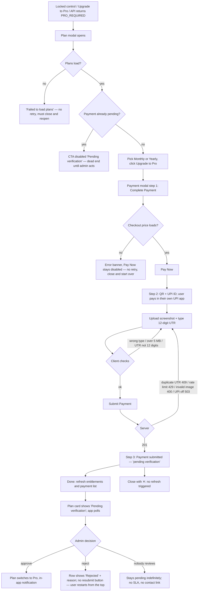
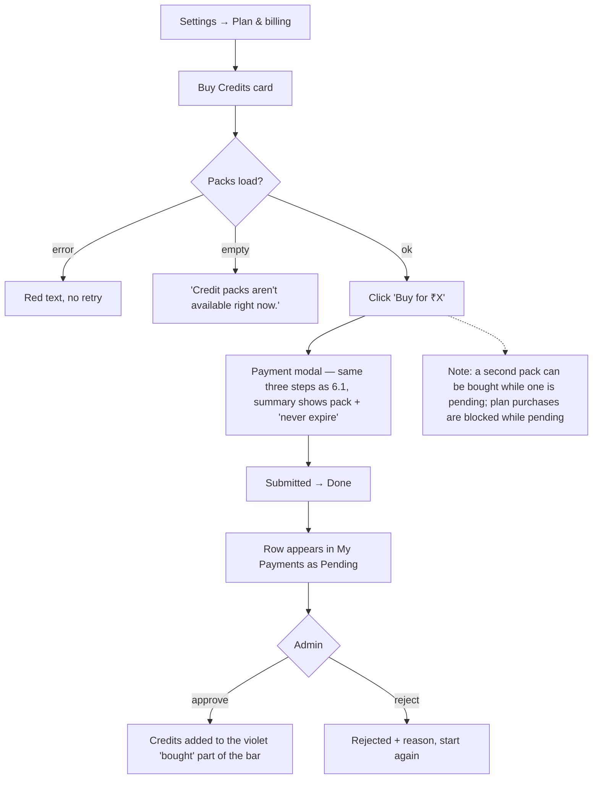
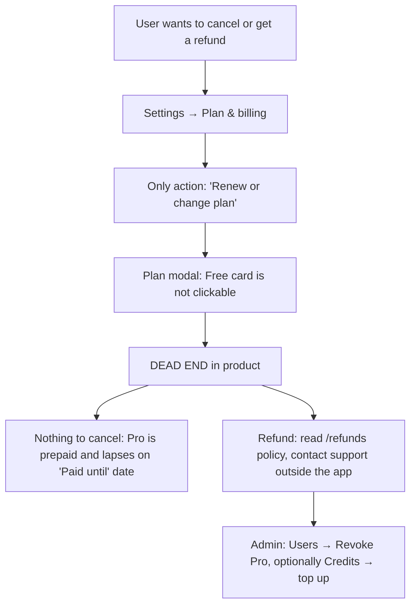
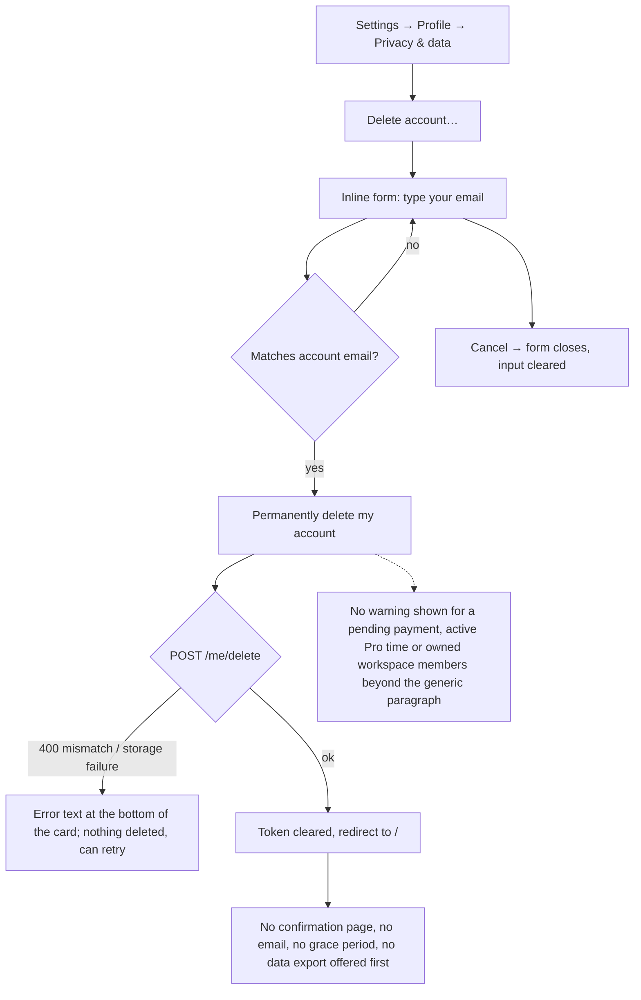
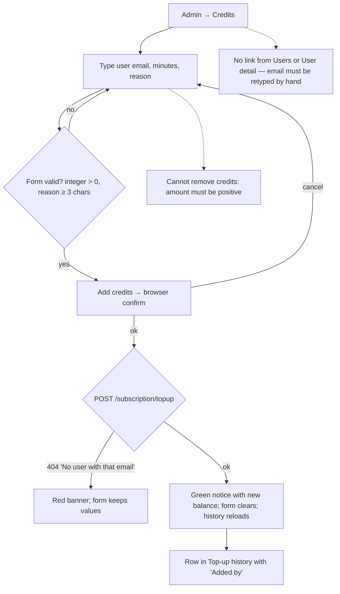
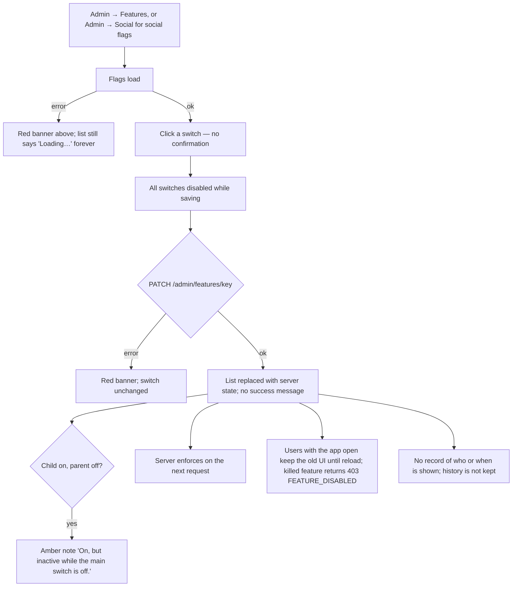

# 07 — Settings, billing and admin (Wave 0 audit)

Audit date: 2026-10-03. Branch `clipnera` at `38f9bd5`. Read-only audit; nothing was run.

**Scope read end to end (29 slice files, 3,413 lines):**
`components/dashboard/{SettingsView,AccountPrivacyPanel,PaymentModal,PlanSelectionModal}.tsx`, `components/payments/*` (4), `components/admin/*` (13), `app/dashboard/(shell)/settings/page.tsx`, `app/admin/**` (11).
**Followed for context (not documented as slice):** `hooks/useFeatureFlags.ts`, `hooks/useEntitlements.ts`, `hooks/usePlan.ts`, `lib/utils/payments.ts`, parts of `lib/api.ts`, `components/dashboard/{DashboardApp,Sidebar,EntitlementsProvider}.tsx`, backend `feature_flags/*`, `admin/{route,schema,service}.py`, `payment/{route,schema,service}.py`, `subscription/{entitlements,route,dependencies}.py` + parts of `service.py`/`schema.py`, `broll/{model,route,schema,service,repository}.py`, `auth/dependencies.py`, `user/{route,service}.py`, `workspace/route.py`.

All frontend paths below are relative to `frontend/`, backend paths to `backend/`.

---

## 0. Headline findings

1. **Payments are fully manual UPI.** No gateway, no cards, no auto-renew, INR only. User scans a QR, uploads a screenshot and a 12-digit UTR; an admin eyeballs it and clicks Approve. Every "upgrade" has a human in the loop and a "pending verification" limbo state.
2. **Feature flags are a single global boolean per key** (13 keys, one parent level). No per-user, per-workspace, per-plan or percentage targeting, no remote config values, no audit history (only last `updated_by`/`updated_at`, and `updated_by` is never shown).
3. **There is no cancel, downgrade or refund flow in the product.** Pro is a prepaid period that simply lapses. Only an admin can end it early ("Revoke Pro").
4. **Team management exists but is half-built and partly a dead end:** an owner creates a member's account *with a password*, yet the app has no password login UI (Google-only). No role change, no removal, no workspace rename/create UI even though the API has routes for role change and removal.
5. **Admin B-roll is an ingest-and-moderate tool, not a curation tool:** no upload, no tag editing, no approval queue (assets go straight to `live`), no collections; licence data is captured but only two fields are shown.
6. **Two admin pages (B-roll library, Features) are unreachable from the main app sidebar** — the sidebar's admin list has 6 links, the admin panel has 8.
7. **The plan + payment modal pair is mounted twice** (in `DashboardApp` and again in `SettingsView`) with different behaviour (one stacks the modals, one swaps them).
8. **Admin actions are logged to the server log only** for plan grants/revokes, payment decisions, flag flips and B-roll status changes. Only manual credit top-ups have a queryable audit trail.

---

## 1. Component inventory

Legend for states: D default, H hover, L loading, E empty, Err error, Dis disabled. "—" = not applicable.

### 1.1 Settings and billing (user-facing)

| Component | Purpose | Props | Internal state / effects | API calls | States present | States MISSING | Used by | Decision |
|---|---|---|---|---|---|---|---|---|
| `SettingsView` `components/dashboard/SettingsView.tsx:43` | Whole Settings screen: section nav + Profile, Plan & billing, Social, Team panels; owns its own plan/payment modals | `user`, `workspaces`, `onUpdateUser`, `activeSettingsTab`, `onSettingsTabChange` (`:27-33`) | 14 `useState` (modal flags, selected plan/pack, payments refresh key, team list, add-member form fields, invite status) `:50-76`. Effects: refresh entitlements when billing tab opens `:60-62`; fetch members when team tab opens `:99-103` | `workspaceApi.listMembers` `:82`, `workspaceApi.createAndAddMember` `:120`; entitlements via context | D, H (nav, buttons), L (plan card pulse `:240-245`, members `TableSkeleton` `:429`), E (no members `:430-435`, no workspace `:426`), Err (invite `:402`), Dis (submit `:411`) | Members fetch error is swallowed into "No team members yet" `:92-94`; credits card and "Used today" show fallback zeros while loading (only the number is hidden `:291`); no error state if entitlements fail (silently shows Free fallback); no focus styles beyond border colour | `DashboardApp.tsx:885` only | **REBUILD** — 485-line god component mixing four unrelated sections, duplicate modal ownership, team section incomplete |
| `AccountPrivacyPanel` `components/dashboard/AccountPrivacyPanel.tsx:16` | Email opt-out switch and self-service account deletion | `user`, `onUpdateUser` | `savingEmails`, `confirming`, `confirmEmail`, `deleting`, `error` `:18-22` | `userApi.setEmailPreferences` `:28`, `userApi.deleteAccount` `:41` | D, H, L (switch disabled; button "Deleting…"), Err (single shared `role="alert"` at the bottom `:144`), Dis | No success feedback for the email toggle; error is far from the control that caused it; no optimistic state; `max-w-2xl` + `shadow-xl` + `p-6` do not match the sibling Profile card (`:51` vs `SettingsView.tsx:206`) | `SettingsView.tsx:231` | **REBUILD** — logic is sound, keep the type-your-email confirmation; restyle and split into two cards (notifications / danger zone) |
| `PlanSelectionModal` `components/dashboard/PlanSelectionModal.tsx:33` | Plan comparison + monthly/yearly toggle; emits the chosen plan | `isOpen`, `onClose`, `onPlanSelected`, `upgradeReason?` `:23-29` | `plans`, `period`, `loading`, `error`; effect refetches plans on every open `:41-60` | `subscriptionApi.getPlans` `:47` | D, H, L (`ModalSkeleton` `:100`), Err (`:101`, no retry), Dis (CTA while payment pending `:175`) | E (API returns zero plans → empty grid, no message); no retry on error; no focus trap, no Esc, no backdrop click, no `role="dialog"`/`aria-modal`, close button has no `aria-label` (`:85-90`); period buttons lack `aria-pressed` | `DashboardApp.tsx:953`, `SettingsView.tsx:457` | **REBUILD** — data-driven comparison (`comparisonRows`) is worth keeping; shell must become an accessible dialog and be mounted once |
| `PaymentModal` `components/dashboard/PaymentModal.tsx:33` | 3-step manual UPI checkout for a plan period or a credit pack | `isOpen`, `onClose`, `plan`, `creditPack?`, `onPaymentComplete` `:16-23` | `step` (`confirm`/`pay`/`submitted`), `checkout`, `screenshot`, `utr`, `copied`, `error`, `loading` `:34-40`; effect resets and loads checkout on open `:48-70` | `paymentsApi.getCheckout` / `getCreditPackCheckout` `:57`; `paymentsApi.submit` / `submitCreditPack` `:89-91` | D, H, L (spinner in CTA), Err (banner `:129`), Dis (Pay Now until checkout loads; Submit until screenshot + valid UTR) | No retry when checkout fails (button stays disabled forever, dead end); no screenshot preview/remove; no drag-and-drop; no focus trap/Esc/`role="dialog"`; `navigator.clipboard` call is unguarded `:103`; closing on step 3 with ✕ skips the refresh (see P-07) | `DashboardApp.tsx:1009`, `SettingsView.tsx:466` | **REBUILD** — flow is dictated by manual UPI; keep server-priced checkout, rebuild the shell and states; design it so a real gateway can replace step 2 |
| `CreditPacksCard` `components/payments/CreditPacksCard.tsx:13` | Three one-off credit packs with Buy buttons | `onSelect(pack)` | `packs` (null = loading), `error`; one fetch on mount `:18-32` | `subscriptionApi.getPlans` `:21` (same endpoint the plan modal calls) | D, H, L (3 pulse tiles `:48`), E (`:56`), Err (`:46`, no retry) | Buy is not disabled while a payment is pending; no "best value" emphasis; hard-coded 3-column grid | `SettingsView.tsx:344`. Exported `CREDIT_PACKS_ANCHOR` (`:10`) has **zero importers** | **KEEP** (restyle) — delete the unused anchor export or actually deep-link to it |
| `MyPaymentsCard` `components/payments/MyPaymentsCard.tsx:10` | The user's payment history with status | `refreshKey?` | `payments` (null = loading), `error`; refetch when `refreshKey` changes `:14-27` | `paymentsApi.getMine` `:17` | D, L (2 pulse rows), E ("No payments yet."), Err | No pagination; no receipt/invoice; no "resubmit" action on a rejected row; stale list flashes on refetch (state not reset) | `SettingsView.tsx:351` | **KEEP** (restyle, add receipt + resubmit) |
| `PaymentStatusBadge` `components/payments/PaymentStatusBadge.tsx:11` | Coloured status chip (pending/success/rejected/failed) | `status` | none | none | D | Duplicates the job of `components/ui/StatusPill` used in `SettingsView.tsx:249`; uses `red-*` while the newer code uses `rose-*` | `MyPaymentsCard.tsx:7`, `AdminPaymentsView.tsx:8` | **DELETE** — fold into the shared `StatusPill` |

### 1.2 Admin

| Component | Purpose | Props | Internal state / effects | API calls | States present | States MISSING | Used by | Decision |
|---|---|---|---|---|---|---|---|---|
| `AdminGate` `components/admin/AdminGate.tsx:32` | Client guard: spinner until `/me` returns `role === 'admin'` | `children` | `allowed`; effect on mount `:13-25` | `userApi.getMe` `:19` | L (full-screen spinner) | No "not authorised" message — silent redirect to `/dashboard`; network error is treated as "logged out" and sends the admin to `/login` `:24` | `app/admin/layout.tsx:1` | **KEEP** — correct pattern (server re-checks); add a 403 screen and distinguish network failure |
| `AdminLayout` `components/admin/AdminLayout.tsx:30` | Admin page frame: 240px sidebar (desktop), scrolling tab strip (mobile), title/subtitle/actions header | `title`, `subtitle`, `actions?`, `children` | none; `usePathname` | none | D, H, active (`aria-current`) | No sign-out, no admin identity, no global search, no breadcrumbs; each view wraps itself in the layout so the whole frame re-mounts on navigation | 9 admin views | **REBUILD** — move into `app/admin/layout.tsx` so the shell persists; nav list must be the single source for the dashboard sidebar too |
| `AdminUi` `components/admin/AdminUi.tsx` | Shared primitives: `ADMIN_RANGES`, `usd()`, `AdminSpinner`, `AdminError`, `StatTile`, `RangeTabs`, `AdminTable` | per export | none | none | D, H (tile with `href`), E (table `empty` row) | Table: no sort, no pagination, no sticky header, row key is the array index `:96` | Overview, Usage, UserDetail, Users (`usd` only) | **KEEP** as the seed of an admin kit; only 3 of 9 views use `AdminError`/`AdminSpinner` — the rest re-inline them |
| `AdminOverviewView` `components/admin/AdminOverviewView.tsx:84` | KPI tiles + growth tiles + 7 daily bar charts + optional day table | none | `overview`, `error`, `days` (30), `growth`, `growthError`; inner `GrowthSection` has `showTable` | `adminUsersApi.getOverview` `:93`, `getGrowth(days)` `:102` | D, L (spinner per block), Err (per block), E (table) | No retry; no last-updated time; no auto-refresh; no comparison to previous period | `app/admin/overview/page.tsx` | **KEEP** (restyle) |
| `DailyBarChart` `components/admin/DailyBarChart.tsx:24` | One Recharts bar series per UTC day with title and total | `title`, `total`, `points`, `format`, `wholeNumbers?` | none | none | D, H (tooltip) | E (all-zero series draws an empty plot with no message); hard-coded hex colours `:9-11`; chart is `role="img"` with a summary label only — no data table fallback inside the component | `AdminOverviewView.tsx:49` | **KEEP** — move colours to tokens |
| `AdminUsersView` `components/admin/AdminUsersView.tsx:44` | User list with search, sort, per-user figures, Grant/Extend/Revoke Pro | none | `search`, `query` (300 ms debounce), `sort`, `users`, `hasMore`, `loading`, `error`, `busyId`, `granting` | `adminUsersApi.list` `:66`, `setPlan` `:92` | D, H, L (spinner below list), E ("No users found."), Err, Dis (while busy) | `window.confirm` for destructive actions `:87`; no reason captured for grant/revoke; no filter by plan/role; "Load more" only; no bulk actions; `Crown` imported and used, fine | `app/admin/users/page.tsx` | **REBUILD** — as a real data table with filters and a proper confirm dialog that records a reason |
| `AdminUserDetailView` `components/admin/AdminUserDetailView.tsx:91` | Read-only user dossier: 8 stat tiles, merged timeline, projects, logins (IP + device), payments, credit history | none (reads `useParams().id`) | `detail`, `error`, `showFullTimeline`; memoised `buildTimeline` | `adminUsersApi.getDetail` `:99` | D, L, Err, E (each table and timeline) | **No actions at all** — cannot grant Pro, top up credits, deactivate, or impersonate from here; no pagination past the server caps (200 projects / 100 logins / 50 payments / 200 credit rows, `admin/service.py:31-34`); unused import `Crown` `:6` | `app/admin/users/[id]/page.tsx` | **REBUILD** — make this the place where user-scoped actions (plan, credits, flag overrides) live |
| `AdminCreditsView` `components/admin/AdminCreditsView.tsx:13` | Manual credit top-up form + top-up audit table | none | form (`email`, `amount`, `reason`, `submitting`, `notice`), list (`search`, `query`, `entries`, `hasMore`, `loading`, `error`) | `adminCreditsApi.topup` `:67`, `adminCreditsApi.list` `:38` | D, H, L, E ("No top-ups yet."), Err, success notice, Dis | No user picker/autocomplete (free-typed email); add only — no deduction; `window.confirm`; copy says "minutes" while users see "credits" | `app/admin/credits/page.tsx` | **REBUILD** — merge into user detail; keep the audit table |
| `AdminPaymentsView` `components/payments/AdminPaymentsView.tsx:19` | Review queue for UPI payments: approve / reject with reason, screenshot lightbox | none | `tab`, `search`, `query`, `payments`, `hasMore`, `loading`, `error`, `busyId`, `rejecting`, `preview` | `adminPaymentsApi.list` `:42`, `get` `:103`, `approve` `:97`, `reject` `:245` | D, H, L, E ("No payments here."), Err, Dis | Lightbox has Esc but no focus trap or `role="dialog"`; thumbnail signed URLs expire after 10 min and are not refreshed (broken images on an idle tab); `window.confirm` for approve; no counts on tabs; lives in `components/payments/` not `components/admin/` | `app/admin/payments/page.tsx` | **REBUILD** (and move to `components/admin/`) |
| `AdminSocialView` `components/admin/AdminSocialView.tsx:18` | Social publishing switches, per-platform health, quota, recent failures, connected accounts with force-disconnect | none | `overview`, `accounts`, `query`, `busy`, `error` | `adminSocialApi.getOverview` `:33`, `listAccounts` `:28`, `forceDisconnect` `:42` | D, H, E ("None.", "No connected accounts."), Err, Dis | **No loading state** — "No connected accounts." shows before the first response; overview block simply absent while loading; search only fires on Enter and has no label; window fixed at 7 days; no pagination | `app/admin/social/page.tsx` | **REBUILD** |
| `AdminUsageView` `components/admin/AdminUsageView.tsx:16` | AI spend: tiles + 5 tables (cost per source minute, by model, costliest videos, clip quality by director version, by day) | none | `days`, `summary`, `quality`, `error` | `adminUsageApi.getSummary` `:26`, `getClipQuality` `:30` | D, L, Err, E | Project and user shown as raw UUIDs, not linked to `/admin/users/[id]`; clip-quality failure is silent; "Average per video (top videos)" is the mean of the *top* list, a misleading KPI `:33-35`; no chart | `app/admin/usage/page.tsx` | **KEEP** (restyle, link ids, fix the KPI) |
| `AdminBrollView` `components/admin/AdminBrollView.tsx:68` | B-roll library grid: ingest by topic, search, status filter, block / take down / restore | none | `query`, `status`, `offset`, `assets`, `total`, `error`, `ingestTopic`, `notice`; nested `AssetCard` | `adminBrollApi.listAssets` `:81`, `setStatus` `:98`, `ingest` `:109` | D, H (video plays on hover), E ("No shots match."), Err | **No loading state** ("No shots match." flashes first); `window.prompt` for the reason `:95`; status filter omits `ingesting` (`:8`) although the API accepts it; unlabeled inputs and `<select>`; hover-only preview (no keyboard/touch) | `app/admin/broll/page.tsx` | **REBUILD** — see section 4 |
| `AdminFeaturesView` `components/admin/AdminFeaturesView.tsx:8` | Page listing every flag except `social_publishing*` | none | `error` | (via `FeatureSwitches`) | D, Err | — | `app/admin/features/page.tsx` | **REBUILD** — see section 3 |
| `FeatureSwitches` `components/admin/FeatureSwitches.tsx:7` | List of on/off switches filtered by a predicate | `show(key)`, `onError(msg)` | `flags` (null = loading), `busy` | `adminFeaturesApi.list` `:12`, `set` `:18` | D, L ("Loading…" text), Dis (all switches while one saves) | Switch has no accessible name (`role="switch"` with no `aria-label`/`aria-labelledby` `:38-52`); no confirm before turning a live feature off; `updated_at` is returned but never shown; no "who changed it"; no success feedback | `AdminFeaturesView.tsx:17`, `AdminSocialView.tsx:63` | **REBUILD** |

### 1.3 Route files

| File | What it does |
|---|---|
| `app/dashboard/(shell)/settings/page.tsx:1-3` | **Returns `null`.** It only registers the URL; `DashboardApp` (mounted by `app/dashboard/(shell)/layout.tsx:9-11`) renders `SettingsView` when the pathname is `/dashboard/settings` (`DashboardApp.tsx:884-892`). The settings sub-tab is React state, set once from `?tab=` on each pathname change (`DashboardApp.tsx:133-136`); clicking a tab does not update the URL. |
| `app/admin/layout.tsx` | Wraps every admin route in `AdminGate`. |
| `app/admin/page.tsx` | Server `redirect('/admin/overview')`. |
| `app/admin/{overview,users,users/[id],payments,credits,social,usage,broll,features}/page.tsx` | Each is a 5-line server component that renders the matching `*View`. No metadata, no loading/error boundaries. |

**Dead code in slice:** `CREDIT_PACKS_ANCHOR` export (`CreditPacksCard.tsx:10`, no importer; the `id` is still on the element but nothing scrolls to it); unused `Crown` import (`AdminUserDetailView.tsx:6`). No whole component in the slice has zero importers. Adjacent, outside the slice: `adminMusicApi` (`lib/api.ts:2543`) has backend routes (`edit_engine/route.py:109-141`) but **no admin UI**; `workspaceApi.inviteMember`/`updateMemberRole` and `subscriptionApi.getMyTransactions`/`getCreditLedger` have no callers in `app/`, `components/` or `hooks/`.

---

## 2. Screen-by-screen

Visual language today: near-black page (`neutral-950`), cards `neutral-900/80` with a 1px `neutral-800` border and 16px radius, amber-500 primary buttons with dark text, 11–13px type, violet used only for "admin" and "bought credits".

### 2.1 Settings (`/dashboard/settings`)

Page header: **"Settings"** / "Your profile, plan, connected accounts and team." (`SettingsView.tsx:175`).

Layout: two columns from `lg` — a 220px sticky section list on the left, content on the right. Below `lg` the list becomes a horizontally scrolling pill row above the content (`:177-200`). Sections: **Profile**, **Plan & billing**, **Social accounts** (only when the social flag is on, `:149`), **Team & workspace**.

#### Profile tab
1. **Profile card** (`:206-230`): 56px avatar, name, email, an amber chip "`{Plan}` plan" (crown icon if paid). Two disabled read-only inputs, "Full name" and "Email". Footnote: "Your name and email come from your Google account." Nothing is editable.
2. **Privacy & data card** (`AccountPrivacyPanel`): narrower than the card above (`max-w-2xl`).
   - **Account emails** switch. Copy: "Emails when a scheduled post fails or a connected account needs reconnecting. We never send marketing emails."
   - **Delete account**. Copy: "Permanently deletes your account, videos, clips, reels, brand kits, payment records and connected social accounts. Unused credits and any paid time left are lost. This cannot be undone. See the privacy policy." Button "Delete account…" (rose outline) reveals an inline form: "Type **{email}** to confirm:", then "Permanently delete my account" (disabled until the email matches, case-insensitive) and "Cancel".

Not present: password, 2FA, sessions/devices, language, timezone, theme, notification categories, data export, API keys, avatar upload.

#### Plan & billing tab
Top row, two cards side by side from `md`:
- **Plan card** (`:239-284`): status pill ("Active" / "Pending verification" / "Free plan"), amber gradient crown tile, plan name, and either "Paid until {date}" or "Free forever. Upgrade any time." Then either the amber notice "Pro activation pending verification. We'll switch your plan as soon as the payment is approved." or a button: "Upgrade to Pro" (Free) / "Renew or change plan" (paid).
- **Credits card** (`:286-315`): "Credits" with `remaining / total`, a two-colour bar (amber = plan credits, violet = bought credits), legend "`N` plan credits" and "`N` bought, never expire", and "≈ `N` min of video at `N` credits a minute. Plan credits reset to `N` on {date}; unused ones don't roll over."

Then full-width:
- **Used today** (`:318-342`): "Resets at midnight UTC". Five meters in a 2/4-column grid: Exports, Audio clean-ups, Reel renders, AI shots, Footage edits. Each shows `used / limit` or "`used` · no limit"; the bar turns rose when the limit is hit. (A sixth metered key, `intro_renders`, exists in the data but is not shown.)
- **Buy Credits** (`CreditPacksCard`): "One-off top-ups on any plan. Bought credits never expire and are used after your plan's monthly credits." Three tiles: pack name, big credit count, "credits · ≈ `N` min of video", button "Buy for ₹`X`".
- **My Payments** (`MyPaymentsCard`): rows of "`Pro Monthly` · ₹699" (or "`200 credits` · ₹299"), date-time, "UTR `…`", optional "Reason: …" in red for rejected ones, and a status chip.

#### Social accounts tab
Renders `ConnectedPlatformsPanel` (owned by another slice).

#### Team & workspace tab
- **Add a team member** card: "Creates their account and adds them to this workspace." Button "New member" (shows a Pro lock badge and opens the upgrade modal on Free). The form has Full name, Email, **Password** ("At least 8 characters"), Role (Member / Viewer), and "Create and add to team". Success: "`{name}` added successfully!"; errors in a rose box.
- **Team** card: count, then a list of avatar-initial, name, email, role chip, status pill. Empty: "No team members yet — Add someone above to get started." No workspace: "Create a workspace first to manage team members."

Despite the tab name, **nothing about the workspace itself** is shown (name, rename, create, switch, delete).

### 2.2 Plan selection modal

Centered dialog, `max-w-4xl`, black/80 blurred backdrop. Title **"Choose Your Plan"**, subtitle "Start free. Upgrade when you need more." When opened from a locked control an amber chip reads "`{reason}` — available on Pro" (e.g. "Depth captions — available on Pro"). Close is a "✕" glyph.

If a payment is pending: "Pro activation pending verification. We'll switch your plan as soon as your payment is approved."

Segmented toggle **Monthly | Yearly · 2 months free** (the saving is computed from the prices, `:67-68`). Two cards from `md`:
- **Free** (dark, grey bolt icon): "₹0", feature list, non-interactive footer "Current Plan" or "Always free".
- **Pro** (amber 2px border, glow, crown): "₹699 /month" or "₹6,990 /year", feature list, CTA "Upgrade to Pro" / "Renew Pro" / "Pending verification" (disabled).

A "Current" chip marks the user's plan. Feature rows are ticks or crosses, generated from server data (`lib/utils/payments.ts:36-65`). Footer for paid users: "Renewing adds the new period on top of your current end date."

### 2.3 Payment modal (manual UPI, INR)

Dialog `max-w-md`. Title changes per step. Provider: **none** — the server builds a `upi://pay` link and an SVG QR for one configured VPA (`payment/service.py:82-84, 244-254`). Currency is hard-coded INR server-side.

| Step | Title | What is shown |
|---|---|---|
| 1 `confirm` | "Complete Payment" | Summary box: Plan / Billing / Credits "`600` every 30 days" / Amount — or Credit pack / Credits "`200` · never expire" / Amount. Amber note: "Pay by scanning our UPI QR code with any UPI app, then upload the payment screenshot and UTR. Your plan is activated as soon as we verify the payment." Legal line: "One-time payment; Pro does not renew automatically. Payments are non-refundable except as described in our Refund Policy. Credits used by processing that fails are always returned." Button "Pay Now" (disabled until the price loads). |
| 2 `pay` | "Pay with UPI" | White-backed 208px QR, amount in large type, "to `{payee}`", mobile-only link "Open UPI app", UPI ID with Copy, amber note "After paying, upload the screenshot and enter the UTR / transaction ID.", file picker "JPG, PNG or WebP, up to 5 MB", input "12-digit UTR number" with inline "UTR must be exactly 12 digits.", buttons "Back" and "Submit Payment". |
| 3 `submitted` | "Payment Submitted" | Green check, "Payment submitted", "Pro activation is pending verification, which usually takes a few minutes. Track it under Settings → Plan & Billing → My Payments." Button "Done". |

Server-side errors the user can hit on submit (`payment/service.py`): invalid UTR, bad/oversized screenshot, "This UTR has already been submitted" (409), "Too many payment submissions. Please try again in an hour." (5 per hour), "UPI payments are not available right now" (503 when no VPA is configured), "This plan cannot be purchased with UPI".

### 2.4 Admin shell

Desktop: 240px left rail with the Clipnera wordmark and a violet "ADMIN" tag, 8 links (Overview, Users, Payments, Credits, Social, AI usage, B-roll library, Features), and "Back to the app" at the bottom. Active link has an amber 3px left bar. Content column `max-w-6xl`. Mobile/tablet: "Back to the app" link, title, then the same 8 links as a horizontally scrolling chip row.

### 2.5 Admin pages

| Page | Header | Body |
|---|---|---|
| **Overview** `/admin/overview` | "Overview" / "Plans and revenue at a glance. Revenue counts payments approved this calendar month (UTC)." | 4 tiles: Free users, Active Pro users, Revenue this month, **Payments to review** (amber when > 0, hint "Review now" / "All caught up", links to Payments). Section "Growth" — "Per UTC day. Active users and logins are counted from the day tracking went live; everything else covers all history." — with a 7/30/90-day toggle, 8 tiles (Total users, Active today, Active 7d, Active 30d, Projects, Clips, Revenue, AI cost), 7 bar charts in 2 columns (Sign-ups, Active users, Logins, Projects created, Clips generated, Revenue (approved payments), AI cost), and a "Show day-by-day table" toggle. |
| **Users** `/admin/users` | "Users" / "Grant Pro for refunds, gifts or testing, or revoke it. Open a user to see everything they have done." Actions: sort select (Newest sign-ups, Recently active, Most projects, Highest AI cost) + search "Search email or name". | One card per user: name (+ violet "ADMIN"), email, "Joined {date} · View activity"; plan and "Until {date}" / "No expiry"; buttons "Revoke Pro" (paid only) and "Grant Pro" / "Extend Pro". A 7-figure strip: Last active, Last login, Projects, Clips, Credits left, Paid, AI cost. Granting opens an inline row with 7 / 30 / 365-day presets, a days input (1–3650) and Confirm. Browser confirms: "Give {email} 30 days of Pro? This is added to any Pro time they have." / "Revoke Pro from {email} now? Their credits are capped at the Free allowance." 50 per page, "Load more". |
| **User detail** `/admin/users/[id]` | Title = name, subtitle "{email} · joined {date}", link "All users". | 8 tiles (Plan, Credits left, Projects, Total paid, AI cost, Days active, Last active, Last login). **Timeline** merging sign-up, logins (IP · "Chrome on Windows"), project creation (with source link) and payments; first 30, "Show all N events". Tables: **Projects** (title + source, status, length, clips, credits, AI cost, created), **Logins** (when, method, IP address, device), **Payments**, **Credit history** (signed change, balance, reason). Entirely read-only. |
| **Payments** `/admin/payments` | "UPI Payments" / "Match each amount and UTR against your bank or UPI app before approving." Search "Search UTR, user or amount". | Tabs Pending / Success / Rejected / All. Card per payment: 64px screenshot thumbnail (click for full-size lightbox with a fresh signed URL), name, status chip, email, "Submitted …", "Reason: …", "Reviewed …"; right side amount, what was bought, UTR (click to copy). Pending rows get "Reject" and "Approve". Reject opens an inline panel with presets "UTR not found", "Amount mismatch", "Screenshot unclear", a required textarea "Reason shown to the user (required)" and "Confirm Reject". Approve uses a browser confirm that states the effect. |
| **Credits** `/admin/credits` | "Credits" / "Add credit minutes to a user by hand. Every top-up is logged with who made it." | One-row form: User email, Minutes, Reason ("Refund for failed render"), "Add credits". Success: "Added 100 min to x@y. New balance: 160 min." Then "Top-up history" with a user search and a table: When, User, Minutes, Balance after, Reason, Added by ("Deleted admin" if the admin no longer exists). |
| **Social** `/admin/social` | "Social publishing" / "Switch the feature on or off, watch publishing health and disconnect accounts. Tokens are never shown." | Feature switches (the 5 `social_publishing*` flags), a tile per platform (connected, need reconnect, "7d: N published, N failed (N% ok)"), "YouTube uploads today (app-wide) used / limit", "X spend this month $x / $y", "Recent failures" list, and "Connected accounts" with search ("Search email or handle, then Enter") and "Force disconnect" per row (confirm: "… Their scheduled posts will be cancelled."). |
| **AI usage** `/admin/usage` | "AI usage" / "Tokens and dollars spent on AI models, from every call the pipeline makes." 7/30/90 toggle. | 3 tiles (Spend, AI calls, Average per video (top videos)). Tables: "AI cost per source minute" ("What a minute of uploaded video really costs in AI. Credits should earn at least 3x this per minute." — rows "Pro (Claude)" / "Free (Groq)"), "By model", "Most expensive videos", "Clip quality by director version", "By day". |
| **B-roll library** `/admin/broll` | "B-roll library" / "Licensed stock shots used for reels. Users only ever see these inside their own renders." | Ingest bar: "Topic to ingest, e.g. city at night" + "Ingest from stock sources". Search "Search the library", status select (All statuses, live, blocked, taken down, failed), "`N` shots". Grid of 9:16 cards (2/3/5 columns): hover-to-play preview, status chip, duration, title, "`source` · `licence` · `W`×`H`", attribution, status reason, buttons Source / Block / Take down / Restore. Previous / Next, 40 per page. |
| **Features** `/admin/features` | "Features" / "Turn features on or off for every user. New features ship off; the API refuses what is off and the app hides it." | A single card with one row per flag (label, description, switch); child flags are indented 24px; an amber line "On, but inactive while the main switch is off." appears when a child is on under an off parent. |

---

## 3. Existing feature flags

### 3.1 Data model

One table, `feature_flags` (`feature_flags/model.py:11-23`):

| Column | Type | Notes |
|---|---|---|
| `key` | `String(100)` PK | Must exist in the code registry |
| `enabled` | `Boolean`, default false | The stored switch |
| `updated_by` | FK `users.id`, `SET NULL` | Last admin only |
| `updated_at` | `DateTime` | Last change only |

A row is an *override*; **no row means off**. Definitions live in code, not the database: `FlagDefinition(key, label, description, parent)` in `feature_flags/registry.py:14-19`, collected in `FLAGS` (`:106`). Adding a flag is a code change and deploy; the frontend has its own hard-coded copy of the key union (`lib/api.ts:1705-1718`) and of the all-off default (`hooks/useFeatureFlags.ts:8-22`), so a new flag touches three files.

### 3.2 Flags that exist (13)

| Key | Label (admin UI) | Parent | Enforced in backend at | Read in frontend at |
|---|---|---|---|---|
| `social_publishing` | Connected publishing platforms | — | `social/posts.py:79`, `social/service.py:170` | Sidebar, MobileTabBar, CommandPalette, DashboardHomeView (×7), DashboardApp, ConnectedPlatformsPanel, PlanSelectionModal `:157` |
| `social_publishing.youtube` | YouTube Shorts | social_publishing | `social/service.py:170` | (via social panel) |
| `social_publishing.tiktok` | TikTok | social_publishing | same | same |
| `social_publishing.instagram` | Instagram Reels | social_publishing | same | same |
| `social_publishing.x` | X | social_publishing | same | same |
| `video_upload` | Video upload | — | `uploads/route.py:25` | `UploadModal` |
| `broll_studio` | B-Roll Studio | — | (parent only) | — |
| `broll_studio.cutaways` | B-roll cutaways on clips | broll_studio | `broll/route.py:29`, `pipeline/service.py:815` | `UploadModal`, `VideoEditorStudio` |
| `broll_studio.reels` | Reels from images | broll_studio | `reels/route.py:26` | Sidebar, MobileTabBar, CommandPalette, DashboardApp |
| `broll_studio.ai_shots` | AI-generated shots (Pro) | broll_studio | `broll/generation.py:122` | `ClipBrollPanel`, `ReelsView` |
| `broll_studio.reels.footage` | Reels from raw footage | broll_studio.reels | `edit_engine/route.py:30` | `ReelsView` |
| `broll_studio.reels.footage.opus_director` | Opus director for Pro footage reels | broll_studio.reels.footage | `edit_engine/service.py:90`, `edit_engine/jobs.py:242` | — (server behaviour + pricing switch) |
| `agent_editor` | Editor | — | `editor/route.py:16` | Sidebar, DashboardApp |

### 3.3 Evaluation

`resolve()` (`feature_flags/service.py:18-26`): a flag is effective when its stored value is true **and its direct parent's stored value is true**. Only one level is checked — see P-01: `broll_studio.reels.footage` stays effective when the grandparent `broll_studio` is off, as long as `broll_studio.reels` is still stored as on.

Every evaluation is a fresh `SELECT key, enabled FROM feature_flags` (`:33-35`) — no cache, so a flip takes effect on the next request (a working kill switch server-side) at the cost of one query per guarded request. Evaluation takes **no context**: there is no user, workspace, plan or request argument anywhere in the service.

A disabled feature returns `403 FEATURE_DISABLED` with `{"feature": key}` and the message "`{label}` is not available right now." (`:45-55`).

### 3.4 Delivery to the client

`GET /api/v1/features` (any signed-in user) returns `{ data: { flags: { key: bool } } }` with the *effective* values (`feature_flags/route.py:20-22`). `useFeatureFlags` (`hooks/useFeatureFlags.ts`):
- one module-level cached promise per page load, shared by all callers (`:25-38`);
- defaults to all-off until loaded and on failure ("a dark-launched feature never flashes into view");
- `refresh()` forces a refetch but only updates the calling component's state — other mounted consumers keep their old copy;
- **no polling, no push, no refetch on focus** — a user with the tab open keeps a killed feature in their UI until reload, and gets a 403 when they use it. There is no generic handler for `FEATURE_DISABLED` (only plan errors raise a global event, `lib/api.ts:551-555`).
- Not available to signed-out pages or to server components (client hook, auth required).

### 3.5 Who can change them, and auditing

`PATCH /api/v1/admin/features/{key}` with `{enabled}`; router-level `get_current_admin` (`feature_flags/route.py:15-17, 30-35`). Any platform admin can flip any flag; there is a single admin role, no separation of duties, no approval.

Audit: the upsert overwrites `updated_by`/`updated_at` (`service.py:57-67`) and writes one application log line (`:68`). **There is no history table.** The admin API does not even return `updated_by`, and the UI shows neither field.

### 3.6 Gap to the target

| Target capability | Today | Gap |
|---|---|---|
| Global flag | Yes (boolean) | — |
| Kill switch | Server-side yes, immediate; client stale until reload | Need client refresh (poll/SSE/focus), a `FEATURE_DISABLED` handler, and a confirm + reason on turn-off |
| Per-user override | No | New table (flag × subject × value) and evaluation context |
| Per-workspace override | No | Same; workspaces exist as an entity |
| Per-plan targeting | No (plan gating is a separate, code-only system in `subscription/entitlements.py`) | Decide whether flags and entitlements merge or stay layered; today a "Pro-only flag" is expressed by convention in the label ("AI-generated shots (Pro)") |
| Percentage rollout | No | Needs stable hashing on user/workspace id and a rollout field |
| Remote config (non-boolean values) | No — booleans only; tunables are env settings (`core/config.py`) and code constants | New typed value column / config table |
| Audit log | Last writer only, not displayed | Append-only `flag_changes` (who, when, old → new, reason) and a UI for it |
| Flag lifecycle | Definitions in code, three duplicated lists | Serve definitions from one registry; generate the TS union; add owner, created date, "stale" marker |
| Admin UI | Flat list of switches split across two pages by a key-prefix predicate (`AdminFeaturesView.tsx:17`, `AdminSocialView.tsx:63`) | Search, grouping, targeting rules editor, history drawer, environment indicator |
| Hierarchy | One parent level, evaluated one level deep | Fix ancestor chain; show the tree properly (grandchildren currently indent the same 24px as children, `FeatureSwitches.tsx:30`) |
| Server-rendered / signed-out use | No | Public bootstrap endpoint or SSR evaluation |
| Tests/dev overrides | None | Local override mechanism |

---

## 4. Existing admin B-roll

### 4.1 What it can do today

| Capability | UI | Backend |
|---|---|---|
| Browse the library | 9:16 grid, 40 per page, Previous/Next (`AdminBrollView.tsx:160-174`) | `GET /admin/broll/assets?q&status&limit&offset` → `{items,total}`; full-text search over title + caption + tags; newest first (`broll/repository.py:122-131`) |
| Search | Free text, debounced 300 ms | Postgres `websearch_to_tsquery` |
| Filter by status | All / live / blocked / taken down / failed (no `ingesting`) | Accepts all five |
| Preview | Hover plays the low-res proxy; poster = thumbnail | 1-hour signed URLs to proxy and thumb only; masters never linked (`broll/service.py:65-67`) |
| Add content | "Ingest from stock sources": a topic string, fixed `per_source: 5` (`:109`) | `POST /admin/broll/ingest` queues a job that searches stock providers and ingests results (`broll/service.py:48-50, 158-162`); request also supports `per_source` 1–20 and a `sources` list the UI never sends |
| Block / Take down | Buttons on live assets; reason via `window.prompt` | `POST /admin/broll/assets/{id}/status` with `live` / `blocked` / `taken_down` and optional reason; removed from search at once |
| Restore | Button on any non-live asset (including `failed` and `ingesting`) | Same endpoint |
| See licence | "`source` · `license_code` · `W`×`H`" and the attribution text; "Source" link to the provider page | A `broll_licenses` row per asset: `license_code`, `license_url`, `author`, `author_url`, `attribution_text`, `commercial_ok`, `source_record_key` (the provider's record as fetched), `fetched_at` (`broll/model.py:88-104`). **Only `license_code` and `attribution_text` reach the API response** (`broll/schema.py:9-28`) |

Data the model already holds but the admin never sees: `kind` (stock / template / generated / user), `tags`, `caption`, `orientation`, `fps`, `quality_score`, `has_people`, `has_logos`, `owner_user_id`, `content_hash`, and usage/swap history (`broll_usage`, with a `swap_rates()` query at `broll/repository.py:106-116`). `tags`, `kind`, `orientation` and `quality_score` are in the response but not rendered.

### 4.2 What it cannot do

- **Upload**: no admin upload of own footage (the model has `kind = template | user` but no admin route creates them).
- **Tagging / metadata editing**: no endpoint to edit title, tags, caption, people/logo flags or quality score.
- **Approval**: there is no review queue. The status enum has no "pending review"; ingested assets become `live` without a human. Moderation is after the fact.
- **Retire vs. take down**: "blocked" and "taken_down" are the only off states; no scheduled expiry, no licence-expiry date, no "deprecated but keep in existing renders".
- **Licensing admin**: cannot view licence URL, author, commercial-use flag or the stored proof; cannot edit or re-verify; cannot filter by licence or by `commercial_ok`.
- **Curation tools**: no collections/categories/themes, no featured or pinned shots, no ordering, no duplicate review (a `content_hash` exists), no bulk select, no bulk status change.
- **Quality signal**: swap rate and usage counts are collected but not shown; no "most swapped away" report.
- **Ingest visibility**: no job list, progress, per-source results or failures — only the notice "Ingest queued for "…". New shots appear here as they finish." and no auto-refresh.
- **Filters**: none for source, kind, orientation, duration, resolution, people/logos, date.
- **Audit**: status changes store only the latest `status_reason`; the acting admin is not recorded anywhere (the route does not even take the admin, `broll/route.py:51-54`).
- **Private assets**: the admin list does not filter `owner_user_id`, so users' private generated/uploaded clips appear mixed into the "library" with no owner shown.
- **Music**: a parallel admin music library API exists (`/admin/music`: list, add, set status) with no UI at all.

### 4.3 Gap to a curated platform library

Needed, roughly in order: (1) a review state and queue between ingest and live; (2) an asset detail drawer with full metadata, full licence record and usage stats; (3) edit endpoints for title/tags/flags; (4) admin upload with licence entry; (5) collections and featuring; (6) faceted filters and bulk actions; (7) ingest job monitor; (8) an audit trail of who changed what; (9) separating platform library from user-owned assets; (10) bringing music under the same curation surface.

---

## 5. Plans, entitlements, credits

### 5.1 Plans as shown in the UI

Source of truth: `subscription/entitlements.py`. The UI renders them from `GET /subscription/plans` — nothing is hard-coded in the modal except labels.

| | Free | Pro | Pro Plus (legacy, not sold) |
|---|---|---|---|
| Price | ₹0 | ₹699 / 30 days, ₹6,990 / 365 days (`:57-60`) | — |
| Credits per 30 days | 20 | 600 | 1,200 |
| Max source length | 30 min | 120 min | 120 min |
| Clips per video | 5 | 20 | 50 |
| Output formats | 9:16 | 9:16, 1:1, 4:5, 16:9 | same |
| Choose formats per video | No | Yes | Yes |
| Caption styles | 6 | All | All |
| Exports per day | 10 | Unlimited | Unlimited |
| Audio enhancements per day | 3 | Unlimited | Unlimited |
| Reel renders per day | 2 | 20 | 20 |
| AI shots per day | 0 | 10 | 10 |
| Footage edits per day | 1 | 15 | 15 |
| Intro renders per day | 0 | 5 | 5 |
| Watermark | Forced | None | None |
| Pro AI models | No | Yes | Yes |
| Hook transition presets, brand kit editing, depth captions, batch processing, team members, creator intro | No | Yes | Yes |
| Priority rendering | No | No | Yes |
| Social accounts / posts per day | 1 / 3 | 4 / 25 | 4 / 25 |
| Social scheduling | No | Yes (30 days ahead) | Yes |
| Publish to X | No | Yes | Yes |

The plan modal lists these as tick/cross rows (`lib/utils/payments.ts:36-65`); reel/AI-shot/footage-edit limits, priority rendering and creator intro are **not** in the comparison list.

Credit pricing: 2 credits per source minute, +50% per extra output format (`core/config.py:56,60`). Credit packs (`entitlements.py:74-81`): **Starter 60 for ₹99, Creator 200 for ₹299, Studio 500 for ₹649** — never expire, spent after plan credits.

### 5.2 How gating shows up

- Locked controls show a `ProLockBadge`; clicking calls `promptUpgrade(reason)` which opens the plan modal with the reason chip (`SettingsView.tsx:369-374`).
- Any API refusal with a plan error code raises a window event that opens the same modal (`lib/api.ts:551-555`, `EntitlementsProvider.tsx:87-94`).
- Server enforcement is independent: `require_feature` → 403 `PRO_REQUIRED`; `check_limit` → 429 `LIMIT_REACHED` (`subscription/dependencies.py`).
- Until entitlements load, the UI assumes Free (`hooks/useEntitlements.ts:20-67`).

### 5.3 Upgrade, renew, downgrade, cancel

| Flow | Exists? | Detail |
|---|---|---|
| Upgrade Free → Pro | Yes | Plan modal → payment modal → admin approval. While pending, the CTA is disabled and the app polls entitlements (`EntitlementsProvider.tsx:70-85`). |
| Renew | Yes | Same flow; "Renewing adds the new period on top of your current end date." No reminder UI in this slice (a 3-day `isExpiringSoon` flag exists in `usePlan.ts:70`). |
| Auto-renew | **No** | "One-time payment; Pro does not renew automatically." |
| Change plan | **No** | Button says "Renew or change plan" but only one paid plan is sold. |
| Downgrade | **No** | Lapses to Free at period end. |
| Cancel | **No** | Nothing to cancel; no refund request UI (a `/refunds` policy page is linked). |
| Refund | Manual | Admin "Revoke Pro" + admin credit top-up are the only tools. |
| Buy credits | Yes | Credit pack tile → payment modal (steps identical). |
| Invoices / receipts | **No** | Only the payment list. |
| Billing details (GST, address) | **No** | — |

### 5.4 Team / workspace members

Exists: list members; create a member account (name, email, password, role Member/Viewer) — Pro only (`workspace/route.py:62-74`).
Does not exist in the UI: invite by email link, change role, remove member, resend, seat counts or seat pricing, workspace create/rename/switch/delete, per-workspace plan or credits (plan and credits belong to the user). The API has `PATCH` and `DELETE` member routes (`workspace/route.py:82-99`) with no caller. **Password login has no UI anywhere in the frontend** (the only `type="password"` input in the app is this form, `SettingsView.tsx:393`), so a member created this way can only get in if they sign in with Google using the same email — the password they were given is unusable.

---

## 6. User flows

### 6.1 Upgrade plan → pay → confirmation

### 6.2 Buy a credit pack

### 6.3 Cancel

### 6.4 Delete account

### 6.5 Admin adjusts a user's credits

### 6.6 Admin toggles a feature

---

## 7. Admin access gating

**Frontend.** `app/admin/layout.tsx` wraps every admin route in `AdminGate`. With no token it redirects to `/login`; otherwise it calls `GET /me` and renders children only if `role === 'admin'`, else redirects to `/dashboard` (`AdminGate.tsx:13-25`). Children are not mounted before that, so no admin request fires for a non-admin. The dashboard sidebar shows the admin group only when `user.role === 'admin'` (`Sidebar.tsx:376`). There is no Next.js middleware (`frontend/middleware.ts` does not exist) — gating is client-side by design.

**Backend.** Every admin router carries `dependencies=[Depends(get_current_admin)]` (`admin/route.py:26`, `payment/route.py:25-27`, `feature_flags/route.py:15-17`, `broll/route.py:30`; same pattern for social, usage, quality, music). `get_current_admin` loads the user from the database on every request and requires `is_active` and `role == ADMIN` (`auth/dependencies.py:53-65`), so revoking the role takes effect immediately and the role is never trusted from the token. The credit top-up routes live under `/subscription` rather than `/admin`, protected per-route by `CurrentAdminDep` (`subscription/route.py:46-61`).

**Concerns**

| # | Severity | Concern | Where |
|---|---|---|---|
| S-1 | High | Bearer token is kept in `localStorage` (`lib/auth.ts:13-32`); any XSS yields full admin API access. No step-up auth, MFA or re-auth for admin actions. | `lib/auth.ts` |
| S-2 | High | No persistent audit trail for plan grant/revoke, payment approve/reject (only `verified_by` on the row), flag changes, B-roll status changes or force-disconnect — application log lines only (`admin/service.py:143`, `feature_flags/service.py:68`). B-roll status changes do not record the admin at all (`broll/route.py:51-54`). | backend |
| S-3 | Medium | Single all-powerful `admin` role: the person who reviews payments can also grant Pro, mint credits (up to 100,000 per call, `subscription/schema.py:58`) and flip kill switches. No support / finance / content roles. | `auth/dependencies.py:63` |
| S-4 | Medium | Admin UI exposes user PII (login IP addresses, user agents, source URLs, payment screenshots) with no access logging. | `AdminUserDetailView.tsx:187-198`, `AdminPaymentsView.tsx:152-159` |
| S-5 | Medium | No way to manage admins in the product; the role is assigned outside the app (no route sets it). Good for safety, but there is no visibility of who is an admin beyond a tag in the user list. | — |
| S-6 | Low | The top-up routes sit outside the `/admin` router, so the "every route added later is protected" guarantee of the router-level dependency does not cover them; a future edit could drop the per-route guard. | `subscription/route.py:46-61` |
| S-7 | Low | `AdminGate` treats any `/me` failure as signed-out and navigates to `/login`, without clearing the token. | `AdminGate.tsx:24` |
| S-8 | Low | Destructive admin actions rely on `window.confirm`/`window.prompt`, which can be suppressed by the browser ("prevent this page from creating additional dialogs") — `confirm` then returns false and the action silently never runs. | Users `:87`, Payments `:94`, Credits `:61`, Social `:39`, B-roll `:95` |
| S-9 | Info | User-supplied source URLs are only linkified when they start with `http(s)://` and open with `rel="noopener noreferrer"` — correctly handled. The B-roll "Source" link uses `rel="noreferrer"` on a provider URL without the same scheme check. | `AdminUserDetailView.tsx:44-52`, `AdminBrollView.tsx:44` |

---

## 8. Problems

Severity: **H** breaks a flow or misleads; **M** degrades experience or maintainability; **L** polish.

### Bugs and logic

| ID | Sev | Problem | Where |
|---|---|---|---|
| P-01 | H | Flag hierarchy is checked one level deep. Turning off `broll_studio` leaves `broll_studio.reels.footage` and `…opus_director` effective while `broll_studio.reels` is still stored on — the "main switch" does not kill grandchildren. | `feature_flags/service.py:18-26` |
| P-02 | H | Team member creation asks for a password, but the product has no password sign-in screen. The created credential is unusable; the member must use Google with the same email, which the UI never says. | `SettingsView.tsx:391-395` |
| P-03 | H | Plan + payment modals are mounted twice with diverging behaviour: `SettingsView` closes the plan modal before opening payment (`:460-464`); `DashboardApp` leaves it open underneath (`DashboardApp.tsx:726-729`), stacking two `z-50` dialogs. Completion paths differ too (`refreshPlan` vs. `refreshAccount`). | `SettingsView.tsx:457-482`, `DashboardApp.tsx:953-1017` |
| P-04 | M | Free-tier fallback says 60 credits per cycle; the server's Free plan grants 20. While entitlements load (or if the request fails) the Credits card reads "Plan credits reset to 60 every 30 days." | `hooks/useEntitlements.ts:29` vs `subscription/entitlements.py:207` |
| P-05 | M | Credits card and "Used today" render fallback zeros during load — only the `x / y` figure is guarded by `loadingSub`. | `SettingsView.tsx:291-314, 323-341` |
| P-06 | M | Member list fetch failure is shown as "No team members yet". | `SettingsView.tsx:92-94` |
| P-07 | M | On the "Payment submitted" step, closing with ✕ calls `onClose`, not `onPaymentComplete`, so the payments list and entitlements are not refreshed. | `PaymentModal.tsx:120-126` vs `:321` |
| P-08 | M | Checkout load failure is a dead end: error banner + permanently disabled "Pay Now", no retry. Same for plan load failure. | `PaymentModal.tsx:61-63, 191-193`; `PlanSelectionModal.tsx:101` |
| P-09 | M | Settings sub-tab is not in the URL. Tab clicks do not update `?tab=`, refresh returns to Profile, and `?tab=account` is ignored, so a previously selected tab sticks when navigating to a link without a tab param. | `DashboardApp.tsx:128-136` |
| P-10 | M | The dashboard sidebar's admin list omits **B-roll library** and **Features** and labels Social differently ("Social accounts" vs "Social"); the comment claims the lists match. | `Sidebar.tsx:115-123` vs `AdminLayout.tsx:9-18` |
| P-11 | M | Admin payment thumbnails use signed URLs valid for 10 minutes; an idle review tab shows broken images until reload. Only the lightbox refetches. | `AdminPaymentsView.tsx:158`, `payment/service.py:31` |
| P-12 | M | `FeatureSwitches` load error leaves "Loading…" on screen forever. | `FeatureSwitches.tsx:12, 26` |
| P-13 | M | `useFeatureFlags.refresh()` updates only the caller; other mounted consumers keep stale flags. No refetch on focus or interval. | `hooks/useFeatureFlags.ts:53` |
| P-14 | M | Admin Social and B-roll show their empty messages before the first response ("No connected accounts." / "No shots match."). | `AdminSocialView.tsx:130`, `AdminBrollView.tsx:165` |
| P-15 | M | "Average per video (top videos)" averages only the most expensive projects, so it overstates the real average. | `AdminUsageView.tsx:33-35, 50` |
| P-16 | M | Credit packs can be bought while another payment is pending; plan purchases cannot. Inconsistent, and undocumented to the user. | `CreditPacksCard.tsx:71-76` vs `PlanSelectionModal.tsx:175` |
| P-17 | L | Unit naming drifts: admin says "credit minutes" / "min" (`AdminCreditsView.tsx:61, 68, 81, 91`), users see "credits"; fields are still named `credit_minutes*` though one minute now costs 2 credits. | several |
| P-18 | L | B-roll status filter omits `ingesting`; "Restore" is offered on `failed` and `ingesting` assets, which would mark an unusable asset live. | `AdminBrollView.tsx:8, 57-61` |
| P-19 | L | The B-roll subtitle says shots are "used for reels" although they are also used as clip cutaways; the admin list mixes in user-owned assets. | `AdminBrollView.tsx:118`, `broll/repository.py:122-131` |
| P-20 | L | `copyUpiId` and the UTR copy call `navigator.clipboard.writeText` with no error handling or fallback (fails on insecure origins / denied permission); the admin UTR copy gives no feedback. | `PaymentModal.tsx:101-106`, `AdminPaymentsView.tsx:184` |
| P-21 | L | `intro_renders` is metered but missing from "Used today". | `SettingsView.tsx:156-169` |
| P-22 | L | Payment success copy says "Settings → Plan & Billing → My Payments" while the tab is labelled "Plan & billing". | `PaymentModal.tsx:317` |

### API contract (project rule: `{data, message, error}` everywhere)

| ID | Sev | Problem | Where |
|---|---|---|---|
| C-01 | M | Two response shapes coexist inside this slice. Raw models: `/admin/users`, `/admin/users/{id}/plan`, `/admin/overview`, all `/payments*` and `/admin/payments*`, all `/subscription/*`, `/me`. Envelope: `/admin/users/{id}/detail`, `/admin/growth`, `/admin/usage`, `/admin/features`, `/admin/social/*`, `/admin/broll/*`, `/me/delete`. The client mirrors this with `authedRequest` vs `envelopeRequest`. | `admin/route.py:36-70`, `payment/route.py`, `subscription/route.py`; `lib/api.ts:1428-1436` |
| C-02 | L | The flag key union and the all-off map are hand-copied from the backend registry into two frontend files. | `lib/api.ts:1705-1718`, `hooks/useFeatureFlags.ts:8-22` |
| C-03 | L | `AdminUserPayment.plan_type` is typed loosely and cast in the view. | `AdminUserDetailView.tsx:207` |

### Duplication and structure

| ID | Sev | Problem | Where |
|---|---|---|---|
| D-01 | M | Search-debounce + paged "load more" list logic is copy-pasted three times. | `AdminUsersView.tsx:55-80`, `AdminPaymentsView.tsx:31-61`, `AdminCreditsView.tsx:27-52` |
| D-02 | M | Inline spinner and error-banner markup is repeated in 5 views although `AdminSpinner`/`AdminError` exist; the copies use `red-*`, the shared ones `rose-*`. | Users `:136, 234`, Payments `:140, 258`, Credits `:111, 161`, Social `:59`, Features `:15` |
| D-03 | M | `GET /subscription/plans` is fetched separately by `PlanSelectionModal` (on every open) and `CreditPacksCard`; no shared cache. | `PlanSelectionModal.tsx:47`, `CreditPacksCard.tsx:21` |
| D-04 | M | Three unrelated modal implementations (plan, payment, screenshot lightbox) each hand-roll backdrop and close; none use a shared dialog primitive. | — |
| D-05 | L | Two status-chip components (`PaymentStatusBadge`, `StatusPill`) and two card styles (`neutral-900/80` no shadow vs `neutral-900/90 shadow-xl p-6`) on the same billing tab. | `SettingsView.tsx:239` vs `CreditPacksCard.tsx:35`, `MyPaymentsCard.tsx:30`, `AccountPrivacyPanel.tsx:51` |
| D-06 | L | `AdminPaymentsView` lives in `components/payments/`; every other admin view is in `components/admin/`. | — |
| D-07 | L | Every admin view wraps itself in `AdminLayout`, so the frame re-mounts per navigation instead of living in `app/admin/layout.tsx`. | all admin views |
| D-08 | L | Feature flags are split across two admin pages by a string-prefix predicate. | `AdminFeaturesView.tsx:17`, `AdminSocialView.tsx:63` |

### Accessibility

| ID | Sev | Problem | Where |
|---|---|---|---|
| A-01 | H | No modal is a real dialog: no `role="dialog"`, `aria-modal`, labelled title, focus trap, focus return, or Esc (lightbox has Esc only). Background stays tabbable. | `PlanSelectionModal.tsx:71`, `PaymentModal.tsx:111`, `AdminPaymentsView.tsx:275-297` |
| A-02 | H | Admin feature switches have no accessible name — screen readers announce "switch, on" thirteen times. | `FeatureSwitches.tsx:38-52` |
| A-03 | M | Close buttons are a bare "✕" with no label. | `PlanSelectionModal.tsx:85-90`, `AdminPaymentsView.tsx:286` |
| A-04 | M | Inputs with placeholder only, no label: B-roll ingest/search/status select, Social account search, admin search boxes. | `AdminBrollView.tsx:121, 134, 143`, `AdminSocialView.tsx:122`, Users `:125`, Payments `:116`, Credits `:117` |
| A-05 | M | Segmented controls lack state semantics: billing period toggle and payment status tabs have no `aria-pressed`/`role="tab"`. (`RangeTabs` does it right.) | `PlanSelectionModal.tsx:107-121`, `AdminPaymentsView.tsx:126-138` |
| A-06 | M | Plan comparison ticks/crosses are icon-only; "included / not included" is conveyed by icon and text colour alone. | `PlanSelectionModal.tsx:156-169` |
| A-07 | M | Focus indication is a border-colour change only (`focus:outline-none`), and buttons have no visible focus style at all. | throughout |
| A-08 | M | Text sizes of 10–11px in `neutral-500` on near-black are used for meaningful content (figures, timestamps, licence lines). | e.g. `AdminUsersView.tsx:36`, `AdminBrollView.tsx:37-41` |
| A-09 | M | B-roll previews play on mouse hover only; no keyboard or touch equivalent, no pause control. | `AdminBrollView.tsx:23-26` |
| A-10 | L | Error and status messages mostly lack `role="alert"`/`aria-live` (payment modal banner, admin banners, credit notice, B-roll notice). | `PaymentModal.tsx:129`, admin views |
| A-11 | L | The file input is `sr-only` inside a label — works, but the visible drop zone shows no focus state. | `PaymentModal.tsx:249-266` |
| A-12 | L | Settings section nav uses `aria-current="page"` on buttons that do not change the URL. | `SettingsView.tsx:185-189` |

### Performance

| ID | Sev | Problem | Where |
|---|---|---|---|
| F-01 | M | Each flag check is an uncached table read; guarded routes pay one extra query per request, and `GET /features` is not cacheable. | `feature_flags/service.py:33-38` |
| F-02 | M | B-roll list makes one extra licence query per asset (41+ queries for a page of 40) and signs two URLs per asset. | `broll/service.py:38-41, 52-63` |
| F-03 | L | B-roll grid mounts up to 40 `<video>` elements (`preload="none"`, so acceptable) — will not scale to larger pages. | `AdminBrollView.tsx:23` |
| F-04 | L | Overview fires 7 Recharts instances at once and the growth endpoint runs ~7 count queries per load; no caching between range switches. | `AdminOverviewView.tsx:44-58`, `admin/service.py:115-129` |
| F-05 | L | "Load more" lists grow without bound or virtualisation. | Users, Payments, Credits |
| F-06 | L | User detail loads up to 200 projects, 100 logins, 50 payments and 200 ledger rows in one response with no paging. | `admin/service.py:31-34` |

---

## 9. Notes for the redesign

- **Design around the pending state.** With manual UPI, "submitted, awaiting a human" is the normal outcome of every purchase. It deserves a first-class status surface (dashboard banner, expected wait, what to do if rejected, resubmit), not a pill in Settings.
- **One purchase entry point.** Mount the plan and payment dialogs once at the shell; let Settings and locked controls both call it.
- **User detail should become the admin workbench**: plan grant/revoke, credit adjust (both directions, with reason), per-user flag overrides, payments and audit history in one place.
- **A single admin audit log** (actor, action, target, before/after, reason) would close S-2 and give the flag system its history for free.
- **Team needs a product decision before any UI work**: invite-by-link with Google sign-in vs. the current create-with-password, and whether plans/credits move to the workspace.
- **Keep**: server-priced checkout, type-your-email delete confirmation, data-driven plan comparison, `StatTile`/`RangeTabs`/`AdminTable`/`DailyBarChart`, the "ship dark, default off" flag principle, DB-checked admin role.
