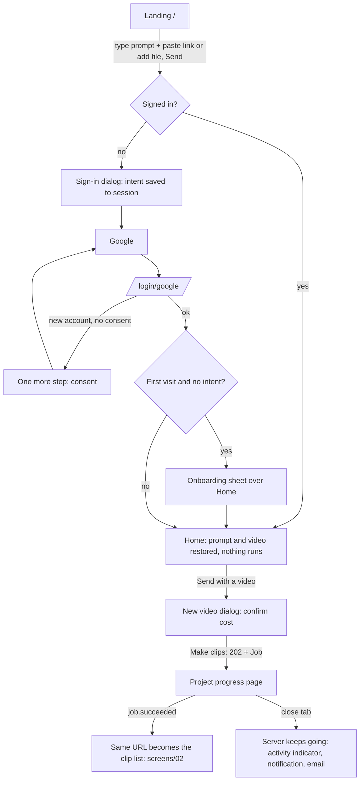

# Clipnera UI revamp — Wave 2 screens, part 1: entry and dashboard

Date: 3 October 2026. Author: Product Designer 1. Builds on [00-audit.md](../00-audit.md), [01-experience-principles.md](../01-experience-principles.md), [02-design-system.md](../02-design-system.md), [04-architecture.md](../04-architecture.md), [audit/03](../audit/03-marketing-auth.md) and [audit/04](../audit/04-dashboard-shell.md).

**Covers:** the marketing landing (`/` merged with `/editor`), sign-in (`/login`, `/signup`, `/login/google`), first-run onboarding, the app shell (sidebar, header, phone tab bar, notifications, credits, activity, ⌘K prompt entry), Home, Projects with folders, the New video (upload) flow, the project progress page, and route-level loading, error, not-found and signed-out behaviour.

**Mockups:** `/design-system/screens/entry` (index) with one route per screen: `landing`, `sign-in`, `onboarding`, `shell`, `home`, `projects`, `upload`, `progress`, `system`. Each has a state switcher (`?state=`), a dark/light toggle (`?theme=light`), sample data and no API calls, and returns 404 in production. Source: `frontend/app/design-system/screens/entry/`. The running `next dev` must be restarted once to pick up the `cn-*` Tailwind keys (02 §2.9); until then the mockups render unstyled.

### Owner defaults used here (pending owner confirmation)

| # | Default | Where it shows |
|---|---|---|
| D1 | Folders are a real server feature | Projects (§8), upload folder picker (§9) |
| D2 | Analytics is hidden behind a flag | Shell nav (§5), Home (§7) |
| D3 | Only YouTube and Instagram are claimed | Landing publish section, FAQ, onboarding |
| D4 | `/` and `/editor` merge into one landing | §2 |
| D5 | ⌘K focuses the prompt; navigation moves under `/go` | §5.6 |
| D6 | No violet | Credits, notifications, plan notice |
| D7 | Dark ships first; light designed through tokens | All mockups have the toggle |
| D8 | Payments stay manual UPI | Credits popover "payment being checked" |
| D9 | RoiCalculator dropped | Removals table |
| D10 | A processing project has its own progress page | §10 |

### Rules every screen here follows

- Components only from 02 §11 and tokens only from `lib/design/tokens.ts`. Where a needed component does not exist, it is listed in **Design-system additions** (§14) and the mockup uses a clearly marked stand-in in `entry/_mock/StandIns.tsx`.
- One amber fill per view (02 §1.1). Header and tab-bar actions are therefore neutral or `accent-subtle`; the page owns the amber primary.
- No spinners: buttons use the loading sweep, regions use skeletons (after 300 ms), long work names its step (`WorkingText`).
- Errors say what happened, what is safe and one action (02 §7.3). "Something went wrong" is not used.
- Copy: sentence case, Indian English (colour, optimise, cancelled), first person for Clipnera ("I couldn't…"), no "pipeline", "processing" (name the step), "job", "AI-powered" or "agent".
- Every flagged page has a "not on for you" state instead of a blank page (audit 04 B10).

---

## 1. Flows at a glance

The two dead ends the audit found at the entry are closed: the visitor's link, prompt and file survive sign-in (audit 03 F1–F3), and a processing project can be opened (audit 04 dead end 5).

---

## 2. Landing (`/`, with `/editor` merged)

**Purpose.** Show what Clipnera does by letting a visitor start doing it: the hero *is* the product's prompt bar.

**URLs.** `/` (static, hero is a client island). `/editor` → 308 to `/#editing` (pending D4); `/editor?brief=…` → `/?prompt=…#top` so the brief pre-fills the hero. **Flag:** `new_ui_auth` (anonymous bucketing via `cn_anon`).

**Layout.**

| Width | Layout |
|---|---|
| Desktop ≥ 1024 | Sticky 64 px navbar (wordmark · five section links centred · Sign in, Start free). Hero centred, `display-lg` heading, prompt bar 768 px wide, chips below, trust line. Then: example output, How it works (3 × 2), before/after + captions (2 columns), Editing (2 columns), Publish (3), Pricing (2), FAQ (one column, 768 px), closing band, footer. Marketing max width 1440 px (02 §2.8) |
| Tablet 640–1023 | Same order; grids drop to 2 columns; section links still visible from 768 |
| Phone < 640 | Navbar: wordmark, Start free, menu button → right Drawer with the section links and Sign in (fixes audit 03 #54). Heading `display-sm`. Prompt bar full width; chips wrap. All grids one column |

**Components.** PromptBar (hero, modes hidden — DS-9), ContextChip (`source` kind — DS-6), Chip (action), Button, `buttonClasses` links, IconButton, Card + CardHeader, Badge, Dialog (sign-in), Drawer (phone menu), Wordmark (DS-1). Kept marketing components restyled to tokens: `EngineSection`, `BeforeAfterShowcase`, `CaptionTypographyShowcase`, `LandingVideo`, `FaqSection` (one accordion; native `
` acceptable), `PricingSection` data.

**Sections and copy.**

| Section | Heading | Body / notes |
|---|---|---|
| Hero | "Long video in. **Shorts** out." | "Paste a YouTube link or add a video and say what you want. Clipnera finds the moments worth posting, reframes them to 9:16 around the speaker, cleans the audio and adds captions. You review before anything is posted." Placeholder: "Paste a YouTube link or add a video, then say what you want". Chips: Find the 5 best moments · Clips under 30 seconds · Only the funny parts · Hinglish captions · Cut a trailer for this episode. Trust line: "Free plan, no card · 20 free credits every 30 days · Only YouTube and Instagram for direct posting" |
| Example output | "One 58-minute podcast, three clips" + Badge "Example output" | "Sample clips for illustration. Your clips come from your own footage; scores help you choose and don't predict views." Replaces the "Live demo · real footage" claim (audit 03 #17) |
| How it works | "Six editing jobs, done for you" | EngineSection's six cards, kept |
| Before/after, captions | "Drag the line. That's the whole edit." · "Captions people actually read" | Kept components |
| Editing (`#editing`, from `/editor`) | "Then change anything with a sentence" | Three moves (Drop and describe · Direct the edit · Export or post) beside a docked PromptBar example with a Clip chip and "Uses about 4 credits" |
| Publish | "Straight to where people scroll" | YouTube Shorts · Instagram Reels · Anywhere else (download MP4). TikTok and X removed (D3) |
| Pricing | "Start free. Upgrade when it's working." | Server-driven cards. Error: "Prices didn't load. The Free plan needs no card, so you can start now either way." + Try again |
| FAQ | "Straight answers" | One merged list (7 questions, Indian English, YouTube + Instagram only) |
| Closing band | "Your next Shorts are already recorded." | Button "Start with your video" scrolls to and focuses the hero bar (no second form) |
| Footer | wordmark, "Long video in. Shorts out.", legal links, business details block (kept word for word) | Footer "App Dashboard / Project Folders / Settings & Billing / Sign In" collapse into the navbar's Sign in / Open Clipnera |

**States.**

| State | Behaviour |
|---|---|
| Signed out, empty | As above. Send is disabled until there is text or a video |
| Link + prompt typed | Pasting a YouTube URL anywhere in the text turns it into a `source` chip (title and duration after the lookup; "Checking link" meanwhile) |
| Send while signed out | Sign-in Dialog "Sign in to start" with the carried-intent note ("Your prompt and video are kept"). Intent saved before redirect (§3.4) |
| Signed in | Navbar shows "Open Clipnera" instead of Sign in / Start free. Send goes to `/dashboard?restore=1` with the intent restored. Nothing runs until Send on Home |
| Link not supported | "That isn't a YouTube link. Paste a youtube.com or youtu.be address, or add the video file with the paperclip." (rose, `role="alert"`, focus stays in the bar) |
| File picked | Chip shows file name and size. The file itself is held as in §3.4 |
| Pricing failed | Inline card with Try again; never "Sign in to see prices" (audit 03 F12) |
| Loading | Static page; only pricing has a skeleton, same height as the cards (no layout shift, audit 03 #50) |
| Offline | Send shows "You're offline. Your prompt is kept; send it when you're back." |
| Phone menu | Drawer from the right, section links at 44 px, Sign in |
| Reduced motion / Save-Data | Example output shows posters only; no autoplay |

**Interactions and motion.** Chip click fills the bar, never sends. Section links scroll with `scroll-margin` equal to the navbar height (WCAG 2.4.11). Dialog `pop` 200 ms; Drawer slide 250 ms; nothing else animates except muted, in-view, single-instance example video (at most two `<video>` elements mounted at once; audit 03 #46).

**Keyboard and screen reader.** Skip link → `#landing-main`. One `h1`. The prompt textarea is named "Paste a YouTube link or describe the clips you want"; the `source` chip reads "YouTube video: Episode 41…, 58:12" and its remove button "Remove Episode 41… from the prompt". Navbar links are a labelled `nav` ("Sections"). Hero LCP image gets `priority` (audit 03 #48).

**API and events.** Public: `GET /subscription/plans` (pricing), `GET /clips/youtube-metadata` for the chip title (existing `clipApi.fetchYoutubeMetadata`; public rate-limited variant needed — API-1). No events. `GET /flags/bootstrap` with `cn_anon`.

---

## 3. Sign in (`/login`, `/signup`, `/login/google`)

**Purpose.** One way in, one consent, and back to what the person was doing.

**URLs.** `/login` and `/signup` render the same page (same component; `/signup` exists for old links). Both accept `?next=` and `?reason=expired`. `/login/google` is the OAuth callback — path registered with Google, **do not move**. Signed-in visitors on `/login` or `/signup` are redirected to `next` or `/dashboard` (audit 03 F5). **Flag:** `new_ui_auth`.

**Layout.** Centred single column at every width: wordmark (links to `/`), a 384 px card (`surface`, `rounded-cn-xl`), legal links under it. On phones the card goes full width with 16 px gutters. The landing page shows the same panel in a `Dialog size="sm"` (bottom sheet on phones). The two-column showcase (violet glow, rainbow phones, Anton, second wordmark) is removed.

**Components.** SignInPanel (DS-10 composite of Checkbox + Button + inline notices), Checkbox, Button (lg, secondary, Google mark as the only brand colour), WorkingText, Dialog.

**Copy.**

| Element | Copy |
|---|---|
| Heading (page) | "Sign in to Clipnera" |
| Sub-line | "New here? Signing in with Google creates your account." (replaces "Welcome back" for everyone, audit 03 #19) |
| Dialog title | "Sign in to start" |
| Consent | "I'm 18 or older and agree to the Terms and Privacy Policy" · description "Needed once, when your account is created." Links open in a new tab and say so to screen readers |
| Button | "Continue with Google" → loading "Opening Google" |
| Footnote | "Clipnera uses Google sign-in only. We never see your Google password." |
| Carried intent | "Your prompt and video are kept" + one-line preview + "They'll be waiting on Home. Nothing runs until you press send." |
| Session ended | "You were signed out after a while away. Sign in and I'll take you back to the page you were on." |

### 3.1 Consent once

The backend needs `accept_terms` only when Google creates an account (`backend/auth/service.py:163`), but today's button is disabled for everyone until the box is ticked (audit 03 #7).

- **Continue with Google is always enabled.** The box is optional for returning people and shown with "Needed once, when your account is created."
- If the box was ticked, the flag travels as today (`sessionStorage` → callback → `accept_terms: true`).
- If it was not ticked **and** the Google account is new, the API answers `403 CONSENT_REQUIRED` (API-2; today it is a message string). The callback shows **"One more step"** with the checkbox and **Create my account**, which re-runs Google with consent (one quick hop; Google remembers the account). No password, no cognitive test (WCAG 3.3.8).
- After any successful sign-in, `localStorage['cn_signed_in_before']=1` hides the box on that device ("Returning device" state).

Alternative needing more backend (open question Q3): the callback keeps a 10-minute pending-signup token so "Create my account" completes without a second Google hop.

### 3.2 States

| State | Shows |
|---|---|
| First time on this device | Checkbox + Google button |
| Carrying a prompt | Intent note above the checkbox |
| Returning device | No checkbox; "You've signed in on this device before, so there's nothing to tick." |
| Session ended (`reason=expired`) | Info notice; after sign-in → `next` |
| Going to Google | Button loading "Opening Google". `pageshow` with `persisted` resets it, so Back from Google never leaves a dead spinner (audit 03 #9) |
| Callback: signing in | `h1` "Signing you in", WorkingText "Checking with Google", `role="status"` (audit 03 #59) |
| Callback: new account, consent needed | "One more step" card |
| Callback: cancelled | "Sign-in was cancelled. You closed the Google window before finishing. Nothing was created or changed." + Try again |
| Callback: stale / other tab | "That sign-in took too long. It was started in another tab or more than 10 minutes ago. Start again; it takes a few seconds." (no longer blames "the link", audit 03 F8) |
| Callback: server error | "I couldn't sign you in just now. Nothing was changed." + Try again; `request_id` behind "Copy details" |
| Not configured (dev only) | "Google sign-in isn't set up on this server." |
| Offline | Rose notice; Google button disabled with the reason beside it |

### 3.3 Signed-out redirects

- Middleware (`auth_cookie_enforce`, 04 §1.4): no session on `/dashboard/**` or `/admin/**` → `/login?next=<path+query>`. Expired mid-session (`auth.expired` event or `TOKEN_EXPIRED` after a failed refresh) → `/login?next=…&reason=expired`.
- Before redirecting on expiry, the client saves any unsent PromptBar text and the open dialog's form to `sessionStorage` (keyed by path) and restores it after sign-in (WCAG 3.3.7; audit 03 F4).
- Exempt: `/login/google`, `/dashboard/connect/[platform]`, `/unsubscribe`, `/data-deletion`, marketing and legal.
- Until `auth_cookie_enforce` is on, the client guard does the same redirect (one destination, not `/` vs `/login`; audit 03 F7).

### 3.4 Carrying intent through sign-in

Saved before the Google redirect, read once on Home, then cleared:

| Item | Where | Notes |
|---|---|---|
| Prompt text | `sessionStorage['cn_intent']` | ≤ 2,000 characters |
| YouTube link | same | URL only; the title is re-fetched |
| File | IndexedDB (`cn-intent` store, the `File` object) | Only if under the storage estimate; else name + size are saved and Home says "Pick masterclass.mp4 again to continue" with the file button focused (open question Q4) |
| `next` | URL param | Validated as a same-origin path |

Nothing auto-runs on return (01 §4 "Sign-in").

**API.** `POST /auth/oauth/google` (sets cookies, returns `SessionResult`), `POST /auth/refresh`, `auth.expired` on the event stream.

---

## 4. Onboarding (first run)

**Purpose.** Make the first Home feel made for this person in ten seconds, without blocking anyone who arrived with something to do. None exists today (audit 03 §3.1).

**URL.** `/dashboard` on the first signed-in visit, as a Dialog over Home (not a separate route, so the hero is already there behind it). **Flag:** `new_ui_dashboard`.

**Rules.**
- Shown once per account when `me.onboarding_completed_at` is null **and** no intent was carried in. With carried intent, Home opens with the prompt restored and the questions move to a small card on Home after the first clips are ready.
- Two steps, both multi-select toggle Chips, both skippable. Escape or Skip at any point = done.

| Step | Title | Description | Options |
|---|---|---|---|
| 1 | "What do you make?" | "Step 1 of 2. Pick any that fit; I'll suggest prompts for them." | Podcasts · Interviews · Talking-head videos · Tutorials and courses · Streams and gaming · Vlogs · Webinars and talks · Something else |
| 2 | "Where do you post?" | "Step 2 of 2. I'll set your default format. You can publish straight to YouTube and Instagram from Clipnera." | YouTube Shorts · Instagram Reels · Somewhere else · Not posting yet. Footnote: "You have 20 free credits, about 10 minutes of video. Free credits renew every 30 days." |

Buttons: Skip (ghost) · Next / Start making clips (primary).

**States.** Step 1 · Step 2 · Saving (primary loading "Saving", dialog not dismissible for that moment) · Arrived with a prompt (no dialog) · Couldn't save ("I couldn't save your answers. You can carry on; I'll ask again next time." — closes anyway).

**Effect of answers.** Home suggestion chips per creator type; default output format (Reels-only → 9:16; both → 9:16; "Somewhere else" → no change); "Get set up" checklist hides "Connect" for "Not posting yet". Editable in Settings → Profile.

**API.** `PATCH /me/preferences {creator_types: string[], platforms: string[], onboarding_completed_at}` (API-3, new).

**A11y.** Dialog named by the step title, described by the step line; chips are `aria-pressed` toggles in a labelled group; focus starts on the first chip.

---

## 5. App shell

**Purpose.** One frame for every signed-in page that never remounts (01 §10), with the prompt one keystroke away.

**URL.** Layout of `/dashboard/**` (`app/v2/(app)/dashboard/layout.tsx`). **Flag:** `new_ui_shell` (parent of every `new_ui_*`).

### 5.1 Layout

| Width | Sidebar | Header | Bottom |
|---|---|---|---|
| ≥ 1024 | 256 px, collapsible to a 64 px rail (persisted per user) | 56 px sticky: breadcrumb · prompt entry (288 px, "Ask Clipnera, or type / to go", ⌘K) · activity · credits · bell · New video | — |
| 768–1023 | 64 px rail; expand button opens it to 256 px **over** the page (fixes audit 04 dead end 11) | Same; prompt entry collapses to an icon button | — |
| < 768 | none | Wordmark · prompt icon · activity · credits · bell | 64 px tab bar: Home · Projects · New (+) · fourth tab · More |

One DOM tree for all widths (no duplicate ids, audit 04 A4). Content max width 1280 px; gutters 16/24/32 px.

**Sidebar contents.** Wordmark → nav: Home, Projects, Library (`broll_platform_library`), Reels (`broll_studio.reels`), Scheduler (`social_publishing`), Brand kit, Settings; Analytics only when its flag is on (D2) → "Recent" (4 projects, live % for running ones; processing ones link to their progress page) → bottom: CreditMeter (DS-4) and the account Menu (email, workspace switcher with ticks, Settings, Keyboard shortcuts, Sign out). Active item: `surface-active` fill, `fg` bold label, amber icon. Phone tab bar centre "+" is `accent-subtle` with an `accent-border` edge (not an amber fill), fourth tab: Schedule → Reels → Brand kit by flag (kept rule from `MobileTabBar`).

**Plan banner** (kept) sits under the header in `z-cn-banner`: "Your Pro plan ends in 3 days. Pro doesn't renew on its own." + Renew Pro (secondary) + "Hide for now". The "features moved to Pro" notice uses `info` tone instead of violet.

### 5.2 Notifications drawer

Right Drawer (`md`, 416 px; full-height sheet on phones). Title "Notifications", description "2 unread".

- Browser-notification prompt card at the top, shown once after the first project starts: "Get a browser notification when clips are ready, even with this tab closed." Turn on / Not now.
- Grouped "Today" / "Earlier". Row: kind icon (clips ready = success, failed = danger, posted/scheduled = info, credits = accent (was violet), reconnect = neutral), title (bold when unread, "Unread:" for screen readers), one-line message, relative time in mono, unread dot. The whole row is a link to the project, run or settings page; opening marks it read (`POST /notifications/{id}/read`, new per-item read). Rows without a target are plain text, not disabled buttons (audit 04 A12).
- Footer: Clear all (ghost; toast with **Undo** for 6 s instead of no confirmation) · Mark all read.
- States: loading (3 skeleton rows), empty "You're all caught up — I'll let you know here when clips are ready, an export finishes or a post goes out.", error "I couldn't load notifications. Try again.", offline (last list kept, note at top).
- Relative times refresh every minute (audit 04 B27).

### 5.3 Credits popover

Trigger: ghost Button with a coin icon and the balance in mono ("1,240"), name "1,240 credits". Popover "Credits": CreditMeter (plan credits accent, pack credits neutral, words carry meaning), "Plan credits renew 12 Oct", "Pack credits never expire", "Held for work in progress 18", buttons **Add credits** (primary; the popover is its own view) and See plans (ghost). Payment pending: info notice "Your UPI payment for 200 credits is being checked. I'll add them and let you know once it's approved." (D8). Balance updates live from `credits.updated` (fixes audit 04 B8).

### 5.4 Activity indicator

DS-5 (02 §4.8 spec). Hidden when idle. Pill with a pulsing amber dot and a count; name "2 in progress". Popover lists each server job: project title (link to its progress page), live step as WorkingText, ProgressBar when determinate. Footer: "These keep going if you close the tab, except uploads from this tab. Finished work moves to notifications." Failed job → rose dot until the popover is opened. Feeds: `GET /jobs?status=active`, `activity.updated`, `job.*`.

### 5.5 Phone "More"

Left Drawer with every nav item at 44 px, the CreditMeter and the account menu.

### 5.6 ⌘K prompt entry (D5)

- `⌘K` / `Ctrl+K` from anywhere: on Home it focuses the hero bar; elsewhere it opens a top-aligned Dialog "Ask Clipnera" with a docked PromptBar. `/` focuses it when no field has focus.
- Typing `/` opens the SlashMenu (DS-7): Make (`/clips`, `/captions`, `/trim`, …) and **Go to** (`/go`). `/go <text>` filters projects (with live status as the description), clips and pages — everything today's CommandPalette searched (Actions, Pages, Projects, Clips), plus Analytics and Editor when on, Sign out and workspace switch, which the palette lacked.
- On a project page the prompt applies to that project (context chip); on other pages a prompt with no video asks for one, as on Home.
- Footer hint: "↑ ↓ to choose · ↵ to fill · Esc to close. Nothing runs until you press send."

### 5.7 Shell states

Default · each overlay open · collapsed rail · tablet expanded · offline ("You're offline. Work already started keeps going on our side; this page catches up when you're back.") · reconnecting (`WorkingText` "Reconnecting." strip; driven by EventSource state and `sync.reset`) · flag still loading: impossible by design (flags come from bootstrap on first render, 04 R7).

**Keyboard and screen reader.** Skip link "Skip to content" → `main#main`. Landmarks: `aside` "Sidebar" containing `nav` "Main"; header `nav` "Breadcrumb"; tab bar `nav` "Main, phone" (distinct names, audit 04 A9). Collapsed rail items keep their names via `sr-only` labels and show a Tooltip. All overlays: focus in, trap (dialogs/drawers), Escape, focus return (02 §3.13–3.15). The bell's name includes the unread count.

**Motion.** Page content cross-fades 150 ms; sidebar width 200 ms in-out; drawers 250 ms; popovers rise 200 ms; live dot pulse 1.6 s. All instant under reduced motion.

**API and events.** `GET /me`, `GET /workspaces`, `GET /subscription/entitlements`, `GET /flags/bootstrap`, `GET /notifications`, `GET /jobs?status=active`; one `EventSource` on `/events/stream` per tab: `notification.created`, `activity.updated`, `credits.updated`, `entitlements.changed`, `config.changed`, `auth.expired`, `sync.reset`, `job.*`.

---

## 6. Route-level loading, error, not found

| File | What it shows | Copy |
|---|---|---|
| `(app)/dashboard/loading.tsx` | Shell streams first; main area shows a skeleton shaped like the target page inside one `SkeletonGroup` ("Loading Projects") | — |
| `(app)/dashboard/error.tsx` | In-shell Card + EmptyState; nav keeps working | "This page didn't load" · "I couldn't get your projects just now. Nothing was lost, and work already running carries on." · **Try again** (`reset()`) · ghost "Copy details for support" (`request_id`) |
| `(app)/dashboard/not-found.tsx` | In-shell | "This page doesn't exist" · "The link may be old or mistyped. Everything else is where you left it." · Go to Home |
| `projects/[projectId]/not-found.tsx` (403/404 → `notFound()`) | In-shell | "Project not found" · "It may have been deleted, or it belongs to a workspace you're not in. Check the workspace in the account menu." · See all projects. Also fixes "zero projects + project URL" (audit 04 B22) |
| Flag off for a page | In-shell, never blank | e.g. "Scheduler isn't on for your account yet" · "It's being rolled out in stages. Until then you can download clips and post them yourself." · Go to Projects |
| `global-error.tsx` | Own `<html>`, no shell | "Clipnera didn't load" · "Something in this page stopped it from opening. Your projects and anything already running are safe on our side." · Reload · reference id in mono |
| root `not-found.tsx` | Public 404 with wordmark | "This page doesn't exist" · Go to the home page · Open my projects |

Every in-shell page keeps one `h1` (visually hidden on error cards that use an `h2` title). Mockup: `entry/system`.

---

## 7. Home (`/dashboard`)

**Purpose.** Start new work from one prompt; see what's running and what's ready.

**Flag.** `new_ui_dashboard`. **Title.** "Home · Clipnera".

**Layout.**

| Width | Layout |
|---|---|
| Desktop | Hero column 768 px centred: greeting (label), `h1` "What should we cut today?" (`display`), hero PromptBar, chips, secondary links. Below at full content width: In progress (2 columns) → Recent projects (3) → Top clips this week (5) → Up next (when `social_publishing`) |
| Tablet | Same, grids 2 / 2 / 3 |
| Phone | `h1` at `display-sm`; bar full width; grids 1 / 1 / 2. "New video" lives in the tab bar |

**Components.** PromptBar (hero, modes hidden DS-9), ContextChip `source` (DS-6), Chip, Button, Card (interactive with `cardLinkOverlay`), Poster/MediaCard (DS-3), StatusBadge with live step, WorkingText, ProgressBar, IconButton, EmptyState, Skeleton/SkeletonGroup, ProgressBar (checklist).

**The hero.**
- Paste a YouTube link anywhere in the text → becomes the `source` chip; the paperclip (attach) picks a file; dropping a file on the bar attaches it. One video per prompt.
- Credit hint appears once the duration is known: "Uses about 116 credits" ("116 credits" on phones).
- Send with a video → opens New video (§9) prefilled; Send without one → inline "Add a video or paste a YouTube link first. Clipnera works from your footage." (rose, focus stays).
- Below: ghost "Upload a video"; first run adds "Try a sample video, free" (API-4).
- Chips by situation (01 §4): no video yet / video attached / clips ready (examples in `_mock/data.ts`), tuned by onboarding answers. Click fills, never sends.

**Sections.**
- **In progress** (only when jobs are active): cards with project title (link to progress page), WorkingText step ("Transcribing · 42 of 58 min"), thin ProgressBar. Replaces the "Processing" card with its frozen percentage and Cancel (cancel moves to the progress page).
- **Recent projects**: 3 cards, poster, title, live StatusBadge, "9 clips · 3 hours ago"; "All projects →".
- **Top clips this week**: 5 portrait cards with "Score 94" badge, title, project; Edit and Schedule icon buttons (Schedule hidden when `social_publishing` is off — fixes audit 04 B10).
- **Up next** (kept, `social_publishing`): up to 3 scheduled posts; empty "Nothing scheduled. Pick a clip and choose when it goes out."
- **Get set up** (first run, until dismissed or done; kept behaviour): "Get set up · Four things that make your clips feel like yours." Make your first clips · Connect YouTube or Instagram (flag) · Set your brand colours and logo · Schedule or publish a clip (flag); ProgressBar "0 of 4 done".

**States.**

| State | Behaviour |
|---|---|
| Returning | As above |
| First run | Greeting "Welcome to Clipnera, Akhil"; lead "Paste a YouTube link or add a video, say what you want, and Clipnera finds the moments worth posting. You have 20 free credits, about 10 minutes of video."; sample-video link; Get set up instead of empty sections |
| Prompt carried from landing | Status line above the bar: "Kept from before you signed in. Nothing runs until you press send." (dismissible); focus on Send |
| Video attached | Chip + cost hint; chips switch to "with video" set |
| Loading | Hero is interactive immediately; sections show skeletons in one `SkeletonGroup` "Loading your projects" (never the empty state while loading, audit 04 §7.6) |
| Part failed | Failed section only: "I couldn't load your projects. Your projects are safe. Everything above still works." + Try again |
| Out of credits | Under the bar: "This 58-minute video needs about 116 credits; you have 6. Your prompt and video stay here." + Add credits (secondary; Send keeps the amber) |
| Offline | Bar disabled with "You're offline. Your prompt is kept; send it when you're back." Typed text is kept |
| Signed out | Redirect (§3.3) |

**Keyboard / SR.** `h1` is the question; the bar is labelled "Describe the clips you want"; Enter sends, Shift+Enter new line; each section is a labelled `section`; cards have one link each.

**API / events.** `GET /projects?limit=3` (with live job summary), `GET /clips/top?period=7d` (API-5; today derived client-side), `GET /jobs?status=active`, `GET /social/posts` (flag), `job.*`, `notification.created`. Removed calls: `analyticsApi.getDashboardStats` (stat tiles removed — see table).

---

## 8. Projects and folders (`/dashboard/projects`)

**Purpose.** Find, organise and act on every project; folders are real (D1).

**URLs.** `/dashboard/projects` (canonical). `/dashboard/folders` → 308 here for new-UI users (04 §1.4). Folder: `?folder=<id>`; filters `?status=&source=&q=&sort=&view=` in the URL so Back and links keep them. **Flag:** `new_ui_dashboard`.

**Layout.** Header (`h1` "Projects", line "One project per long video. 6 projects · 26 clips · 4 h 41 min of video.", actions New folder (secondary) · New video (primary)) → folder strip (cards, horizontal scroll on phones) → toolbar (search · status SegmentedControl All / In progress / Ready / Failed with counts · sort Menu · grid/list) → source chips (All sources / YouTube / Uploads) → results. Grid 1 / 2 (sm) / 3 (xl). Inside a folder: breadcrumb Projects / Folder name, `h1` = folder name, a Folder menu (Rename folder, Delete folder) replaces New folder.

**Project card.** Poster with duration; selection checkbox top-left (always visible on touch, on hover/focus with a pointer); title (two lines) as the card link (ready → clip list, otherwise → progress page); "More" Menu: Rename, Move to folder…, Download all clips (ready), Try again (failed), Stop (running), separator, Delete project (rose, last). Meta: channel or "Upload" · relative time. Live StatusBadge ("Transcribing · 42 of 58 min", "Uploading · 62%", Ready, Failed, Stopped, Waiting for credits), clip count, FolderBadge (DS-8) when not inside a folder. Failed: reason in rose and **Try again** (fixes audit 04 dead end 4). Rename is inline (Enter saves, Escape cancels) and **saved** (API-6).

**List view.** Rows with a 96 px poster, title, status, meta and the same Menu.

**Selection.** Sticky bar: "2 selected" · Move to folder · Download clips · Clear. Shift-click range; ⌘A in the grid selects all.

**Dialogs.**
- Move: "Move 2 projects" · "A project lives in one folder at a time. Its clips move with it." · radio list (No folder + folders) · New folder · Cancel / Move.
- New folder: "New folder" · "Group projects by show, client or series. Folders are saved to your workspace." · Name (required, 80 chars) · Cancel / Create folder. No category, colour or confetti.
- Delete project (`alertdialog`): "Delete this project?" · "Episode 40 and its 9 clips are deleted for good. Clips already posted to YouTube or Instagram stay posted." · Keep project (focused) / Delete project.
- Delete folder: "Delete this folder?" · "The 6 projects in it move to All projects. Nothing else is deleted." · Keep folder / Delete folder.

**States.** All · inside a folder · list · selecting · move · new folder · delete · loading (6 skeleton cards; fixes audit 04 §7.6) · no projects ("No projects yet. Add a video or paste a YouTube link and Clipnera finds the best moments. Each video becomes a project with its clips inside." · Add a video) · no matches ("No projects match "wedding". Try another word, or clear the search and filters." · Clear filters) · couldn't load ("I couldn't load your projects. Your projects and clips are safe. This is usually a connection problem." · Try again) · offline (last list kept, actions that write are disabled with the reason in a tooltip and a note) · busy states on rename/move/delete (button loading) · delete failure as a danger toast, never `alert()`.

**Drag.** Dragging cards onto a folder card is a pointer extra; Move to folder… is the keyboard and touch path (WCAG 2.5.7).

**API / events.** `GET /projects?folder_id=&status=&source=&q=&sort=&cursor=`, `PATCH /projects/{id}` (title, folder_id), `POST /projects/move` (bulk), `DELETE /projects/{id}`, `GET/POST/PATCH/DELETE /folders` (API-6, API-7), `POST /pipeline/start/{id}` for Try again, `POST /jobs/{id}/cancel` for Stop, `job.*` for live status (every processing project, not only the active one — fixes audit 04 B7).

---

## 9. New video (upload flow)

**Purpose.** Confirm what will happen and what it costs, then hand the work to the server.

**URL.** `/dashboard/upload` as an intercepted route (`@modal/(.)upload`) — a Dialog over the current page; a full page on direct load. Back closes it. Opens from Home send, header New video, tab-bar +, ⌘K `/clips`, empty states. Prefill via `?url=` / restored intent. **Flag:** `new_ui_dashboard`.

**Layout.** Dialog `lg` (672 px; bottom sheet on phones). Sections top to bottom: (optional) channel-intro nudge (kept) → **Video** → **What should Clipnera make?** (Textarea, prefilled from the Home prompt) → **Project name** + **Folder** (2 columns ≥ 640) → **Options** (one collapsed disclosure with a summary line) → alerts → footer (format count and "1,124 credits left after" · Cancel · **Make clips · 116 credits**).

**Video section.**
- YouTube: poster, `source` chip (title, channel), "Link checked · 1080p", Change.
- Checking: skeleton poster + WorkingText "Checking the link"; Make clips disabled until the duration and cost are known (fixes audit 04 B13).
- File: file chip (name, size), duration on the poster, "Uploads from this tab, then continues on our side"; info line "Large files upload in parts and resume if the connection drops."
- Nothing yet: drop zone (DS-11) "Drop a video here · MP4, MOV, WebM or MKV · up to 2 hours on your plan" + Choose a file, and "Or paste a YouTube link" Input. Drag-over highlights the zone (`accent-border`).
- Too long: "This video is 2 h 41 min. Your plan takes up to 2 hours per video." + **See plans** (fixes audit 04 dead end 12).
- Wrong type: "Use an MP4, MOV, WebM or MKV video." Unreadable link: "That isn't a YouTube video link. Try one like youtube.com/watch?v=…".

**Prompt.** Label "What should Clipnera make?", hint "Optional. Leave it empty and I pick the best moments.", 500 characters. Sent as `PipelineOptions.prompt` (API-8).

**Name and folder.** Name hint "Filled from the video; change it any time." — **saved** (sent as `title`; fixes audit 04 B6). Folder: Menu-button field (Select is not rebuilt yet) with No folder, folders, New folder…

**Options** (summary "9:16 · Studio voice, Maximum · Captions auto"):
- Formats: toggle Chips 9:16 / 4:5 / 1:1 / 16:9; locked ones show a lock and open the plan dialog with the reason (kept `OutputFormatPicker` rules: last format can't be removed; first included; +50% each extra). Hint "The first format is included; each extra one adds half the cost."
- Studio voice: Switch + description "Removes room echo, mic hiss, fan hum and background noise." Strength as SegmentedControl Light / Balanced / Maximum (maps to 55 / 80 / 90; see moves table). Checkboxes: Remove echo · Voice clarity · 50/60 Hz hum filter.
- B-roll cutaways (`broll_studio.cutaways`): Switch "Adds matching footage where it fits. 5 credits per clip that gets B-roll."
- Hindi and Telugu captions: SegmentedControl Auto / Roman / Native, "Auto writes Hinglish and Tenglish in Roman letters."

**States.** YouTube link · checking · file · drop · options open · too long · not enough credits ("This video needs 116 credits; you have 6. Pick fewer formats, or add credits and come back." + Add credits secondary; Make clips disabled) · starting (primary loading "Starting", dialog not dismissible, status "Creating the project. I'll take you to its progress page.") · couldn't start ("I couldn't start this project. Nothing was charged. Try again in a moment."; Make clips stays as the retry) · offline (Make clips disabled with reason).

**What happens on Make clips.**
1. YouTube: `POST /imports/youtube {url, title, on_ready: {pipeline}}` with an `Idempotency-Key` → 202 `{project_id, job}`.
2. File: `POST /uploads {…, purpose: source_video, on_ready: {pipeline}}` → parts upload from the tab → `POST /uploads/{id}/complete` → 202 + Job.
3. The dialog closes as soon as the 202 arrives (< 1 s) and routes to the progress page. The button is never busy for the length of the work (02 §13).
4. The server starts the clip run when the video is ready; closing the tab is safe except during a file upload, where `beforeunload` warns and `GET /uploads/{id}` resumes after reload (fixes audit 04 B2, B3).

**Keyboard / SR.** Dialog named "New video", described by its line; focus starts in the prompt Textarea (or the link field when empty); the Options disclosure is a button with `aria-expanded` inside an `h3`; errors use `role="alert"` and `aria-describedby`; Make clips names the cost.

---

## 10. Project progress (`/dashboard/projects/[projectId]` while processing)

**Purpose.** The one place to watch, stop, fix or leave a processing project (D10). Same URL becomes the clip list when ready (screens/02), so links never break.

**Flag.** `new_ui_dashboard`.

**Layout.** Breadcrumb Projects / Folder / Title. Header: `h1` title; meta line: live StatusBadge, source (YouTube channel or file name), duration, FolderBadge. Desktop: two columns (2/3 + 1/3). Main: state card (when not plain running) or a right-aligned Stop button → **Steps** card (ProgressSteps vertical, five stages, "About 6 min left") with a **StepList** disclosure for the detailed steps → "Your clips appear here" (5 dim portrait posters; real posters when done). Side: "What you asked for" (prompt quote, formats, audio, captions, folder) → credits card ("116 credits · Charged / Not charged yet / Returned", "If making clips fails, the credits come back on their own.") → "You can close this tab. I'll let you know here and by notification when the clips are ready." + Switch "Email me when it's done" (`/me/notification-preferences`). Phone: one column, side cards after the steps.

**Stage mapping** (11 server steps → 5 stages people see; detail list uses plain words):

| Stage | Server steps (`pipeline_step_logs`) | Done detail example |
|---|---|---|
| Getting your video | download / upload, audio extraction | "Got 58:12 from YouTube" |
| Cleaning up the audio | AI noise cancellation | "Removed hum and room echo" |
| Transcribing | transcription | "8,412 words, with timings" |
| Finding the best moments | topic research, visual analysis, content classification, highlight detection, scoring | "23 moments scored" |
| Making your clips | metadata generation, aspect-ratio render, clip generation | "9 clips at 9:16, captions on" |

The active stage shows WorkingText ("Transcribing · 42 of 58 min") and a determinate ProgressBar whenever `job.progress` has a number; a visible change at least every 5 s (01 §5).

**States.**

| State | Shows |
|---|---|
| Uploading | Stage 1 active "Uploading from this tab · 1.2 of 1.9 GB"; side card "Keep this tab open until the upload finishes. After that you can close it; the rest happens on our side."; **Cancel upload** |
| Running | As above; Stop |
| Steps expanded | StepList open with the 11 named steps |
| Waiting for credits (`awaiting_credits`) | Card "Waiting for credits · Your video is in. Making clips needs 116 credits and you have 6. I'll start as soon as you add credits; nothing has been charged." **Add credits** · Change options |
| Reconnecting | Strip "Reconnecting. Your clips are still being made; this page catches up when the connection is back." Status shows "last update 0:40 ago" |
| Failed | ResultMessage failed: "Transcribing Episode 41 didn't finish. The audio cut out at 31:08." · safe: "Your video is safe and the 116 credits are back in your balance." · **Try again**. The failed step shows Try again in the StepList. Second failure: suggest "Only the first 30 minutes" and a Contact support link (01 §8) |
| Stop? | `alertdialog` "Stop making clips?" · "The steps already done are kept, so you can start again later from where it stopped. Credits for the unfinished part come back to you." · Keep going (focused) / Stop |
| Stopped | ResultMessage stopped with what was done; chips "Start again", "Only the first 30 minutes" |
| Clips ready | ResultMessage done "Done — 9 clips, reframed to 9:16 with Hinglish captions." + success toast "9 clips ready" with **See clips**; then the page swaps to the clip list |

**SR.** StepList announces each new step once; ProgressSteps marks `aria-current="step"`; percentages are not announced on every tick.

**API / events.** `GET /projects/{id}` (with `job`), `GET /jobs/{id}`, `GET /jobs/{id}/events?after_seq=` for backfill, stream `job.queued|started|step|progress|retrying|succeeded|failed|cancelled`, `POST /jobs/{id}/cancel`, `POST /pipeline/start/{id}` (retry / start again / after credits), `credits.updated`, `PUT /me/notification-preferences`.

---

## 11. Removals and moves (owner to confirm each)

Under the AGENTS.md UI rule nothing below ships without the owner's yes.

| # | Today | Where | Proposal | Why |
|---|---|---|---|---|
| R1 | `/editor` marketing page (reel art, three moves, six features, FAQ, CTA) | `EditorLanding` | **Move** into `/` as the "Editing" section and FAQ; `/editor` 308 → `/#editing`; `?brief=` carried to the hero | D4; one landing |
| R2 | Hero tabs "YouTube link / Upload a file / Write a prompt" and "Cut my clips" form | `HeroSection`, `VideoLinkForm` | **Replace** with one prompt bar (paste link, attach file, type) | Tabs did nothing (audit 03 F2) |
| R3 | "Live demo · real footage, real output" eyebrow and pulsing red dot | `HeroSection` | **Remove**; example labelled "Example output" | Claim contradicted by "sample outputs" (audit 03 #17) |
| R4 | Fixed 1312 px hero stage with tilted phones and connectors | `HeroStage` | **Replace** with a simpler "one podcast, three clips" example card | Heavy, brittle, two DOM trees |
| R5 | Clip wall (7 category filters, film strip) | `ClipWall` | **Remove** from v1 of the new landing; example card covers it | Filter only dimmed tiles; media not in build |
| R6 | Fake app window "What you get back" | `ResultsPreview` | **Remove** | Mimics the old dashboard; 100 ms timer |
| R7 | ROI calculator | `RoiCalculator` | **Remove** (D9) | Off-palette, unverifiable savings |
| R8 | TikTok and X publish cards; "TikTok" in FAQ and auth showcase | `PublishSection`, FAQ, `AuthShell` | **Remove**; YouTube and Instagram only (D3) | Not supported |
| R9 | Second URL form in the bottom band | `BottomCta` | **Replace** with "Start with your video" that focuses the hero | One input, no duplicate state |
| R10 | Footer "App Dashboard / Project Folders / Settings & Billing / Sign In" | `Footer` | **Move** to navbar Sign in / Open Clipnera | Three labels for one action |
| R11 | Navbar "Clip wall" and "Editor NEW" links | `Navbar` | **Replace** with How it works · Captions · Editing · Pricing · FAQ | Follows the new sections |
| R12 | Two-column auth showcase (violet glow, rainbow phones, Anton, "Clip**nera**" wordmark, three bullets) | `AuthShell` | **Remove**; centred card with the one wordmark | Off-palette; four wordmarks |
| R13 | "Welcome back" / "Create account — Start creating viral clips with AI" headings | `GoogleSignIn` | **Replace** with "Sign in to Clipnera / New here? Signing in with Google creates your account." | Greets new users as returning |
| R14 | Consent tick required on every sign-in | `GoogleSignIn` | **Change**: optional for returning; required only for new accounts (§3.1) | Backend needs it once |
| R15 | "AuthModal" account and workspace dialog | `components/dashboard/AuthModal` | **Move** into the sidebar account Menu (and header avatar on phones) | It is a switcher, not auth |
| R16 | Command palette as a separate ⌘K dialog | `CommandPalette` | **Move** into the prompt entry's `/go` (D5) | One entry point |
| R17 | Header search field, job chip (spinner + % + "+N"), workspace chip, plan chip, Upgrade / "Pro activation pending" pill, avatar (≥ md) | `Header` | **Replace** with prompt entry, activity indicator, credits popover (plan and pending inside), bell, New video; workspace and avatar move to the sidebar account menu | Fewer chips competing (audit 04 §1.4) |
| R18 | Sidebar "New video" amber button | `Sidebar` | **Move** to header (secondary) and tab bar | One amber per view |
| R19 | Sidebar active-project group ("Clips", "Edit clip") | `Sidebar` | **Remove**; breadcrumb and Recent cover it | Pointed at "whatever was last open" |
| R20 | Sidebar Admin group | `Sidebar` | **Keep**, moved under the account menu "Admin" for admins | Less clutter for everyone else (confirm) |
| R21 | Home greeting subtitle "{Workspace} · N projects · N clips" and header buttons Upload file / New video | `DashboardHomeView` | **Replace** with the hero; counts move to Projects | Prompt-first |
| R22 | Home link bar "Paste a YouTube link to get clips" + "2 credits per minute…" helper | `DashboardHomeView` | **Replace** with the hero prompt bar and its live cost hint | Same job, prompt added |
| R23 | Home Processing card (pill, %, View progress, Cancel, "+N more") | `DashboardHomeView` | **Replace** with "In progress" cards linking to progress pages; Cancel moves there | Live step, not frozen % |
| R24 | Home Credits card | `DashboardHomeView` | **Move** to header credits popover and sidebar meter | Third copy of the meter |
| R25 | Home four stat tiles (Clips created, Editing time saved, Average virality, Best time to post) | `DashboardHomeView` | **Remove**; clip count moves to Projects' summary line | Fake values on failure; "best time" is not real data (D2) |
| R26 | Home Shortcuts cards (Brand kit; Analytics "SAMPLE DATA") | `DashboardHomeView` | **Remove**; Brand kit is in the nav, Analytics hidden (D2) | Duplicate / sample |
| R27 | Projects "New folder" (local only, category, six colour swatches, confetti) | `ProjectFoldersView` | **Replace** with real folders: name only | D1; no colours on an amber/neutral palette |
| R28 | Projects topic chips (Podcasts, Keynotes, Masterclasses, AI prompt stories, "NOT WIRED") | `ProjectFoldersView` | **Remove** | Never matched |
| R29 | Hard-coded `#YouTube #AI #Shorts` tags, "Denoised" and "⚡ N credits" pills on cards | `ProjectFoldersView`, `DashboardApp` | **Remove** (credits charged move to the progress page) | Invented client-side |
| R30 | Projects summary strip incl. "average virality" | `ProjectFoldersView` | **Replace** with one line: projects · clips · minutes of video | Calmer; score average not useful |
| R31 | Download-all confetti | `ProjectFoldersView` | **Remove** | Motion rules |
| R32 | Upload "Auto filler & silence cut", "Auto sound effects", "Dynamic auto-zoom" switches | `UploadModal` | **Remove** until wired | Never sent (audit 04 #10) |
| R33 | Upload Studio-voice strength slider 30–100 with "% · Maximum" read-out | `UploadModal` | **Change** to Light / Balanced / Maximum (55 / 80 / 90) | No slider in the DS; three levels were already the labels (confirm, or ask DS for a Slider) |
| R34 | Upload numbered sections ①–④ always open | `UploadModal` | **Move** options into a collapsed "Options" disclosure with a summary | Calm by default |
| R35 | Upload in-modal progress (spinner, "Uploading to cloud…", log list) | `UploadModal` | **Move** to the progress page | Server-owned work |
| R36 | `PipelineProgressTracker` and `PipelineStepIndicator` | dashboard | **Replace** with the progress page (ProgressSteps + StepList) | D10 |
| R37 | Mobile tab bar raised amber "+" | `MobileTabBar` | **Change** to `accent-subtle` with amber icon | One amber per view |
| R38 | Snackbar stack | `SnackbarStack` | **Replace** with `Toast` (same timing rules, more tones) | DS |
| R39 | Notifications popover under the bell (desktop) | `NotificationsDrawer` | **Change** to a right Drawer; "Clear all" gets Undo | 02 §3.14 |
| R40 | Violet: bought-credit bar, plan notice, credit-update icon, admin icons | various | **Change** to neutral / info / accent (D6) | Palette |

---

## 12. Open questions

| # | Question | Default used |
|---|---|---|
| Q1 | Confirm D1–D10 above | As listed |
| Q2 | Should `/signup` stay as its own URL or 308 to `/login`? | Same page at both URLs |
| Q3 | Consent for new accounts without the tick: second Google hop (no backend state) or a 10-minute pending-signup token? | Second hop |
| Q4 | Carrying a picked file through sign-in: store in IndexedDB (may be large) or ask to pick it again? | IndexedDB under the storage estimate, else re-pick |
| Q5 | "Try a sample video, free": provide a sample project per new account that costs no credits? | Yes, if backend agrees (API-4) |
| Q6 | Stopping a run: are credits for unfinished steps returned? The refund policy covers failures only | Copy says yes; needs policy confirmation |
| Q7 | Plan limit copy: what is Pro's maximum video length? Mock says 2 hours | Read from entitlements |
| Q8 | Admin links: in the account menu or a sidebar group? | Account menu (R20) |
| Q9 | Onboarding answers: also used for analytics/marketing? | No; only to tune suggestions and defaults |
| Q10 | Is there a Pro price for the landing cards, or always server-driven? | Server-driven (mock shows a placeholder) |
| Q11 | Header "New video" on Home: keep (secondary) or hide because the hero is there? | Kept on other pages, hidden on Home |
| Q12 | Email on completion default on for jobs over 5 minutes (01 §14 q4) | On |

---

## 13. API and backend needs found by this design

| # | Need | For |
|---|---|---|
| API-1 | Public, rate-limited YouTube metadata lookup (title, duration, poster) for signed-out visitors | Landing chip |
| API-2 | `403 CONSENT_REQUIRED` error code from `POST /auth/oauth/google` (today a message string) | §3.1 |
| API-3 | `PATCH /me/preferences {creator_types, platforms, onboarding_completed_at}` + fields on `/me` | §4 |
| API-4 | Sample project per new account, no credits | Home first run |
| API-5 | `GET /clips/top?period=7d&limit=5` | Home top clips |
| API-6 | `PATCH /projects/{id} {title?, folder_id?}`; `POST /projects/move {project_ids, folder_id}`; `folder_id`, `q`, `status`, `source`, `sort` filters on `GET /projects` | Rename and folders |
| API-7 | `GET/POST /folders`, `PATCH/DELETE /folders/{id}` (delete moves projects to none), with `{id, name, project_count, created_at}`; Alembic migration | Folders (D1) |
| API-8 | `PipelineOptions.prompt` (string ≤ 500) and `title` honoured by `/imports/youtube` and `/uploads` `on_ready` | Upload prompt and name |
| API-9 | `GET /projects/{id}` includes the active `Job` and the chosen options (formats, audio, captions, prompt, credits charged/held/returned) | Progress page side cards |
| API-10 | Clear-all notifications with undo: `DELETE /notifications` returning ids + `POST /notifications/restore` (or soft delete with 10 s window) | Drawer |

Frontend types for each are generated from OpenAPI (04 R11) in the same change; none of these is called by the mockups.

---

## 14. Design-system additions needed

| # | Addition | Spec | Mock stand-in |
|---|---|---|---|
| DS-1 | **Wordmark** | `LogoMark` + lowercase "clipnera" in Syne; sizes sm (24) / md (28); the only brand lock-up | `StandIns.Wordmark` |
| DS-2 | **Avatar** (02 §3.23, spec exists) | Move to `ui/`; circle initials on `surface-active` | `StandIns.Avatar` |
| DS-3 | **MediaCard / Poster** (02 §5.4) + token `aspect-cn-portrait` (9:16) | Poster with duration chip, missing-poster tile, slots for badges | `StandIns.Poster` |
| DS-4 | **CreditMeter** | Balance in mono, two-segment bar (plan accent / packs neutral), `role="img"` label, compact and full | `StandIns.CreditMeter` |
| DS-5 | **ActivityIndicator** (02 §4.8, spec exists) | As specced; add "failed" dot and footer note | `StandIns.ActivityIndicator` |
| DS-6 | **ContextChip `source` kind** | YouTube / file icon, title, meta, "Checking link" working state, 32 px on hero | `StandIns.SourceChip`; Home/landing mocks use `asset` kind meanwhile |
| DS-7 | **SlashMenu** (02 §4.3, spec exists) | Plus a "Go to" group whose rows carry live status | `StandIns.SlashMenuList` (static) |
| DS-8 | **FolderBadge** | Badge with folder icon, truncates at 192 px | `StandIns.FolderBadge` |
| DS-9 | **PromptBar `modes` prop** | `modes?: PromptMode[]`; empty hides the switch (Home, landing). Also an `onDropFile` and a `footer` slot for inline errors (02 §4.1 notes the error line is "not part of the component yet") | CSS hide in mocks (`[&_[role=radiogroup]]:hidden`) |
| DS-10 | **SignInPanel** pattern | The composite in §3, shared by page and dialog | `_mock/SignInPanel.tsx` |
| DS-11 | **DropZone** | Dashed `control-border` area, drag-over `accent-border` + `accent-subtle`, file input inside, keyboard "Choose a file" | Inline in upload mock |
| DS-12 | **NavItem / AppNav** | Sidebar item with icon, label (sr-only in rail + Tooltip), active state, optional count; tab-bar item | Inline in `AppShell` |
| DS-13 | **SelectionBar** | Sticky bar with count and bulk actions, `role="region"` | Inline in projects mock |
| DS-14 | **Disclosure** | Button-in-heading with summary text and chevron (Options, Details) | Inline in upload mock |
| DS-15 | **Select** rebuild (02 §3.5, spec exists) | Folder field uses a Menu button until then | Menu |
| DS-16 | **RadioGroup** (02 §3.8, spec exists) | Move-to-folder list | Inline `role="radio"` buttons |
| DS-17 | **Slider** (only if the owner rejects R33) | Range with value text, keyboard steps | — |
| DS-18 | **Banner** | Strip under the header (`z-cn-banner`): icon, text, one action, dismiss; tones neutral/info | Inline in shell mock |
| DS-19 | Token for safe-area padding (`pb-safe`) | Phone tab bar and sheets | Not used in mock |

---

## 15. Mockup notes

- Built only from `components/ui` (new set plus the kept `LogoMark`) and `cn-*` tokens; stand-ins are confined to `entry/_mock/StandIns.tsx` and named DS-n above.
- States switch by `?state=`; theme by `?theme=light`. Each screen remounts per state so sample data seeds fresh.
- Interactive bits: pasting a youtube.com link into Home or the landing hero creates the source chip; chips fill the bar; Home send routes to the upload mock; landing send opens sign-in (signed out) or goes to Home restored (signed in); every overlay opens, traps focus and closes with Escape.
- Not simulated: real media, streaming events, upload progress ticking, ⌘K global key binding.
