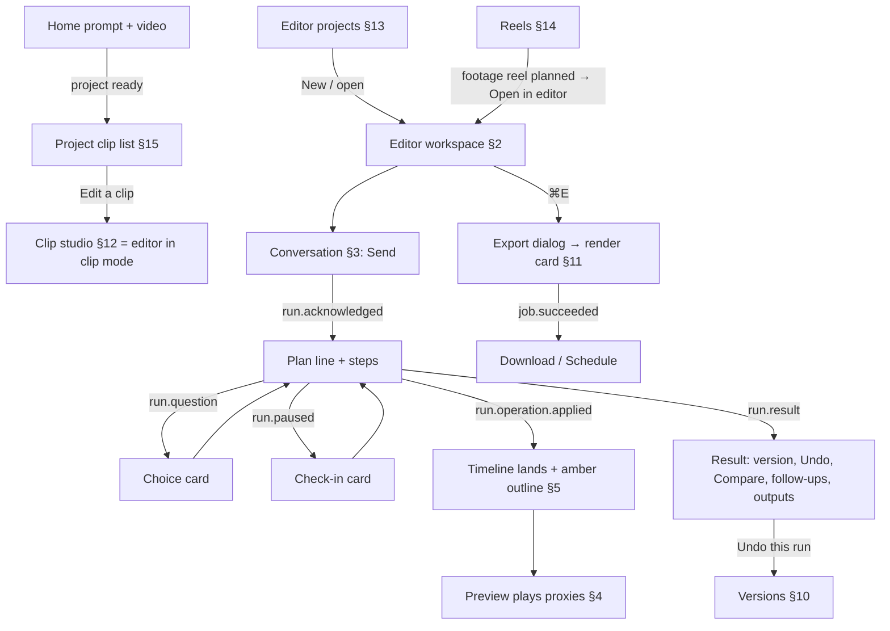

# Clipnera UI revamp — Wave 6 screens, part 2: the AI editor

Date: 5 October 2026. Author: Product Designer (Wave 6). Builds on [01-experience-principles.md](../01-experience-principles.md), [02-design-system.md](../02-design-system.md), [architecture/frontend.md](../architecture/frontend.md) §5 and §8.4, [architecture/backend.md](../architecture/backend.md) §4, [architecture/events.md](../architecture/events.md), [05-broll.md](../05-broll.md), [wave6/01-platform-api.md](../wave6/01-platform-api.md), the audits [05](../audit/05-clips-studio-editor.md) and [06](../audit/06-reels-brand-social.md), and the studies [perplexity.md](../research/perplexity.md), [lovable-visual.md](../research/lovable-visual.md), [cardboard-compass.md](../research/cardboard-compass.md) and [cardboard.md](../research/cardboard.md). Once `wave6/07-visual-direction.md` exists, it overrides any visual value given here.

**Covers:** the editor workspace (four zones), the conversation (composer, plan, steps, questions, timestamp citations, results, follow-ups, outputs), the preview (aspect toggle, safe zones, select-to-edit toolbar), the timeline (tracks, AI-change markers, undo this run), transcript editing, captions and styles, the other tools (hook and title, audio, format), the B-roll panel, versions, history and compare, export as a job with its render card, the clip studio (editing one clip from a project), the editor projects page, the project clip list that opens the studio, and reels.

**Most important output:** the build units in §20. Each unit is one builder agent, one exclusive set of folders, 1–3 days of work, and can be merged on its own.

**Mockups (starting point):** `/design-system/screens/editor/{workspace,conversation,timeline,clips,assets,versions,export,reels}`, source `frontend/app/design-system/screens/editor/`. What changes in each one is in §19.2. Two of them are broken today: `export/page.tsx` imports `./ExportShare` and `reels/page.tsx` imports `./ReelBoard`, and neither file exists, so `tsc` fails on them. Fixing that is part of unit DS-E (§20).

### Owner defaults used here (pending owner confirmation)

| # | Default | Where it shows |
|---|---|---|
| E-D1 | Conversation sits on the **right**, tools and assets on the left, timeline along the bottom (Cardboard and the existing mockup). Lovable puts chat on the left | §2 |
| E-D2 | The one amber fill in the editor is the prompt's **Send**. Export is `secondary`. The render card's Download becomes the amber action once a render is done | §2, §11 |
| E-D3 | The clip studio is the **same editor in clip mode**, at the same URL (frontend.md owner question 5) | §12 |
| E-D4 | Until runs exist on clips (`EB-14`), the clip studio has no conversation zone. It is hidden, not shown greyed out | §12 |
| E-D5 | Platform chrome previews stay: Clean · Reels · Shorts · TikTok. TikTok is a safe-zone aid, not a publishing claim | §4 |
| E-D6 | Preview-only features stay visible and keep their "Preview only" label (sound effects in clip mode, auto-zoom) until they are wired or the owner removes them | §8, §17 |
| E-D7 | Reels footage boards open in the editor through the existing `POST /editor/projects/from-reel/{edit_id}`. The reel plan card stays on the reel page | §14 |
| E-D8 | Ask mode is free within a daily allowance (01 §14 q2, backend.md §4.6) | §3 |
| E-D9 | No model names, no "agent" or "Director" persona. The assistant is "Clipnera" or nothing | All |

### Rules every screen here follows

- `cn-*` tokens only. No raw hex, no arbitrary `[..px]` sizes, no new z-indexes. Primitives come from `components/ui/*`. Anything missing is listed in §19.1 (DS-E*) and built by the Design System agent, never inside an area folder.
- Everything is reached through `middleware.ts` under `new_ui_editor` (routes), `new_ui_editor_timeline` (preview, timeline, versions), `prompt_streaming_v2` (conversation), `new_ui_export` (export dialog) and `new_ui_reels` (reels). Legacy files under `app/dashboard`, `components/dashboard` and `lib/api.ts` are never edited.
- Data goes through `apiFetch` (`lib/api/client.ts`) in `lib/api/<domain>/`, with query keys in `lib/query/keys/<domain>.ts` and in-page flags via `useFlag`. Endpoints that don't exist yet are typed stubs marked `// NEEDS-BACKEND: <id>` (ids in §18.2), driven in development by the run simulator (§20, unit E1).
- No spinners. Buttons use the loading sweep, regions use skeletons after 300 ms, and long work names its step (`WorkingText`). No invented numbers: a percentage shows only when the server sends one.
- Errors give what happened, what is safe, and one action. Copy is sentence case Indian English, first person for Clipnera, and never uses "pipeline", "processing", "job", "agent" or "AI-powered".
- Interaction motion is 150–250 ms. The one exception is the 600 ms amber landing highlight. Under reduced motion everything is instant and shimmer becomes static text.
- Every screen works at 360 px with no horizontal page scroll. Touch targets are 44 px on phones.

---

## 1. Flows at a glance

---

## 2. Editor workspace (four zones)

**Purpose.** One screen where you talk, watch, point and fine-tune. The conversation drives the timeline. The preview never reloads.

**URLs.** `/dashboard/editor/[editorProjectId]`, which is `app/v2/(editor)/dashboard/editor/[editorProjectId]/page.tsx` (full screen, no app shell). The clip studio `/dashboard/projects/[projectId]/edit/[clipId]` uses the same client in clip mode (§12). **Flags:** `new_ui_editor` for the route; inside it, `new_ui_editor_timeline` (when off, the preview and timeline zones show the read-only stand-ins from today's `EditorProject`), `prompt_streaming_v2` (when off, the conversation zone is hidden) and `agent_editor` (backend gate on `/editor`; when off, the page shows the flag-off state).

### 2.1 Layout

Zones: **Z1 Tools** (rail plus panel, left), **Z2 Preview** (centre top), **Z3 Timeline** (centre bottom, the width of the preview), **Z4 Conversation** (right). Top bar 56 px, `z-cn-sticky`.

| Width | Arrangement and sizes |
|---|---|
| ≥ 1280 | Top bar 56. Z1 = 56 px rail plus a 320 px panel (ResizablePanels, 20–30 %, collapsible to the rail). Z4 = 384 px (ResizablePanels, 24–36 %, collapsible with ⌘B). Z2 fills the centre; the stage is the largest box of the project aspect that fits, at least 320 px tall. Z3 defaults to 240 px (vertical ResizablePanels, 20–50 %), collapsible to a 40 px strip with ⌘J. Panel sizes are remembered per browser (`storageKey: 'cn-editor'`) |
| 1024–1279 | Same, but the Z1 panel opens **over** Z2 (overlay sheet, `z-cn-drawer`, 320 px) instead of pushing it. Z4 = 352 px |
| 768–1023 | Top bar. Z2 plus a compact Z3 (two lanes, 112 px) on the left. Z4 = 320 px on the right. The Z1 rail turns into a horizontal 56 px dock under the timeline, and a tool opens as a sheet over half of Z2 (as in the mockup's tablet view) |
| < 768 (360 design width) | One column: top bar (48 px: back, title over save state, Undo, Export icon) → Z2 (aspect-fit, at most 50dvh) → transport row 44 px → Z3 strip (Video, Captions and B-roll lanes, 96 px) → docked prompt line 56 px (status or "Describe an edit to …", opens Z4 as a bottom sheet at 62dvh) → tool dock 56 px (7 tools at 48 px each, 336 px, which fits 360 with 12 px gutters). A tool opens a 55dvh bottom sheet that covers the transport, strip and dock (kept from the legacy studio). Swiping isn't needed; every sheet has a close button and a grab handle |

**Top bar (left to right).** Back link (editor: "Projects" → `/dashboard/editor`; clip mode: "Clips" → the project page) · in clip mode, the ScoreRing (kept) · title (inline rename on click, Enter saves via `EB-17`) over a subtitle "Project · version 12 · Saved" · Undo (⌘Z) · Redo (⇧⌘Z) · History with the version count (pulses once per new version) · ActivityIndicator (DS-E5) · credits in mono (≥ 1280 only) · Shortcuts (?) · Share (ghost; hidden until a share backend exists, `EB-22`) · **Export** (secondary, ⌘E). On phones only back, title, Undo and an Export icon stay; the rest goes into an overflow Menu ("More").

**Save state** (subtitle, `role="status"`): Saved · Saving · Not saved, "Check your connection. Your next change will retry." with Retry · Offline, "changes kept on this device" (pending ops are held in IndexedDB, frontend.md §5.2).

### 2.2 Components

`ResizablePanels`, `IconButton`, `Button`, `Menu`, `Tooltip`, `Kbd`, `Dialog` (shortcuts), `Drawer` (history, phone sheets), `ScoreRing`, `WorkingText`, `Skeleton`, `Toast`, `EmptyState`; NEW: `EditorTopBar` (area component), `ToolRail` (area component, DS-E9 for the generic rail item), `ActivityIndicator` (DS-E5), `ShortcutsDialog` (area component on `Dialog` + `Kbd`).

### 2.3 States

| State | Shows |
|---|---|
| Loading | `SegmentLoading`-style frame skeleton: top bar, empty stage at the project aspect, three track skeletons, conversation skeleton. The composer is usable at once; Send waits for the project |
| Empty project (no media) | Stage: FileDropzone "Add a video to start · MP4, MOV, WebM · or paste a YouTube link in the prompt". Timeline: one empty video track with "Drop media here". Conversation: suggestions "Cut a 30-second highlight from this", "Add captions", "Find the funniest moment" (they fill the bar, never send) |
| Media still preparing (`media.updated` proxy not ready, `EB-12`) | Stage poster + WorkingText "Preparing preview · 2 of 3 files". Timeline items show a hatched "Preparing" fill. Prompting is allowed |
| Live | §3–§11 |
| Run active | Composer working sweep; locked items show a lock; everything else stays editable |
| Viewing an earlier version | Banner over Z2: "Viewing an earlier version · v9 Trimmed silences" + **Back to latest** + Restore. Timeline read-only; composer says "Go back to latest to edit" |
| Offline | Strip under the top bar: "You're offline. Hand edits are kept on this device and sent when you're back. Runs already started keep going on our side." Send disabled with that reason |
| Reconnecting | Strip with WorkingText "Reconnecting — your edit is still running." |
| Not found / no access | `SegmentNotFound`: "Project not found · It may have been deleted, or it's in a workspace you're not in." + See all projects |
| Flag off (`agent_editor` or `new_ui_editor_timeline`) | In-frame card: "The editor isn't on for your account yet · It's being rolled out in stages. Your clips are in Projects." + Go to Projects |
| Crash | `error.tsx` (Platform's `SegmentError`) keeps unsent ops in IndexedDB and offers "Reload editor" |
| Rebase dropped an edit | Toast "Your edit to Title 2 was replaced by Clipnera's change." with View |

### 2.4 Keyboard (whole editor; single keys only when no text field has focus)

| Group | Keys |
|---|---|
| Prompt | ⌘K focus prompt · / focus prompt · ↵ send · ⇧↵ new line · ⌘. stop the run · 1–4 pick an option on a focused question |
| Playback | Space or K play/pause · J / L −2 s / +2 s · ← / → one frame (preview focused) · Home / End · M mute · C captions on/off · F full screen · hold B to see before · ⇧B side-by-side compare |
| Editing | ⌘Z / ⇧⌘Z (or ⌘Y) undo/redo · ⌫ cut selected words or delete the selected item · H highlight words · S split at playhead · [ / ] trim start/end to playhead (timeline focused) · , / . nudge one frame · ⌘+ / ⌘− zoom timeline · V select tool · T edit text on canvas |
| Layout | ⌘B hide or show conversation · ⌘\ hide or show the tool panel · ⌘J collapse or expand the timeline · ⌥1–⌥7 open a tool |
| Moving around | [ / ] previous/next clip (clip mode, timeline not focused) · ⌘⇧H version history · ⌘E export · Esc closes the top overlay, then clears the selection, then (clip mode) goes back to clips · ? shortcuts |

The legacy map (audit 05 §1.2) is a subset of this, so nothing is lost. One conflict is fixed: `[`/`]` mean trim only while the timeline has focus.

### 2.5 API

| Call | Status |
|---|---|
| `GET /editor/projects/{id}` (`EditorProjectResponse`) | exists |
| `POST /editor/projects/{id}/ops` (`EditorOpsRequest` → `EditorOpsResponse`, 409 `STALE_VERSION`) | exists |
| `GET /editor/projects/{id}/ops?since=` | NEEDS-BACKEND `EB-2` |
| `GET /subscription/entitlements` (plan locks) | exists |
| `GET /subscription/me` (credits) | exists |
| `PATCH /editor/projects/{id} {title}` | NEEDS-BACKEND `EB-17` |
| Event stream `GET /events/stream` (`run.*`, `version.*`, `project.revised`, `media.updated`, `job.*`) | NEEDS-BACKEND `EB-1`; `lib/realtime` is also not built yet (Platform request R-1) |

---

## 3. Conversation (Z4)

**Purpose.** Say what you want. Watch it being done, with the reasons. Keep going.

**Layout.** Header 48 px: "Conversation" + a Menu (Older turns, Clear suggestions). Thread (scrolls; reading measure at most 384 px wide, 16 px body at about 1.6 leading, 24 px between turns) → PromptQueue (when anything is queued) → composer (docked PromptBar). On phones it is a bottom sheet at 62dvh, and the docked prompt line shows the live step.

### 3.1 Composer

PromptBar (docked) with: context-chip row (selection → chips, §3.6), text that grows from 1 to 6 rows, Attach (video, image, audio, link → `+` menu with search: Upload video · Paste link · From library · Brand kit), mode SegmentedControl **Edit / Ask / Plan**, credit hint ("Uses about 12 credits" from `POST …/runs/estimate`, `EB-4`; "Free · 17 of 20 left today" in Ask), Send (the amber), and Stop beside it while a run is active. Send becomes **Add to queue** during a run. Typing `/` opens the SlashMenu (DS-E2): `/clips /captions /trim /reframe /broll /hook /audio /music /export /undo /go`. Choosing one fills an editable template and never sends.

**Send button states:** empty (neutral, disabled) · ready (amber) · running (neutral "Add to queue" + Stop) · offline or not enough credits (disabled, with the reason in a Tooltip and on the hint line) · before hydration (rendered disabled).

**Composer working signal:** a thin amber sweep along the top edge of the bar while a run is active (static under reduced motion). No spinner in the thread.

### 3.2 Turn anatomy (event → what renders)

| Moment (01 §5) | Event (events.md §3) | Renders |
|---|---|---|
| 1 Send | local | Your prompt is the turn heading (`fg`, `label` weight) with its chips read-only. Edit-and-resend menu on hover/focus |
| 2 Understanding | `run.acknowledged` / `run.queued` | WorkingText "Reading your request" + the chips it is using / "Waiting for the edit before this one · 2nd in line" |
| 3 Plan | `run.plan.delta` → `run.plan` | StreamedText (DS-E7), one sentence with counts: "I'll trim 14 silences and add Hinglish captions to all 3 clips." + "Uses about 12 credits" |
| Findings (new) | `run.finding` (`EB-8`) | **Source strip**: 3–4 cards (poster, timecode, typed tag "Story · 15:26 · 0:17", score) + "+N", horizontal scroll on phones. Cards stream in as found. Click seeks the preview; "Use this" adds a Moment chip |
| 4 Question | `run.question` / `run.answered` | ChoiceCard (up to 4 options, number keys, optional preview: poster, caption sample, play button for music) + "Skip, use your best guess". After a pick it locks as a record |
| 5 Steps | `run.step.*` | StepList collapsed to one line: "Trimming silences · step 2 of 4 · 9 of 14 · 0:18". Expand for the list with past-tense rows that name their object ("Transcribed episode-12.mp4"). Funnel counters use real numbers only ("Watching 40 B-roll clips… 3 fit") |
| 6 Lands | `run.operation.applied` | Nothing new in the thread; the timeline and preview change (§4, §5) |
| Pause | `run.paused` | CheckInCard (DS-E4): credits ("Spent 18 of 30. Needs 12 more; you have 6.") with **Add credits** / **Finish with what's done**; approval ("This removes 54% of the clip.") with **Go ahead** / **Not now** |
| 8 Check | `run.check.*` | Step "Checking the result"; preview scrim "Checking the result…" for at most 2.6 s (static label under reduced motion) |
| 9 Result | `run.result` | ResultMessage: summary with numbers, Not-done box, version badge with **Undo** and **Compare**, Details (Tabs: Steps · Changes · **Outputs**), up to 3 follow-up chips, editability line ("Each clip is separate, so you can trim or swap any of them.") |
| Failed | `run.failed` / `run.step.failed` | ResultMessage failed: what happened · safe ("Your earlier versions are untouched; the 2 steps before this are kept as v13") · **Try again** (`POST /runs/{id}/retry`, `EB-3`). A second failure suggests a different prompt + Contact support |
| Stopped | `run.cancelled` / partial after stop | "Stopped — 2 of 3 done." Completed work stays as a version |

**Timestamp citations (new).** Every claim or cut in plan, answer and summary text can carry an inline numbered chip, `CitationChip` (DS-E8): mono "0:12", tooltip with the transcript line and a thumbnail, click seeks, ⇧-click adds a Range chip. They come from a `citations` array on `run.plan`, `run.message.delta` and `run.result` (`EB-7`), referenced in the text as `[[c1]]`. Until that exists, the mockup's `AnswerText` parse of bare "m:ss" stays as the fallback, and only for Ask answers.

**Outputs tab (new, Perplexity Labs' Assets).** Lists what a turn produced: versions, renders started from it (render cards, §11.3), caption files (.srt/.vtt, `EB-21`) and thumbnails. Each has Download where a file exists. The tab is hidden when a turn produced nothing.

**Follow-ups.** At most 3, generated from `run.result.suggestions`. A click fills the bar and never sends. Ask answers offer "Make it an edit: …".

**Select-to-act in the thread.** Selecting text in a reply shows a two-button popover: **Add to prompt** (iterate) · **Show in video** (verify; seeks to the first citation in the selection).

### 3.3 Modes

| Mode | Behaviour |
|---|---|
| Edit | As above. Pauses on approval only above the remote-config thresholds |
| Ask | Answer streams (`run.message.delta`, `role: answer`); "Free · 17 of 20 questions left today. Nothing was changed."; follow-ups as "Make it an edit: …" |
| Plan | `run.result.plan_document` renders as an editable plan (reorder, edit or remove steps; cost) with **Approve and run** → a new Edit run carrying the edited plan (`EB-5` field `plan_document`) |

### 3.4 Queue and history

PromptQueue (DS-E3) above the bar: "Up next · 2", each item editable, removable and reorderable by keyboard (`PATCH`/`DELETE /runs/{id}`, `EB-3`). More than two collapse to "2 waiting · Show". Older turns load on scroll-up from `GET /editor/projects/{id}/activity` (`EB-6`) with a skeleton row. Returning to a project where a run finished in the background shows that result marked "New".

### 3.5 States

Empty thread ("Tell Clipnera what to change. Select something first to point at it." + 3 situation chips) · Loading history (2 skeleton turns) · Running · Queued · Question open · Paused · Result (done / partial / stopped) · Failed / second failure · Not understood (choice card with clip posters) · Not enough material ("There isn't enough footage of the product demo to do this." + alternatives) · File can't be read ("episode-12.mov can't be read. Convert it to MP4 (H.264) and replace it." + Replace file) · Send failed ("Not sent. Check your connection." + Retry, text kept) · Offline (Send disabled, typing allowed) · Reconnecting (missed events replay; `resync` reloads the thread) · Flag off (`prompt_streaming_v2`: the zone is hidden and Z2 widens).

### 3.6 Selection → chips (point, then prompt)

| Selected | Chip |
|---|---|
| Timeline item (video/B-roll) | Clip: "03 · Hot take · 7s" |
| Timeline range or transcript range | Range: "0:12 – 0:31" |
| Transcript words or a caption on the canvas | Caption line: "“most people never…”" |
| Library tile, dropped file | Asset (thumbnail, name) |
| "Ask about this frame" (preview) | Moment: "0:14" |
| Region box on the canvas | Region "Area at 0:14" (`EB-9`, new ContextChip type) |

Chips locked by a running step show a lock and can't be removed until the step ends.

### 3.7 Keyboard, screen reader, 360 px

The thread is a `log` with polite announcements: one per step ("Step 2 of 4: Trimming silences"), and the result summary once. Turns are `article`s named by the prompt. ChoiceCard is a labelled `group`, and number keys work while it has focus. At 360 px the sheet is full width, the queue collapses to one line, the source strip scrolls horizontally, and the result's actions wrap to two rows at 44 px.

### 3.8 API and events

| Call | Status |
|---|---|
| `POST /editor/projects/{id}/runs {prompt, chips, mode, rewind_to_version_id?}` (Idempotency-Key) → 202 `{run_id, queue_position?}` | NEEDS-BACKEND `EB-3` |
| `POST /editor/projects/{id}/runs/estimate` | NEEDS-BACKEND `EB-4` |
| `GET /runs/{id}`, `GET /runs/{id}/events?after_seq=`, `POST /runs/{id}/{stop,answer,continue,retry}`, `PATCH`/`DELETE /runs/{id}` | NEEDS-BACKEND `EB-3` |
| `GET /editor/projects/{id}/activity` | NEEDS-BACKEND `EB-6` |
| `run.*` events over the stream | NEEDS-BACKEND `EB-1` |
| `citations` on run events | NEEDS-BACKEND `EB-7` |
| `run.finding` event | NEEDS-BACKEND `EB-8` |
| `run.result.outputs` | NEEDS-BACKEND `EB-21` |

---

## 4. Preview (Z2)

**Purpose.** See the edit at once, from proxies, without a render. Point at things to talk about them.

**Layout.** Toolbar 40 px above the stage: Aspect SegmentedControl (9:16 · 1:1 · 4:5 · 16:9; plan-locked ratios show a lock and open the plan dialog, wording kept from `FormatPanel`), Platform SegmentedControl (Clean · Reels · Shorts · TikTok, 9:16 only, E-D5), Safe zones toggle (disabled off 9:16 with the Tooltip "Safe zones apply to 9:16 videos"), Select tool toggle (V). Stage (centred, `rounded-cn-lg`, black on `bg`). Under the stage: CaptionSafetyNote (one line, `role="status"`), then the transport (36 px desktop, 44 px touch): restart, −2 s, play/pause, +2 s, TimeCode "0:14.3 / 0:44.0", speed Menu (0.75×–2×), mute, captions toggle, full screen. QualityBadge "Preview quality" sits top-left on the stage.

**Layers on the stage (bottom to top):** composed video (PreviewEngine), B-roll overlays, safe-zone bands (rose hatched, 9:16 only), title or text items, captions (drag to move; snaps to the safe area; ↑/↓ moves 1 %), platform chrome (neutral glyphs, no fake handle or counts, R-E8), selection outlines, the frame-check scrim.

**Aspect change.** Editor mode sends `set_project {width, height}` as one hand version. Clip mode updates `aspect_ratio` in the clip settings. The playhead and selection stay put.

**Jump to change.** When an operation lands outside the visible frame, a chip "Jump to change · 0:31" appears at the bottom of the stage. The playhead never moves on its own (01 §6).

**Compare.** Hold B (or the "Hold to see before" button) to show the version before the last run. ⇧B shows them side by side, with labels "Before · v11" and "After · v12". Both come from `GET …/versions/compare` (`EB-11`) and play proxies.

### 4.1 Select-to-edit toolbar (new)

Click or tap an element on the stage (caption, title or text item, B-roll overlay) with the Select tool on (default on for desktop, off on phones where a tap plays or pauses). The element gets a 2 px amber outline and an amber tag pill ("Caption", "Title", "B-roll"), and its chip is added to the composer. A floating toolbar (DS-E10, `z-cn-popover`, anchored above the element, flipped below at the top edge; draggable, snaps to the stage corners or bottom centre; position remembered per project in localStorage):

| Element | Actions |
|---|---|
| Caption | Ask about this (focus prompt) · Edit words (inline; writes `transcript_edits` or text) · Style (opens the Captions tool) · Position (drag, or arrows ±1 %) · Hide this line |
| Title / text | Ask · Edit text (T, inline `update_item {text}`) · Style · Size (Slider) · Delete |
| B-roll overlay | Ask · Swap (alternates strip, §9) · Trim in timeline · Remove |
| Region (drag on an empty part of the frame) | Ask about this area (Region chip, `EB-9`) · Zoom here (keyframe on `scale`, editor mode) |

Esc clears the selection. ⌘-click adds more elements (several chips). The toolbar is hidden below 768 px; on phones a tapped element opens an action sheet with the same actions.

### 4.2 States

Loading ("Loading preview", poster) · Preparing proxies (§2.3) · Ready · Buffering (sweep on the scrubber) · Playing proxies (QualityBadge) · Full quality ready (200 ms cross-fade on the same frame, badge fades out) · Can't play ("This video could not play. Your edit is safe." + Retry; signed-URL expiry refetches the assets and resumes) · Viewing an earlier version (banner, §2.3) · Compare (hold / side by side) · Checking the result (scrim) · Empty project (dropzone) · Ended (Replay).

**360 px:** the stage is full width, up to 50dvh; the toolbar collapses to Aspect + a "More" Menu (Platform, Safe zones); the transport is 44 px with restart, play, time and a Menu for speed and mute.

**API:** none of its own beyond §2.5. Proxies, storyboard and waveform need `EB-12`; compare needs `EB-11`; clip-mode settings need `PUT /clips/item/{clip_id}/editor-settings` (exists).

---

## 5. Timeline (Z3)

**Purpose.** The cut, made visible, where the AI's changes are easy to find, inspect and undo.

**Layout.** Header strip 32 px: zoom (− / Slider / +, ⌘± keeps the playhead fixed), snapping toggle, "Fit", and a hint "Click or drag to move the playhead · hatched = cut". Track header column 120 px: purpose name, kind icon, mute, lock. Ruler 24 px in seconds (mono). Tracks: video 48 px; captions, B-roll, text, music, speech and SFX 32 px each. Playhead: 2 px `accent` line with a head, its own layer, moved by the clock outside React (frontend.md §5.3). Rendering is canvas tiles for film strips, waveforms and words, with DOM only for interactive items in view (frontend.md §5.5).

**Tracks named by purpose,** derived from Timeline v1 track kind and id: Title (`text` track `title`), Video (`video`), Captions (from `timeline.captions`, one block per caption group), B-roll (`overlay` track `broll`), Music (`audio` with music items), Speech (the waveform of the followed track; cut words hatched rose), SFX (`audio` with sfx items). Colours stay on palette (02 §5.2): video `surface-active`, text `accent-subtle`, audio `info-subtle`, overlay `success-subtle`. Clips are labelled with an index and subject ("03 · Hot take").

**Items.** 6 px radius, label + duration (12 px, mono duration). Selected: 2 px `accent-border`. Trim handles 8 px wide on hover and selection. Locked by a running step: lock icon, 60 % opacity, can't be dragged, Tooltip "Clipnera is working on this. It unlocks when the step ends." Conflict (overlap refused, caption off-frame): amber dashed edge plus a ⚠ glyph, with the reason on hover and focus (never colour alone).

### 5.1 AI-change markers and Undo this run (new)

- When `run.operation.applied` arrives, the touched items (`item_ids`) get the 600 ms amber outline. After that they keep a **2 px amber left edge** and a small chip with the before → after change: "4.0s → 2.1s", "+ captions", "moved 0:12 → 0:18", "swapped B-roll". The text comes from `describe_op` (`EB-11` returns `changes` in plain words; until then the client derives it from the op).
- Changed ranges also show as amber ticks on the ruler, and ←/→ on the ruler ticks jumps between them.
- The chip has a Menu: **Undo this run** (`POST /editor/projects/{id}/undo {version_id}`, `EB-10`) · Show in conversation (scrolls to the result and flashes it for 600 ms) · Compare.
- Markers clear after the next hand edit on that item, or when the next run starts. The run's ResultMessage keeps its own Undo (01 §3.4).
- `409 UNDO_WOULD_DISCARD` opens an `alertdialog`: "Undo would also remove 2 hand edits made after this run. Undo them too?" · Keep my edits (focused) / Undo all.

### 5.2 Hand edits

Move (drag or Alt+arrows), trim (handles or [ / ]), split (S), delete (⌫; ⇧⌫ deletes and closes the gap = `remove_item {ripple: true}`, kept from `EditorProject`), speed and volume (item Menu), track mute (`EB-13`: there is no op that sets `Track.muted` today). Each gesture is one batch of `TimelineOp`s from `lib/editor/timeline.ts`, applied locally first and then sent as pending ops with rebase (frontend.md §5.2). Hand edits group into a version after 60 s idle or on leaving the editor (`EB-10` checkpoint).

**Drop target.** B-roll drags (`BROLL_DRAG_MIME`, `readBrollDrag` from `components/editor/slots.ts`) land on the B-roll track. With no B-roll track, dropping under the video creates one (`add_track`). On drop: `add_asset` (when new) + `add_item` (volume 0, 4-frame fade, at most 4 s by default), as one batch. Overlap → nudge to the next free slot, or ask to replace. Keyboard and touch use "Add at playhead" (the `InsertBroll` seam).

### 5.3 States

Loading (3 skeleton tracks) · Empty (one video track with "Drop media here or ask Clipnera to add it") · Normal · Selection · Locked items · An operation lands · Markers present · Conflict · Read-only (viewing an older version; hatched overlay "Read-only") · Preparing items · Phone strip.

**Keyboard and SR.** The timeline is a `grid` (one tab stop; arrows move between items and tracks; Enter selects; Esc clears). The playhead is a `slider` with `aria-valuetext` "0:14 of 0:44". A selection becomes a chip. The lock and AI-change state are part of each item's name ("03 Hot take, 2.1 seconds, changed by Clipnera: 4.0 to 2.1 seconds").

**360 px.** Three lanes (Video, Captions, B-roll), 96 px tall, horizontal scroll with the playhead centred. Tap selects, and a long press opens the item's action sheet (Split here, Delete, Trim to playhead start/end, Undo this run). No drag-trim on touch.

**API.** `POST …/ops` (exists); `EB-2`, `EB-10`, `EB-11`, `EB-13`; drop validation `422 ASSET_NOT_AVAILABLE` (05-broll §7.4, `EB-19`).

---

## 6. Transcript editing (Z1 tool "Transcript", default tool)

**Purpose.** Edit by text. It is the strongest interaction in the legacy studio, and it is kept and made keyboard-operable.

**Layout.** Panel header: "Transcript" · "Cut fillers" (secondary, Tooltip "Cut every um, uh and like") · "Remove dead air" (`EB-20`, hidden until it exists). Search field with a counter "2/7" / "No match", Enter and ⇧Enter cycling. Body: virtualised segments with a mono timestamp gutter, speaker label when there is more than one, and words as a `listbox` with one tab stop. Footer: "3 cut · 4.2 s removed · 12 words highlighted". Retakes are tagged inline with a "Retake" Badge when the transcript marks them (`EB-20`).

**Word states:** plain · past (`fg-muted`) · current (`surface-active` pill; driven by the clock selector, only two spans re-render) · highlighted (`accent-subtle`, was violet) · selected (`info-subtle`) · cut (rose, struck through) · search hit (amber ring) · no timing (Cut disabled, Tooltip "This word has no timing, so it can't be cut.").

**Interactions.** Click or Enter seeks. Shift+click, drag or ⇧+arrows select. A selection floats a mini toolbar: Cut ⌫ / Restore · Highlight H / Unhighlight · Ask about this (Caption chip) · ✕. A selection also becomes a chip on the composer. On phones: tap a word, then tap another to select a range.

**Writes.** Clip mode: `transcript_edits {removed, highlighted}` in `ClipEditorSettings` (exists; autosave, §12). Editor mode: a cut is `split_item` × 2 + `remove_item {ripple: true}` on the followed clip, as one batch. Highlights in editor mode need `EB-15` (captions config in the Timeline).

**States:** loading (skeleton lines) · no transcript yet ("No transcript yet for this clip. It appears when transcribing finishes.") · transcribing (WorkingText from `job.step`) · normal · search no match · read-only (older version).

**API.** Clip mode: the transcript comes from `GET /clips/item/{clip_id}` (exists, but has no `response_model` and no envelope: `EB-16`). Editor mode: `GET /editor/projects/{id}/transcript` (NEEDS-BACKEND `EB-18`).

---

## 7. Captions and styles (Z1 tool "Captions")

**Purpose.** Pick a look in one click; fine-tune if you want.

**Layout (panel 320 px, scrolls).** Captions Switch at the top ("Captions are off, so the video exports without them. Pick a style to add them back."). Then sections as Disclosures, all kept from `CaptionsPanel`:
1. **Style**: grid of 3 live `CaptionStylePreview` tiles ("No captions" first, then 5 styles + **See all 21 styles**, which opens a Dialog grid with search and the groups from the catalogue, including the 9 "Behind subject" styles). Plan-locked styles show a lock + "Pro" Badge and open the plan dialog. Hovering or focusing a tile previews it on your clip after 150 ms. Brand-kit style marked "Your brand".
2. **Look**: active word, highlighted words and word box swatches (ColorSwatchPicker + custom colour), Size and Shadow Sliders.
3. **Motion**: 11 motion Chips (pop, karaoke, wave, glow, land, bounce, grow, breathe, blur, shake, glitch) + Speed Slider.
4. **Position**: Top / Middle / Lower third Chips + Slider + "Or drag the caption on the video. It snaps to the safe area." + the clear/covered note.
5. **Emojis**: Switch + collection Chips.
6. **Background**: Switch + one-line explanation.
7. **Language**: Auto / Roman / Native SegmentedControl ("Auto writes Hinglish and Tenglish in Roman letters").

**Defaults.** On first open of a clip with no saved settings, the brand kit's caption preset applies if the kit is customised (kept from `VideoEditorStudio`).

**Writes.** Clip mode: `caption_config`, `captions_enabled` (exists). Editor mode: `set_captions {enabled, style, language}` (exists). The full config (look, motion, position, emojis, background, highlights) needs `EB-15` (a `config` field on `Captions` and `set_captions`, a shared contract change). Until then the editor-mode panel shows Style, Language and the Switch, plus a note: "Fine-tuning captions in projects is coming. Styles apply now."

**States:** loading presets (skeleton tiles) · presets failed ("Caption styles didn't load. Your captions are unchanged." + Try again) · locked style · captions off · saving.

**API.** `GET /subtitle-styles/presets` (exists; no envelope, `EB-16`), `GET /depth-captions/styles` (exists, for Behind subject), `GET /brand-kits/me` (exists), entitlements (exists).

**360 px.** The sheet shows Style first; the other sections are collapsed; the "See all" Dialog is full screen.

---

## 8. Other tools: hook and title, audio, format, sound

All are Z1 tools with the same panel frame. On phones each is a 55dvh sheet.

| Tool | Contents (kept unless noted) | Writes | API |
|---|---|---|---|
| **Hook** | Title text (now **editable**; it was read-only), Size and Position Sliders, Title on/off. "Transition into the clip": Auto / Presets / Mix / Off with the full `HookTransitionPanel` (preset gallery with search, shuffle and groups; Mix builder; bridge text; length) and the "Renders as …" recipe | clip: `hook_transition`, `title_enabled`; title text `EB-17b`; editor: title = `text` item | `GET /hook-transitions/catalog`, `POST /hook-transitions/clips/{id}/resolve` (exist; no envelope `EB-16`). Clip mode only (editor projects have no hook) |
| **Audio** | Studio voice Switch, strength Light / Balanced / Tight (55 / 80 / 90), Remove echo · Voice clarity · 50/60 Hz hum, **Hold to hear before** (`POST /audio/preview`), "N free enhancements left today. Pro is unlimited." | `EB-23`: today `/audio/process` isn't connected to the clip (audit 05 B1), so the panel saves nothing. Until `EB-23` lands it is labelled "Preview only" | `POST /audio/preview`, `GET /audio/presets` (exist) |
| **Format** | Four ratio tiles (ratio, name, pixel size, drawn outline), plan locks + "Unlock 1:1, 4:5 and 16:9 exports with a paid plan." Auto-zoom Switch + Zoom Slider, "Preview only" Badge (E-D6) | editor: `set_project`; clip: `aspect_ratio` | entitlements |
| **Sound** | Effects at the playhead (Whoosh, Ding, Pop, Sub drop, Glitch, Shutter), "On this clip" list | editor: real `SfxItem` via `add_item` (Timeline v1 has it); clip mode: "Preview only. Sound effects play here but aren't saved or exported yet." | — |
| **Library / B-roll** | §9 | | |

The tool order on the rail: Transcript · Captions · B-roll · Hook · Audio · Format · Sound (⌥1–⌥7). Badges kept: B-roll count, a dashed dot on Sound in clip mode, an emerald dot on Audio when it is on.

---

## 9. B-roll panel (Z1 tool "B-roll")

**Purpose.** Find footage and put it where it fits, by hand or by asking.

**Layout.** Tabs (Chips): **Clipnera** (`broll_platform_library`) · **Your uploads** (`broll_user_library`) · Favourites. Each tab hides when its flag is off, and the panel shows "B-roll isn't on for your account yet" when both are. SearchField "Search footage — try “drone shot of a city at night”", filters as Chips (orientation, length, source). Results: 2-column MediaCard grid (DS-E6; duration-first, hover preview after 150 ms, poster only under reduced motion or Save-Data). Each tile is draggable (writes `BrollDropPayload`), has `+` "Add at playhead", and a Menu: Add at playhead · Add to… (time picker) · Favourite · Ask about this clip (Asset chip). Footer: "Open the full library" → `/dashboard/library`.

**Clip mode adds, at the top: "AI cutaways"** (kept from `ClipBrollPanel`, `broll_studio.cutaways`): "Cutaways the AI placed on this clip. Swap or remove any; the next export uses your changes." One row per placement: "3.2s–6.0s · “query”", thumbnail, alternates, Swap, Remove, search, and "AI shot · 120 credits" (`broll_studio.ai_shots`, Pro). Polling becomes `job.*` events once they exist; the legacy 3 s poll is the fallback. Plus **Add cutaway at playhead** (`EB-19` `POST /broll/clips/{clip_id}/placements`).

**AI picks ("why this clip").** Under a run result that placed B-roll: BrollPick card (DS-E11): "Added at 0:12–0:16 — “Pouring coffee into a white mug” from your uploads. Why: matches “coffee” and “pour” · from your library · fits 9:16." + Swap ▾ (4 alternates, hover preview, "Search for something else" opens this panel prefilled) + Undo.

**States:** browse · results · searching (skeleton tiles) · no match ("Nothing matches “sunset drone”. Try fewer words, or switch to Your uploads.") · didn't load (Try again) · one library flag off · cutaways generating (WorkingText per row) · cutaway error (inline Try again; today's swallowed error is fixed).

**API.** Exists: `GET /broll/search` (≤ 4 results, kept for clip mode), `GET /broll/clips/{clip_id}`, `POST /broll/clips/{clip_id}/placements/{index}`, `POST …/{index}/generate`. NEEDS-BACKEND: `/library/search`, `/library/favourites` (`EB-19`, 05-broll §7.3), `GET /editor/projects/{id}/broll-picks` + swap (`EB-19`), placements create (`EB-19`).

**360 px.** No drag. A tile's action sheet offers Add at playhead / Add to…. One-column grid with 2 tiles per row at 160 px.

---

## 10. Versions, history and compare

**Purpose.** Nothing is lost. Look at any point, restore it, compare.

**Layout.** Right Drawer `md` (416 px; a bottom sheet at 80dvh on phones), title "Version history", description "Kavya on pricing · 14 versions". Tabs: **All** · **Bookmarked**. List (`ol`, newest first) of VersionItem (DS-E12): 64×36 thumbnail (9:16 pillarboxed), name (inline rename), author ("You" / "Clipnera"), relative time in mono, Badges (Current, Bookmarked, Exported, Restored), actions View · Restore · bookmark · Menu (Rename, Compare with current, Jump to message). Footer note: "Restoring doesn't unpublish posted clips or return credits."

**Viewing.** View loads `GET …/versions/{vid}` into a read-only preview document. The banner "Viewing an earlier version · v9 Trimmed silences" + **Back to latest** + **Restore** sits over Z2, the timeline is hatched read-only, and the composer is disabled with the reason.

**Restore.** `POST …/versions/{vid}/restore` makes it the newest version. Toast "Restored “Trimmed silences” · It's now the newest version. Nothing was deleted."

**Compare.** From a version row or a ResultMessage: side by side in Z2 at the first changed range, with a **Changes** list in the drawer (plain words from `compare.changes`). Hold B anywhere for a quick before.

**Edit and resend.** The Menu on your own prompt: "Edit and resend" puts the text back in the composer with a note "Runs from before this prompt (v11). Later versions stay in history." → `runs {rewind_to_version_id}`.

**States:** loading (5 skeleton rows) · list · viewing · restoring (WorkingText "Restoring") · compare · undo conflict (`alertdialog`, §5.1) · empty ("No versions yet. Each prompt and each pause in hand editing saves one.") · error ("I couldn't load the history. Your versions are safe." + Try again).

**Keyboard.** ⌘⇧H opens it. Arrows move through rows, Enter views, R restores (with a confirm when not the latest), B bookmarks. Focus returns to the History button.

**API.** All NEEDS-BACKEND `EB-10`/`EB-11`: `GET …/versions`, `GET …/versions/{vid}`, `PATCH …/versions/{vid} {name?, bookmarked?}`, `POST …/versions/{vid}/restore`, `POST …/versions/checkpoint`, `POST …/undo`, `GET …/versions/compare?from=&to=`, events `version.created|updated|restored`. Clip mode has no versions until `EB-14`; its history button is hidden and Undo/Redo stay local (`useHistory`, kept) as today.

---

## 11. Export (as a job, with the render card)

**Purpose.** Hand the render to the server, then get on with the next thing.

**Owner.** Area 8 implements `ExportDialogSlot` (`components/editor/slots.ts`). Area 4 hosts it and flushes pending ops first.

### 11.1 Export dialog

Dialog `md` (bottom sheet on phones), title "Export", description "Kavya on pricing · 0:44 · 9:16". Sections:
1. **What**: "Video file" (only option until an NLE export exists; no fake second option). In clip mode on a project page: "This clip" / "Selected clips (3)" / "All 12 clips".
2. **Quality**: 1080p (default) · 720p "faster" · 4K when the plan allows (locked otherwise).
3. **In the video** (moved from the legacy Export ▾ menu): Title text (hint "The headline at the top of the video" / "Pick a caption style to use it") · Clipnera watermark ("Paid plans can turn it off", locked on Free) · Channel intro ("Plays before the clip" / "Create it in Brand kit first" + link, Pro) · Captions burned in.
4. **Advanced** (Disclosure, collapsed): format MP4, frame rate (Same as source / 30 / 60), "Also make one ZIP of every clip" (bundle).
5. Summary line: "1 file · about 38 MB · Uses 0 credits" (the cost only when there is one).

Footer: Cancel · **Export video** (primary in the dialog; it is the one amber while the dialog is open). On submit the dialog closes at once and a render card appears.

### 11.2 Schedule

A secondary "Schedule post…" in the dialog footer menu (`social_publishing`) opens Area 8's scheduler composer with this clip. Kept from the legacy menu row "Schedule post — Pick a time and platforms".

### 11.3 Render card (NEW, DS-E13)

Shown in the Outputs tab of the turn that started it (or a pinned "Exports" row at the top of the conversation for hand exports), in the ActivityIndicator, and as a notification when done.

| State | Card |
|---|---|
| Queued | "Kavya on pricing · 0:44 · 1080p · MP4" · WorkingText "Waiting to start" · Cancel |
| Rendering | WorkingText per `job.step` ("Burning in captions", "Encoding") · ProgressBar only with `job.progress.percent` · Cancel |
| Checking | "Checking the file" (every export is verified before it is handed over) |
| Done | Emerald check "Ready" · **Download MP4** (amber) · Schedule · Copy link (when share exists) · "Watermark on" / "Channel intro first" facts |
| Failed | "The export didn't finish. Your edit is safe and nothing was charged." · Try again |
| Cancelled | "Export cancelled." · Export again |

You can close the tab while it renders. With today's blocking endpoint that isn't true, so until `EB-24` exists the card says "Keep this tab open until it's ready" and shows WorkingText without a percentage. The legacy fake percentage and confetti are dropped (R-E10).

**API.** Today: `POST /pipeline/export/{project_id}` (`SocialExportRequest` → `SocialExportResponse`, blocking, no envelope). Target: `POST /exports {source: {type: video_project|editor_project, id, version_id?}, options}` → 202 Job, `job.*` events, `POST /jobs/{id}/cancel` (`EB-24`). Editor projects can't be exported at all today (`EB-24` covers `editor_project`).

**Keyboard.** ⌘E opens it. Enter in the dialog exports. Esc cancels.

---

## 12. Clip studio (one clip from a project)

**Purpose.** Polish one of the clips Clipnera found, with every studio control kept, inside the new editor frame.

**URL.** `/dashboard/projects/[projectId]/edit/[clipId]` → `app/v2/(editor)/dashboard/projects/[projectId]/edit/[clipId]/page.tsx`. **Flag:** `new_ui_editor` (+ `new_ui_editor_timeline` for the new timeline).

**How it differs from §2 (clip mode, E-D3):**
- The document is the clip's `StudioDoc`, adapted by `lib/editor/clip-doc.ts`: `GET /clips/item/{clip_id}` in, `PUT /clips/item/{clip_id}/editor-settings` out (autosave debounced 800 ms, save-state indicator as in §2.1). Undo/redo are local (`useHistory` behaviour kept) until `EB-14` (`POST /editor/projects/from-clip/{clip_id}`) turns clips into editor projects. After that the clip studio gains runs, versions and the conversation with no layout change.
- **Clip switcher** (kept, was missing in the mockup): desktop ≥ 1280 shows a 72 px clip rail at the far left of Z1 (poster 46 px, score, amber outline on the active clip, `aria-current`). Below 1280: "Clips 12" in the top bar opens a Drawer "Clips in {project}" with rows of poster, title and "Score 91 · 44 s". [ / ] move to the previous/next clip. A switch saves first.
- Top bar: "← Clips" (Esc), ScoreRing, "Project · clip 3 of 12 · Saved", Undo/Redo, Shortcuts, Export.
- Tools: Transcript, Captions, B-roll (with AI cutaways), Hook (title + transition), Audio, Format, Sound (preview-only).
- Conversation: hidden until `EB-14` (E-D4).
- Timeline: lanes Title, Video (film strip with cut words hatched), Captions, B-roll, Sound (Preview only), Speech. It's read-only except selection and seeking until `EB-14`, because the clip doc has no timeline ops; trims happen through the transcript.
- Export: the §11 dialog on `video_project` with `clip_ids: [clipId]`.
- Brand kit caption defaults and channel-intro readiness (`GET /creator-intro`) are kept.

**States:** loading (summary first, then full record, with no remount; legacy B9 fixed by keying on the clip id only) · no clip ("This clip isn't in this project any more." + Back to clips) · video not available ("This clip's video isn't ready. It appears when rendering finishes.") · preview link expired (refetch once, then "Refresh to load it again" + Refresh) · saving / saved / not saved · plan-locked controls · offline.

**360 px:** as §2.1 phone, plus "Clips 12" in the overflow Menu.

**API.** Exists: `GET /clips/item/{clip_id}`, `GET /clips/{project_id}` (rail), `PUT /clips/item/{clip_id}/editor-settings`, `GET /brand-kits/me`, `GET /creator-intro`, `GET /broll/clips/{clip_id}` and its siblings, `GET /hook-transitions/catalog`, `POST /hook-transitions/clips/{id}/resolve`, `POST /pipeline/export/{project_id}`. Typing gaps: `GET /clips/item/*` and `GET /clips/{project_id}` have no `response_model` and no envelope, and `editor_settings` isn't in `GeneratedClipResponse` (`EB-16`).

---

## 13. Editor projects page (`/dashboard/editor`)

`app/v2/(app)/dashboard/editor/page.tsx`, inside the app shell. **Flag:** `new_ui_editor` + `agent_editor`.

Layout: `h1` "Editor" + line "Build a video on a timeline, or keep editing a reel." → a docked PromptBar-style **New project** row: name Input (placeholder "Goa trip reel"), shape SegmentedControl 9:16 / 1:1 / 4:5 / 16:9, **New project** (primary) → `POST /editor/projects` → routes to the workspace. → "Keep editing a reel": Chips per footage reel (`GET /edits`) → `POST /editor/projects/from-reel/{edit_id}`. → "Your projects": grid 1/2/3/4 of cards (16:9 poster, title, "0:12 · version 3 · 2 hours ago").

States: loading (6 skeleton cards) · empty ("No projects yet. Start one above, or open a reel.") · error (Try again) · creating (button loading "Creating") · create failed (inline "I couldn't create the project. Nothing was saved." + Try again) · flag off. 360 px: the form stacks, and the shape control scrolls horizontally inside its own row.

API: `GET/POST /editor/projects`, `POST /editor/projects/from-reel/{edit_id}`, `GET /edits` (all exist; `/edits` needs `broll_studio.reels.footage`).

---

## 14. Reels (`/dashboard/reels/**`)

`app/v2/(app)/dashboard/reels/{page.tsx,[reelId]/page.tsx,footage/[editId]/page.tsx}`. **Flag:** `new_ui_reels` (+ backend `broll_studio.reels`, footage `broll_studio.reels.footage`).

### 14.1 Reels list and create

Layout ≥ 1024: left column 384 px (create), right grid of reels. < 1024: create collapses into a "New reel" button that opens a Dialog (bottom sheet on phones), and the grid is full width.

- **Create**: SegmentedControl "Edit my footage" / "Build from images" (kept). Footage form, kept field for field: Title (optional), FileDropzone "Drop your raw videos and photos · MP4, MOV, JPG, PNG · up to N min of footage on your plan" with 9:16 thumbnails, duration and remove, usage line "3 files · 1:42 of 5:00 used" (rose when over); Length Chips Auto / 15 / 30 / 45 / 60 / 90 s (plan-locked show "· Pro"); Disclosure "Add a script" (Textarea + "How should we use it?" Select with the 5 options); Disclosure "Add a voiceover"; "What should it feel like?"; Language and Captions Selects; Switch "Autopilot: render as soon as the plan is ready"; **Analyse footage** + hint "Planning and previews are free. About N credits when you render · you have M." Images form, kept: Title, "Write it for me" / "My own script" + Textarea, Language, Style (Clean / Bold / Neon / Warm), images 2 of 5, voiceover, **Build scene board**.
- **Grid**: 9:16 cards with poster (or the title on a neutral tile; the amber-caps glow is dropped), StatusBadge (Draft, Planning, Plan ready, Rendering, Done, Failed), Footage/Images tag, duration, title, time. NEW: a Menu with Open · Open in editor (footage, planned) · Download (done). Rename and delete need `EB-25`; the menu leaves them out until then (no dead items).
- States: loading, empty ("No reels yet. Your reels show up here with their cover and status."), error, uploading (UploadProgressItem per file), over-limit, flag off.

### 14.2 Image reel board (`/dashboard/reels/[reelId]`)

Header: back "Reels", StatusBadge, title, status line (kept copy table from audit 06 §3.2), actions **Render · N credits** / Download + Render again. Body: preview (280 px 9:16, `ReelPreviewPlayer` core via `lib/media`), scene strip (now buttons that scroll to their card; kinds marked by icon and label, not colour alone), scene cards grid 2→5: 9:16 preview, number, "0.0–3.4s", narration line, kind SegmentedControl Image / B-roll / Text (now real controls), image strip, B-roll strip + a search box (05-broll §3.1), headline Input + "Use text", "AI shot · 120 credits" (`broll_studio.ai_shots`; accent-subtle, not violet). Rendering and planning use WorkingText driven by events, with the 2 s poll as fallback.

### 14.3 Footage reel board (`/dashboard/reels/footage/[editId]`)

- **Analysing**: ProgressSteps vertical with the 5 named steps (kept) + "Usually 2–3 minutes. You can leave this page; we'll notify you when the plan is ready."
- **Planned**: preview (left) + "The plan" card (kept rows: Type, Length, Script coverage with the missing-lines callouts + Leave them out / Show them as text cards, left-out lines with Restore, Hook Input + Save, Music + licence + Change…, Look, Captions, Extras). Below it, a **docked PromptBar** wired to `POST /edits/{id}/chat` with the hint "5 changes left" (kept limit), and replies shown as a short ResultMessage-style line. Footer: "Try a different plan · 2 left" + the free-changes note. NEW primary path: **Open in editor** (secondary) → `from-reel` → workspace, where the full conversation applies (E-D7).
- **Done**: video + "Music credit" card (Copy) + "Instagram caption" card (Copy) + Render again with "Re-renders cost a quarter of the first render."
- States: analysing, planned, rendering, done, failed (Try again), chat limit reached ("No changes left on this reel. Open it in the editor to keep going."), flag off.

**API (all exist):** `/reels` (create, list, get, assets init/complete, plan, scenes update/generate, render), `/edits` (limits, create, list, get, sources init/complete, analyze, plan, changes, chat, render), `/editor/projects/from-reel/{edit_id}`. Missing: rename/delete reels `EB-25`; render progress as `job.*` (`EB-1`).

**360 px.** One column; scene cards 2 per row at 160 px; the plan card rows stack label over control.

---

## 15. Project clip list (opens the clip studio)

`/dashboard/projects/[projectId]` once clips are ready (01 §10 hands over here). **Owner: Area 3** (its route), built from the editor `clips` mockup.

Layout: header (title with inline rename, source · duration · "Original video ↗", Copy ID) → **Source map** (kept: numbered blocks by start time on a 44 px track, selected amber; blocks are buttons) → toolbar: count, Select, Sort SegmentedControl (Highest score / Video order / Longest), score filter Menu (All / 70+ / 85+ / 90+) → grid 2/3/4/5 of ClipTiles: 9:16 hover preview (150 ms, muted; one audible at a time; play button always visible on touch), rank, ScoreRing, "2:14–2:58 · 44s", title (the one link → clip studio), hook with Copy, Hook and Engage score bars, actions Edit · Schedule (`social_publishing`) · Download. Select mode: sticky SelectionBar "3 selected · Select all · Clear · Export 3" → §11 dialog with those clip ids. Audio before/after card (kept, rebuilt with real players; R-E7).

States: ready · still finding clips (live step) · stopped/failed (reason + Try again) · filter empty ("No clips match this score filter." + Show all scores) · loading (skeleton tiles) · preview link expired (per tile). API: `GET /clips/{project_id}`, `POST /pipeline/export/{project_id}` (→ `EB-24`), `POST /pipeline/revert/{project_id}/{step}` (audio revert).

---

## 16. Parity: every legacy feature → where it lives now

### 16.1 Clip studio (`VideoEditorStudio` + `studio/*`)

| Legacy feature | Where now |
|---|---|
| "← Clips" back, Esc leaves | Top bar back; Esc last in the Esc order (§2.4) |
| Score ring, "Project · clip 3 of 12", title | Top bar (§12) |
| Undo / redo, ⌘Z ⇧⌘Z ⌘Y, coalescing history | Top bar + keys; local history in clip mode, versions after `EB-14` |
| Save indicator Autosave/Saving/Saved/Not saved + tooltip | Top-bar subtitle save state with Retry (§2.1) |
| Export ▾ menu: Title text / Watermark / Channel intro switches | Export dialog "In the video" (§11.1) |
| Download HD · MP4 · 1080×1920 | Export dialog → render card Download |
| Schedule post | Export dialog "Schedule post…" + clip list Schedule |
| ⌘E export immediately | ⌘E opens the dialog (one Enter exports) |
| Clip rail (desktop) / ClipDrawer (tablet), [ / ] | Clip rail in Z1 / "Clips 12" drawer, [ / ] (§12) |
| Transcript: seek, select, cut/restore, highlight, search with counter, Cut fillers, footer counts, tap-to-extend on phones | Transcript tool (§6), now keyboard-operable |
| Canvas: platform preview Clean/TikTok/Reels/Shorts | Preview toolbar Platform (§4) |
| Safe zones toggle (9:16 only) and rose bands | Preview toolbar (§4) |
| Caption drag + "Safe area edge" guide + ↑/↓ nudge | Stage captions (§4, §4.1 Position) |
| CaptionSafetyNote | Under the stage (§4) |
| B-roll image overlay with chip | Stage layer + B-roll track |
| Headline card for the first 5 s | Title text item / clip title layer |
| "No transcript yet" chip, "Video not available" | Preview and transcript states |
| Transport: restart, ±2 s, play, time, speed 0.75–2×, mute | Transport (§4) |
| Timeline six lanes, zoom 1–4×, scrub, hatched cuts | Timeline (§5); clip mode read-only lanes (§12) |
| Inspector Captions: style grid, see all 21, locks, Look, Motion (11), Position, Emojis, Background, off state | Captions tool (§7) |
| Brand kit caption default | §7 Defaults |
| Hook: title size/position (title read-only) | Hook tool, title now editable (§8) |
| Hook transition Auto/Presets/Mix/Off, gallery, Mix builder, recipe | Hook tool (§8) |
| B-roll: AI cutaways swap/remove/search/AI shot | B-roll tool, clip mode section (§9) |
| B-roll: four Unsplash stock tiles | Replaced by library search (R-E1, owner sign-off) |
| Sound panel (preview only) | Sound tool; real in editor mode, labelled preview-only in clip mode (§8) |
| Audio enhancer (denoise, strength, 3 toggles, Process, Preview, daily allowance) | Audio tool (§8); Process → saved setting after `EB-23` |
| Format ratio picker with locks + upgrade hint | Preview Aspect toggle + Format tool (§4, §8) |
| Auto-zoom (preview only) | Format tool, "Preview only" (E-D6) |
| Export progress modal (stages, done summary, error, Try again) | Render card (§11.3) |
| Shortcuts dialog | ShortcutsDialog, extended (§2.4) |
| Phone: 7-tool dock, 55dvh tool sheet, compact transport, 2-lane strip | §2.1 phone layout (kept) |
| Plan locks open the upsell | Same, via `isPlanError` / entitlements |
| Channel intro readiness check | §11.1 hint + `GET /creator-intro` |
| "No clip selected" screen | §12 no-clip state |

### 16.2 Editor (`EditorView`: `EditorHome`, `EditorProject`, `TimelineView`)

| Legacy | Where now |
|---|---|
| New project form: name + shape | §13 New project row |
| "Keep editing a reel" chips | §13 |
| Project list with "12.4 s · version 3 · edited 2 hours ago" | §13 cards |
| Project header "1080×1920 · 12.4 s · version 3 · saving…" | Top-bar subtitle |
| Timeline rows with items by id | §5 timeline |
| Select item → bar with description and range | Selection → chip + item Tooltip; range in the chip |
| Delete / Delete and close the gap | ⌫ / ⇧⌫ and item Menu (§5.2) |

### 16.3 Reels (`ReelsView`, `FootageReelForm`, `FootageReelBoard`, `ReelPreviewPlayer`)

| Legacy | Where now |
|---|---|
| Mode switch, both forms, every field and hint | §14.1, field for field |
| Reels grid with status, tag, duration, time | §14.1 grid (+ Menu) |
| Image board header/status table, scene strip, scene cards, image/B-roll strips, headline, AI shot | §14.2 |
| Footage analysing checklist | §14.3 ProgressSteps |
| Plan card rows, script callouts, restore lines, hook save, music/look/captions | §14.3 |
| Chat "Tell the editor what to change · 5 left" | §14.3 docked PromptBar with the same limit + Open in editor |
| "Try a different plan · 2 left", cost notes | §14.3 footer |
| Done: video, music credit Copy, Instagram caption Copy | §14.3 Done |
| Preview player (overlays, karaoke captions, controls) | `lib/media` engine + preview chrome (§4) |

### 16.4 Clip list (`ClipGeneratorView`, `ClipCard`, `ClipPoster`, `AudioBeforeAfter`)

Header, rename, Copy ID, original link → §15 header. Processing/failed cards → §15 states (+ Try again, new). Source map → §15. Sort, score filter, select mode, Export N, Export all → §15 toolbar + SelectionBar + §11. ClipCard hover preview, single audible, rank, score, hook copy, score bars, Edit/Schedule/Download → ClipTile. ClipPoster fallback chain → MediaCard (DS-E6). AudioBeforeAfter Revert/Re-apply → §15 card with real playback (R-E7).

---

## 17. Removals and moves (owner to confirm each)

Nothing here ships without the owner's yes (AGENTS.md UI rule). Legacy stays reachable through the classic UI until cutover.

| # | Today | Proposal | Why |
|---|---|---|---|
| R-E1 | Four hard-coded Unsplash stock tiles in the studio B-roll panel | **Replace** with library search | Mock content (05-broll §8.7) |
| R-E2 | Export ▾ popover with switches | **Move** into the export dialog | One place to set export options |
| R-E3 | ⌘E exports immediately, skipping options | **Change**: opens the dialog, Enter exports | Options visible before credits or time are spent |
| R-E4 | Inspector on the right | **Move** to the left tool rail; the right is the conversation | Four-zone layout (E-D1) |
| R-E5 | Violet highlighted words, fuchsia title lane, violet AI-shot buttons | **Change** to amber/neutral | Palette |
| R-E6 | Export confetti and bouncing icon, fake % | **Remove**; render card with real steps | Motion rules, no fake numbers |
| R-E7 | AudioBeforeAfter static bars and dead play buttons | **Replace** with real before/after players | Plays nothing today |
| R-E8 | Platform overlay with the `@clipnera` handle, fake counts, emoji icons | **Change** to neutral chrome with no counts | Fake data |
| R-E9 | Amber-caps glow cover on footage reels | **Change** to a neutral title tile or the first frame | One amber per view |
| R-E10 | Hook panel heading repeated ("Hook Transition") and its blurb | **Remove** the duplicate heading | Clutter |
| R-E11 | Editor list page's "New" eyebrow | **Remove** | Not a status |
| R-E12 | Inspector tabs as `tablist` without arrow keys | **Replace** with a toggle rail (`aria-pressed`) | A11y |

---

## 18. API

### 18.1 Existing routes this design uses

`/editor/projects` (GET, POST), `/editor/projects/{id}` (GET), `/editor/projects/{id}/ops` (POST), `/editor/projects/from-reel/{edit_id}` (POST); `/clips/{project_id}`, `/clips/item/{clip_id}` (GET), `/clips/item/{clip_id}/editor-settings` (PUT), `/clips/item/{clip_id}/burn` (POST, not used by the new UI); `/subtitle-styles/presets`; `/depth-captions/styles`; `/hook-transitions/catalog`, `/hook-transitions/clips/{id}/resolve`; `/audio/preview`, `/audio/presets`, `/audio/process`; `/broll/search`, `/broll/clips/{clip_id}`, `/broll/clips/{clip_id}/placements/{index}` (+ `/generate`); `/pipeline/export/{project_id}`, `/pipeline/revert/{project_id}/{step}`; `/reels/**`; `/edits/**`; `/brand-kits/me`; `/creator-intro`; `/subscription/{me,entitlements}`; `/me`.

### 18.2 NEEDS-BACKEND

| # | Need | Unblocks |
|---|---|---|
| EB-1 | `GET /events/stream` (SSE, `Last-Event-ID`, `resync`) carrying `run.*`, `job.*`, `version.*`, `project.revised`, `media.updated` (backend.md §5, events.md) | Live conversation, timeline landing, render card |
| EB-2 | `GET /editor/projects/{id}/ops?since=` | Rebase / resync |
| EB-3 | Runs: `POST …/runs`, `GET /runs/{id}`, `GET /runs/{id}/events?after_seq=`, `POST /runs/{id}/{stop,answer,continue,retry}`, `PATCH`/`DELETE /runs/{id}` (openapi.yaml) | §3 |
| EB-4 | `POST …/runs/estimate` | Credit hint |
| EB-5 | `RunCreate.plan_document` (approve an edited plan) | Plan mode |
| EB-6 | `GET /editor/projects/{id}/activity` | Older turns |
| EB-7 | `citations: [{id, start_f, end_f, item_id?, text}]` on `run.plan`, `run.message.delta`, `run.result` + `[[cN]]` markers (events v1, additive) | Timestamp citations |
| EB-8 | `run.finding {kind: moment\|broll, items: [...]}` durable event | Source strip |
| EB-9 | `ContextChip.type = "region"` with `{f, bbox}` | Region select |
| EB-10 | Versions: list, get, patch, restore, checkpoint, `POST …/undo` with `409 UNDO_WOULD_DISCARD` | §5.1, §10 |
| EB-11 | `GET …/versions/compare` with `changed_ranges` and `changes` in plain words (`describe_op`) | Compare, marker chips |
| EB-12 | Proxies (540p), storyboard + VTT, waveform peaks, `media.updated` | Preview, film strip, speech lane |
| EB-13 | Timeline op `set_track {track, muted}` (shared contract: `lib/editor/timeline.ts` + `backend/editor/` + fixtures) | Track mute |
| EB-14 | `POST /editor/projects/from-clip/{clip_id}` (clip adapter, like `reel_adapter.py`) | Runs and versions in the clip studio |
| EB-15 | `Captions.config` (CaptionConfig) + `set_captions {config}` + highlights (shared contract) | Full captions in editor mode |
| EB-16 | `response_model` + envelope on `GET /clips/{project_id}`, `GET /clips/item/{clip_id}` (with `editor_settings`), `/subtitle-styles/presets`, `/hook-transitions/*`, `/audio/*`, `/pipeline/export` | Typed wrappers (AGENTS.md contract rule) |
| EB-17 | `PATCH /editor/projects/{id} {title}`; EB-17b clip `title` editable (`PATCH /clips/item/{clip_id} {title}`) | Rename, editable title |
| EB-18 | `GET /editor/projects/{id}/transcript` (words with source times per asset) | Transcript in editor mode |
| EB-19 | `/library/search`, `/library/favourites`, `POST /broll/clips/{clip_id}/placements`, `GET …/broll-picks` + swap, `add_asset` validation (05-broll §7.3–7.4) | B-roll panel |
| EB-20 | Retake and dead-air marks in the transcript; "Remove dead air" | Transcript extras |
| EB-21 | `run.result.outputs` + caption file export (.srt/.vtt) | Outputs tab |
| EB-22 | Share links | Share button |
| EB-23 | `audio_enhancement` in `ClipEditorSettings`, `SocialExportRequest` and the Timeline | Audio tool that saves |
| EB-24 | `POST /exports` (video_project and editor_project) → Job; `POST /jobs/{id}/cancel` | Export as a job |
| EB-25 | Rename and delete reels (`PATCH`/`DELETE /reels/{id}`, `/edits/{id}`) | Reel card Menu |

---

## 19. Design-system additions and mockup changes

### 19.1 Additions (built by the Design System agent in `components/ui/`, unit DS-E)

| # | Component | Source |
|---|---|---|
| DS-E1 | PromptBar additions: `onDropFile`, `footer` slot for inline errors, `working` sweep, "Add to queue" send state, `+` menu slot | 02 §4.1 notes, lovable-visual #5–7 |
| DS-E2 | SlashMenu | promote `screens/editor/_components/SlashMenu.tsx` |
| DS-E3 | PromptQueue | promote `PromptQueue.tsx` |
| DS-E4 | CheckInCard | promote `CheckInCard.tsx` |
| DS-E5 | ActivityIndicator | promote `ActivityIndicator.tsx` (shared with 01 DS-5) |
| DS-E6 | MediaCard / Poster with hover preview | promote `MediaCard.tsx` (01 DS-3) |
| DS-E7 | StreamedText | promote `StreamedText.tsx` |
| DS-E8 | CitationChip (mono timecode, preview Tooltip, seek) | NEW |
| DS-E9 | ToolRail item (icon over label, `aria-pressed`, badge dot) | from `SidePanel.tsx` |
| DS-E10 | FloatingToolbar (anchored, draggable, snaps, remembers position) | NEW |
| DS-E11 | BrollPick | promote `BrollPick.tsx` |
| DS-E12 | VersionItem | promote from `VersionHistory.tsx` (02 §4.10) |
| DS-E13 | RenderCard | NEW |
| DS-E14 | QualityBadge | promote `QualityBadge.tsx` |
| DS-E15 | SourceStrip (horizontal scroll of moment cards + "+N") | NEW |
| DS-E16 | SelectionBar (01 DS-13) | NEW |
| DS-E17 | Remove `framer-motion` from mockups (`EditorTopBar` uses it) in favour of CSS motion tokens | frontend.md §8.2 0.3 |

### 19.2 Mockup changes (`app/design-system/screens/editor/`)

| Mockup | Change |
|---|---|
| workspace | Rail order (§8), add the clip rail (clip mode), ⌘B/⌘\/⌘J collapse, Share hidden, phone overflow menu, offline/reconnecting strips, select tool on the stage |
| conversation | Add citations, source strip, Outputs tab, select-to-act popover, composer working sweep, "Add to queue" |
| timeline | Add AI-change edge + before→after chip + ruler ticks, Undo this run Menu, undo-conflict dialog, conflict marker, long-press sheet |
| clips | Belongs to §15 (Area 3); add the audio before/after card and the SelectionBar |
| assets | Rename to "B-roll"; Favourites tab; clip-mode AI cutaways section |
| versions | Bookmarked tab, Edit and resend, Changes list |
| export | **Create the missing `ExportShare.tsx`**: dialog, render card states, Schedule |
| reels | **Create the missing `ReelBoard.tsx`**: list, both boards |

---

## 20. Build units (one per Wave 2 builder)

**Rules.** Each unit owns exactly the paths listed; everything else is read-only to it. Each merges on its own behind its flag. Dependencies name units that must be merged first (contracts only, never internals). Folders not in frontend.md §8.4 are proposed here under its rule 3 ("registries are folders"); the Lead confirms them. Every unit uses `apiFetch` wrappers, `lib/query/keys/<domain>.ts`, `useFlag` for in-page flags, Platform's `SegmentLoading/Error/NotFound`, typechecks with `npx tsc --noEmit -p . | grep <paths>`, and ships tests for pure logic (`node --test`).

| Unit | Area | Owns (exclusive) | Builds | Depends on | Days |
|---|---|---|---|---|---|
| **DS-E** Editor primitives | Design System | `components/ui/{SlashMenu,PromptQueue,CheckInCard,ActivityIndicator,MediaCard,StreamedText,CitationChip,ToolRailItem,FloatingToolbar,BrollPick,VersionItem,RenderCard,QualityBadge,SourceStrip,SelectionBar}.tsx`, `components/ui/PromptBar.tsx` (DS-E1), `app/design-system/screens/editor/**` | §19.1 promotions + the missing `ExportShare.tsx` and `ReelBoard.tsx`; mockups switched to the promoted components | — | 3 |
| **E1** Editor contracts and stores | 4 | `lib/editor/{store,run-store,rebase,selection,clip-doc}.ts` (+ tests), `lib/editor/dev/**` (run simulator ported from the mockup scenarios), `lib/api/editor/**` (projects, ops; typed stubs for runs, versions, activity, estimate, transcript marked NEEDS-BACKEND), `lib/api/messages/editor.ts`, `lib/query/keys/editor.ts` | Zustand doc/run/selection stores, pending ops + IndexedDB + rebase (frontend.md §5.2), run event reducer, StudioDoc ↔ `ClipEditorSettings` adapter, dev simulator feeding the run store | — | 3 |
| **E2** Workspace frame and routes | 4 | `app/v2/(editor)/**` route files, `components/editor/EditorClient.tsx`, `components/editor/workspace/**` (four-zone layout, top bar, phone sheets, shortcuts, global keys, states) | §2 with placeholder zones that the zone units fill through props | E1, DS-E | 3 |
| **E3** Composer | 4 | `components/editor/prompt/**` | §3.1 composer, slash templates, modes, estimate hint, queue, Stop, selection chips, phone docked line | E1, DS-E | 2 |
| **E4b** Conversation cards | 4 | `components/editor/plan/**`, `components/editor/answers/**` (new: citations, source strip, outputs, select-to-act) | Presentational plan, question, check-in, plan document, citations, source strip and outputs, fed by run-store types | E1, DS-E | 2 |
| **E4a** Run thread wiring | 4 | `components/editor/run/**`, `components/editor/progress/**`, `lib/realtime/handlers/runs.ts` | Thread, turns, results, failures, older turns, event → store → UI per §3.2, polling fallback while the stream is missing | E1, E4b, (Platform `lib/realtime`, R-1) | 3 |
| **EH** Editor projects page | 4 | `app/v2/(app)/dashboard/editor/page.tsx`, `components/editor/home/**` | §13 | E1 | 1 |
| **P1** Playback engine | 5 | `lib/media/**`, `lib/editor/playback/**` | PreviewEngine from the `ReelPreviewPlayer` core, clock outside React, A/B pool, overlay evaluation, signed-URL refresh (+ tests) | — | 3 |
| **P2** Preview zone | 5 | `components/editor/preview/**` except `preview/select/**` | §4: stage, aspect, platform, safe zones, safety note, transport, quality badge, jump to change, compare, check scrim, states | P1, E1 | 3 |
| **P3** Select-to-edit | 5 | `components/editor/preview/select/**` | §4.1 selection outlines, tag pill, floating toolbar, inline text edit, caption drag/nudge, region chip, phone action sheet | P2, DS-E | 2 |
| **T1** Timeline core | 5 | `components/editor/timeline/**` except `timeline/edit/**` and `timeline/markers/**` | §5 rendering (canvas tiles, virtualisation), purpose tracks, ruler, playhead, zoom, grid keyboard, selection → chips, locks, read-only, phone strip | P1, E1 | 3 |
| **T2** Timeline edits and AI markers | 5 | `components/editor/timeline/edit/**`, `components/editor/timeline/markers/**` | §5.1 markers, Undo this run, undo conflict; §5.2 move/trim/split/delete/ripple, B-roll drop target (`slots.ts`) | T1 | 3 |
| **X1** Transcript | 5 | `components/editor/transcript/**` | §6 for both modes | E1, P1 | 3 |
| **V1** Versions and compare | 5 | `components/editor/versions/**`, `components/editor/compare/**` | §10 drawer, viewing banner, restore, rename, bookmark, edit and resend entry, compare views | E1, P2, DS-E | 2 |
| **C1** Captions tool | 5 (proposed) | `components/editor/tools/captions/**` | §7 for both modes, style gallery dialog, brand default, locks | E1 | 3 |
| **H1** Hook, audio, format, sound tools | 5 (proposed) | `components/editor/tools/{hook,audio,format,sound}/**` | §8 (hook transition rebuilt on palette) | E1 | 3 |
| **B1** Editor B-roll panel | 6 | `components/editor/tools/broll/**` (+ uses Area 6's public `components/broll/library` exports and `lib/api/broll/**`) | §9 tabs, search, drag source, add at playhead, clip cutaways, BrollPick swap | E1, DS-E, Area 6 library API | 2 |
| **X2** Export and render card | 8 | `components/export/**`, `lib/api/export/**`, `lib/query/keys/export.ts` | §11 dialog implementing `ExportDialogSlot`, render card, cancel; blocking-endpoint path until `EB-24` | DS-E | 3 |
| **CS1** Clip studio | 4 | `components/editor/clip-studio/**` (clip rail, clip drawer, clip-mode wiring, autosave) | §12 on the E2 frame with the E1 clip-doc adapter; clip API via Area 3's `lib/api/clips` (request R-3) | E1, E2 | 3 |
| **R1** Reels list and create | 4 (reels) | `app/v2/(app)/dashboard/reels/page.tsx`, `components/reels/list/**`, `components/reels/create/**`, `lib/api/{reels,edits}/**`, `lib/query/keys/reels.ts` | §14.1 | DS-E | 3 |
| **R2** Reel boards | 4 (reels) | `app/v2/(app)/dashboard/reels/[reelId]/**`, `app/v2/(app)/dashboard/reels/footage/**`, `components/reels/board/**` | §14.2–14.3, incl. Open in editor | R1, P1 | 3 |
| **PC1** Project clip list | 3 | `components/projects/clips/**` | §15, rendered by Area 3's `projects/[projectId]/page.tsx` | DS-E, X2 (dialog slot) | 2 |

**Merge order** (parallel within a row): DS-E, E1, P1 → E2, E3, E4b, EH, T1, C1, H1, X2, R1 → E4a, P2, X1, T2, CS1, B1, R2, PC1 → P3, V1. That is 22 units of about 2.6 days each, five deep on the critical path (DS-E/E1 → E2 → P2 → P3/V1).

**Each unit is done when** its states from this spec render in v2 (`?ui=new`), its keys work, 360 px has no horizontal scroll, typecheck is clean for its paths, and every missing endpoint is a typed stub with `// NEEDS-BACKEND: EB-n`.

---

## 21. Open questions

| # | Question | Default used |
|---|---|---|
| Q1 | Confirm E-D1 to E-D9 | As listed |
| Q2 | Conversation right (Cardboard) or left (Lovable)? | Right |
| Q3 | Does the clip studio become the editor in clip mode (E-D3), or stay separate? | Clip mode; `EB-14` unifies |
| Q4 | Keep the TikTok preview overlay given "YouTube and Instagram only"? | Keep as a safe-zone aid |
| Q5 | Preview-only sound effects and auto-zoom: finish, keep labelled, or remove? | Keep labelled |
| Q6 | Ask mode free within a daily allowance? | Yes, 20/day |
| Q7 | Who owns the tool panels (C1, H1): Area 5 or a new area? | Area 5 |
| Q8 | Footage reel chat: keep the 5-change limit next to "Open in editor"? | Keep |
| Q9 | Approval thresholds for pausing a run (credits, share removed) | Remote config; 30-min-video cost, 50 % |

## 22. Requests to shared-file owners

| # | To | Request |
|---|---|---|
| R-1 | Platform | `lib/realtime/{stream,router}.ts` (frontend.md §4.3) isn't built yet; E4a, T2, X2 and R2 need `subscribe(topic, handler)` |
| R-2 | Platform | `components/editor/slots.ts`: add `RenderCardSlot` (Area 8 component rendered in Area 4's Outputs tab) and an `InsertBroll` provider so B1 reaches T2 without importing it |
| R-3 | Area 3 | Publish `lib/api/clips` wrappers `getClip`, `listClips`, `saveEditorSettings`, typed to `GeneratedClipResponse` + `ClipEditorSettings`, for CS1 and C1 |
| R-4 | Lead + Backend | Shared Timeline contract changes `EB-13` and `EB-15` (`lib/editor/timeline.ts` with `backend/editor/` and fixtures) |
| R-5 | Design System | Move `run/events.ts` + `run/scenarios.ts` to import from `lib/editor/dev/` once E1 lands, so the scenarios live in one place |
| R-6 | Lead | Confirm the proposed folders in §20 (`components/editor/{workspace,home,answers,clip-studio,tools/*}`, `components/reels/**`) and add them to the §8.4 table |
