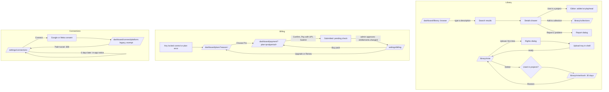

# Clipnera UI revamp — Wave 6 screens, part 3: library, settings, billing, brand kit

Date: 5 October 2026. Author: Product Designer 3 (Wave 6, phase 1b). Builds on [00-agent-brief](../wave6/00-agent-brief.md), [01-platform-api](../wave6/01-platform-api.md), [02-ui-catalog](../wave6/02-ui-catalog.md), [01-experience-principles](../01-experience-principles.md), [02-design-system](../02-design-system.md), [05-broll](../05-broll.md), [architecture/frontend.md](../architecture/frontend.md) (§1, §3, §8.4), [audit/06](../audit/06-reels-brand-social.md), [audit/07](../audit/07-settings-billing-admin.md), and the research in [research/perplexity.md](../research/perplexity.md), [research/lovable.md](../research/lovable.md) and [research/lovable-visual.md](../research/lovable-visual.md). When `wave6/07-visual-direction.md` exists, it overrides the visual details here wherever the two disagree. The structure follows [01-entry-and-dashboard.md](01-entry-and-dashboard.md).

**Covers:**
- **B-roll library:** the Clipnera library (browse, search, details, report), your uploads (upload tray, rights, details, delete), favourites and collections, recently deleted (trash), and the editor's Library panel. The editor only receives the panel as an export.
- **Settings:** account and privacy, workspace and team, connected accounts (YouTube and Instagram), and notifications.
- **Billing:** the plan and billing page, the plans dialog, the payment dialog (plans and credit packs), and payments and receipts.
- **Brand kit,** including the channel intro (the creator intro feature).

**Mockups (the starting point):** `/design-system/screens/libraries/<route>`. The routes are `library`, `library-uploads`, `library-collections`, `library-trash`, `library-panel`, `settings-account`, `settings-workspace`, `settings-connections`, `settings-notifications` and `settings-billing`. Source is in `frontend/app/design-system/screens/libraries/`. Each mockup has a `?state=` switcher and a dark/light toggle, makes no API calls, and returns 404 in production.

Two mockup gaps:
- `_screens/BrandKit.tsx` exists but has no route folder. The Design System agent should add `libraries/brand-kit/page.tsx` (request DS-L0).
- The `INDEX_HREF` index page `libraries/page.tsx` is missing.

Each screen below has a **"Changes from the mockup"** list. A builder starts from the mockup and applies that list.

### Owner defaults used here (pending owner confirmation)

| # | Default | Where it shows |
|---|---|---|
| L-D1 | Library URLs are `/dashboard/library` (Clipnera library), `/dashboard/library/mine` (your uploads; the Platform placeholder is already there) and `/dashboard/library/mine/trash`. The mockup's `/library/uploads` and `/library/trash` are dropped | §3–§7 |
| L-D2 | The library tab is the search scope. The "Source" filter chip is removed from the page and kept only in the editor panel | §4 |
| L-D3 | Settings sections are static path segments: `account`, `workspace`, `billing`, `notifications`, `connections`. The legacy tab ids `social` and `team` redirect to `connections` and `workspace` | §8 |
| L-D4 | Plans and payment are URL dialogs at `/dashboard/plans` and `/dashboard/payment`. They are intercepted inside the app shell and render as full pages on direct load | §14, §15 |
| L-D5 | Payments stay manual UPI with admin approval. The disabled "Card or UPI autopay · Coming later" option is **removed** (no fake controls) | §15 |
| L-D6 | One brand kit per user, as today. Multiple kits are out of scope | §16 |
| L-D7 | The channel intro keeps all nine intro platforms, with YouTube and Instagram first. Only *publishing* is limited to YouTube and Instagram | §16.3 |
| L-D8 | Workspaces are personal this wave (05 Q3). Team invites still work for Pro owners | §10 |
| L-D9 | Receipts appear only once the backend can issue them (L-API-10). Until then the payments table has no receipt column | §13 |
| L-D10 | The theme control lives in the account menu (Area 1), not in Settings | §9 |

### Business rules every screen here respects

1. **Credit packs never expire.** Bought credits are spent after plan credits, can be bought on any plan, and are approved by an admin. Every place that shows a balance splits it into "plan credits (reset on {date}, unused ones don't roll over)" and "pack credits (never expire)". No copy may suggest that pack credits lapse, including when a plan ends or the account is deleted (deletion copy says unused credits are lost, as today).
2. **Social connections disconnect themselves 7 days after connect or reconnect.** A warning appears **in the app only**, a day before (`EXPIRY_WARNING`, `backend/social/service.py:58`). No screen offers an email for this warning, and the Notifications page says so. Scheduling is capped at the connection's end (`max_schedule_days`).
3. **Login is Google-only.** No password field, change-password, or "create member with password" appears anywhere. Team invites are by Google account email. Account details come from Google.
4. **The compliance pages and account deletion stay reachable** from Settings → Account in at most two clicks. That covers Terms, Privacy, Refunds, Cookies, Data deletion, and the grievance contact when its `NEXT_PUBLIC_*` value is set. The refund policy is also linked in the payment dialog. `/unsubscribe` and `/data-deletion` stay on their exempt legacy routes and are never rewritten (01-platform-api).
5. **Only YouTube and Instagram are offered for publishing.** TikTok and X rows are hidden even though the backend `Platform` literal still lists them.
6. **No fake numbers.** Where a value needs a backend that doesn't exist yet (`NEEDS-BACKEND`), the control or row is hidden and the number is never invented.

### Rules every screen here follows

- Components come from `@/components/ui` (02-ui-catalog) and tokens from `lib/design/tokens.ts`. Anything missing is marked **NEW** and listed in §20. Builders put NEW parts inside their own folder until the Design System agent promotes them.
- One amber fill per view. Purchase and upload buttons are secondary wherever the page already has its primary.
- No spinners. Buttons use `loading`, regions use skeletons (after 300 ms), and long work names its step (`WorkingText`). The one exception is `Spinner` for the OAuth hand-off.
- Errors use `InlineAlert` and say what happened, what is safe, and one action. "Something went wrong" is never used.
- Copy is sentence case and Indian English (colour, cancelled, licence). Clipnera speaks in the first person in results and errors. Don't use "pipeline", "job", "AI-powered" or "agent".
- Every page has a "not on for you" state for its flag (in-shell `EmptyState`, never blank).
- Data goes through `apiFetch` and React Query. Keys live in `lib/query/keys/<domain>.ts`, and cache times follow frontend.md §3.4: `['access']` 60 s, `['catalog','plans']` Infinity, `['broll','search',…]` 5 min. Mutations that spend money or create things send an `Idempotency-Key`.
- At 360 px: 16 px gutters, no horizontal page scroll (tab rows scroll inside themselves), 44 px touch targets, dialogs become bottom sheets, and drawers become full-height sheets.

---

## 1. Flows at a glance

Dead ends closed here:
- Team members could only be created with a password nobody can use (audit 07 #4). Invites are now by Google email.
- The pending payment no longer locks the user out. The plan card says what is happening and shows the payment row.
- The brand kit gets a real logo upload once L-API-11 exists (audit 06 P-B2).
- Nothing gets a second "change plan" button for a plan that doesn't exist.

---

## 2. Routes, flags and owners

| URL | Route file (`app/v2/(app)/dashboard/…`) | Flag(s) | Wave 6 area / unit (§22) | Mockup |
|---|---|---|---|---|
| `/dashboard/library` | `library/page.tsx`, `library/layout.tsx` | `new_ui_dashboard` → page needs `broll_platform_library` | Area 6 · U9 | `library` |
| `/dashboard/library/favourites` | `library/favourites/page.tsx` | `broll_platform_library` or `broll_user_library` | Area 6 · U10 | `library-collections?state=favourites` |
| `/dashboard/library/collections`, `/collections/[collectionId]` | `library/collections/**` | as above | Area 6 · U10 | `library-collections` |
| `/dashboard/library/mine` | `library/mine/page.tsx` | `broll_user_library` | Area 7 · U13 | `library-uploads` |
| `/dashboard/library/mine/trash` | `library/mine/trash/page.tsx` | `broll_user_library` (the page stays readable when the flag is off and items exist, so people can still delete: 05 §9.1) | Area 7 · U14 | `library-trash` |
| Editor Library panel | export only: `components/broll/library/panel` | `broll_platform_library` / `broll_user_library` + `agent_editor` | Area 6 · U11 | `library-panel` |
| `/dashboard/settings` | `settings/page.tsx` → `redirect('/dashboard/settings/account')` | `new_ui_settings` | Area 9 · U1 | — |
| `/dashboard/settings/account` | `settings/account/page.tsx` | `new_ui_settings` | U1 | `settings-account` |
| `/dashboard/settings/workspace` (`/team` → 308) | `settings/workspace/page.tsx` | `new_ui_settings` | U2 | `settings-workspace` |
| `/dashboard/settings/notifications` | `settings/notifications/page.tsx` | `new_ui_settings` | U3 | `settings-notifications` |
| `/dashboard/settings/connections` (`/social` → 308) | `settings/connections/page.tsx` | `new_ui_settings`; shown while `social_publishing` is on **or** the user still has accounts | Area 8 · U4 (component), route file U1 | `settings-connections` |
| `/dashboard/settings/billing` | `settings/billing/page.tsx` | `new_ui_settings` | Area 9 · U5 | `settings-billing` |
| `/dashboard/plans` (dialog over the current page; full page on load) | `@modal/(.)plans/page.tsx`, `plans/page.tsx` | `new_ui_settings` (needs Platform request P1) | Area 9 · U6 | `settings-billing?state=plans` |
| `/dashboard/payment` | `@modal/(.)payment/page.tsx`, `payment/page.tsx` | as above | Area 9 · U6 | `settings-billing?state=pay-*` |
| `/dashboard/brand-kit` (`#channel-intro` anchor) | `brand-kit/page.tsx` | `new_ui_settings` | Area 9 · U7 (+ U8 intro) | `_screens/BrandKit.tsx` |

**Routing notes:**
- Platform's catch-all placeholder `settings/[[...tab]]/page.tsx` is replaced by the static segments above (U1 deletes it; it is v2, not legacy).
- U1 adds `settings/layout.tsx` (the settings frame) and placeholder pages for the segments that later units replace. This is the same hand-over pattern as Platform's `<Placeholder>`.
- `settings/social/page.tsx` and `settings/team/page.tsx` call `permanentRedirect()`. Middleware already turns `?tab=social` into `/dashboard/settings/social`.
- The legacy OAuth return `app/dashboard/connect/[platform]` (exempt, untouched) sends people back to `/dashboard/settings?tab=social`. That lands on Connections in two hops, with no change to legacy code.
- Backend emails link to `/dashboard/settings` (`social/notify.py:38`), which lands on Account. Request B-L1 asks backend to link `/dashboard/settings/connections` instead.

---

## 3. Library frame (shared by every library page)

**Purpose.** One place for footage. It reads like Perplexity's Library: a calm list you come back to, explicit lifetimes, soft delete. It acts like Lovable's knowledge: something you can point a prompt at.

**Owner.** `library/layout.tsx` + `components/broll/library/frame/**` (U9). The layout wraps `mine/**` too. Area 7 pages render inside it, and the layout file stays Area 6's.

**Layout.**

| Width | Layout |
|---|---|
| ≥ 1024 | Content max 1280 px, gutters 32 px. Header row: `h1` "Library" (`text-cn-title-lg`) and one line of description on the left. Right side: `StorageMeter` compact (NEW, 192 px) and **Upload** (`Button`, secondary; primary only on `/mine`). Below it, the section tabs: a 40 px underline `nav` (links, not `Tabs`, because each is a URL) reading Clipnera library · Your uploads (count) · Favourites (count) · Collections · Recently deleted (count, only when > 0 or on that page). 24 px gap to content |
| 640–1023 | Same; gutters 24 px; storage meter drops under the header as a full-width thin bar |
| < 640 (360) | Header stacks: title, description (clamped to 2 lines), then a row with the storage meter (flex-1) and an Upload `IconButton` (44 px, label "Upload footage"). The tab row scrolls horizontally inside itself with edge fades, and the active tab is scrolled into view |

**Copy.** Description: "Footage for any project: shots picked by Clipnera and clips you upload. Drag one into the editor, or ask for it in a prompt: 'add B-roll of rain at 0:12'."

**Components.** Section nav (NEW `SectionNav`, DS-L1: underline links with `aria-current="page"`, counts, horizontal scroll; the mockup's `NavTabs` stand-in), `StorageMeter` (NEW, DS-L2), `Button`, `IconButton`, `Tooltip` (disabled Upload gives its reason).

**Flag behaviour.**
- `broll_user_library` off: hide Your uploads, Recently deleted (unless items exist), Upload and the storage meter.
- `broll_platform_library` off: hide Clipnera library, and `/dashboard/library` redirects to `/mine`.
- Both off: the in-shell EmptyState "The library isn't on for your account yet · We're opening it up in stages. Footage already in your projects keeps playing." with **Go to Home**.

**Upload disabled reasons** (via `aria-describedby` and a Tooltip on the `aria-disabled` button):
- "Uploads are paused: your library is full."
- "Viewers can browse but not upload."
- "Uploads are paused for now." (flag off, existing files kept)

**API.**
- `useFlag('broll_platform_library')` and `useFlag('broll_user_library')`.
- Storage: `GET /library/usage` → `LibraryUsage` (**NEEDS-BACKEND L-API-2**), and the quota from `GET /subscription/entitlements` `.library.quota_bytes` (**NEEDS-BACKEND L-API-3**).
- Counts: `meta.total` from the list endpoints (L-API-1/2). Hide a count rather than guess it.

---

## 4. Clipnera library (`/dashboard/library`)

**Purpose.** Find a shot by describing it, not by guessing tags.

**Layout.**

| Width | Layout |
|---|---|
| ≥ 1024 | Toolbar (sticky under the shell header, 56 px): `SearchField` (flex-1, max 640 px, placeholder "Describe the shot — 'drone over a city at night'", `/` shortcut). Then filter chips, each a `Menu` of checkable values: Orientation · Duration · Resolution · Colour · Mood · People. Then a sort `Menu` (Best match / Newest / Most used) and a "No credit line needed" toggle `Chip`. **Browse (empty query):** featured collection rows (`TileRow`, horizontal scroll, 160 px portrait tiles, "See all N" ghost link), then Categories (grid, 4 columns, 80 px tiles), then "Popular this week" grid. **Results:** a summary line ("48 shots", plus `Badge` "Matches by meaning" with an explanation when vector recall led), then a justified grid (row height 220 px), then **Show more** (cursor) |
| 640–1023 | Chips wrap to two lines; categories 3 columns; row height 180 px |
| < 640 | Toolbar: the search field is full width; below it, a **Filters** button (with the active count) that opens a bottom `Drawer` holding all filters as `Chip` groups, with Clear and Show N shots. Featured rows scroll horizontally (snap). Categories 2 columns. Results grid row height 150 px, about 2 tiles per row. First tap previews, second tap opens details |

**Tile (NEW `LibraryTile`, DS-L3).** A composite of `VideoThumb` (own aspect, duration bottom-right, hover preview after `delay.mediaHover` 150 ms via `useHoverIntent`; poster only under reduced motion or Save-Data), a title button with `cardLinkOverlay` (opens details), a favourite `IconButton` (`pressed`), and a "More" `Menu`. The menu has: Details · Add to collection… · Use in a project… · separator · Report a problem. Keys: Space previews, F favourites, Enter opens. Locked tiles (tiering, later) show a lock `Badge` and open plans on add.

**Details drawer** (`Drawer side="right" size="lg"`, 576 px; full-height sheet < 640). Contents:
- Preview with play and scrub, title, AI caption, tags (`Badge`), `KeyValues` (NEW, DS-L4): duration, resolution, orientation ("Vertical, fits 9:16 projects"), mood, colours.
- **Licence block:** author link, licence link, "Credit: required, added to your export credits" or "not required, offered", the attribution line in a `CopyField mono`, and "Use in your videos: yes. Download: not available — Clipnera library footage is only used inside your exports."
- **Similar shots** strip.
- Footer: Add to collection (secondary, `Menu side="top"`) and **Use in a project** (primary, `Menu`: 5 most recent editor projects + "Choose another project…").

**Report dialog** (`Dialog size="md"`): RadioGroup (NEW, DS-L5) "What's wrong?" with Wrong tags or description · Low quality · Offensive or harmful · Copyright or licence problem · Something else. Then Textarea "Anything else? (optional)" with 500 characters max. Footer: Cancel · Send report.

**Changes from the mockup.**
1. Remove the "Source" filter chip from the page (L-D2). The tab is the scope.
2. The "Uploads flag off" / "Both flags off" states follow §3.
3. The `AppShell` stand-in is replaced by the real shell (Area 1). Nothing in this route draws chrome.
4. Categories link to `?category=` (URL state), not `#`.
5. Search, filter and sort live in the URL (`?q=&orientation=&duration=&res=&colour=&mood=&people=&nocredit=1&sort=`), so Back and shared links keep them.
6. "Use in a project…" lists real editor projects (`GET /editor/projects`). Choosing one opens `/dashboard/editor/{id}?insert=broll:<asset_id>`. That URL contract is Area 4's (request A4-1). Until Area 4 accepts it, the menu item is hidden.
7. The colour swatches in the drawer stay as content colours (from the asset). They are the only raw colours, and they come from data.
8. Tiering state: only when the remote config `broll.platform.tiering_enabled` is true (`useConfig`). It's off at launch.

**States.**

| State | Shows |
|---|---|
| Browse | Featured rows, categories, popular |
| Typing | Results update 250 ms after typing stops; the `SearchField` shows `loading` and the previous results stay (no flash) |
| Results | As above; "Matches by meaning" badge when relevant |
| No results | `EmptyState` "No shots match 'purple giraffe skateboarding'" · "Try fewer words, or describe what's on screen rather than the topic." · 3 suggestion `Chip`s from `meta.suggestions`; clicking one fills the search |
| Filters exclude everything | "No shots match these filters." + **Clear filters** |
| Loading (first) | `SkeletonGroup label="Loading footage"`: 12 tiles at mixed ratios, same row height (no layout shift) |
| Load failed | `InlineAlert tone="danger"` "The library didn't load. · Your projects and the footage in them are safe. Check your connection and try again." + Try again |
| Partial (browse rows failed, search fine) | Only the failed row shows a compact alert with Try again |
| Details loading | Poster first, metadata `SkeletonText` |
| Details failed | "I couldn't load this shot's details. It's still in the library." + Try again |
| Report sent / rate limited | Toast "Report sent · We look at reports within 2 working days." / inline "You've sent 10 reports today. Try again tomorrow." |
| Retired favourite opened | Badge "No longer offered · still plays where you used it" |
| Offline | Last results kept, search disabled with "You're offline" |
| Flag off | §3 |

**Keyboard and screen reader.**
- One `h1` "Library" and an `h2` per section.
- The grid is one Tab stop with arrow navigation (`MediaGrid` behaviour, extended for justified rows, DS-L3).
- Each tile's button is named "{title}, {duration}, {orientation}".
- The result count is announced in a polite `role="status"` after each search, once.

**API.**

| Need | Endpoint | Schema | Status |
|---|---|---|---|
| Browse rows, categories, popular | `GET /library/browse` | `LibraryBrowse` (05 §7.2) | **NEEDS-BACKEND L-API-1** |
| Search | `GET /library/search?q=&scope=platform&…&cursor=` | `list[LibraryItem]` + `meta {total, next_cursor, matched_by, suggestions}` | **L-API-1** |
| Details | `GET /library/items/{asset_id}` | `LibraryItemDetail` | **L-API-1** |
| Favourite | `PUT` / `DELETE /library/favourites/{asset_id}` | `{favourite}` | **L-API-1** |
| Report | `POST /library/items/{asset_id}/report` | `ReportCreate {reason, note?}` | **L-API-1** |
| Projects for "Use in a project" | `GET /editor/projects` | `ApiResponse[list[EditorProjectSummary]]` | exists (`editor/route.py:37`) |
| Today's search (clip studio only) | `GET /broll/search?q=&min_duration=` | `ApiResponse[list[BrollPreview]]`, ≤ 4 results, behind `broll_studio.cutaways` | exists; **not** used by this page (no filters or paging). Kept unchanged for `ClipBrollPanel` (05 §14.2) |

Until L-API-1 lands, U9 builds against typed stubs in `lib/api/broll/library.ts`, each marked `// NEEDS-BACKEND: GET /library/search` and so on, with types copied field for field from 05 §7.2.

**Legacy parity.**

| Legacy (where) | What it did | New home |
|---|---|---|
| `ClipBrollPanel` search box (`ClipBrollPanel.tsx:40`, `brollApi.search`) | Phrase search, 4 results, pick to swap | Unchanged in the clip studio. The library page is the richer search; the editor panel (§7) replaces it in v2 editor surfaces |
| `ClipBrollPanel` thumb `title` = attribution | Hover showed the credit | Drawer licence block with Copy |
| Studio `BrollPanel` Unsplash stills | Preview-only stills | Not carried. Removal needs the owner's yes (05 Q10, R-L1) |
| No user-facing library page existed | — | New |

---

## 5. Your uploads (`/dashboard/library/mine`)

**Purpose.** Private footage that Clipnera understands by what's on screen.

**Layout.**

| Width | Layout |
|---|---|
| ≥ 1024 | Inside the frame: alerts row (quota, held, viewer), then the toolbar (`SearchField` "Search your uploads — try 'the part where I'm running'", filters: Orientation · Duration · Kind (Uploads / AI shots) · State (Ready / Processing / Held / Failed)), a count line "6 files · 14 shots", the justified grid (row height 220). Selecting tiles shows the sticky SelectionBar (DS-13): "2 selected · Add to collection · Delete · Clear" |
| < 640 | Search full width; Filters sheet; grid row height 150; SelectionBar pinned above the tab bar (`pb-safe`) |

**Tiles.**
- A file is one tile, with a "6 shots" `Badge` when it has more than one shot. Opening a multi-shot file expands an inline panel under its row (`Disclosure`-like region, `h2` "Beach run · 6 shots", Collapse).
- Search results show shots directly with the meta "in Beach run · 0:42".
- A processing tile shows `StatusBadge processing` with a `WorkingText` step ("Finding shots").
- A held tile shows a rose `Badge` "Held for review". Failed and held tiles are not draggable or addable.

**Upload.**
- Ways in: the frame's Upload button, `FileDropzone` (empty state and page-wide drag-over), and drops onto the editor panel or PromptBar (other areas call `startLibraryUpload(files)` from `lib/upload`).
- Accepted: MP4, MOV, WebM, MKV.
- **First upload only:** `Dialog` "Before your first upload" with `Checkbox` "I own this footage or have permission to use it." and description "We ask once. Footage that breaks our Terms can be taken down." The Terms link opens in a new tab. Primary: "Upload 3 files". Error if unticked: "Tick this to upload."
- Preflight per file (before any bytes): type, size (`library.max_file_bytes`), duration (`library.max_file_seconds`), quota, and duplicate fingerprint. Rejections show as tray rows, not toasts.

**Upload tray** (`components/broll/uploads/tray`, mounted by the shell, request A1-2).
- Desktop: a 360 px panel docked bottom-right above the toast region (`z-cn-toast` − not new: it uses `z-cn-sticky`), collapsible to a pill "Uploading 2 · 62%".
- Phone: a bottom sheet, collapsed to a pill above the tab bar.
- Rows use `UploadProgressItem`. Row states follow 05 §3.3: checking, duplicate (Use existing · Upload anyway), too big / too long / over quota (See plans · Free up space · Remove), uploading (Pause · Cancel), paused offline, needs file again ("Choose 'interview-b.mov' again to resume"), processing (named step), ready (Open · Add to project), held, failed (Retry · Remove).
- Up to 3 files at a time (remote config).
- `beforeunload` warns only while bytes are still leaving this tab.

**Own-item drawer** (`Drawer size="lg"`):
- Preview.
- Title `Input`.
- Tags as removable `Chip`s plus an "Add a tag" `Input` (Enter adds).
- **Used in** (links to projects).
- `KeyValues`: Length, Original (resolution · codec · size), Stored as ("1080 × 1920 copy · 412 MB" when compacted), Audio.
- Note: "We store a 1080p copy to save space. Download gives you that copy; keep your original on your device."
- Compact `StorageMeter` with breakdown.
- Footer: Delete… (ghost) · Download (secondary) · **Save changes** (primary; enabled only when dirty).

**Delete** (`Dialog role="alertdialog" size="md"`).
- Title "Delete 'Beach run'?"
- When used: "Used in 2 projects. Those projects will show 'Missing clip' where it was. Videos you've already exported or published don't change." plus the project list.
- Footer: **Keep file** (ghost, initial focus) · Delete now (`danger`) · Move to Recently deleted (secondary).
- Note: "Recently deleted still counts towards storage. 'Delete now' frees 412 MB at once and can't be undone."
- After "Move", a toast "Moved 'Beach run' to Recently deleted · Restore it within 30 days." with **Undo** (6 s).

**Changes from the mockup.**
1. The URL becomes `/dashboard/library/mine` (L-D1).
2. In the delete dialog, `danger` moves from "Move to Recently deleted" to **Delete now**, the irreversible action. Move becomes secondary.
3. Quotas and limits come from `entitlements.library` and are never hard-coded ("25 GB on Pro" disappears until L-API-3 provides it). "See Pro storage" opens `/dashboard/plans?reason=storage`.
4. The "Viewer role" state only shows on a shared workspace (L-D8). Keep it, but expect it rarely.
5. The tray's Pause is shown only when the upload engine supports it (U12). Cancel is always shown.
6. Download is disabled with "Still preparing" until the file is `ready` (`409 NOT_READY`).

**States.**

| State | Shows |
|---|---|
| Empty (first use) | `FileDropzone` "Upload your own footage — it stays private to you" · hint "MP4, MOV, WebM or MKV · up to {max_file} and {max_minutes} min each · {quota} on your plan" (limits from entitlements; the hint omits any limit it doesn't have) · line "Clipnera describes each file and splits it into shots, so you can search them by what's on screen." |
| Dragging files over | Dropzone `accent-border` + `accent-subtle`, "Drop to upload 3 files" |
| Default | Grid |
| Expanded file | Inline shots panel |
| Rights confirmation | Dialog |
| Near quota (≥ 80%) | `InlineAlert warning` "You've used 21 GB of 25 GB. · Uploads keep working until the library is full. Deleting files in Recently deleted frees space at once." + Review large files (sorts by size) |
| Over quota | `InlineAlert danger` "Uploads paused — your library is full. · 25.4 GB of 25 GB used. Nothing is deleted, and footage already in projects keeps working." + Free up space · See plans |
| Held | `InlineAlert danger` "'Night drive' is held for review. · It can't be used until we check it, usually within a day. You'll get a notification either way." |
| Loading | 6 skeleton tiles, one live region "Loading your uploads" |
| Load failed | "Your uploads didn't load. · Your files are safe, and uploads already running keep going." + Try again |
| Flag off (files exist) | `InlineAlert neutral` "Uploads are paused for now. · Your files are safe and still play in your projects. You can still download or delete them." Grid read-only |
| Viewer | `InlineAlert neutral` "You can browse this library. · Only members and the owner can upload, rename or delete." |
| Offline | Grid kept; Upload disabled with reason; the tray pauses rows |

**Keyboard and screen reader.**
- Tiles are selectable with Space when selection is active and open with Enter.
- The SelectionBar is `role="region"` named "Selection".
- The tray is a `region` "Uploads" with a polite status for state changes (ready, failed), not for every percentage tick.

**API.**

| Need | Endpoint | Status |
|---|---|---|
| List files | `GET /library/sources?state=&deleted=false&cursor=&limit=` → `list[LibrarySource]` + `meta` | **NEEDS-BACKEND L-API-2** |
| Search own shots | `GET /library/search?scope=mine&q=` | **L-API-1** |
| File details | `GET /library/sources/{id}` → `LibrarySourceDetail` | **L-API-2** |
| Edit title and tags | `PATCH /library/sources/{id} {title?, tags?}` | **L-API-2** |
| Delete / delete now | `DELETE /library/sources/{id}?now=false\|true` | **L-API-2** |
| Download | `GET /library/sources/{id}/download` → `{url}` | **L-API-2** |
| Upload init | `POST /library/uploads` (`Idempotency-Key`) → `LibraryUploadInitResponse`; errors `UPLOAD_TOO_LARGE`, `DURATION_NOT_ENTITLED`, `STORAGE_QUOTA_EXCEEDED`, `LIMIT_REACHED` | **L-API-2** |
| Resumable parts | `GET /uploads/{id}`, `POST /uploads/{id}/parts`, `POST /uploads/{id}/complete`, abort (backend.md §6.2) | **NEEDS-BACKEND L-API-2**. Today only `/uploads/video/{init,complete,abort}` exist (`uploads/route.py:35-51`); those stay for project uploads and are not reused |
| Processing progress | `job.*` events on the stream (`broll.library_ready`) | **L-API-2** + Platform realtime |
| Limits | `GET /subscription/entitlements` `.library` | **L-API-3** |
| Plan errors | `isPlanError` → `clipnera:upgrade-required` → `/dashboard/plans?reason=` | client exists. `STORAGE_QUOTA_EXCEEDED` and `UPLOAD_TOO_LARGE` must join the plan error codes (request P2) |

**Legacy parity.** There is no user B-roll library in legacy. Related flows that must keep working untouched: project video upload (`/uploads/video/*`, `UploadModal`), footage reels' own upload (`edit_engine`), and AI shots (they appear here under Kind = AI shots, still Pro and 120 credits, created only from the clip or editor).

---

## 6. Favourites and collections (`/dashboard/library/favourites`, `/collections`)

**Layout.**
- **Favourites:** the justified grid of every hearted shot, from either library.
- **Collections:** an h2 "Yours" grid of cards (2 / 3 / 4 columns, card = 112 px cover poster + name + "14 shots"), then "Featured by Clipnera" in the same shape. **New collection** (secondary) sits top-right; it becomes primary only on the empty state.
- **Collection detail** (`/collections/[collectionId]`): `Breadcrumbs` Library / Collections / Name. `h1` name and a description line ("5 shots · only you can see this"). Actions: **Use in a prompt** (copies `use B-roll from 'Product shots'` into the shell's ⌘K prompt; Area 1 API `openPrompt(text)`, request A1-3) and a `Menu` (Rename, Delete collection).
- Detail has an ordered list. Each row is grip · position (mono) · 32 × 56 poster · title · duration · Move up · Move down · Remove. Drag-reorder is the pointer extra; buttons are the keyboard and touch path (WCAG 2.5.7).
- Featured detail: a read-only grid with **Save a copy**.

**Dialogs.**
- New or rename: `Input` Name (required, 120 characters) and `Textarea` Description (500 characters). Footer: Cancel · Create collection / Save.
- Delete collection (`alertdialog`): "Delete 'Product shots'? · The 14 shots stay in the library; only the collection goes." · Keep collection / Delete collection.

**Changes from the mockup.**
1. Remove the "Free up to 10 · Pro up to 200" badges from the New dialog. The limit appears only when reached: inline `LIMIT_REACHED` error "You have 10 collections, the most on your plan. Delete one or see plans."
2. Every reorder shows a toast and also a polite live message ("Moved 'Typing on a laptop' to position 2").
3. Collection URLs are real (`[collectionId]`), not state.

**States.**
- Favourites: empty ("No favourites yet · Tap the heart on any shot to keep it here. Favourites are private to you."), loading, failed, a retired item ("No longer offered", still usable), a taken-down item (removed from the list on refetch).
- Collections: empty ("No collections yet · Group shots for a project or a series, then ask for them in a prompt: 'use B-roll from Product shots'." + New collection), loading, failed, at limit, saving, reorder failed (order reverts and an alert shows).
- At 360 px: cards go to 2 columns, and detail rows hide the grip and keep the arrows.

**API.** `GET /library/collections?scope=mine|featured`, `POST /library/collections`, `PATCH` and `DELETE /library/collections/{id}`, `POST /library/collections/{id}/items {asset_ids}`, `DELETE /library/collections/{id}/items/{asset_id}`, and favourites `PUT`/`DELETE`. All are **NEEDS-BACKEND L-API-1**. Reordering needs `PATCH /library/collections/{id} {item_order: string[]}`. That isn't in 05 §7.3, so it is added as **L-API-1b**.

**Legacy parity.** None (new).

---

## 7. Recently deleted (`/dashboard/library/mine/trash`)

**Layout.**
- Summary line "3 files · 1.8 GB. Each is deleted for good 30 days after you deleted it."
- **Empty now** (secondary) on the right. It is hidden for members, with the line "Only the workspace owner can empty this."
- Below it, a `DataTable` with columns: Poster · Name · Size (mono, numeric) · Time left ("27 days left"; rose under 3 days) · Used in ("shows as Missing clip in 1 project") · Restore (secondary) · Delete now (ghost).
- On phones the table collapses to cards (`hideOnMobile` on Size and Used in).

**Dialogs.**
- Empty: `alertdialog` "Delete 3 files for good? · This frees 1.8 GB and can't be undone. Exported and published videos don't change." · Keep them / Delete 3 files (danger).
- Delete now on one row uses the same pattern.

**States.** Default · empty ("Nothing here · Deleted uploads stay here for 30 days so you can restore them. They still count towards storage until then.") · loading · failed · restoring (row button loading, then a toast "Restored 'Old intro take'") · restore failed because it was already purged (`404`: "That file was already deleted for good.", and the row is removed) · member.

**Changes from the mockup.** The URL changes, and the days come from the remote config `storage.user_library_trash_days` (`useConfig`), never the literal 30.

**API.** `GET /library/sources?deleted=true`, `POST /library/sources/{id}/restore`, and `DELETE /library/sources/{id}?now=true` (**L-API-2**). Empty-all needs `DELETE /library/trash` (**L-API-2b**, not in 05).

**Legacy parity.** None (new). Perplexity has no trash; this follows its "explicit lifetimes" lesson (research §3).

---

## 8. Editor Library panel (export for the editor)

**Owner.** U11 builds `components/broll/library/panel/**` and exports `LibraryPanel` from `components/broll/library/panel/index.ts`. Area 4/5 mount it in the editor's left rail. This spec defines the panel; the rail is the editor's.

**Layout.** 320 px wide.
- Pill `Tabs` (Clipnera · Uploads · Favourites · Collections; each hides by its flag).
- `SearchField sm`.
- Chips: **Fits this project** (on by default), Under 5 s, With people, and Source (the only place Source exists, L-D2).
- A justified grid with row height 150.
- Footer hint "Drag a tile onto the timeline, press A or + to add it at the playhead, or select it to attach it to your prompt."
- On phones (editor on phone) the panel is a bottom sheet with no drag; each tile's menu has "Add at playhead".

**Contracts.**
- Drag uses `writeBrollDrag(dt, payload)` with `BrollDropPayload` from `components/editor/slots.ts`; the editor implements `InsertBroll`.
- Adding raises the editor's toast "Added 'Pouring coffee' at 0:12 · Saved as a new version." with Undo (the editor's).
- The "why this clip / swap" card (mockup states `why`, `swap`, `swapped`, `no-match`, `missing`) belongs to the editor's ResultMessage area (Area 4). U11 exports `BrollWhyCard` for it to place.

**API.** As in §4 and §5, plus `GET /library/media?refs=` for preview resolution (**L-API-1**).

**Legacy parity.**

| Legacy | New |
|---|---|
| `ClipBrollPanel` swap among alternates | `BrollWhyCard` Swap strip (editor). The clip studio keeps `ClipBrollPanel` |
| `ClipBrollPanel` remove cutaway | `BrollWhyCard` "Remove B-roll" |
| `ClipBrollPanel` "AI shot · 120 credits (Pro)" (violet) | Suggestion chip in ResultMessage "Make an AI shot of a red tractor · 120 credits" (accent, not violet) |

---

## 9. Settings frame and Account (`/dashboard/settings/account`)

### 9.1 Settings frame (U1: `settings/layout.tsx`, `components/settings/frame/**`)

| Width | Layout |
|---|---|
| ≥ 1024 | Header: `h1` "Settings" and the line "Your account, workspace, plan and the accounts you publish to." Two columns: a 224 px sticky section `nav` "Settings sections" (36 px rows, icon + label, active `surface-active` + amber icon) and content (max 768 px, 24 px between cards) |
| 640–1023 | The nav becomes a horizontal, internally scrolling row above the content |
| < 640 | Same row, 44 px targets, active section scrolled into view. Content full width with 16 px gutters; cards keep 16 px padding |

Sections in order: Account and privacy · Workspace and team · Plan and billing · Notifications · Connected accounts. Connected accounts is shown while `social_publishing` is on **or** `GET /social/connections` returns accounts, which keeps parity with `useSocialTabVisible`. Turning the feature off never stops anyone from disconnecting.

The `SettingsCard` composite (NEW, DS-L6) is a section with an `h2`, a description, actions, content and a `danger` variant. The mockup's `_components/SettingsFrame.tsx` is the stand-in.

### 9.2 Account and privacy

**Cards, top to bottom.**
1. **Profile.** Description: "Your name, email and picture come from your Google account. Change them in Google and they update here at your next sign-in." Shows an `Avatar size 40`, the name, the email, and a plan `Badge` ("Pro plan" with a crown and accent tone, or "Free plan" neutral). `KeyValues`: Signed in with: Google (from `providers`) · Member since · Age confirmed: 18 or older · {date}. The last two show only when `/me` has them (L-API-5).
2. **Privacy.** `Switch` "Use my uploads in AI edits" · "When you ask for B-roll, Clipnera may pick shots from your own uploads, and tells you when it does. Turn off to use only the Clipnera library." Shown only when `broll_user_library` is on **and** L-API-7 exists.
3. **Where you're signed in.** Only once sessions exist (L-API-6). The mockup's `sessions-off` state is the launch state.
4. **Legal and your data (NEW card).** A link list: Terms of service · Privacy policy · Refund policy · Cookie policy · How to delete your data (`/data-deletion`) · Grievance officer (name + email, shown only when `NEXT_PUBLIC_GRIEVANCE_OFFICER` / `_EMAIL` are set). Each opens in the same tab, apart from `/data-deletion`, which is a public page; all are plain links. The line "Account emails can also be turned off from any email's unsubscribe link." links to Notifications.
5. **Delete account** (`danger` card). Copy is kept word for word from legacy: "Permanently deletes your account, videos, clips, reels, brand kits, payment records and connected social accounts. Unused credits and any paid time left are lost. This cannot be undone. See the privacy policy." Button: Delete account… (secondary, danger text).

**Delete dialog** (`alertdialog`, `dismissible={!deleting}`).
- Title "Delete your account?"
- An `InlineAlert warning` with real numbers from entitlements: "You have 22 days of Pro left and 140 pack credits. · They end with the account. Payments already made aren't refunded." Each half shows only when its value is > 0.
- Input "Type **{email}** to confirm" (case-insensitive match, `autoComplete="off"`).
- Footer: **Keep my account** (ghost) · Permanently delete my account (danger, disabled until the email matches, `loadingLabel="Deleting"`).
- On success: clear the query cache and auth (`lib/auth`), then `router.replace('/')` with a session flag the landing shows once: "Your account and its data have been deleted."
- On error: the field shows "Your account wasn't deleted. Nothing was lost. Try again." plus the request id behind "Copy details".

**Changes from the mockup.**
1. Add the Legal and your data card.
2. Hide Member since and Age confirmed until L-API-5.
3. The Privacy switch is gated as above.
4. The sessions card ships hidden.
5. The pack-credit and Pro-days numbers come from entitlements (never hard-coded), and each sentence is omitted when its value is 0.

**States.** Default · loading (`SkeletonGroup` "Loading your account") · load failed ("Your account details didn't load. · Nothing has changed. Settings you can't see aren't editable until they load." + Try again) · delete dialog · email typed · deleting · delete failed · privacy switch saving (the switch disables, then a polite "Saved") · switch failed (reverts, and an alert says so).

**360 px.** Profile wraps the avatar above the text. KeyValues stack label over value. The delete dialog is a bottom sheet with full-width buttons, the destructive one last.

**API.**

| Need | Endpoint | Schema | Status |
|---|---|---|---|
| Profile | `GET /me` | `UserProfileResponse` (bare body) | exists. Envelope missing (**L-API-13**) |
| Plan badge, Pro days, pack credits | `GET /subscription/entitlements` | `EntitlementsResponse` (`plan`, `plan_expires_at`, `purchased_credits_remaining`) | exists |
| Delete account | `POST /me/delete {confirm_email}` | `DeleteAccountRequest` → `ApiResponse[None]` | exists |
| Member since, age confirmed | `/me.created_at`, `/me.terms_accepted_at` | — | **NEEDS-BACKEND L-API-5** |
| Sessions | `GET /auth/sessions`, `DELETE /auth/sessions/{id}`, `POST /auth/sessions/revoke-others` | — | **NEEDS-BACKEND L-API-6** (frontend.md B1) |
| Use my uploads in AI | `PATCH /me/preferences {use_uploads_in_ai}` | — | **NEEDS-BACKEND L-API-7** (extends screens/01 API-3) |

**Legacy parity.**

| Legacy (`SettingsView` Profile tab, `AccountPrivacyPanel`) | New |
|---|---|
| 56 px avatar, name, email, plan chip | Profile card |
| Disabled "Full name" / "Email" inputs | Plain text (read-only data shown as text, not disabled fields) |
| "Your name and email come from your Google account." | Kept, extended |
| Account emails switch (`PUT /me/email-preferences`) | **Moved** to Notifications (§11) |
| Delete account: inline confirm form | `alertdialog` with the same copy, the same email check, and the same endpoint |
| `/privacy` link in delete copy | Kept, plus the Legal card |

---

## 10. Workspace and team (`/dashboard/settings/workspace`)

**Cards.**
1. **Workspace.** `Avatar shape="workspace"`, name, "Personal · 3 people". Description: "Projects, uploads and brand kit belong to a workspace. Your plan and credits belong to you." There is no rename (no endpoint; owner Q-L3).
2. **Team.** Description "People sign in with Google using the address you invite. No passwords." Owner action: **Invite someone** (primary). It is a `DataTable` with these columns:
   - Person: `Avatar 32`, name, email.
   - Role: a `SegmentedControl sm` with Member and Viewer for the owner, or plain text otherwise. It is a segmented control because `Select` is legacy.
   - Status: `Badge success` "Active" or `Badge info` "Invited · not joined yet".
   - Actions: a `Menu` with "Remove from workspace" or "Cancel invite" (danger).

**Dialogs.**
- **Invite:** `Input type="email"` "Google account email" with hint "Any Google account works, including Google Workspace addresses." Then RadioGroup (DS-L5) "What can they do?": Member, "Edit projects, upload footage, export and publish." · Viewer, "See projects and footage. Cannot edit, upload or publish." Footer: Cancel · Send invite.
- **Remove** (`alertdialog`): "Remove Arjun Mehta? · Arjun loses access to this workspace's projects and uploads straight away. Projects he made stay here. His own account and plan aren't affected." · Keep Arjun / Remove Arjun.

**Changes from the mockup.**
1. Role changes use `SegmentedControl` instead of the `SelectField` stand-in.
2. Status values map from the backend: `active` → Active, `pending` → "Invited · not joined yet".
3. "Invite sent to x" becomes "Added x · They join by signing in with Google using this address." The backend sends no email yet (L-API-9). Once it does, the copy reverts to "Invite sent".
4. Free: the plan callout "Teams are part of Pro." (+ See Pro → `/dashboard/plans?reason=team_members`). Existing members stay listed and removable, as the backend allows on Free.

**States.**
- Owner with team · only you ("Just you so far · Invite an editor or a client. They join with their Google account.") · loading (3 row skeletons) · members failed ("Your team didn't load. · Nobody's access has changed." + Try again).
- Invite dialog · invite errors (`409` already a member: "arjun@studioframe.in is already in this workspace."; `422` invalid email; plan error → plans).
- Saving a role (optimistic, reverts on error with a toast "Arjun is still a Member. The change didn't save.") · remove dialog · Free (locked) · signed in as a member ("You're a member here. Only {owner} can invite people or change roles.").
- No workspace: unreachable (every user has a personal one). If `GET /workspaces` is empty, show "Your workspace didn't load" with Try again.

**360 px.** The table becomes stacked cards: person, then role and status in a row, then the menu top-right.

**API.**

| Need | Endpoint | Status |
|---|---|---|
| Workspaces | `GET /workspaces` → `list[WorkspaceResponse]` | exists (bare body, L-API-13) |
| Members | `GET /workspaces/{id}/members` → `list[WorkspaceMemberResponse]` | exists |
| Invite | `POST /workspaces/{id}/members {email, role: 'member'\|'viewer'}` (Pro: `team_members`) | exists. It creates a `pending` member, sends no email, and never activates on sign-in (**L-API-9**) |
| Change role | `PATCH /workspaces/{id}/members/{member_id} {role}` | exists (no caller today) |
| Remove / cancel invite | `DELETE /workspaces/{id}/members/{member_id}` → `MessageResponse` | exists (no caller today) |
| Never call | `POST /workspaces/{id}/members/create` (password account) | exists; **not used** (Google-only) |

**Legacy parity.**

| Legacy (`SettingsView` Team tab) | New |
|---|---|
| "Add a team member" form: Full name, Email, **Password**, Role → `createAndAddMember` | **Replaced** by Invite by Google email (R-L3, owner sign-off) |
| Pro lock on "New member" → `promptUpgrade` | Free callout → `/dashboard/plans?reason=team_members` |
| Team list with role chip and status pill | DataTable; role becomes editable, remove added (API already existed) |
| "Create a workspace first…" empty state | Not reachable; replaced by the load-error state |

---

## 11. Notifications (`/dashboard/settings/notifications`)

**Intro line.** "You always get an in-app notification when an upload, edit or export finishes, or when a connected account is about to disconnect. Choose what else reaches you."

**Cards.**
1. **Account emails** (exists today).
   - `Switch` "Account emails" · "Emails when a scheduled post fails or a connected account loses access. We never send marketing emails."
   - Note under it: "The 7-day auto-disconnect warning for YouTube and Instagram is shown in Clipnera only, a day before. It isn't emailed."
   - When off: neutral note "Account emails are off. You can also turn them off from any email's unsubscribe link."
   - The switch applies immediately. A polite status line follows: "Saved. Emails go to {email}."
2. **When long work finishes** (L-API-8). `Switch` "Email me when it finishes" plus a threshold (`SegmentedControl` 1 min · 5 min · 15 min · 30 min, default 5). Hidden until the endpoint exists.
3. **Browser notifications** (client-only, works now while a Clipnera tab is open).
   - `Switch` "Show a browser notification when work finishes" · "Works while Clipnera is open in a tab. Your browser asks for permission the first time."
   - Stored per device (`usePersistentState('cn_browser_notify')`). Area 1's notification handler reads it when `notification.created` arrives (request A1-4).
   - Permission denied: the switch is disabled and the description explains how to allow it in site settings.
   - Notifications with the tab closed need web push (L-API-8b, later).

**Changes from the mockup.**
1. The account emails copy says "loses access", not "needs reconnecting", to keep it separate from the in-app-only 7-day warning, and the in-app-only note is added.
2. "You turned these off from an email link" becomes a cause-neutral note (the app can't know the cause).
3. The completion card is hidden until L-API-8.
4. The threshold uses `SegmentedControl`, not the Select stand-in.

**States.** Default · loading · saved · save failed (the switch reverts; "That change didn't save. · We put the switch back. Your other settings are unchanged." + Try again) · emails off · browser permission denied · browser unsupported (the card is hidden).

**360 px.** One column. Switch labels wrap and the controls stay right-aligned at 44 px.

**API.** `GET /me` (`email_notifications`) · `PUT /me/email-preferences {email_notifications}` → `ApiResponse[UserProfileResponse]` (exists) · `GET/PUT /me/notification-preferences` (**NEEDS-BACKEND L-API-8**, shared with the screens/01 §10 "Email me when it's done").

**Legacy parity.** The account emails switch in `AccountPrivacyPanel` keeps the same endpoint and copy, now with the in-app-only note. The browser notification switch is new, and so is the completion email (backend pending).

---

## 12. Connected accounts (`/dashboard/settings/connections`)

**Owner.** U4 (Area 8, which owns `lib/api/social/**`) builds `components/publish/connections/**` and exports `ConnectionsSection` from `components/publish/connections/index.ts`. U1 renders it from the route file. Until U4 merges, U1 ships the segment's placeholder.

**Card "Publishing accounts".** Description: "Clipnera posts only the clips you choose. Each account disconnects by itself 7 days after you connect or reconnect it; reconnecting takes a few seconds." The right side reads "2 of 4 accounts" in mono (`accounts.length` / `max_accounts`).

**One block per platform,** for the platforms that are available or already have accounts. That is YouTube and Instagram in that order. TikTok and X never render (rule 5) even if the API lists them.
- Header: `PlatformMark` (NEW, DS-L7: the official mark, used only here and on connect buttons, 02 Q6), name, and a **Connect {platform}** button (secondary).
- Lock when `!allowed_by_plan`: the button reads "Pro" with a lock and opens `/dashboard/plans?reason=social`.
- When `accounts.length >= max_accounts`: the button is `aria-disabled` with "Free includes 1 account. Disconnect it or upgrade to add another." (the number comes from `max_accounts`).
- Instagram line: "Instagram professional (creator or business) accounts only."
- `pending_review_note` shows when present.

**Account row.**
- `Avatar` (from `avatar_url`), handle or display name, and a status `Badge`:
  - `active` → success "Active"
  - active with `expires_at − now < 24 h` → accent "Expiring soon" (derived on the client; it matches `EXPIRY_WARNING`)
  - `needs_reconnect` → danger "Needs reconnect"
  - `disconnecting` → `StatusBadge processing` "Disconnecting"
- Audience: `follower_count` in compact mono, or "Hidden" when null, with a Tooltip "Updated {date}".
- Note line:
  - Active: "Auto-disconnects {9 Oct, 4:30 pm}."
  - Expiring: "Auto-disconnects tomorrow, 11:00 am. Reconnect to keep posting for 7 more days."
  - Needs reconnect: `status_reason`, or "Access expired. Reconnect to keep publishing."
- Actions: **Reconnect** (primary, shown when expiring or needs reconnect; only one row's Reconnect is primary, the rest secondary) · Disconnect (ghost).

**Connect flow.** `POST /social/oauth/{platform}/start` → `window.location.assign(authorize_url)`. While the request is in flight, the button shows `Spinner` "Opening YouTube" (the one place `Spinner` is allowed). On `pageshow` with `persisted`, it resets.

**Back from the provider.** The legacy exempt callback page posts the code and returns to `?tab=social`, which lands here. If an account's `connected_at` is under 2 minutes old, show `InlineAlert success live="status"` "Connected @priyacooks on YouTube. · You can publish and schedule to it now." with "Back to Scheduler" (when `social_publishing` is on). If the user cancelled at the provider, the legacy callback shows its own message. No v2 state is needed.

**Disconnect** (`alertdialog`, opened after `GET …/disconnect-preview`). "Disconnect @priyacooks? · {2 scheduled posts will be cancelled. | No scheduled posts are affected.} Clipnera's access will be revoked and its stored tokens deleted." · Keep connected / Disconnect (danger). Afterwards a toast "Disconnected @priyacooks · 2 scheduled posts cancelled."

**Changes from the mockup.**
1. Statuses map from the backend literal; "expiring" is derived.
2. The platform list comes from `platforms[]` (filtered to YouTube and Instagram).
3. Limits come from `max_accounts`.
4. The "Back from YouTube" state is detected from `connected_at` (no query parameter exists).
5. The "Connection cancelled" mockup state is dropped (the legacy callback handles it).
6. The audience "142.8K" comes from `follower_count`.
7. Only one Reconnect per view is amber.
8. Add the in-app-only note to the description: "A day before, you'll see a notice in Clipnera."

**States.** Every status at once · nothing connected ("No accounts connected · Connect YouTube or Instagram to publish clips straight from Clipnera.") · Free at limit · locked platform · loading (2 block skeletons) · load failed ("Your connected accounts didn't load. · Your accounts and scheduled posts haven't changed." + Try again) · starting connect · start failed ("I couldn't open YouTube. Nothing changed. Try again." — `429` adds "You've tried 10 times this hour. Try again later.") · disconnect preview loading (button loading) · disconnecting · disconnect failed · back from the provider · publishing switched off with accounts left ("Publishing is switched off for now. · Scheduled posts are paused. You can still disconnect an account; nothing else changes." Connect is hidden).

**360 px.** Platform header: the mark and name on one line, with Connect full width below. Row actions wrap under the text, full width.

**API.** `GET /social/connections` → `ApiResponse[ConnectionsResponse]` · `POST /social/oauth/{platform}/start` → `ConnectStartResponse` · `GET /social/accounts/{id}/disconnect-preview` → `DisconnectPreviewResponse` · `DELETE /social/accounts/{id}`. All exist (`social/route.py:66-95`). The front end narrows `Platform` to `'youtube' | 'instagram'` for display only, and the wrapper type keeps the full literal `'youtube' | 'tiktok' | 'instagram' | 'x'` to match the schema.

**Legacy parity.**

| Legacy (`ConnectedPlatformsPanel`) | New |
|---|---|
| "Connected Publishing Platforms" / "Authorize your creator profiles for 1-click publishing and scheduling." | "Publishing accounts" plus plainer copy |
| `n/max accounts` | Kept |
| Platform cards for YouTube, TikTok, Instagram, X (hidden when unavailable) | YouTube and Instagram only |
| Connect "Redirecting…" | `Spinner` "Opening YouTube" |
| "Pro only" / at-limit `title` tooltip | Visible reason text (a tooltip alone isn't accessible) |
| Reconnect when expiring or needs reconnect; "Auto-disconnects: {time}" | Kept |
| Inline disconnect confirm with pending-post count | `alertdialog`, same preview and copy |
| `useSocialTabVisible` (flag or has accounts) | Same rule in the settings nav |
| `pending_review_note` | Kept |
| TikTok creator info route | Not used here (composer only) |

---

## 13. Plan and billing (`/dashboard/settings/billing`)

**Purpose.** What you have, what's left, what's pending, and how to get more, all from server data. This page owns the page's single amber CTA.

**Layout.**

| Width | Layout |
|---|---|
| ≥ 768 | Alerts row, then two cards side by side (**Plan** · **Credits**), then full-width **Used today**, **Buy credits**, **Payments**, and **Credit history** (a `Disclosure`, closed by default) |
| < 768 | One column, same order |

**Alerts** (at most one shown, the most urgent first):
- **Rejected payment:** `InlineAlert danger` "Your payment for 200 credits wasn't approved. · Reason: {rejection_reason}. If you paid the full amount, reply to the notification email with your bank statement." + Pay again. Shown when the latest payment is `rejected` and newer than the latest success.
- **Pending:** `info` "We're checking your payment of ₹699. · We check each payment by hand, usually the same day. Pro switches on by itself and you'll get a notification. You can keep using Clipnera meanwhile." + View payment (scrolls to and focuses the row).
- **Expiring:** `warning` when `plan_expires_at` is ≤ 3 days away: "Pro ends on 6 Oct. · Pro doesn't renew by itself. Renewing adds the new period on top of your current end date." + **Renew Pro** (primary).

**Plan card.**
- Title is the plan name ("Pro" / "Free plan"). Description: "Paid until 3 Nov 2026" (from `plan_expires_at`, which counts queued renewals) or "Free forever. Upgrade any time."
- Badge: Active / `StatusBadge processing` "Pending check" / Free.
- Button: "Upgrade to Pro" (primary on Free) or "Renew Pro" (secondary unless expiring) → `/dashboard/plans`.
- While a payment is pending the button stays **enabled**. The plans dialog explains that a payment is being checked; renewing again stacks, which the backend allows. The legacy lock was a dead end (audit 07 §6.1).

**Credits card.**
- Big mono number: `credit_minutes_remaining` over `credit_minutes_total`.
- `CreditMeter` (DS-4, NEW): two segments, plan credits = remaining − purchased (accent) and pack credits = `purchased_credits_remaining` (neutral `fg-muted`; no violet). `role="img"` label "400 plan credits and 140 pack credits left".
- Legend: "**400** plan credits · reset to {credit_minutes} on {next_credit_reset_at}; unused ones don't roll over" and "**140** pack credits · never expire, used after plan credits".
- Line: "≈ {minutes} min of video at {credits_per_video_minute} credits a minute."
- Zero pack credits: the second legend line becomes "Pack credits never expire. Buy a pack below."

**Used today.** "Resets at 5:30 am IST (midnight UTC)." A `UsageMeter` (NEW, DS-L8) for each key in `daily_limits`, in this order: Exports, Audio clean-ups, Reel renders, AI shots, Footage edits, **Channel intro renders** (`intro_renders`, missing in legacy). Each shows "used / limit" or "used · no limit", with a rose bar at the limit. A meter whose limit is 0 shows "Not on your plan" with a lock badge, never "0 / 0". When `broll_user_library` is on and `entitlements.library` exists, a `StorageMeter` row follows (L-API-3).

**Buy credits.**
- Description: "One-off top-ups on any plan. Bought credits never expire and are used after your plan's monthly credits."
- Tiles come from `GET /subscription/plans` `.credit_packs` (Starter 60 / ₹99, Creator 200 / ₹299, Studio 500 / ₹649 today; never hard-coded). Each tile (`Card`, 3 columns ≥ 640, 1 column at 360) shows the name, the credits in mono, "≈ {credits / credits_per_video_minute} min of video · ₹{per credit} a credit", and **Buy for ₹99** (secondary) → `/dashboard/payment?pack=starter`.
- Empty list: "Credit packs aren't on sale right now. Your plan credits still renew on {date}."

**Payments** (`DataTable` "Your payments").
- Columns: For ("Pro · Monthly", "200 credits"; from `plan_name` / `plan_type` / `credits`) · Amount (mono, numeric) · Submitted (date, time) · UTR (mono; `hideOnMobile`) · Status (`StatusBadge`: pending → processing "Checking", success → ready "Approved", rejected → failed "Rejected" with the reason under it, failed → failed "Failed") · Actions (Pay again for rejected; **Receipt** once L-API-10 exists).
- Empty: "No payments yet. When you buy Pro or a credit pack, it shows here with its status."

**Credit history** (new, uses an existing API). A `Disclosure` "Credit history" with the summary "Last 30 entries". Inside, a `DataTable`: Date · Change (+600 / −116, mono, success/neutral) · Reason (humanised: "Pro credits renewed", "Clips from 'Episode 41'", "Refund: making clips failed", "Credit pack: Creator") · Balance after.

**Changes from the mockup.**
1. Every number comes from entitlements, plans and payments. The mockup's literals (₹699, 600, the packs) are sample data only.
2. "Usually within a few hours" and "a few minutes" are unified to "usually the same day" (owner Q-L5).
3. Add the Channel intro renders meter and the `limit = 0` treatment.
4. Add Credit history.
5. Renew stays enabled while a payment is pending.
6. "Payments" gets an empty state.
7. The pack-credit bar segment is neutral, not `accent/40`, so "plan vs pack" isn't carried by opacity alone. The legend words carry it.
8. Show at most one alert.

**States.** Free · Pro active · pending · rejected · expiring (≤ 3 days) · expired (Free with "Your Pro plan ended on {date}. Pack credits you bought are still here." when `purchased_credits_remaining > 0`) · loading (two 160 px card skeletons + a 128 px wide one) · plan failed ("Your plan didn't load. · Your plan and credits haven't changed. I don't show numbers I can't confirm." + Try again; the cards are hidden, not zeroed) · packs failed (only that card) · payments failed (only that card) · offline (last data with "As of {time}") · live update (on `entitlements.changed` / `credits.updated` the cards refresh, and an approved payment gets a toast "Pro is on. 600 credits added.").

**360 px.** Cards stack. The CreditMeter legend wraps. The payments table becomes cards (For + Amount on the first line, status badge, date; UTR under "Details"). Pack tiles are full width with the price button full width.

**API.**

| Need | Endpoint | Schema | Status |
|---|---|---|---|
| Plan, credits, usage, pending flag | `GET /subscription/entitlements` | `EntitlementsResponse` | exists |
| Plans and packs | `GET /subscription/plans` | `PlansResponse {plans: PlanOfferResponse[], credit_packs: CreditPackResponse[]}` | exists |
| Payments | `GET /payments/my` | `list[PaymentResponse]` | exists |
| Credit history | `GET /subscription/ledger` | `list[CreditLedgerResponse]` | exists (no caller today; needs `?limit=`, **L-API-12**) |
| Live refresh | `entitlements.changed`, `credits.updated` events (`lib/realtime/handlers/access.ts`) | — | **NEEDS-BACKEND L-API-15** (frontend.md B3). Until then `refetchInterval` 30 s **only while** `has_pending_payment` is true and the tab is visible |
| Receipts | `GET /payments/{id}/receipt` | — | **NEEDS-BACKEND L-API-10** |
| Library storage row | `entitlements.library`, `GET /library/usage` | — | **L-API-3**, **L-API-2** |
| Not used | `GET /subscription/me`, `/subscription/transactions`, `POST /subscription/activate-free`, `/subscription/topup(s)` (admin) | — | exist; not needed on this page |

**Legacy parity.**

| Legacy (`SettingsView` Billing tab, `CreditPacksCard`, `MyPaymentsCard`) | New |
|---|---|
| Plan card: status pill, crown tile, "Paid until…" / "Free forever…", "Renew or change plan" / "Upgrade to Pro" | Plan card; "change plan" removed (only one paid plan) |
| Pending notice "Pro activation pending verification…" and a hidden CTA | Pending alert + enabled CTA |
| Credits: remaining / total, amber and violet bar, "N bought, never expire", ≈ minutes, reset date | CreditMeter (accent and neutral), same facts |
| Used today: 5 meters, "Resets at midnight UTC" | 6 meters (+ intro renders), IST and UTC |
| Refresh entitlements when the tab opens | React Query `refetchOnWindowFocus` for `['access']` |
| `CreditPacksCard` (anchor `#buy-credits`) | Buy credits card with `id="buy-credits"` (kept anchor) |
| `MyPaymentsCard` list with status chip, UTR, rejection reason | Payments table, plus Pay again |
| Plan + payment modals mounted here **and** in `DashboardApp` | Mounted once as URL dialogs (§14, §15) |

---

## 14. Plans dialog (`/dashboard/plans`)

**Opens from:** the billing page, every Pro lock, the plan banner, and any `isPlanError` (Area 1 listens to `clipnera:upgrade-required` and pushes `/dashboard/plans?reason=<feature>&next=<current path>`, request A1-1). The URL is `?reason=` + `?period=monthly|yearly`.

**Layout.**
- `Dialog size="lg"` (672 px). Below 640 px it's a full-height bottom sheet. On direct load it's a full page in the shell with the same content and a Back link to `next` or billing.
- Header: title "Choose your plan", description "Start free. Upgrade when you need more."
- Reason badge (accent, lock icon): "{FEATURE_LABEL} — available on Pro". Labels come from the existing `FEATURE_LABELS` map (moved into `lib/api/billing/labels.ts`; legacy keeps its own copy).
- Pending note (`InlineAlert info`) "A payment of ₹699 is being checked. Renewing now adds another period after it."
- `SegmentedControl` Monthly / "Yearly · 2 months free" (months computed from prices, as legacy does; hidden if there's no yearly price).
- Two plan cards side by side ≥ 640 (card within a card, after Lovable): an inner raised header with the name, price (36 px mono tabular), "/month", "600 credits every 30 days", the CTA, and the top 6 features with ticks.
- **Compare everything** `Disclosure` with the full comparison table (rows from `comparisonRows(capabilities, social)`), with Free and Pro columns; Pro's column on `accent-subtle`.
- Below the plans, a secondary row: "Need a few more credits? Packs never expire." with the 3 pack chips → payment.
- Footer note: "Pro doesn't renew by itself. Renewing adds time on top of your current end date." · Not now (ghost) · the primary CTA ("Upgrade to Pro · ₹699" / "Renew Pro · ₹699") → `/dashboard/payment?plan=pro&period=monthly` (replace, so Back returns to where they were).

**Comparison rows.** From `comparisonRows` (`lib/utils/payments.ts:36`), re-implemented in `lib/api/billing/compare.ts`:
- **Remove** "Publish to X" (rule 5).
- **Add** "Your channel intro" (`creator_intro`), "Library storage {n} GB" (when `library` exists), and "Brand kit" (already there).
- Social rows only when `social_publishing` is on. "Connected social accounts" stays.

**Changes from the mockup.** Plan cards are added above the table (the mockup was table-only), the table goes behind a Disclosure, the packs row is added, rows come from the server, the reason badge comes from the URL, and the pending note is added.

**States.** Loading (two card skeletons, same height) · failed ("Plans didn't load. · Your current plan is unchanged." + Try again) · Free · Pro current (Pro card shows the "Current" badge and "Renew Pro") · pending · with reason · no yearly price.

**API.** `GET /subscription/plans` (catalogue cache Infinity), `GET /subscription/entitlements`. Both exist.

**Legacy parity.** `PlanSelectionModal` gave the title, subtitle, reason chip, pending note, period toggle with computed months free, two cards with `comparisonRows`, Current badges, "Renew/Upgrade/Pending verification" CTAs, and the renewal footnote. Everything is kept. The CTA no longer disables while a payment is pending (it explains instead), and "Publish to X" is gone.

---

## 15. Payment dialog (`/dashboard/payment`)

**URL.** `?plan=pro&period=monthly|yearly`, or `?pack=starter|creator|studio`. An invalid combination shows "That plan or pack isn't on sale. Nothing was charged." + See plans.

**Layout.** `Dialog size="md"` (512 px; a bottom sheet on phones). `ProgressSteps` Confirm → Pay → Submitted.
1. **Confirm.**
   - `KeyValues`: Plan "Pro · Monthly" / "Credit pack · Creator"; Credits "600 every 30 days" / "200 · never expire"; Amount (from the server checkout, mono, large).
   - Line: "Pay with any UPI app: scan a QR, then add the screenshot and the 12-digit UTR. We check each payment by hand."
   - Legal line, kept: "One-time payment; Pro does not renew automatically. Payments are non-refundable except as described in our Refund Policy. Credits used by processing that fails are always returned." For packs it starts with "One-time payment." The Refund Policy link opens in a new tab.
   - Footer: Cancel · **Continue to pay ₹699** (disabled until the checkout loads).
2. **Pay.**
   - `QrPlate` (NEW, DS-L9: a fixed white plate so any phone can scan it in either theme, 208 px) shows `qr_image`, with the alt text "UPI QR code to pay ₹699 to {payee_name}".
   - Amount, "to {payee_name}", `CopyField mono` with the UPI ID, and **Open UPI app** (`upi_uri`, shown on touch devices).
   - `InlineAlert neutral` "After paying, add the screenshot and type the 12-digit UTR (transaction ID) from your UPI app."
   - `FileDropzone compact` "Add payment screenshot" with hint "JPG, PNG or WebP, up to 5 MB", reusing `SCREENSHOT_TYPES` and `MAX_SCREENSHOT_BYTES` from `lib/utils/payments`.
   - `Input` "UTR number" (numeric, "Spaces are fine; we remove them.", validated with `normalizeUtr` + `UTR_PATTERN`; the error says "UTR must be exactly 12 digits. This one has 11.").
   - Footer: Back · **Submit payment** (`loading` "Submitting").
3. **Submitted.** A success icon and "Payment submitted. · We'll check it by hand, usually the same day, and let you know. Track it under Plan and billing → Payments." · Done (closes, invalidates `['access']` and payments, toast "Payment submitted").

**Changes from the mockup.**
1. Remove the disabled "Card or UPI autopay · Coming later" option (L-D5). The method is just stated.
2. The QR is the server's `qr_image`, not a drawn pattern.
3. Unify the "few minutes / few hours" copy (Q-L5).
4. Add the server error states below.

**States.**
- Checkout loading · price failed ("The price didn't load. · Nothing was charged." + Try again) · UPI unavailable (`503`: "UPI payments aren't available right now. · Nothing was charged. Try again later, or write to us and we'll help.").
- Pay step · no screenshot (Submit disabled with reason) · bad screenshot (type or size inline) · UTR invalid · submitting.
- Duplicate UTR (`409`: "This UTR was already submitted. If it's yours, it's being checked; you don't need to send it again.") · too many submissions (`429`: "That's 5 payments this hour. Try again in an hour.") · server error (Submit stays as the retry; "Nothing was charged here. Your UPI payment, if made, is safe — submit again with the same UTR.").
- Submitted · offline (Submit disabled with reason).

**360 px.** The QR is 208 px centred. The UPI ID field is full width, the steps sit compact above, and the footer buttons are full width, primary last.

**API.**

| Need | Endpoint | Schema | Status |
|---|---|---|---|
| Plan checkout | `GET /payments/qr?plan_slug=&plan_type=` | `UpiCheckoutResponse` | exists (bare body) |
| Pack checkout | `GET /payments/credit-packs/{pack_slug}/qr` | `UpiCheckoutResponse` | exists |
| Submit plan | `POST /payments` multipart `plan_slug, plan_type, utr_number, screenshot` | → `PaymentResponse` (201) | exists |
| Submit pack | `POST /payments/credit-packs` multipart `credit_pack, utr_number, screenshot` | → `PaymentResponse` | exists |
| Idempotency | `Idempotency-Key` header | — | sent; honoured later (**L-API-14**, frontend.md B8). The duplicate-UTR 409 is the guard meanwhile |

**Legacy parity.** `PaymentModal` gave the three steps, the summary rows, the amber explainer, the legal line with the Refund link, the QR on white, Open UPI app, Copy UPI ID, the screenshot type and size checks, the UTR check, Back, Submit, the submitted message and `onPaymentComplete` refresh. All are kept. The title "Complete Payment" becomes "Confirm your purchase", and the spinners become button loading.

---

## 16. Brand kit (`/dashboard/brand-kit`)

**Purpose.** Your look on every new clip (watermark, type, colours, default caption style, end card) and your channel intro before every export.

### 16.1 Layout

| Width | Layout |
|---|---|
| ≥ 1024 | Header: `h1` "Brand kit" and the line "Applied to every new clip: watermark, fonts, colours, default caption style and end card. Your channel intro plays before every export." 12-column grid: a form (7 columns) with the cards Identity and watermark · Type and colour · Default caption style · Extras; a sticky preview (5 columns, top 80 px). Below the grid, full width, **Channel intro** (`id="channel-intro"`, `scroll-margin-top` = header height). The SaveBar (NEW, DS-L10) appears at the bottom when dirty |
| 640–1023 | One column; the preview moves above the form at 240 px wide, not sticky |
| < 640 | One column. The preview collapses to a 160 px-wide phone sitting in a `Disclosure` "Preview" (open by default) at the top. The SaveBar sits above the tab bar, full width |

### 16.2 Kit form

- **Identity and watermark.**
  - `Input` "Brand or channel name" (1–255 characters, required to save).
  - **Logo:** `FileDropzone compact` "Add your logo" with hint "PNG or SVG with a transparent background, up to 2 MB. Without one, your brand name is used." Shown only when L-API-11 exists. Until then a neutral line says "Logo upload is coming. Your brand name is used as the watermark." (honest, no dead control).
  - Watermark position: RadioGroup cards (DS-L5) as a 2 × 2 mini-screen (values `top_left`, `top_right`, `bottom_left`, `bottom_right`).
  - `Slider` Opacity 20–100 % (step 5, `formatValue` "80%").
  - `Slider` Size 18–48 px (step 2).
- **Type and colour.**
  - Font: RadioGroup cards with "Aa" samples: Syne · Ultra bold, Plus Jakarta Sans · Clean, JetBrains Mono · Techy.
  - `ColorSwatchPicker allowCustom` "Highlight colour" ("The active word in captions"), and the same for "Accent colour" ("Supporting text and details"). Hex is validated as 7 characters: "Use a 6-digit hex colour, like #F59E0B."
  - These are the user's brand colours (content), so custom hex is allowed. The chrome around them stays token-only.
- **Default caption style.**
  - A RadioGroup card grid (2 / 3 columns, internal scroll capped at 416 px) of the real catalogue from `GET /subtitle-styles/presets` (21 styles).
  - Each card shows a live sample (NEW `CaptionStyleSample`, rebuilt in Area 9's folder on `lib/utils/captionStyles.getCaptionConfig`), the name, and a badge "Free" / "Pro".
  - Free users can preview Pro styles; saving opens plans.
- **Extras.** `Checkbox` "Auto emojis in captions" ("Adds a matching emoji to words like 'secret', 'money' or 'rocket'.") and `Input` "End card call to action" (500 characters).
- **Preview.** A 9:16 phone frame. The watermark sits in the chosen corner with its opacity and size (logo or name). The caption sample uses the chosen style, font and colours. The CTA pill is at the bottom. A label shows "9:16 · {style name}". The frame always renders in `data-theme="dark"` (video is dark).
- **Save.**
  - The SaveBar shows "Unsaved changes" · Discard (ghost) · **Save brand kit** (primary; on Free it shows a lock and opens `/dashboard/plans?reason=brand_kit_edit`, keeping the edits in place).
  - Leaving with changes: `beforeunload`, plus an in-app guard `alertdialog` "Leave without saving? · Your changes to the brand kit will be lost. Your saved kit stays as it was." · Keep editing / Leave without saving.
  - On save: the toast "Brand kit saved · New clips use it." `isCustomized` then flips, and the editor starts applying the kit.

### 16.3 Channel intro (U8)

**Rules (owner decisions, memory):**
- Pro only; Free sees the form with a lock.
- Made **once per channel** and reused by every project; re-created only after an edit.
- **Auto-added to every export** with a per-export "Include channel intro" toggle in the export dialog (Area 8 reads `GET /creator-intro`).
- A one-time nudge in the upload flow links to `#channel-intro` (U8 exports it, Area 3 places it).
- The look is plain and platform-native, in the platform's primary colour. The colour rendering is the backend's (`creator_intro/platforms.py`); the UI never redraws platform colours.

**Layout.** `SettingsCard` "Channel intro" with a Pro badge on Free. Description: "A 6-second intro with your name, what your channel is about, and a cursor tapping your platform's Like and Subscribe or Follow. Made once, then played before every clip you export." Actions: `Switch` "Play before every export" (only when an intro exists; saves at once with `PUT {…, enabled}`; reverts on error). Two columns ≥ 768 (7/5), stacked below that.
- **Form:**
  - Platform: `SegmentedControl` is too narrow for 9 options, so this is a RadioGroup of `Chip`s with YouTube and Instagram first, then TikTok, Twitch, X, Facebook, Kick, LinkedIn, Other. No colour dots.
  - `Input` Channel name (required, 120).
  - `Input` Handle (optional, 120).
  - Niche (optional, 60): an `Input` with suggestion `Chip`s Gaming · Travel · Tech · Education · Food · Fitness · Music · Podcast · Finance · Comedy · Beauty · Vlogs.
  - `SegmentedControl` Look: Auto / Light / Dark.
  - Picture: `Avatar 40` + Upload / Change (secondary) + Remove (ghost). JPG, PNG or WebP up to 10 MB. Hint: "Your profile picture or logo. Without one, your initial is used."
  - `Textarea` "What's your channel about?" (2,000 characters, placeholder "In any language, e.g. Telugu travel vlogs: temples, waterfalls and history across Andhra Pradesh").
  - `Input` "Line shown in the intro" (200) with hint "Leave empty and I'll write it from your description. Clear it to get a new one."
  - Button **Create intro** / **Re-create intro** (secondary: the page's primary is Save brand kit when dirty; when the kit is clean, Create becomes primary). Meta under it: "Uses 1 of your 5 intro renders today" (from `usage_today.intro_renders` / `daily_limits.intro_renders`).
- **Preview:**
  - `SegmentedControl sm` 9:16 / 16:9 / 1:1 (default 16:9).
  - Frame at that ratio (max 240 px wide for 9:16).
  - `<video controls playsInline>` from `preview_urls[rendition]`.
  - Caption "Showing: '{tagline}' · {Dark|Light} look".

**Create flow.**
1. If a picture was chosen: `POST /creator-intro/avatar {content_type, size_bytes}` → PUT the file to `url` → `key`.
2. `PUT /creator-intro` with the form, `avatar_key` and `remove_avatar`.
3. `POST /creator-intro/render` → `status: rendering`.
4. Poll `GET /creator-intro` every 3 s while `rendering` and the tab is visible (`refetchInterval`), until `ready` or `failed`. The AI line then fills the field.

**States.** No intro · Free (form visible, Create shows a lock → plans `?reason=creator_intro`) · saving · rendering (`WorkingText` "Writing and creating your intro" in the preview, Create disabled) · ready (video, Switch) · failed (`error`, or "The intro didn't finish. Your settings are saved and nothing was used. Try again.") · daily limit reached (`429 LIMIT_REACHED`: "You've made 5 intros today, the most on Pro. Try again tomorrow.") · picture rejected (type or size) · load failed (the card shows "Your channel intro didn't load. · It's safe." + Try again; the kit form is unaffected) · disabled (Switch off: "Exports skip the intro. Turn it on any time.").

### 16.4 Changes from the mockup

1. Position values become `top_left` etc. (underscores, matching `LogoPosition`).
2. Native range inputs become `Slider`.
3. Colour `Input`s become `ColorSwatchPicker allowCustom`.
4. The 6 invented caption presets become the real catalogue of 21, with Free/Pro from the server.
5. Logo upload is gated on L-API-11.
6. Intro: add Niche, Picture and the rendition switch. Remove the platform colour dots. Order YouTube and Instagram first. The render counter comes from entitlements. The **Play before every export** switch shows only once an intro exists.
7. "Brand kit" gets a mockup route (DS-L0).
8. Free state: the form is editable with a live preview; Save opens plans (as legacy).

### 16.5 Kit states

Saved kit · first visit (defaults, `isCustomized=false`: Callout "Set your look once and every new clip uses it.") · dirty · saving · saved · save failed ("Your brand kit didn't save. · Your previous kit is still in use." + Try again; the edits stay) · invalid colour · leave guard · loading (two skeleton panels) · load failed (**form hidden**: "Your brand kit didn't load · Your saved kit is safe. I don't show the form until it loads, so nothing can be overwritten by mistake." + Try again) · Free · caption catalogue failed (style card shows "Styles didn't load." + Try again; the rest still works).

### 16.6 API

| Need | Endpoint | Schema | Status |
|---|---|---|---|
| Load kit | `GET /brand-kits/me` | `BrandKitResponse` (**camelCase**, bare body) | exists. The wrapper maps camelCase to the v2 types; **L-API-12b** makes it snake_case (frontend.md B5/C11) |
| Save kit | `POST /brand-kits` (Pro `brand_kit_edit`) | `CreateBrandKitRequest` (snake_case; `logo_opacity` 20–100 int; `primary_color` 7 characters) | exists |
| Logo upload | `POST /brand-kits/logo` → signed PUT + `logo_key` | — | **NEEDS-BACKEND L-API-11** |
| Caption catalogue | `GET /subtitle-styles/presets` | `SubtitleStylePresetsResponse` | exists |
| Plan gate and render counts | `GET /subscription/entitlements` (`features.brand_kit_edit`, `creator_intro`, `daily_limits.intro_renders`, `usage_today.intro_renders`) | — | exists |
| Intro | `GET /creator-intro` → `ApiResponse[CreatorIntroResponse \| null]`; `PUT /creator-intro` (`CreatorIntroSaveRequest`); `POST /creator-intro/avatar` (`CreatorIntroAvatarRequest` → `CreatorIntroAvatarUpload`); `POST /creator-intro/render` | — | exist (`creator_intro/route.py:34-53`) |
| Intro progress | poll; later `job.*` | — | **L-API-17** optional |
| Not used | `GET /brand-kits` (list), `DELETE /brand-kits/{id}` | — | exist; single kit (L-D6) |

### 16.7 Legacy parity

| Legacy (`BrandKitView`, `ChannelIntroPanel`, `ChannelIntroNudge`) | New |
|---|---|
| Header Save button + floating "Unsaved changes" bar with Discard | SaveBar only (one place to save) + leave guard (new) |
| Name, 2 × 2 position picker, Opacity slider (0.2–1.0 ↔ API 20–100), Size slider | Same fields; `Slider`; values sent as integers |
| Font cards (3) | RadioGroup cards (3) |
| Highlight and accent colour: native picker + hex text | ColorSwatchPicker with custom |
| Default caption style grid (`CAPTION_PRESETS` with `CaptionStylePreview`) | Server catalogue + `CaptionStyleSample` |
| Auto emojis checkbox, end card CTA | Kept |
| Live phone preview (watermark, caption, CTA) | Kept; caption uses the real style |
| `isCustomized` gating in the editor | Unchanged (backend) |
| Free: save → `promptUpgrade` | Save → `/dashboard/plans?reason=brand_kit_edit` |
| Error banner / skeleton | Specific errors; form hidden on load failure |
| Intro: platform chips with colour dots (9) | Chips without dots, YouTube and Instagram first |
| Intro: name, handle, niche (datalist of 12), look, picture upload/remove, about, tagline | Kept (niche as suggestion chips) |
| Intro: "Play before every export" checkbox (`enabled`, immediate save with revert) | `Switch`, same behaviour |
| Intro: Create / Re-create, upload avatar → save → render, poll every 3 s | Same sequence; poll only while visible |
| Intro: preview size radio 9:16 / 16:9 / 1:1, `<video>`, "Showing: …" | Kept |
| Intro: scroll to `#channel-intro` on arrival | Kept (anchor id unchanged) |
| `ChannelIntroNudge` in UploadModal (once, localStorage `clipnera.channelIntroNudge.dismissed`) | U8 exports `ChannelIntroNudge` for Area 3's upload dialog; same storage key, so a dismissal carries over |

---

## 17. Cross-screen states and shared behaviour

- **Plan gate.** Every lock goes to `/dashboard/plans?reason=<feature_key>`. The reason label comes from `lib/api/billing/labels.ts`. Server refusals (`PRO_REQUIRED`, `LIMIT_REACHED`, later `STORAGE_QUOTA_EXCEEDED`) take the same path through `isPlanError`.
- **Entitlements cache.** A single `['access']` query (U5) is read by billing, account, brand kit, library and connections. `useAccess()` is exported from `lib/api/billing`.
- **Flag still loading.** It can't happen (flags come from bootstrap). Pages trust `useFlag` defaults as specified by Platform.
- **Signed out.** Handled by the shell and middleware (screens/01 §3.3).

---

## 18. Removals and moves (owner to confirm each)

Under the AGENTS.md UI rule, nothing below ships without the owner's yes. Legacy files are not edited. These describe what the v2 screens no longer show.

| # | Today | Where | Proposal | Why |
|---|---|---|---|---|
| R-L1 | Studio "Add stock footage" Unsplash stills | `studio/BrollPanel` | **Replace** with real library search in the editor panel (05 Q10) | Preview-only mock |
| R-L2 | Account emails switch in Profile | `AccountPrivacyPanel` | **Move** to Notifications | One home for messages |
| R-L3 | "Add a team member" with **password** | `SettingsView` Team | **Replace** with invite by Google email | Google-only login; the password was unusable (audit 07 #4) |
| R-L4 | "Renew or change plan" label | `SettingsView` | **Change** to "Renew Pro" | Only one paid plan |
| R-L5 | CTA disabled while a payment is pending | `SettingsView`, `PlanSelectionModal` | **Change** to enabled with an explanation | Dead end (audit 07 §6.1) |
| R-L6 | Violet "bought credits" bar segment | `SettingsView` | **Change** to neutral + words | Palette |
| R-L7 | "Publish to X" comparison row; TikTok and X platform cards | `comparisonRows`, `ConnectedPlatformsPanel` | **Remove** | YouTube and Instagram only |
| R-L8 | Plan + payment modals mounted twice | `DashboardApp`, `SettingsView` | **Replace** with one pair of URL dialogs | audit 07 #7 |
| R-L9 | Disabled "Card or UPI autopay · Coming later" (mockup only) | mockup | **Remove** | No fake controls |
| R-L10 | Intro platform colour dots | `ChannelIntroPanel` | **Remove** (text chips) | Palette; the platform colour appears in the real preview |
| R-L11 | Disabled read-only name and email inputs | `SettingsView` | **Change** to plain text | Read-only data isn't a form |
| R-L12 | Source filter on the library page | mockup | **Move** to the editor panel only | The tab is the scope (L-D2) |

---

## 19. Open questions

| # | Question | Default used |
|---|---|---|
| Q-L1 | Confirm L-D1 to L-D10 | As listed |
| Q-L2 | Should the account page offer "Download my data" (DPDP access right)? No endpoint exists | Not shown; Privacy policy explains how to ask |
| Q-L3 | Workspace rename and extra team workspaces this wave? | No rename, personal only |
| Q-L4 | Issue GST tax invoices (needs the GSTIN and legal name env values) or plain receipts? | Receipts after L-API-10; tax invoice if a GSTIN is set |
| Q-L5 | Payment check time to promise: "a few minutes", "a few hours" or "the same day"? | "Usually the same day" |
| Q-L6 | Should the brand kit allow more than one kit (the Pro row says "kits")? | One kit |
| Q-L7 | Keep TikTok, X, Twitch and others as **intro** platforms while publishing is YouTube and Instagram only? | Keep (intro is generic) |
| Q-L8 | Show the theme control in Settings too, once light ships (02 Q2)? | Account menu only |
| Q-L9 | Collections limit visible up front, or only when reached? | Only when reached |
| Q-L10 | Should invited members get an email (L-API-9) before invites are enabled for everyone? | Invites stay Pro; email is a backend follow-up |

---

## 20. API and backend needs found by this design

| # | Need | For |
|---|---|---|
| L-API-1 | User library endpoints from 05 §7.3: `/library/search`, `/browse`, `/items/{id}`, `/media`, favourites, collections (+ items), report | §4, §6, §8 |
| L-API-1b | `PATCH /library/collections/{id} {item_order}` (reorder) | §6 |
| L-API-2 | Your-library endpoints from 05 §7.3: `/library/uploads`, `/library/sources*` (list, detail, patch, delete `?now`, restore, download), `/library/usage`; generic resumable `/uploads/{id}` routes (backend.md §6.2); `broll.library_ready` job events | §5, §7 |
| L-API-2b | `DELETE /library/trash` (empty all, owner only) | §7 |
| L-API-3 | `EntitlementsResponse.library {quota_bytes, max_items, max_file_bytes, max_file_seconds, upload_seconds_per_day}` and a plan-comparison row | §3, §5, §13, §14 |
| L-API-5 | `UserProfileResponse.created_at`, `terms_accepted_at` | §9 |
| L-API-6 | Sessions list and revoke (frontend.md B1) | §9 |
| L-API-7 | `PATCH /me/preferences {use_uploads_in_ai}` (extends screens/01 API-3) and honouring it in `find()` | §9 |
| L-API-8 | `GET/PUT /me/notification-preferences {email_on_completion, completion_threshold_seconds}` (shared with screens/01 §10); L-API-8b web push subscription, later | §11 |
| L-API-9 | Workspace invites: send an email; link `user_id` immediately when the email already has an account; activate `pending` members on Google sign-in with a matching verified email | §10 |
| L-API-10 | `GET /payments/{id}/receipt` (PDF) | §13 |
| L-API-11 | `POST /brand-kits/logo {content_type, size_bytes}` → `{key, url}`; `logo_key` on `CreateBrandKitRequest` | §16 |
| L-API-12 | `GET /subscription/ledger?limit=&cursor=` (today returns everything) | §13 |
| L-API-12b | `BrandKitResponse` in snake_case (frontend.md B5/C11) | §16 |
| L-API-13 | `{data, message, error}` envelope on `/me`, `/subscription/*`, `/payments/*`, `/brand-kits*` and `/workspaces*` (bare bodies today; `apiFetch` tolerates both, AGENTS.md requires the envelope) | all |
| L-API-14 | `Idempotency-Key` honoured on `POST /payments` and `/payments/credit-packs` (B8) | §15 |
| L-API-15 | `entitlements.changed` / `credits.updated` events on payment approval and credit changes (B3) | §13 |
| L-API-17 | Intro render as a job with `job.*` events (optional) | §16 |
| B-L1 | `social/notify.py` links point to `/dashboard/settings/connections` | §2 |

Builders write typed stubs for each one in their own `lib/api/<domain>/` folder, marked `// NEEDS-BACKEND: <endpoint>`, and hide the dependent UI until the call returns real data.

---

## 21. Design-system additions needed (Design System agent)

| # | Addition | Spec | Stand-in today |
|---|---|---|---|
| DS-L0 | Mockup route `libraries/brand-kit/page.tsx` and the `libraries/page.tsx` index | — | missing |
| DS-L1 | **SectionNav** | Underline link row or vertical list with `aria-current`, counts, internal horizontal scroll with edge fades, scrolls the active item into view | `Shells.NavTabs`, `SettingsFrame` nav |
| DS-L2 | **StorageMeter** | Used / total in mono, bar neutral < 80 %, amber ≥ 80 %, rose at 100 %; compact and full; optional breakdown on hover/focus | `Additions.StorageMeter` |
| DS-L3 | **LibraryTile** + justified variant of `MediaGrid` (`layout="justified" rowHeight`) | Own-aspect tiles at one row height; one Tab stop; Space / F / A / Shift+F10; statuses live, processing, held, failed, retired, missing, locked | `Media.MediaCard`, `Media.AssetGrid` |
| DS-L4 | **KeyValues** | `dl` grid, label over value under 640 px | `Additions.KeyValues` |
| DS-L5 | **RadioGroup** (02 §3.8; also in the catalog's "still to build") | `list` and `cards` layouts, error, description per option | `Additions.RadioGroup` |
| DS-L6 | **SettingsCard** | `section` + `h2` + description + actions + `danger` | `SettingsFrame.SettingsCard` |
| DS-L7 | **PlatformMark** | Official YouTube and Instagram marks, decorative, 20 px | `Additions.PlatformMark` |
| DS-L8 | **UsageMeter** | Label, "used / limit" or "· no limit", "Not on your plan" when the limit is 0 | `Additions.UsageMeter` |
| DS-L9 | **QrPlate** | Fixed white plate (the one sanctioned non-token surface, documented as an exception), 208 px, alt text required | inline in mockup |
| DS-L10 | **SaveBar** | Sticky bottom bar above the tab bar, `z-cn-sticky`, polite "Unsaved changes" | `Additions.SaveBar` |
| DS-4 | **CreditMeter** (already listed in the catalog) | Plan (accent) and pack (neutral) segments, words carry the meaning | inline in billing mockup |
| DS-13 | **SelectionBar** (already listed) | Used by Your uploads | — |

---

## 22. Requests to other owners

| # | To | Request |
|---|---|---|
| P1 | Platform | Add `/^\/dashboard\/(plans\|payment)(\/.*)?$/` to the `settings` area in `lib/flags/ui-areas.ts`. When `new_ui_settings` is off, 308 `/dashboard/plans` → `/dashboard/settings?tab=billing` (legacy has no such route). Ownership of `app/v2/(app)/dashboard/{plans,payment}/**` and `@modal/(.){plans,payment}/**` goes to Area 9 |
| P2 | Platform | Add `STORAGE_QUOTA_EXCEEDED` and `UPLOAD_TOO_LARGE` to the plan-error guard (`isPlanError`) |
| P3 | Lead | Split `lib/api/broll/**`: Area 6 owns `library.ts`, `collections.ts`, `types.ts`; Area 7 owns `sources.ts`, `uploads.ts`, `usage.ts` (the frontend.md §8.4 table gives the whole folder to Area 6) |
| A1-1 | Area 1 | On `clipnera:upgrade-required`, push `/dashboard/plans?reason=<feature>&next=<path>` (outside the editor group, a full page) |
| A1-2 | Area 1 | Mount `UploadTray` from `components/broll/uploads/tray` in the shell (Area 7 publishes it) |
| A1-3 | Area 1 | Expose `openPrompt(text)` for "Use in a prompt" |
| A1-4 | Area 1 | Notification handler shows a browser notification when `usePersistentState('cn_browser_notify')` is true and permission is granted |
| A4-1 | Area 4 | Accept `/dashboard/editor/{id}?insert=broll:<asset_id>` (adds at the playhead on open) and mount `LibraryPanel` + `BrollWhyCard` |
| A3-1 | Area 3 | Place `ChannelIntroNudge` (from `components/settings/brand/intro`) in the New video dialog |
| A8-1 | Area 8 | Export dialog "Include channel intro" toggle reads `GET /creator-intro` (`status === 'ready' && enabled`) |

---

## 23. Builder units (one per Wave 2 agent)

Each unit is 1–3 days, merges on its own (after the listed dependency, if any), writes only inside its paths, and adds its own `lib/query/keys/<domain>.ts` and `lib/api/messages/<domain>.ts` where named. Every unit ships empty, loading, error, partial and full states, works at 360 px, and type-checks its paths with `npx tsc --noEmit -p . | grep <paths>`. NEW DS parts are built locally in the unit's folder (`_parts/`) until DS promotes them.

| Unit | Area | Scope | Owns exactly | Days | Depends on |
|---|---|---|---|---|---|
| **U1** Settings frame + Account | 9 | §9 (frame, account, legal, delete), aliases, placeholder segments | `app/v2/(app)/dashboard/settings/{layout.tsx,page.tsx,account/**,social/**,team/**}` (deletes `[[...tab]]`), placeholder `page.tsx` files in `settings/{workspace,notifications,connections,billing}/` (handed to U2–U5), `components/settings/{frame,account}/**`, `lib/api/account/{me.ts,delete.ts,types.ts}`, `lib/query/keys/account.ts`, `lib/api/messages/account.ts` | 2.5 | — |
| **U2** Workspace and team | 9 | §10 | `settings/workspace/**`, `components/settings/workspace/**`, `lib/api/account/workspaces.ts`, `lib/query/keys/workspaces.ts` | 2 | U1 (frame) |
| **U3** Notifications | 9 | §11 | `settings/notifications/**`, `components/settings/notifications/**`, `lib/api/account/notification-preferences.ts` (`PUT /me/email-preferences` real; completion prefs stub) | 1 | U1 |
| **U4** Connected accounts | 8 | §12 | `settings/connections/page.tsx` (replaces U1's placeholder), `components/publish/connections/**`, `lib/api/social/{connections.ts,types.ts}`, `lib/query/keys/social.ts`, `lib/api/messages/social.ts` | 2 | U1 |
| **U5** Plan and billing page | 9 | §13, `useAccess`, comparison helpers, labels | `settings/billing/**`, `components/billing/overview/**`, `lib/api/billing/{types.ts,entitlements.ts,plans.ts,payments.ts,ledger.ts,labels.ts,compare.ts,index.ts}`, `lib/query/keys/billing.ts`, `lib/realtime/handlers/access.ts`, `lib/api/messages/billing.ts` | 3 | U1 |
| **U6** Plans and payment dialogs | 9 | §14, §15 | `app/v2/(app)/dashboard/@modal/(.){plans,payment}/**`, `app/v2/(app)/dashboard/{plans,payment}/**`, `components/billing/checkout/**`, `lib/api/billing/checkout.ts` | 3 | U5; Platform P1 |
| **U7** Brand kit | 9 | §16.1, §16.2, §16.4–16.7 (kit) | `app/v2/(app)/dashboard/brand-kit/**`, `components/settings/brand/{form,preview,caption-sample}/**`, placeholder `components/settings/brand/intro/index.ts` (handed to U8), `lib/api/brand/{kit.ts,types.ts,caption-presets.ts}`, `lib/query/keys/brand.ts` | 3 | — |
| **U8** Channel intro | 9 | §16.3 + `ChannelIntroNudge` export | `components/settings/brand/intro/**` (replaces U7's placeholder), `lib/api/brand/intro.ts` | 2 | U7 |
| **U9** Library frame + Clipnera library | 6 | §3, §4 (browse, search, filters, tile, drawer, report) and all library API stubs | `app/v2/(app)/dashboard/library/{layout.tsx,page.tsx}`, `components/broll/library/{frame,browse,search,tile,drawer,report}/**`, `lib/api/broll/{library.ts,collections.ts,types.ts}`, `lib/query/keys/broll.ts`, `lib/api/messages/broll.ts` | 3 | — (P3 for the split) |
| **U10** Favourites and collections | 6 | §6 | `library/favourites/**`, `library/collections/**`, `components/broll/library/collections/**` | 2 | U9 |
| **U11** Editor Library panel | 6 | §8 (`LibraryPanel`, `BrollWhyCard`, drag payloads) | `components/broll/library/panel/**` | 2 | U9; `components/editor/slots.ts` (exists) |
| **U12** Upload engine + tray | 7 | §5 upload, rights dialog, tray, preflight, resume | `lib/upload/**`, `components/broll/uploads/{tray,rights}/**`, `lib/api/broll/{uploads.ts,usage.ts}`, `lib/query/keys/library-mine.ts` | 3 | P3 |
| **U13** Your uploads | 7 | §5 grid, shots, drawer, edit, delete, download, storage alerts | `app/v2/(app)/dashboard/library/mine/page.tsx`, `components/broll/uploads/{grid,drawer,delete}/**`, `lib/api/broll/sources.ts` | 3 | U9 (frame), U12 (upload entry) |
| **U14** Recently deleted | 7 | §7 | `library/mine/trash/**`, `components/broll/uploads/trash/**` | 1 | U13 (`sources.ts`) |

Suggested order: U1, U7, U9 and U12 start in parallel. Then U2, U3, U4, U5, U8, U10 and U11. Then U6 (after P1), U13 and U14.
